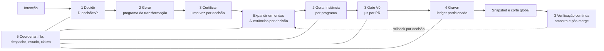

# 01. Problema e requisitos

> **Referência.** A arquitetura de 10^9 PRs/s é o horizonte; a fonte da verdade da fase 1 é a
> [arquitetura-alvo](ARQUITETURA-ALVO.md), e o plano para implementá-la, o [plano de implementação](PLANO-DE-IMPLEMENTACAO.md).

Entregável 1. Define o que a fábrica tem que fazer e as metas numéricas que, somadas, sustentam **10^9 PRs mergeadas
por segundo**. A marcação [M]/[F]/[I]/[E] está em [00](00-avaliacao.md). O que o estado da arte já entrega contra cada
meta está em [04](04-componentes.md); a conta de custo e os degraus estão em [05](05-orcamento-e-degraus.md).

## 1. O problema

Sustentar 10^9 PRs mergeadas por segundo, numa janela móvel, sem que nenhuma guarda de qualidade piore, a um custo por
PR que se possa financiar, com cada PR sendo uma mudança real, independente e verificada (a vazão não se infla, semente
§3).

Três fatos de primeiros princípios fixam a forma de tudo o que vem depois:

1. **A vazão é a do passo mais lento** (dado T da Torre; teoria das restrições e filas em
   [docs/research/toc.md](../research/toc.md)). Cada um dos cinco passos tem que sustentar 10^9/s sozinho.
2. **Fila cheia explode.** Pela fórmula de Kingman a espera cresce com ρ/(1−ρ) [Q2]: vale 3 em ρ = 0,75 e 9 em 0,9.
   Toda capacidade aqui é dimensionada para **utilização ρ ≤ 0,75**, ou seja, capacidade instalada ≥ 1,33 × a vazão.
   Pela lei de Little [Q1], o trabalho em curso é L = λ·W: a 10^9/s, cada segundo de latência de um passo é 10^9 PRs
   em voo naquele passo.
3. **A 10^9/s, custo por PR vira frota.** Um recurso que cada PR ocupa por c segundos exige λ·c/ρ unidades dele em
   paralelo [I]:

| Custo por PR (núcleo ocupado) | Núcleos a 10^9 PRs/s (ρ = 0,75) | Ordem de grandeza física |
|---|---|---|
| 100 ns | 133 | algumas máquinas |
| 1 µs | 1,3 × 10^3 | um rack |
| 10 µs | 1,3 × 10^4 | algumas centenas de máquinas |
| 1 ms | 1,3 × 10^6 | um datacenter grande |
| 1 s | 1,3 × 10^9 | uma fração grande de todos os servidores do mundo (conta em [05](05-orcamento-e-degraus.md)) |

O mesmo vale para bytes e tokens: 128 bytes de estado por PR são 128 GB/s; os ~64 mil tokens não cacheados e de saída
que o motor gasta hoje por PR ([02](02-estado-atual.md)), ~10^6 contando as leituras de cache, seriam 6,4 × 10^13
tokens/s, ou 10^15 com o cache. Neste documento um token é qualquer token processado, inclusive leitura de cache.

**Consequência.** A 10^9/s nenhum passo pode gastar, por PR, uma chamada de IA, um processo, um contêiner ou um teste.
Tudo o que é caro tem que acontecer **uma vez por decisão** e ser aplicado a muitas PRs por programa. Por isso a
fábrica opera em dois níveis.

## 2. Os cinco passos em dois níveis

| Passo | Nível de decisão (atacado: IA, uma vez por decisão) | Nível de instância (varejo: programa, uma vez por PR) |
|---|---|---|
| 1. Decidir | o planejador transforma intenção em decisões: uma transformação com o predicado que escolhe os lugares | o índice de código enumera os lugares que o predicado escolhe |
| 2. Gerar | a IA escreve o programa da transformação e o plano de verificação | o motor de transformação aplica o programa a cada lugar, sem IA |
| 3. Verificar | certifica a decisão uma vez: prova, testes de propriedade e uma amostra de instâncias | confere em cada instância o certificado, a pré-condição e o conjunto de escrita (µs) |
| 4. Gravar | registra a decisão, sua proveniência e suas ondas | anexa cada PR mergeada a um ledger particionado; snapshots juntam milhares de PRs num commit |
| 5. Coordenar | workflow durável por decisão: admissão, ondas, parada, rollback | lotes despachados por partição; claims de escrita; contrapressão |

**A identidade que fecha a conta:** vazão = D × A, em que D são decisões de IA por segundo e A é a **amplificação
efetiva**, PRs mergeadas por decisão de IA, contando também as decisões que falham. O teto de D vem do orçamento de
tokens; A é o que o planejador tem que entregar ([06](06-contrato-planejador.md)).

## 3. Requisitos funcionais

| ID | A fábrica deve | Passo |
|---|---|---|
| RF-01 | Receber intenções com objetivo, restrições, orçamento e prioridade, e rejeitar as que excedem o orçamento | 1 |
| RF-02 | Produzir decisões a partir das intenções pelo contrato do planejador ([06](06-contrato-planejador.md)) | 1 |
| RF-03 | Enumerar os lugares de cada decisão num índice de código léxico e semântico, fresco em relação ao snapshot | 1 |
| RF-04 | Gerar cada instância por programa determinístico; IA por instância só como exceção orçada | 2 |
| RF-05 | Certificar cada decisão antes da expansão (prova ou validação, testes de propriedade, amostra de instâncias) | 3 |
| RF-06 | Verificar cada instância no gate V0 e, por classe de certificado ou amostragem, nos gates V1 e V2 | 3 |
| RF-07 | Expandir cada decisão em ondas crescentes, com parada automática na primeira falha de amostra | 3, 5 |
| RF-08 | Declarar e checar conjuntos de leitura e escrita; validar cada PR contra o que entrou desde a sua base (validação otimista) e, em conflito, recomputar a instância na base nova | 5 |
| RF-09 | Gravar cada PR mergeada de modo durável, idempotente (chave = identidade da instância) e ordenado dentro da partição | 4 |
| RF-10 | Materializar snapshots por partição e cortes globais consistentes, exportáveis como git | 4 |
| RF-11 | Verificar continuamente depois do merge e reverter por decisão (e por instância), em cascata pelas dependências | 3, 5 |
| RF-12 | Espelhar no forge (Origin hoje) visões para pessoas: decisões resumidas e amostras, dentro da cota do forge | 4 |
| RF-13 | Medir de fora, por passo e no todo: vazão, rendimento, guardas, amplificação realizada e custo por PR | todos |
| RF-14 | Admitir trabalho por orçamento (tokens, CPU, dinheiro, cota de forge) e aplicar contrapressão em vez de fila sem limite | 5 |
| RF-15 | Executar todo código e toda ação de agente em sandbox, com identidade própria e privilégio mínimo; assinar a proveniência de decisões e snapshots | todos |
| RF-16 | Mudar de degrau trocando adaptadores e parâmetros atrás de portas fixas, sem mudar os contratos | todos |
| RF-17 | Rastrear proveniência e dependência entre decisões (quem leu o que outra escreveu) | 4, 5 |
| RF-18 | Manter o caminho A = 1 (a IA escreve a PR inteira) para trabalho que não se amplifica e para os degraus baixos | 1, 2 |

**"Gate verde no head exato" a 10^9.** Hoje o motor só faz o merge depois do gate verde no head exato (semente §4). Com
milhares de PRs por commit de snapshot, o equivalente é RF-08: o veredito de uma PR vale para a base em que ela entra
se nenhuma PR mergeada desde a base dela escreveu no que ela leu. É a serializabilidade por conflito da teoria de bancos
de dados aplicada a código; quando falha, a instância é recomputada, o que é barato porque ela é função pura da decisão,
do lugar e da base (RNF-09).

## 4. Requisitos não funcionais

| ID | Requisito | Meta a 10^9 |
|---|---|---|
| RNF-01 | Vazão | 10^9 PRs mergeadas/s em média numa janela móvel de 1 h; capacidade instalada ≥ 1,33× (ρ ≤ 0,75) em todo passo; rajadas de 2× por até 10 min absorvidas por fila com limite |
| RNF-02 | Latência | intenção → decisão admitida p50 ≤ 5 min; certificação p50 ≤ 5 min, p99 ≤ 30 min; expansão completa de uma decisão p50 ≤ 10 min; lugar enumerado → PR durável p99 ≤ 1 s; durável → visível no snapshot p99 ≤ 1 s; corte global a cada ≤ 10 s; defeito pós-merge detectado p50 ≤ 10 min; rollback concluído p99 ≤ 30 min |
| RNF-03 | Qualidade (guardas da semente §4 levadas a 10^9) | retrabalho (PRs revertidas ou corrigidas ÷ mergeadas, 24 h) ≤ 10^-3; decisões revertidas ≤ 1 %; 100 % das PRs mergeadas com veredito V0 válido na base em que entraram e decisão certificada; defeito escapado ≤ 10^-6 por PR [E]; decisão defeituosa parada com ≤ 10^4 PRs mergeadas em ≥ 99 % dos casos; zero incidentes sem causa raiz há mais de 24 h |
| RNF-04 | Custo | ≤ US$ 10^-7 por PR mergeada, tudo incluído (≈ US$ 100/s ≈ US$ 3,2 bi/ano a 10^9); distribuição por passo na seção 5 |
| RNF-05 | Disponibilidade e durabilidade | pipeline de instância ≥ 99,9 % por célula; sistema ≥ 99,95 % do tempo acima de 50 % da meta; PR só é confirmada depois de gravada em ≥ 3 réplicas em ≥ 2 domínios de falha (RPO ≤ 1 s); RTO de célula ≤ 5 min; nenhum ponto único de falha acima da célula |
| RNF-06 | Escala horizontal | por células independentes; ≥ 10^4 partições; adicionar ou rebalancear sem parar as outras |
| RNF-07 | Segurança | sandbox para todo código executado; privilégio mínimo por sessão; nenhum segredo no contexto da IA; separação entre controle e dados contra injeção de prompt; proveniência assinada (meta SLSA nível 3) |
| RNF-08 | Observabilidade | métricas por passo com resolução ≤ 10 s; 100 % das decisões rastreadas; ≥ 10^-6 das instâncias rastreadas por amostra; custo medido por PR |
| RNF-09 | Determinismo | instância = função pura de (hash do programa, lugar, snapshot base, hash do toolchain); registro idempotente pela identidade da instância; tudo reproduzível por replay |
| RNF-10 | Energia | ≤ 0,1 J por PR mergeada [E]; é a medida do desperdício que a tese da Torre persegue (semente §3) |
| RNF-11 | Portabilidade | todo fornecedor atrás de uma porta com adaptador trocável, como o motor já faz ([PORTS.md](../architecture/PORTS.md)); inferência com pelo menos dois provedores |
| RNF-12 | Cota e plano | em todo degrau, uso ≤ 50 % de cada limite de plano ou de cota externa (a regra da semente §4); o degrau a partir do qual nenhum plano gratuito cabe é declarado em [05](05-orcamento-e-degraus.md) |

## 5. Metas de performance dos cinco passos (10^9)

A tabela que o pedido exige. Capacidade de projeto já com ρ = 0,75 e com os rendimentos de cada passo (instâncias que
passam no V0: y ≥ 0,9; o planejador entrega A efetivo, que já desconta as decisões que falham). "Infra" quer dizer que
o estado da arte demonstra a capacidade por unidade e o dinheiro escala por réplica; "pesquisa" quer dizer que nenhum
sistema publicado demonstra a meta e só A Torre pode responder ([07](07-lacunas.md)).

| Passo | Vazão (unidade do passo) | Capacidade de projeto | Latência | Custo por PR | Classe |
|---|---|---|---|---|---|
| 1. Decidir | D = 10^3 decisões/s, A ≥ 10^6, ≤ 10^5 tokens por decisão | 1,33 × 10^3 decisões/s; 1,33 × 10^8 tokens/s | p50 ≤ 5 min por decisão | ≤ 2 × 10^-8 | **pesquisa** (planejador com A ≥ 10^6 e qualidade) sobre **infra** (inferência) |
| 2. Gerar | 10^9 instâncias mergeáveis/s por programa, ≤ 10 µs·núcleo cada; IA em ≤ 10^-5 das instâncias, ≤ 10^3 tokens cada (≤ 1,5 × 10^7 tokens/s) | 1,5 × 10^9 instâncias/s; 1,5 × 10^4 núcleos | p99 ≤ 100 ms do lugar à instância | ≤ 5 × 10^-9 | **infra** (motor de transformação); a correção do programa é pesquisa do passo 1 |
| 3. Verificar | V0 em toda instância ≤ 1 µs·núcleo; V1 em ≤ 1 % ≤ 1 ms·núcleo; por decisão ≤ 10^3 núcleo·s (≤ 500 de certificação + amostra de ≤ 50 instâncias de ≤ 10 núcleo·s); pós-merge ≤ 25 % do total | V0 1,5 × 10^3 núcleos; V1 1,5 × 10^4; decisão 1,33 × 10^6; pós-merge ≤ 4,5 × 10^5; total ≤ 2 × 10^6 núcleos | V0 p99 ≤ 10 µs; decisão certificada p50 ≤ 5 min | ≤ 1,5 × 10^-8 | **infra** (V0, V1, V2, V3); **pesquisa** (certificar transformações gerais a 10^3/s; o que testar depois do merge a 10^9 mudanças/s; independência semântica) |
| 4. Gravar | 10^9 registros/s de ≤ 128 B; ≥ 10^4 partições, ≤ 10^5 PRs/s cada; ≤ 1 commit de snapshot por partição por segundo | 1,33 × 10^9 anexos/s; 170 GB/s antes da réplica | durável p99 ≤ 50 ms; visível p99 ≤ 1 s | ≤ 5 × 10^-9 | **infra** |
| 5. Coordenar | ≤ 10^6 eventos de controle/s; 10^5 lotes/s de 10^4 instâncias; ≤ 5 × 10^4 transições de workflow/s; ≤ 10^6 operações de claim/s | 1,33× cada | despacho p99 ≤ 100 ms; claim p99 ≤ 10 ms | ≤ 2 × 10^-9 | **infra**; conflito semântico entre decisões em voo é **pesquisa** |
| Soma | | | | **≤ 4,7 × 10^-8** (meta RNF-04 ≤ 10^-7 com folga para rede e operação) | |

Nenhum passo tem evento, processo ou chamada de IA por PR fora do ledger: o evento por PR **é** o registro no ledger.

## 6. Padrões de performance por componente (10^9)

Os componentes são os da arquitetura ([03](03-arquitetura.md)). Esta tabela diz o que cada um tem que cumprir; o que o
estado da arte entrega, quantas unidades são precisas e o teto de cada um estão em [04](04-componentes.md).

| Componente | Vazão de projeto | Latência | Custo por PR | Disponibilidade |
|---|---|---|---|---|
| C01 Registro de intenções | ≤ 10^2 intenções/s | escrita p99 ≤ 100 ms | ~0 | 99,9 % |
| C02 Planejador (contrato) | 1,33 × 10^3 decisões/s | p50 ≤ 5 min | ≤ 2 × 10^-8 (com C06) | 99,5 % (decisões esperam em fila) |
| C03 Instruções da IA (contrato) | leitura cacheada em toda sessão | p99 ≤ 10 ms | ~0 | 99,9 % |
| C04 Índice de código | ≥ 1,5 × 10^9 lugares enumerados/s; frescor ≤ 10 s | 10^6 lugares em p50 ≤ 1 s | ≤ 5 × 10^-10 | 99,9 % |
| C05 Admissão e orçamento | ≥ 10^5 decisões de admissão/s | p99 ≤ 10 ms | ~0 | 99,99 %, falha fechada |
| C06 Malha de inferência | ≥ 1,5 × 10^8 tokens/s (decisões + exceções do passo 2), dois ou mais provedores | passo de agente p50 ≤ 30 s | dentro de C02 | 99,9 % |
| C07 Runtime de agentes em sandbox | ≥ 1,33 × 10^3 sessões novas/s; ≥ 4 × 10^5 simultâneas | início p99 ≤ 1 s | ≤ 3 × 10^-9 | 99,9 % |
| C08 Motor de transformação | ≥ 1,5 × 10^9 instâncias/s, ≤ 10 µs·núcleo cada | p99 ≤ 100 ms por instância no lote | ≤ 10^-10 | 99,9 % |
| C09 Cache de derivação | ≥ 1,5 × 10^9 consultas/s | p99 ≤ 1 ms | ≤ 10^-10 | 99,9 % (perda só custa recomputar) |
| C10 Certificador de decisões | ≥ 1,33 × 10^3 decisões/s, ≤ 10^3 núcleo·s cada com a amostra (≤ 500 de certificação) | p50 ≤ 5 min | ≤ 10^-8 | 99,9 % |
| C11 Gate V0 | ≥ 1,5 × 10^9 checagens/s, ≤ 1 µs·núcleo | p99 ≤ 10 µs | ≤ 10^-11 | junto com a célula |
| C12 Verificação incremental V1 | ≥ 1,5 × 10^7 checagens/s, ≤ 1 ms·núcleo | p99 ≤ 100 ms | ≤ 10^-10 | 99,9 % |
| C13 Execução remota V2 (build e testes) | ≥ 6,7 × 10^4 instâncias amostradas/s (≤ 50 por decisão), ≤ 10 núcleo·s cada | p99 ≤ 10 min | dentro de C10 | 99,9 % |
| C14 Verificação contínua V3 e rollback | ≤ 4,5 × 10^5 núcleos | defeito detectado p50 ≤ 10 min | ≤ 3 × 10^-9 | 99,9 % |
| C15 Política e análise estática | ≥ 10^5 avaliações/s; ≤ 100 núcleo·s de análise por decisão | p99 ≤ 10 ms por avaliação | ≤ 10^-10 | 99,99 %, falha fechada |
| C16 Ledger particionado | ≥ 1,33 × 10^9 anexos/s de ≤ 128 B; ≥ 10^4 partições | durável p99 ≤ 50 ms | ≤ 2 × 10^-9 | 99,99 %, 3 réplicas |
| C17 Armazém por conteúdo (CAS) | ≤ 200 B novos por PR (quente, 7 dias); ≤ 10 B por PR amortizado no frio | leitura p99 ≤ 50 ms | ≤ 2 × 10^-9 | durabilidade de armazenamento de objetos |
| C18 Materializador de snapshots | ≥ 10^4 commits/s (1 por partição por segundo), ≤ 10^5 PRs cada | visível p99 ≤ 1 s; corte global ≤ 10 s | ≤ 5 × 10^-10 | 99,99 % |
| C19 Metadados consistentes | ≥ 10^6 transações/s (cabeças, estados, claims) | p99 ≤ 20 ms | ≤ 5 × 10^-10 | 99,99 % |
| C20 Espelho de forge | ≤ 50 % da cota do forge em todo degrau (a 10^9: resumos por intenção e amostras) | assíncrono | ~0 | não está no caminho crítico |
| C21 Barramento de eventos de controle | ≥ 1,33 × 10^6 eventos/s | p99 ≤ 100 ms | ≤ 10^-10 | 99,99 % |
| C22 Orquestrador durável | ≥ 6,7 × 10^4 transições/s; ≥ 10^6 workflows em voo | transição p99 ≤ 1 s | ≤ 5 × 10^-10 | 99,99 % |
| C23 Escalonador de lotes | ≥ 1,33 × 10^5 despachos/s sobre ≥ 2 × 10^6 núcleos | p99 ≤ 100 ms | ≤ 10^-10 | 99,99 % |
| C24 Gerente de conflitos e claims | ≥ 1,33 × 10^6 operações/s; 100 % dos conflitos sintáticos detectados | p99 ≤ 10 ms | ≤ 10^-10 | 99,99 % |
| C25 Sequenciador de partição (trem particionado) | ≥ 1,33 × 10^5 PRs/s por partição, validação ≤ 1 µs·núcleo por PR | lote a cada ≤ 100 ms | dentro de C16 | 99,99 % |
| C26 Plano de controle | leituras cacheadas; ≤ 10 escritas/s; mapa de partições muda ≤ 1/min | p99 ≤ 50 ms | ~0 | 99,99 % |
| C27 Observabilidade e custo | ≥ 10^7 pontos de métrica/s; traços de 100 % das decisões e 10^-6 das instâncias | frescor ≤ 10 s | ≤ 10^-9 | 99,9 % |
| C28 Segurança e proveniência | ≥ 1,33 × 10^3 identidades de sessão/s; assinatura de 100 % das decisões e dos snapshots | p99 ≤ 50 ms | ≤ 10^-10 | 99,99 %, falha fechada |
| C29 Confiabilidade (células, recuperação, simulação) | ≥ 10^3 células; falha de uma célula afeta ≤ 1/N da vazão | RTO ≤ 5 min | ≤ 10^-9 | é o que sustenta as outras |

## 7. O que é infraestrutura e o que é pesquisa

- **Infraestrutura** (o estado da arte demonstra por unidade, o dinheiro escala por réplica): o índice de código, o
  motor de transformação, os gates V0 a V3 como mecanismo, o ledger, o armazém por conteúdo, os snapshots, os
  metadados, o barramento, os workflows, o escalonador, os claims sintáticos, a observabilidade, a segurança e a
  confiabilidade. Passos 2, 4 e 5 inteiros, e o passo 3 como máquina.
- **Pesquisa** (nenhum sistema publicado demonstra; só A Torre pode responder):
  1. um planejador que produz 10^3 decisões/s com amplificação efetiva ≥ 10^6 e qualidade medida (passo 1);
  2. certificar transformações gerais de código a 10^3/s com ≤ 10^3 núcleo·s cada (passo 3);
  3. decidir o que verificar depois do merge quando entram 10^9 mudanças por segundo (passo 3);
  4. independência semântica, além da sintática, entre decisões em voo (passos 3 e 5);
  5. se existe trabalho útil para 10^9 PRs/s, e onde (a demanda; [07](07-lacunas.md)).

A reflexão de Daniel de que, com a lógica desenhada para 10^9, o resto seria infraestrutura e financiamento vale para
os passos 2, 4 e 5; nos passos 1 e 3 a lógica é a própria pesquisa. A avaliação completa está em [07](07-lacunas.md).
