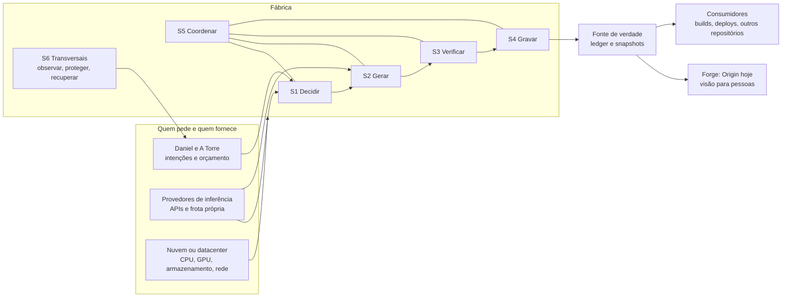
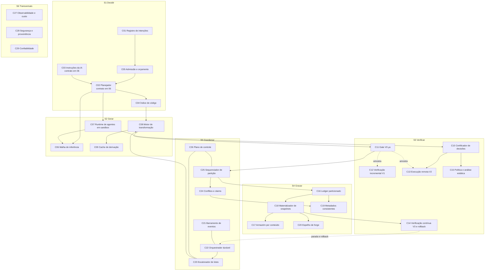
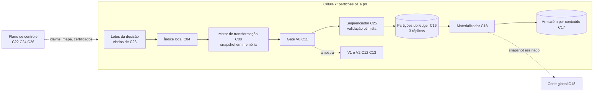
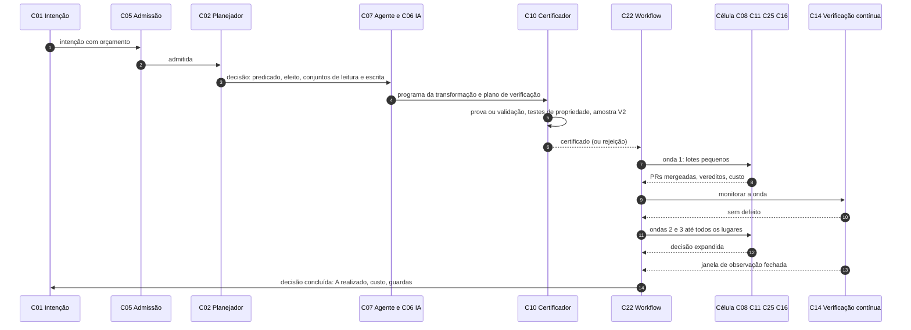
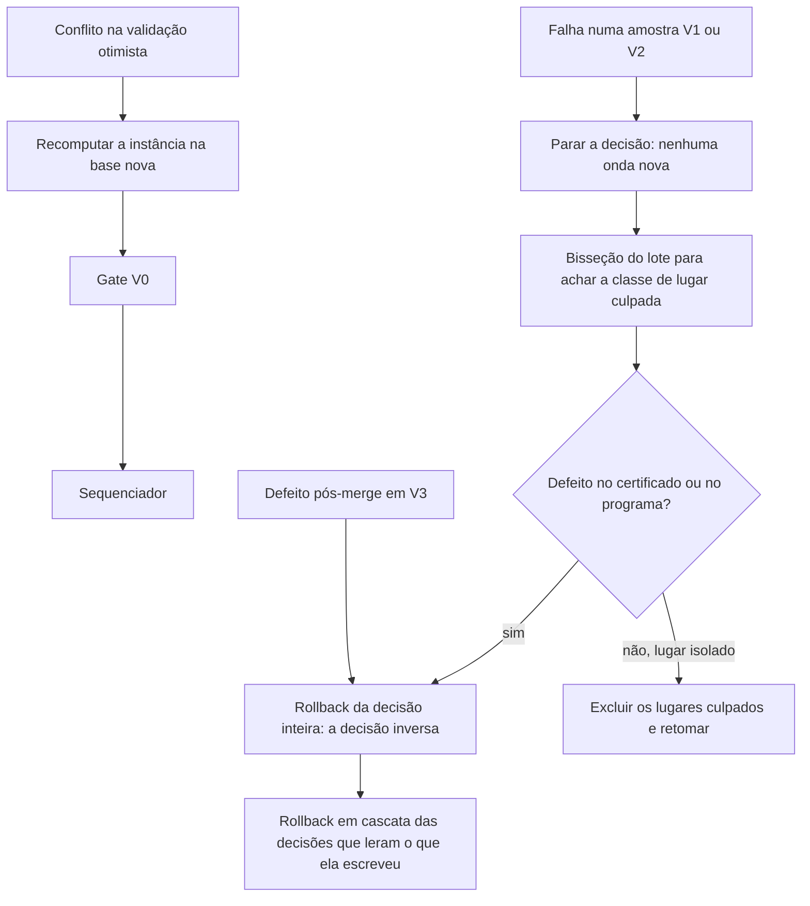
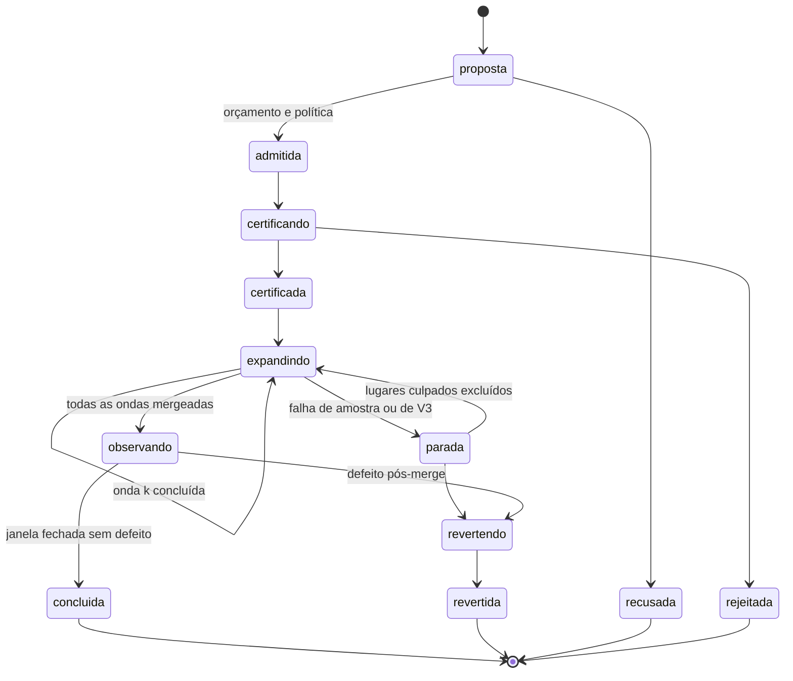
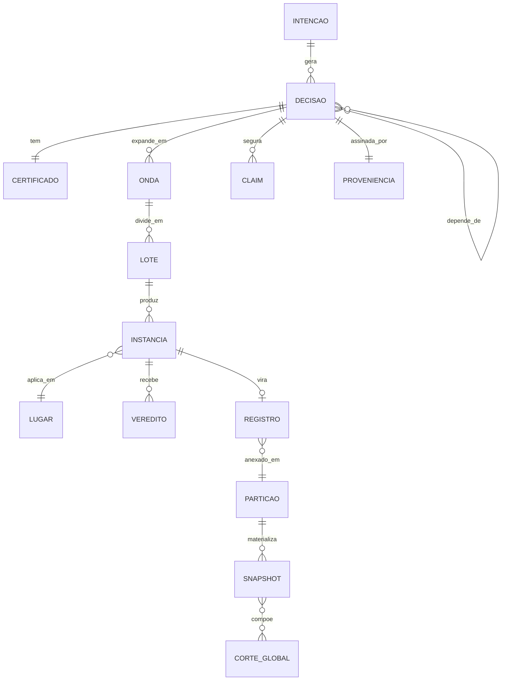

# 03. Arquitetura de referência

> **Referência.** A arquitetura de 10^9 PRs/s é o horizonte; a fonte da verdade da fase 1 é a
> [arquitetura-alvo](ARQUITETURA-ALVO.md), e o plano para implementá-la, o [plano de implementação](PLANO-DE-IMPLEMENTACAO.md).

Entregável 2. A forma completa da fábrica: princípios, sistemas e componentes, formas, portas e adaptadores, fluxos,
estados, modelo de dados, falhas e recuperação, segurança e observabilidade. As metas de cada componente estão em
[01 §6](01-requisitos.md#6-padrões-de-performance-por-componente-109); o estado da arte e o teto de cada um, em
[04](04-componentes.md). As decisões de desenho, cada uma com as alternativas pesadas, estão na seção 12.

## 1. Princípios de forma

Cada princípio sai de uma conta de [01](01-requisitos.md). Nenhum é preferência.

| # | Princípio | De onde sai |
|---|---|---|
| P1 | **Atacado e varejo.** O que é caro (IA, prova, teste) acontece uma vez por decisão; por instância só roda programa barato | 1 s por PR a 10^9/s são 1,3 × 10^9 núcleos (01 §1) |
| P2 | **A instância é função pura** de (programa, lugar, snapshot base, toolchain). Cache, recomputação, replay e idempotência saem daí, como na execução remota de builds, em que a ação é endereçada pelo digest [V6] | conflito e falha viram recomputação, não retrabalho (RF-08, RNF-09) |
| P3 | **O ledger é a verdade; o forge é uma visão.** A PR canônica é um registro da fábrica; o forge recebe resumos e amostras | a cota do forge não passa de ~1 PR/s ([02](02-estado-atual.md)) |
| P4 | **Partição pelo conjunto de escrita, nada global por PR.** Cada partição tem a sua sequência; células não compartilham estado no caminho de dados | um commit por PR num branch só não passa de centenas por segundo (T4) |
| P5 | **Validação otimista em vez de trava global.** A PR entra se ninguém escreveu no que ela leu desde a sua base; senão é recomputada. O Mononoke da Meta já faz isso no servidor: rebase e compare-and-swap no bookmark, com até 100 tentativas [S5] | o "gate verde no head exato" de hoje, generalizado (01 §3) |
| P6 | **Verificar a transformação uma vez e conferir o certificado em cada instância.** Checar uma prova é barato mesmo quando achá-la é caro [V27]; o Alive prova cada reescrita do LLVM uma vez e o compilador a aplica em toda ocorrência sem prova por lugar [V19] | é o único jeito de um gate de µs ter sentido ([05](05-orcamento-e-degraus.md)) |
| P7 | **Expansão progressiva com parada automática; rollback por decisão.** A decisão é a unidade de risco | o raio de explosão de RNF-03 |
| P8 | **Portas fixas, adaptadores por degrau.** O contrato não muda entre 1/min e 10^9/s; muda o adaptador | RF-16; o motor já é assim ([PORTS.md](../architecture/PORTS.md)) |
| P9 | **Orçamento antes da fila.** Nada entra sem orçamento de tokens, CPU, dinheiro e cota; fila sempre com limite | Kingman: fila sem limite explode (01 §1) |
| P10 | **Células independentes; plano de controle fora do caminho de dados.** Uma falha derruba uma célula, não a fábrica (arquitetura em células e shuffle sharding [X20, C33]) | RNF-05, RNF-06 |
| P11 | **Tudo medido de fora.** Vazão, rendimento, guardas e custo por PR por passo, por instrumento, nunca pela sessão | semente §6, verificação externa |
| P12 | **Segurança por desenho.** A IA que planeja nunca lê dado não confiável direto; todo código roda em sandbox; decisões e snapshots são assinados | RNF-07 |

### Regra de forma: gatilho por evento, nunca por relógio (DEP-EVENTS, 09/11)

Nossa operação roda por agentes, que se movem por eventos, não por intervalos (Daniel, 09/11: "Parar 30 minutos por isso é
inadmissível"). Nenhum componente espera um tempo para tentar de novo: a retentativa nasce de um evento (push, correção publicada,
fim de deploy, notificação do Postgres); timeout existe só para detectar falha (algo que nunca termina), nunca para esperar.
Estado "implantado" é verificado por conteúdo (hash por pilha), não por um ponteiro que anda sozinho. Ver aws.md 19.2.

## 2. Contexto

## 3. Sistemas e componentes

| Sistema | O que faz | Componentes |
|---|---|---|
| S1 Decidir | transforma intenção em decisões admitidas, dentro do orçamento | C01 a C05 |
| S2 Gerar | a IA escreve o programa da transformação (por decisão); o motor aplica o programa a cada lugar (por instância) | C06 a C09 |
| S3 Verificar | certifica a decisão uma vez; confere cada instância em µs; amostra; verifica depois do merge; reverte | C10 a C15 |
| S4 Gravar | anexa cada PR mergeada a um ledger particionado; materializa snapshots e cortes; espelha no forge | C16 a C20 |
| S5 Coordenar | workflows de decisão, lotes, claims, sequência de cada partição, configuração e células | C21 a C26 |
| S6 Transversais | mede, protege e recupera | C27 a C29 |

## 4. Formas

### 4.1 Plano de controle e plano de dados

- **Plano de controle** (C01–C07, C10, C15, C19, C21, C22, C26, C28): decisões, políticas, certificados, workflows,
  configuração, mapa de partições. Taxa baixa (10^3 decisões/s, ≤ 10^6 eventos/s), consistência forte.
- **Plano de dados** (C04, C08, C09, C11–C14, C16–C18, C23–C25): o fluxo de instâncias, 10^9/s. Sem chamada de IA, sem
  evento por PR fora do ledger, sem estado compartilhado entre células.

### 4.2 Célula

A unidade de escala. Uma célula hospeda um conjunto de partições e tudo o que o caminho de dados delas precisa, no
mesmo domínio de falha: o snapshot em memória, o índice local, o motor de transformação, o gate V0, o sequenciador e as
partições do ledger. O caminho de uma instância nunca sai da célula até virar registro durável. A fábrica cresce
somando células; um degrau novo não muda a célula, muda quantas existem ([05](05-orcamento-e-degraus.md)).

### 4.3 A chave de partição

A partição é escolhida pelo **conjunto de escrita**: o dono do código (a unidade, no vocabulário do motor de hoje,
[UNITS.md](../architecture/UNITS.md)) ou um prefixo de caminho, com subdivisão por hash quando um dono fica quente. O
motor de hoje já tem a ideia em pequena escala: uma lane é dona exclusiva de um conjunto de unidades (premissa P-13).
Aqui a posse é por decisão, por partição e por faixa de chaves, com prazo (claim com lease), e não por sessão.

## 5. Portas e adaptadores

As portas são o contrato que não muda entre degraus (P8). O adaptador de hoje é o que o motor já usa; os outros entram
quando o degrau pede ([05](05-orcamento-e-degraus.md) diz quando).

| Porta | Operações | Hoje (motor) | 1/s | 10^3/s | 10^6/s e 10^9/s |
|---|---|---|---|---|---|
| Planejador (C02) | `propose(intenção, orçamento) → [Decisão]` | sessão gerente e coordenadores de domínio escrevem a fila | igual, com decisões de A > 1 | serviço planejador | serviço planejador em frota |
| Inferência (C06) | `complete(pedido) → resposta`, em lote e com cache de prompt | Claude Code CLI na cota Max | API com lote e cache | API e frota própria | frota própria (vLLM/SGLang) e APIs |
| Sandbox (C07) | `start(imagem, política) → sessão`; `exec`; `stop` | sessão na nuvem do provedor | pool de microVMs | pool de microVMs | pool de microVMs por região |
| Índice (C04) | `enumerate(predicado, snapshot) → fluxo de Lugar` | `rg` no checkout | índice léxico | índice léxico e semântico | índice particionado por célula |
| Transformação (C08) | `apply(programa, lugar, base) → Instância` | a lane edita (A = 1) | codemod em processo | codemod em lote | codemod paralelo de dados por célula |
| Certificação (C10) | `certify(decisão) → Certificado` | não existe (o gate julga cada PR) | testes da transformação | prova ou validação + amostra | idem, em frota |
| Gate (C11–C13) | `check(instância, certificado) → Veredito` (V0); `verify(instância, nível) → Veredito` (V1, V2) | `scripts/gate-dev` no head exato | gate com cache por conteúdo | V0 + V1/V2 por amostra | idem, V0 na célula |
| Registro (C16–C18) | `append(partição, registros) → posições`; `materialize(partição) → snapshot` | `origin pr merge --expect-head` | git próprio, lote | ledger particionado + snapshots | idem, ≥ 10^4 partições |
| Forge (C20) | a porta de hoje, `forge_events.py` | Origin (fonte de verdade) | Origin como espelho de PRs de decisão | espelho de resumos | espelho de resumos e amostras |
| Eventos (C21) | `publish(envelope)`; `subscribe(tipo)` | log em git-ref no Origin (D-300) | fila em banco | log particionado | log particionado multi-região |
| Workflow (C22) | `start(decisão)`; `signal`; `query` | `scripts/deliver` | workflow em banco | motor de workflow durável | idem, particionado |
| Escalonador (C23) | `submit(lote) → lease` | trava da caixa, lanes | fila de trabalhos | escalonador de cluster | escalonador federado por célula |
| Claims (C24) | `claim(decisão, partição, faixa) → lease`; `validate(instância, base) → ok ou conflito` | posse de unidade por lane | tabela de claims | tabela particionada | idem, em C19 |
| Orçamento (C05) | `admit(pedido) → aceitar, adiar, negar` | leitura da cota (`scripts/usage`) | baldes de tokens por intenção | idem | idem, com preço e cota de GPU |
| Política (C15) | `evaluate(decisão ou lote) → permitir ou negar, com motivos` | `structure-check`, `commit-check` | idem | motor de política | idem |
| Observabilidade (C27) | `emit(métrica, traço, evento)` | `scripts/flow-metrics` sobre o git log | métricas em série temporal | OpenTelemetry | idem, com amostragem |
| Proveniência (C28) | `sign(artefato)`; `attest(build)` | trailers de commit | assinatura de decisões | assinatura + atestados de build | idem, log de transparência |

## 6. Fluxos

### 6.1 Uma decisão, do começo ao fim

### 6.2 O pipeline de instância dentro da célula

1. O lote chega com o identificador da decisão, o certificado e a faixa de lugares.
2. O índice local enumera os lugares que o predicado escolhe no snapshot base.
3. O motor de transformação aplica o programa a cada lugar sobre a árvore em memória e calcula o hash do resultado.
   Se o mesmo (programa, lugar, base, toolchain) já foi calculado, o cache de derivação devolve o resultado.
4. O gate V0 confere, em µs: a pré-condição vale no lugar, o efeito está dentro do conjunto de escrita declarado, o
   tamanho cabe no limite, nenhum padrão proibido (segredo, arquivo de outro dono) aparece, e o certificado cobre a
   classe desse lugar. Uma fração amostrada segue para V1 ou V2.
5. O sequenciador da partição valida de forma otimista: nenhuma PR mergeada desde a base escreveu no que esta leu. Em
   conflito, a instância volta ao passo 3 na base nova.
6. O sequenciador agrupa as PRs aprovadas em lotes de até 100 ms e anexa ao ledger; a PR conta como mergeada quando o
   anexo é confirmado por 3 réplicas.
7. O materializador junta o que entrou na partição num commit de snapshot por segundo, assinado; o corte global junta
   as cabeças das partições a cada ≤ 10 s.

### 6.3 Conflito, falha de amostra e rollback

A decisão inversa é uma decisão como qualquer outra: o programa restaura a pré-imagem de cada lugar onde o conteúdo
atual ainda é a pós-imagem, e é verificada e gravada pela mesma máquina.

### 6.4 O caminho A = 1 (degraus baixos e exceções)

Uma decisão com um lugar só, cujo "programa" é o patch que a IA escreveu. A certificação é o gate inteiro (V2 completo,
como `scripts/gate-dev` faz hoje), o registro pode ser o forge, e o resto do fluxo é o mesmo. É assim que o motor de
hoje já funciona; a arquitetura o mantém como caso particular (RF-18).

## 7. Estados

Estados da instância (PR canônica): `enumerada → gerada → conferida (V0) → [amostrada em V1/V2] → validada → gravada
(mergeada) → materializada → observada`, com saídas `excluída` (pré-condição falhou), `recomputada` (conflito) e
`revertida`. Estados do lote: `agendado → em execução → concluído`, com `falhou` reexecutado de forma idempotente.

## 8. Modelo de dados

| Entidade | Campos essenciais |
|---|---|
| Intenção | id, objetivo, restrições, orçamento (tokens, núcleo·s, dinheiro), prioridade, dono |
| Decisão | id, intenção, tipo, hash do programa, predicado de lugares, especificação do efeito, conjuntos de leitura e escrita declarados, classe de certificado, amplificação esperada, orçamento, ondas, estado, proveniência (modelo, hash das instruções, tokens) |
| Certificado | decisão, método (prova, validação de tradução, testes de propriedade, amostra), classes de lugar cobertas, evidência (hash), custo, validade (faixa de toolchain e de snapshot) |
| Lugar | id, partição, caminho, nó ou faixa, hash da base |
| Instância (PR canônica) | id = H(decisão, lugar, snapshot base, toolchain), decisão, lugar, partição, base, hash do resultado, chaves de escrita, vereditos, estado |
| Registro (no ledger) | ver a orçamentação de bytes abaixo |
| Snapshot | partição, sequência, raiz (hash Merkle), pai, faixa de registros, assinatura, carimbo HLC |
| Corte global | id, vetor {partição → sequência}, carimbo, assinatura |
| Claim | decisão, partição, faixa de chaves, modo, lease |
| Evento de controle | o envelope do motor de hoje: `event_id` (sha256 de produtor, tipo e chave natural, a chave de idempotência), `type`, `version`, `occurred_at`, `producer`, `correlation_id`, `payload` ([contracts/events/envelope.v1.json](../../contracts/events/envelope.v1.json)) |

**Orçamento de bytes do registro** (meta ≤ 128 B, RNF de C16): id da instância truncado (16 B), id interno da decisão
(8 B), id do lugar (8 B), sequência da base (8 B), hash do resultado truncado (16 B), hash das chaves de escrita (8 B),
bandeiras de veredito (2 B), carimbo (8 B): 74 B antes da compressão [I]. O conteúdo da mudança não vai no registro:
é recomputável pela decisão (P2) e fica no armazém por conteúdo enquanto quente.

## 9. Falhas e recuperação

| Falha | Detecção | Contenção | Recuperação |
|---|---|---|---|
| Pré-condição falha no lugar | V0 | a instância é excluída | nenhuma; conta no rendimento |
| Conflito de escrita | validação otimista em C25 | só a instância | recomputar na base nova |
| Certificação falha | C10 | a decisão não expande | o planejador recebe o motivo |
| Amostra falha | V1/V2 | decisão parada antes da próxima onda | bisseção; excluir lugares ou reverter |
| Defeito pós-merge | V3, monitoramento | decisão parada | rollback da decisão e das dependentes |
| Líder de partição cai | lease expira | só a partição | réplica assume; o ledger tem 3 cópias |
| Célula cai | saúde da célula | 1/N da vazão | partições reatribuídas a outras células; snapshots no armazém |
| Região cai | saúde da região | as células da região | réplica assíncrona em outra região (RPO de segundos); decisões são reexecutadas, idempotentes |
| Provedor de inferência fora | erro e latência | só o passo 1 | roteamento para outro provedor; decisões esperam; o plano de dados segue |
| Índice atrasado | frescor vs snapshot | decisões novas esperam | reindexação incremental |
| Cache envenenado | hash não confere na releitura | a entrada | recomputar; entradas assinadas pela célula |
| Custo dispara (negação de carteira) | C27 contra orçamento | admissão nega | baldes por intenção, teto por decisão |
| Mensagem venenosa | reentregas | fila de mensagens mortas | correção ou descarte registrado |
| Partição quente | fila e latência por partição | contrapressão na partição | subdividir por hash (C26) |
| Metadados indisponíveis | erro | claims novos param | réplicas; o caminho de dados segue com os leases vigentes |
| Forge fora | erro | só o espelho | reenvio; o forge não está no caminho crítico |

Toda recuperação depende de P2: como a instância é função pura e o registro é idempotente pela identidade, reexecutar
é sempre seguro.

## 10. Segurança

| Ameaça | Controle |
|---|---|
| Injeção de prompt por código, comentário ou documento lido pela IA (o primeiro risco do OWASP para LLMs [X12]) | separação entre controle e dados: o agente que planeja e chama ferramentas não lê conteúdo não confiável direto; um modelo em quarentena lê e devolve dados tipados; a política confere o fluxo de dados antes de cada ação (CaMeL [X13] e os padrões de desenho de [X14]); nenhum agente junta dado privado, conteúdo não confiável e comunicação externa (a "tríade letal" [X15]) |
| Transformação maliciosa ou errada | certificado obrigatório, política, ondas com amostra, decisão assinada, rollback por decisão |
| Fuga de sandbox | microVM (Firecracker: ≤ 125 ms de boot, ≤ 5 MiB por VM [X1]) ou kernel em espaço de usuário (gVisor [X7]) para todo código executado; rede de saída por lista; nada de segredo dentro |
| Roubo de credencial | identidade por sessão com prazo curto; privilégio mínimo; segredos nunca no contexto da IA (a regra do motor: nunca imprimir segredos) |
| Cadeia de suprimentos | builds herméticos, atestados de proveniência (meta SLSA nível 3 de build [X8], formato in-toto [X9]), assinatura de decisões e snapshots, log de transparência no estilo do Rekor [X10]; nada entra em produção sem proveniência, como no Binary Authorization for Borg [X11] |
| Envenenamento de cache | endereçamento por conteúdo, assinatura da célula, releitura com conferência de hash |
| Negação de carteira | orçamento por intenção e por decisão, admissão com falha fechada |
| Abuso do forge | o forge fica fora do caminho crítico e com cota limitada a ≤ 50 % (RNF-12) |

## 11. Observabilidade

- **Métricas** (resolução ≤ 10 s, por passo, por célula e no todo): vazão em PRs mergeadas/s; rendimento de cada passo;
  utilização; profundidade de fila; latência p50/p99 de cada passo; amplificação realizada por decisão; taxa de
  conflito; acerto de cache; falhas de amostra; defeitos pós-merge; rollbacks; custo por PR em tokens, núcleo·s e bytes.
- **Guardas** (as da semente §4, levadas a 10^9 em RNF-03): retrabalho, veredito válido na base, custo por PR,
  incidentes sem causa raiz, uso de cota e de plano.
- **Traços**: 100 % das decisões; 10^-6 das instâncias por amostra (10^3 traços por segundo a 10^9). O Dapper mostrou que amostrar 1/1024 custa −0,20 % de latência [X16]; o formato é o do OpenTelemetry [X17].
- **Registros**: o próprio ledger é o registro de auditoria por PR; os eventos de controle usam o envelope do motor.
- **Medida de fora**: o instrumento de vazão lê o ledger e os snapshots, nunca o relato de uma sessão; é a
  generalização de `scripts/flow-metrics`.

## 12. Decisões de desenho

Cada uma é a escolha corrente entre alternativas, com o caminho de volta (método §2, solução).

### AD-1. A espinha da fábrica

| Alternativa | Teto | Custo por PR | Qualidade | Requisitos |
|---|---|---|---|---|
| A. Fábrica de agentes: um agente de IA por PR, fila de merge por repositório (o que Anthropic, Stripe e Spotify publicam [A17, A21, A22]) | a inferência do mundo inteiro, ~10^4–10^5 PRs/s no total ([05](05-orcamento-e-degraus.md)) | o de uma sessão de agente | a do agente, PR a PR | só dinheiro e cota |
| B. Monorepo com mudanças em larga escala (o modelo do Google: codemod, divisão por dono pelo Rosie, teste contínuo pelo TAP [S3, S4]) | uma sequência global de commits: 60–70 mil por dia útil [S2] | baixo por lugar | provada em produção | um repositório, uma sequência |
| **C. Motor de derivação** (escolhida): a IA decide transformações, programas expandem, verificação em dois níveis, ledger particionado, células | físico e financeiro ([05](05-orcamento-e-degraus.md)) | ~10^-8 US$ | certificado + amostra + V3 | planejador com A ≥ 10^6 (pesquisa) |
| D. Busca: a IA propõe muitos candidatos e um avaliador automático filtra (AlphaCode, FunSearch, AlphaEvolve [A24–A26]) | o do avaliador | baixo por candidato, rendimento baixo | a do avaliador | tarefa com avaliador automático |

Escolha: **C**, que contém A como o caminho A = 1 (seção 6.4), B como a forma de expansão e D como um tipo de decisão.
Volta: A continua disponível em todo degrau.

### AD-2. Onde fica a verdade

Forge como verdade (hoje) | git próprio | **ledger particionado com snapshots exportáveis como git** (escolhida). O
forge tem teto de ~1 PR/s pela cota ([02](02-estado-atual.md)), e o GitHub recomenda no máximo 1 PR mergeada por minuto
por repositório [S14]; git próprio tira a cota mas mantém um escritor por vez por repositório [S18] e um quórum por
escrita, que o próprio GitHub, refazendo o armazenamento para a escala dos agentes, chama de fator limitante [S16]; o
ledger separa durabilidade (anexo) de materialização (snapshot por segundo). Volta: o adaptador de
registro do forge continua existindo e serve até ~0,1 PR/s.

### AD-3. Como as PRs entram

Trem serial (bors [S9]) | fila especulativa (Zuul [S10], SubmitQueue da Uber [S8], merge queue do GitHub com até 100
builds simultâneos [S11]) | lote com bisseção (bors-ng [S9], [V9, V10]) | **sequenciador por partição com validação
otimista** (escolhida), usando especulação e lote dentro da partição para as classes que exigem V1/V2. Nenhuma fila de
merge publica um teto em PRs por segundo; todas limitam paralelismo, não vazão por partição. Volta: um sequenciador com
uma partição só é o trem de hoje.

### AD-4. Como se verifica

Suíte inteira por PR | seleção de testes e lote (a Meta roda metade dos testes e ainda aponta mais de 99,9 % das
mudanças com defeito [V8]) | **certificar uma vez, V0 em toda instância, amostra e verificação contínua** (escolhida).
O único caso publicado de "provar uma vez e aplicar em todo lugar" é o Alive no LLVM [V19]; fora dele é lacuna
([07](07-lacunas.md)). Volta: a classe de certificado "V2 em toda instância" é o gate de hoje, disponível para decisões
que não se certificam.

### AD-5. Como se coordena

Workflow por PR | **workflow por decisão e lotes paralelos de dados** (escolhida). Um workflow por PR a 10^9/s seriam
10^9 workflows novos por segundo; o maior parque publicado, o Cadence da Uber, faz ~10^5 atualizações de workflow por
segundo no total [C24]. Por decisão são 10^3 workflows novos por segundo.

### AD-6. A chave de partição

Por repositório | **por dono do código (unidade) ou prefixo de caminho, com subdivisão por hash** (escolhida) | por hash
puro. Por dono mantém o conjunto de escrita local (menos conflito entre partições); hash puro espalha carga mas faz
toda decisão tocar todas as partições.

### AD-7. A ordem global

Uma sequência global | **sequências por partição e cortes globais periódicos com relógio lógico híbrido**
(escolhida). Uma sequência global é um ponto único a 10^9/s; o corte a cada ≤ 10 s dá a visão consistente que consumidores
e a verificação contínua precisam. PRs entre partições (≤ 10^-4 das PRs, contrato em [06](06-contrato-planejador.md))
usam commit atômico em duas fases sobre os metadados consistentes.
