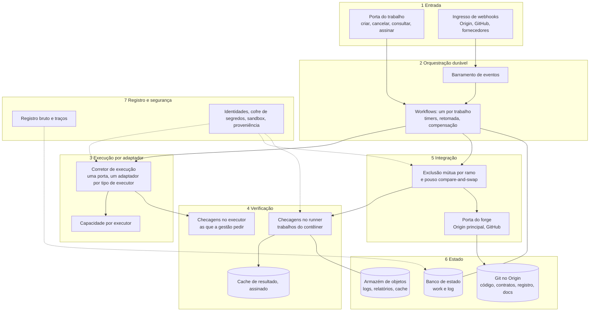
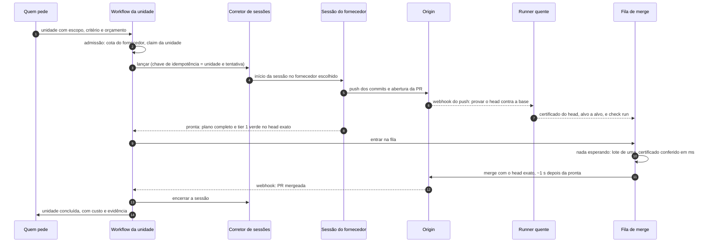

# 10. A arquitetura de 1 PR/min a 1 PR/s: camadas, componentes e onde cada um roda

> **Referência e histórico.** A fonte da verdade da fase 1 é a [arquitetura-alvo](ARQUITETURA-ALVO.md), e o plano
> para implementá-la está no [plano de implementação](PLANO-DE-IMPLEMENTACAO.md); onde este documento divergir dela,
> vale ela.

> **Na fronteira de 12:19** ([22 §3](22-tres-camadas.md#3-o-inventário-peça-por-peça)): infraestrutura, já na forma da
> fronteira: a camada 1 é a porta do trabalho, sem "intenções", que são da liderança; a 3 é a execução por adaptador,
> com a sessão de IA como um executor; da 4 ficam o runner e o cache de resultado, e quais checagens rodar é política
> da gestão; da 5 ficam a exclusão mútua por ramo e o pouso pelo executor forge, e o lote é política da gestão; a 7 é
> o registro e a segurança, e métricas, painéis, alarmes e o valor do orçamento são da gestão e da liderança.

O recorte de 10^0 da arquitetura de [03](03-arquitetura.md). As portas são as mesmas; mudam os adaptadores e onde cada
peça roda. A regra da escolha (Daniel, 03/11 23:43 e 23:49, 04/11 00:38, 01:06 e 01:08): fornecedor livre, com os
serviços mais baratos da AWS (há crédito) e o Google só como alternativa documentada; Origin como forge principal e
GitHub pela mesma porta; nenhum runner fixo em VM; a forma definitiva desde o primeiro dia, sem degrau a trocar depois
(seção 3); e o dimensionamento em **1 PR/min** (1.440 PRs por dia), com entrega instantânea da PR pronta
([11 §5](11-gate-merge-fila-origin.md#5-o-caminho-de-baixa-vazão-da-pr-pronta-à-mergeada-em-até-1-s)). Custos por opção em
[14](14-custos-e-migracao.md).

## 1. As camadas

| Camada | Componentes de [03](03-arquitetura.md) | O que faz |
|---|---|---|
| 1 Entrada | C01, C05, C21 | a porta do trabalho, a mesma para qualquer sistema de gestão: criar, cancelar e consultar trabalho e assinar o registro; os webhooks assinados do forge e dos fornecedores, gravados como eventos idempotentes |
| 2 Orquestração durável | C22, C23, C24 | um workflow por trabalho, com estado, prazos (timers duráveis), retomada, compensação e o lease com fencing token; os workflows de PR e de lote são da gestão |
| 3 Execução por adaptador | C06, C07, C03 | o corretor de execução despacha, acompanha, retoma e encerra a execução em qualquer executor pela mesma porta (contêiner, sessão de IA, pessoa, forge), dentro da capacidade de cada um ([12](12-unidade-e-sessoes.md)) |
| 4 Verificação | C10–C15, C09 | as checagens são trabalhos do contêiner no runner quente, e a saída fica num cache por digest da entrada que só os executores assinam; quais checagens, o tier 1 no executor, o lote e o noturno são política da gestão |
| 5 Integração | C25, C20 | a exclusão mútua por ramo e o pouso com compare-and-swap pelo executor forge, com os adaptadores do Origin e do GitHub; o lote, a atribuição e a ejeção de [11](11-gate-merge-fila-origin.md) são política da gestão |
| 6 Estado | C16–C19, C26 | o banco de estado de execução, o armazém de objetos e o git, cada um com o que é dele ([13](13-estado-e-coordenacao.md)) |
| 7 Registro e segurança | C27–C29 | o registro bruto de tudo o que a infraestrutura observa, com o fluxo assinável e a consulta; identidades de serviço, cofre de segredos, sandbox, resultado assinado; vazão, latência, vermelho, flake e custo por PR são medidas da gestão |

**O recorte de 10^9 para 10^0.** Uma célula, uma partição por grupo de unidades, nenhum ledger particionado: o banco de
estado é o registro dos eventos e o git do Origin continua sendo a verdade do código. A amplificação começa em A ≥ 10
quando o planejador permitir ([06](06-contrato-planejador.md)); até lá vale o caminho A = 1 (a IA escreve a PR inteira),
que a arquitetura sempre manteve (RF-18).

**Uma atualização do degrau 1/s de [05](05-orcamento-e-degraus.md).** Lá, o forge saía do caminho crítico em 1/s porque
uma PR custava ~60 pontos de API. Com eventos no lugar de consultas e o pouso desenhado em [11 §3](11-gate-merge-fila-origin.md#3-como-fica-no-origin-e-no-github),
uma PR custa ~27 pontos, e o Origin aguenta ~1,8 PR/s com o JWT de app a 50 % da cota. O Origin fica como verdade do
código em 1 PR/s; o ledger próprio de [03](03-arquitetura.md) entra antes de 10^3/s. Nenhuma porta muda.

## 2. Onde cada componente roda

Cinco opções, todas com as mesmas portas. A recomendada é a A1; os custos estão em [14](14-custos-e-migracao.md) e a
comparação de bancos e orquestradores em [13](13-estado-e-coordenacao.md).

| Componente | A1 AWS com Postgres e workflows em Python (recomendada) | A2 AWS sem servidor | A3 Google Cloud | A4 Cloudflare pago | A0 Sem dinheiro |
|---|---|---|---|---|---|
| API e ingresso de webhooks | API Gateway HTTP + Lambda que confere a assinatura e grava numa fila SQS, que o serviço de workflows consome | API Gateway HTTP + Lambda | Cloud Run | Worker | Worker grátis (100 mil requisições/dia [C1]) |
| Orquestrador durável | DBOS: workflows Python num serviço em contêiner (Fargate ARM; uma tarefa de 0,25 vCPU a 1 PR/min, duas de 1 vCPU a 1 PR/s) | Lambda com funções duráveis ou Step Functions Standard | Workflows | Workflows ou Durable Objects | scripts e a caixa de hoje |
| Banco de estado e fila | RDS PostgreSQL (db.t4g.micro numa zona, com backup contínuo, a 1 PR/min; Multi-AZ a partir de 0,1 PR/s); a fila é do DBOS no mesmo banco | DynamoDB sob demanda + SQS | Firestore + Pub/Sub (ou Cloud SQL) | Durable Objects, D1, Queues | Durable Object grátis (100 mil linhas escritas/dia [C2]) |
| Armazém de objetos e cache | S3 | S3 | Cloud Storage | R2 | disco da caixa |
| Runners do tier 2 | um runner quente em Fargate Spot (2 vCPU) para a prova do head; tarefas Fargate Spot de rajada por lote, que escalam a zero | CodeBuild com computação Lambda, ou Fargate | Cloud Build ou pool do Cloud Run | Containers | a caixa e os contêineres das lanes [T7] |
| Sessões de agente | no degrau atual, os agentes de nuvem das assinaturas (Claude Code, Cursor, Codex); depois de um gatilho de troca, contêiner efêmero por sessão (Fargate) ou AgentCore Runtime com modelos no Bedrock ([12 §6](12-unidade-e-sessoes.md#6-a-escolha-por-degrau)) | idem | idem, ou Cloud Run Jobs e Agent Runtime com modelos no Agent Platform | idem | as sessões de hoje |
| Segredos | SSM Parameter Store (SecureString) e autenticação IAM no banco | idem | Secret Manager | segredos do Worker | variáveis de ambiente |
| Observação | CloudWatch na franquia grátis, AWS Budgets e visões SQL no Postgres | CloudWatch e AWS Budgets | Cloud Monitoring e Logging | logs do Workers | `scripts/flow-metrics` |
| Forge | Origin com app e JWT; GitHub pelo mesmo adaptador | idem | idem | idem | Origin com chave de usuário |

**Por que A1.**

- **Nenhuma máquina de estimação no caminho crítico (R0-11).** O banco é gerenciado, com backup contínuo e, a partir
  de 0,1 PR/s, réplica em outra zona; o serviço de workflows e o runner quente são tarefas de contêiner que a AWS
  repõe; os runners de rajada e as sessões existem só durante o trabalho. É a resposta a K4 e K5: não há processo de
  estimação para morrer, VM para fazer swap nem caixa para travar.
- **Estado num banco com transação, índice e consulta (R0-02).** Leases, claims e o estado da fila são escritas
  transacionais; o evento sai pela tabela de saída (outbox) para quem assina. É a resposta a K3.
- **O orquestrador espera eventos sem consultar ninguém (R0-06, R0-07).** Um workflow do DBOS dorme até o evento da
  sessão, do runner ou do forge chegar, e tem prazo próprio para quando não chega. É a resposta a K4.
- **É o motor de hoje, sem a forma ruim.** Python e PostgreSQL, os mesmos do toolchain do motor; o que roda no teste
  roda na nuvem. A A2 faz o mesmo com serviços sem servidor, mas pede um modelo de dados novo e custa mais no
  orquestrador ([13 §4](13-estado-e-coordenacao.md#4-a-orquestração-durável-comparada)).
- **Os serviços mais baratos da AWS que servem** (Daniel, 04/11 01:08): a menor classe do RDS (db.t4g.micro, US$ 0,016
  por hora [C41]), a menor tarefa do Fargate para o orquestrador (0,25 vCPU [C46]), Fargate Spot para o runner (~70 %
  abaixo do sob demanda [C46]), o Parameter Store no lugar do Secrets Manager e a franquia grátis do CloudWatch. A A2
  sairia ~US$ 8–19 mais barata por mês a 1 PR/min (sem o banco e a tarefa do orquestrador; DynamoDB e funções duráveis
  pagos por uso [C37, C39]), mas fixa o modelo de dados antes de ele estar pronto (no DynamoDB não se desenha o esquema
  antes de conhecer as perguntas que ele responde [C53], e o modelo de domínio está sendo
  refinado em [16](16-modelo-de-dominio.md)) e custa mais a partir de ~0,1 PR/s ([14 §2](14-custos-e-migracao.md#2-infraestrutura-e-gate-por-opção)).
  A troca depois seria de componente, o que a regra da seção 3 proíbe.
- **O crédito AWS paga a A1 a 1 PR/min por ~21 meses** (US$ 1.100 a ~US$ 53 por mês, com o runner quente em Spot;
  [14 §6](14-custos-e-migracao.md#6-o-crédito-de-us-1100-quanto-dura)). Os modelos do Bedrock só entram nele se os
  termos do Activate cobrirem modelos de terceiros, e mesmo assim ele paga dias de agentes, não meses.
- **A caixa da AWS** que Daniel sugeriu (03/11 23:49) seria a A1 rodando numa instância EC2 em vez do Fargate. Ela fica
  de fora porque é uma máquina de estimação que teria de ser trocada depois (seção 3), e o EC2 Spot de Graviton custa o
  mesmo que o Fargate Spot por vCPU [C46, C48]. A A3 é o espelho no Google; a A4 é a menor mudança a partir do control
  plane de hoje, fora da AWS; a A0 não chega a 1 PR/s, porque a cota grátis da Cloudflare acaba em ~0,06–0,12 PR/s
  ([14](14-custos-e-migracao.md)).

## 3. A forma definitiva desde o primeiro dia

Daniel, 04/11/2026 00:38 BRT: "eu queria que a arquitetura definitiva já fosse desenhada desde o início. Não queria ter
que trocar depois." E às 01:06: otimizar o crédito e a arquitetura para 1 PR/min, porque a maior parte do tempo vai para
produzir a PR. A A1 começa, portanto, já com todos os componentes, dimensionada para 1 PR/min; para subir a 1 PR/s só
mudam números. 1 PR/min cobre com folga o primeiro degrau da intenção da semente (1.000 PRs por dia); o segundo
(10.000 por dia) é ~7 PR/min e o terceiro (100.000 por dia), ~1,16 PR/s ([SEMENTE](../SEMENTE.md)).

| Componente, fixo desde o primeiro dia | A 1 PR/min (agora) | A 1 PR/s (só números) |
|---|---|---|
| ingresso: API Gateway HTTP, uma Lambda que confere a assinatura Ed25519 do Origin, uma fila SQS de entrada | ~0,1 requisição/s, na franquia grátis | ~5 requisições/s |
| orquestrador: o serviço DBOS em contêiner (Fargate ARM) | uma tarefa de 0,25 vCPU e 0,5 GB | duas tarefas de 1 vCPU e 2 GB, em duas zonas |
| banco de estado: RDS PostgreSQL numa sub-rede privada, com backup contínuo | db.t4g.micro numa zona, 20 GB | db.t4g.medium Multi-AZ, 100 GB |
| fila de merge partida por unidade, lote de oportunidade, pouso pela API do Origin, app do Origin | lote de uma PR quase sempre | lotes de até 24, mais partições |
| runner quente e runners de rajada do tier 2 (Fargate Spot), cache atestado em S3 | um quente de 2 vCPU; rajada quase nunca | um quente e rajada até ~50 vCPU |
| sessões pelas assinaturas, com o adaptador próprio com Bedrock testado em sombra ([12 §6](12-unidade-e-sessoes.md#6-a-escolha-por-degrau)) | ~15 sessões simultâneas (A = 1) | ~900 com A = 1 ou ~90 com A = 10, pelo adaptador próprio depois de um gatilho |
| segredos no Parameter Store; papéis IAM por componente; acesso humano pelo IAM Identity Center | — | — |
| observação: CloudWatch, alarmes, AWS Budgets e visões SQL no Postgres | na franquia grátis | retenção e resolução maiores |
| rede: VPC em duas zonas; tarefas em sub-rede pública com IP público e grupo de segurança sem entrada (saída só HTTPS); banco em sub-rede privada; endpoint de S3 na VPC | 2 IPs públicos | 3 IPs públicos e os dos runners de rajada |
| custo por mês ([14 §6](14-custos-e-migracao.md#6-o-crédito-de-us-1100-quanto-dura)) | **~US$ 53** | ~US$ 552–1.495, mais os agentes |

A réplica do banco em outra zona é um ajuste do mesmo RDS (de zero para uma réplica de espera), feito sem migração. A
1 PR/min o backup contínuo basta: se a zona cair, o banco volta do backup, com perda de minutos; a réplica entra a
partir de 0,1 PR/s. Duas escolhas da tabela são deliberadas para caber no crédito sem trocar componente depois:

- **Sem NAT Gateway.** Ele custa US$ 0,045 por hora cada (~US$ 32/mês por zona), mais US$ 0,045 por GB [C52]; as
  tarefas saem pela própria sub-rede pública com IP público (US$ 0,005 por hora cada [C52]), e o banco não precisa de
  saída. O controle fino de saída entra com o adaptador próprio de agentes, como parte dele.
- **O banco começa na menor classe que aguenta a carga** (db.t4g.micro, para ~0,3 escrita por segundo): mudar de classe
  é um número no RDS, não uma migração; com a réplica ligada, a mudança vai primeiro para ela e termina num failover, e
  os workflows do DBOS retomam do último passo gravado.

## 4. O caminho de uma unidade, de ponta a ponta

Os prazos que o workflow guarda (sessão que não deu sinal, cota que reseta, prova que não voltou) e o que ele faz em
cada caso estão em [12](12-unidade-e-sessoes.md); o que acontece na fila, em [11](11-gate-merge-fila-origin.md). Com
outras PRs esperando, a fila junta num lote o que já espera e o runner roda só os alvos de interação
([11 §2](11-gate-merge-fila-origin.md#2-o-desenho)).

## 5. O que muda no motor de hoje

| Hoje | Na arquitetura de 10^0 | Classe que fecha |
|---|---|---|
| sessões lançadas e vigiadas por scripts no box do Grok Bot | corretor de sessões com adaptadores e workflow durável por unidade | K4 |
| a caixa com trava de kernel e uma suíte por vez | o runner quente e os de rajada, em paralelo; a caixa sai do caminho crítico | K5 |
| a VM e2-micro do runner | removida | K5 |
| o control plane num Worker e um Durable Object grátis | API e ingresso gerenciados, estado num banco com cota dimensionada | K3 |
| estado de execução em arquivos mergeados e no log em git-ref | banco de estado e armazém de objetos; git só para o estado desejado | K3 |
| o `deliver` mexendo no branch da PR | a fila monta o lote no ramo dela | K1 |
| a chave de usuário do Origin em toda parte | o app do Origin para a fábrica; a sessão usa a credencial dela, injetada com prazo | K2 |
| a unidade vai para qualquer fornecedor | matriz de capacidades e roteamento por ela | K6 |
| um merge julgado sozinho por vez | lote verificado uma vez, merges na ordem do lote | K7 |

O box do Grok Bot continua útil como cliente: a Torre lê o estado pela API e pelo painel e pede ações pela API. Ele só
não fica mais no caminho de nenhuma unidade.
