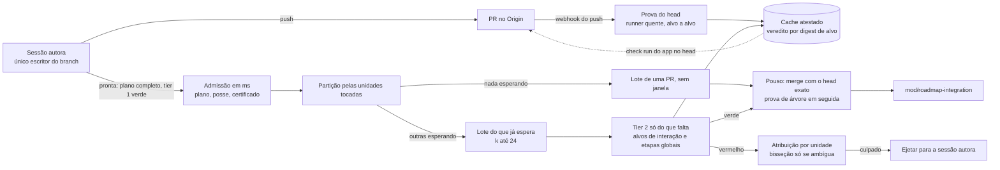

# 11. Gate, merge, fila e Origin: a solução definitiva, de 1 PR/min a 1 PR/s

> **Referência e histórico.** A fonte da verdade da fase 1 é a [arquitetura-alvo](ARQUITETURA-ALVO.md), e o plano
> para implementá-la está no [plano de implementação](PLANO-DE-IMPLEMENTACAO.md); onde este documento divergir dela,
> vale ela.

> **Na fronteira de 12:19** ([22 §3](22-tres-camadas.md#3-o-inventário-peça-por-peça)): misto. Ficam na infraestrutura
> o cache de resultado por digest da entrada (a prova por alvo de §5), o runner quente, o pouso com compare-and-swap
> pelo executor forge, a exclusão mútua por ramo e o ingresso dos webhooks. São da gestão, como política de
> integração, quais checagens uma PR precisa, o que é "pronta", o certificado, o lote, a ejeção, a bissecção e as
> metas de §6, inclusive a de 1 s.

As classes K1, K5 e K7 de [09](09-avaliacao-10-0.md) (dois escritores no mesmo branch, computação do gate fixa e
pequena, merge serial pela API) e a parte do forge de K2 têm uma resposta conhecida: a **fila de merge** do estado da
arte, com o forge como registro e cadeado. Este documento diz qual padrão, como ele fica no Origin (e no GitHub pela
mesma porta), o caminho de entrega em até 1 s e as metas numéricas.

**Dois regimes, um desenho** (Daniel, 04/11 01:01 e 01:06). Por muito tempo as PRs chegam espaçadas: o dimensionamento
é **1 PR/min**, e a maior parte do tempo vai para produzir a PR, não para entregá-la. Nesse regime a fila não impõe
espera: a PR pronta sai num lote de uma, sem janela, e a entrega (conferir a prova e pousar) cabe em ~1 s (seção 5).
Quando a vazão sobe até 1 PR/s, o mesmo desenho junta em lote o que já está esperando; só números mudam.

## 1. O padrão que se repete no estado da arte

Todos os sistemas que mantêm a base verde em volume fazem as mesmas cinco coisas:

1. **Testam o resultado do merge, não a PR sozinha.** É a regra "not rocket science" do bors [S9], o pipeline
   dependente do Zuul [S10], o grupo de merge do GitHub [S11], o trem do GitLab [S12] e o SubmitQueue da Uber [S8].
2. **Separam o filtro da prova.** Checagens rápidas na PR antes da fila (o tier 1 do motor) e a suíte que vale na fila.
   Com o filtro antes da caixa, o vermelho que chega à fila cai de ~0,13 para ~0,02 (pesquisa da caixa [T7]).
3. **Agrupam em lote e acham o culpado por bisseção, sem obrigar a esperar.** O bors-ng faz O(E log N) contra O(N) um a
   um [S9]; o lote de 4 já corta até 75 % das execuções [V9]; o ótimo de Dorfman é k ≈ 1/√p [V12]. A fila do GitHub
   deixa o grupo mínimo em 1 e o tempo de espera para juntar mais como ajuste [S11]: o lote é de oportunidade.
4. **Especulam e paralelizam por alvo afetado.** O Zuul testa uma janela de 20 mudanças em cima umas das outras [S10]; a
   fila do GitHub aceita até 100 builds simultâneos [S11]; o CQ do Chromium reaproveita builds verdes por até 800
   commits [S13]; o cache de ações do Bazel guarda o resultado pelo digest das entradas [V6]. No motor, o "alvo afetado"
   já existe: é a unidade, com dono e bateria própria ([UNITS.md](../architecture/UNITS.md)).
5. **Deixam o forge como registro e cadeado.** O veredito vira um check no head exato e uma regra de merge exige esse
   check; ninguém confia na palavra de quem escreveu o código (semente §6; [T7] §2).

O motor já tem a maior parte das peças: o trem com lote, bisseção, reexecução do culpado para separar flake e prova de
árvore (D-297, [T8]), o cache por conteúdo do gate (D-076) e as baterias por unidade. O que falta é a **forma**: hoje
tudo roda numa caixa com trava de kernel, fila em arquivo e o `deliver` mexendo no branch da PR.

## 2. O desenho

1. **Um escritor por branch (fecha K1).** Só a sessão autora escreve no branch da sua PR. A fila nunca mescla a base
   no branch da PR: um lote de mais de uma PR é montado num ramo próprio (`queue/<lote>`), que só ela escreve. Se a PR
   conflita com a base, a fila a ejeta com o motivo e a sessão autora, a única que escreve ali, mescla a base e empurra
   de novo. A base (`mod/roadmap-integration`) só avança pela fila: uma regra `push_branch` do Origin restringe o push
   na base à identidade da fila.
2. **A prova do head sai no push, antes da PR ficar pronta.** A cada push, o webhook acorda o runner quente, que calcula
   a árvore do merge do head com a base atual (`git merge-tree --write-tree`, que mescla sem índice nem cópia de
   trabalho [V39]: ~5 ms neste repositório [M]) e, para cada alvo afetado (as baterias das unidades tocadas e as etapas
   globais), o digest das entradas a partir dos ids de blob do git (~5 ms por unidade [M]). Alvo cujo digest já tem
   veredito no cache atestado não roda; os outros rodam no runner. Sai o **certificado do head**: a lista (alvo,
   digest, veredito) assinada pela chave do runner, e o app posta o check run `tower/queue` no head. A prova roda em
   paralelo com o tier 1 da sessão, que leva tempo parecido, e um push novo cancela a do head anterior.
3. **Admissão** em milissegundos, sem rodar teste: o plano marcado pelos trailers (`scripts/plan-tick --check`), a
   estrutura do corpo, a posse (todo arquivo mudado pertence a uma unidade da sessão), o tier 1 verde no head exato e o
   certificado desse head.
4. **Partição pelas unidades tocadas.** PRs com conjuntos de unidades disjuntos entram em lotes que se verificam em
   paralelo; PRs que tocam arquivos globais (agregados gerados, registro) vão para a partição global, serial.
5. **Lote de oportunidade.** Quando a PR fica pronta e nada espera na partição, o lote é ela sozinha e sai na hora:
   não há janela de espera. Quando outras PRs esperam (chegaram durante um pouso ou uma prova), o lote junta as que já
   estão lá, até k ≈ 1/√p, limitado a 24 (seção 4). Nenhuma PR é segurada para encher o lote.
6. **Tier 2 só do que falta.** Com o veredito guardado por alvo, um lote só roda os alvos cujo digest de entrada mudou
   com a combinação: os tocados por mais de uma PR do lote (interação) e as etapas globais. O que cada PR provou sozinha
   continua valendo no lote quando a entrada do alvo é a mesma. Só os runners escrevem no cache; as sessões só leem. É o
   que o Bazel e a SLSA pedem para um cache em que se pode confiar ([T7] §3, [V6]).
7. **Atribuição antes da bisseção.** Como cada PR toca suas unidades, um teste vermelho de uma unidade aponta a PR
   direto. A bisseção (o código atual do trem) só roda quando a falha é global ou cai em duas PRs. A reexecução do
   culpado continua separando flake de defeito (D-297).
8. **Pouso.** Ver a seção 3: no Origin, merge pela API na ordem do lote com `--match-head-commit` e prova de árvore; no
   GitHub, um push do head do lote.
9. **Registro.** O check run `tower/queue` no head exato de cada PR leva o veredito e o id da prova ou do lote; uma
   regra `merge_branch` do Origin exige esse check na base. Qualquer leitor confere a prova pelo forge, sem acreditar no
   relato de ninguém.

## 3. Como fica no Origin e no GitHub

O que foi medido e lido nesta sessão sobre o Origin (CLI `origin` 2026.11.03):

| Capacidade | O que o Origin oferece | Fonte |
|---|---|---|
| Identidade de serviço | apps com chaves de assinatura Ed25519; token de instalação (3.000 pontos/min, ≤ 15 min) e JWT de app (6.000 pontos/min) | `origin app --help`; [S21]; [T7] |
| Eventos | assinaturas de webhook por app, entregas assinadas, lista de entregas e **reentrega** (`origin app webhook deliveries`, `redeliver`); acompanhamento ao vivo de uma PR por stream (`origin pr watch`) | CLI [M] |
| Cadeado de merge | rulesets `merge_branch` e `push_branch` (no modelo do GitHub, importáveis dele); `origin pr requirements` mostra o que falta; nenhum ruleset configurado hoje no repositório | CLI [M] |
| Merge | `--match-head-commit`, `--expect-head`, merge commit ou squash, auto-merge (`--auto`), e pilha: o merge de uma PR empilhada pousa todas as de baixo num commit só | CLI [M] |
| Merge por push | **não marca a PR como mergeada**: as PRs #253 e #233, pousadas pelo push do trem, aparecem como `closed`, sem `mergedAt`; a #262, pela API, aparece `merged` | `origin pr view --json` [M] |
| Fila de merge nativa | nenhum comando de fila na CLI | CLI [M] |
| CI própria | existe o conceito de job de "Origin CI", sem runners nem cota públicos | [T7] |

Consequências para o pouso:

- **No Origin, pouso pela API, PR a PR, na ordem do lote.** No regime de 1 PR/min o lote é de uma PR e o pouso é uma
  chamada. Num lote maior, depois do veredito verde, a fila chama `pr merge --match-head-commit` para cada membro, na
  ordem em que o lote foi montado, e confere que a árvore da ponta é a árvore verificada (a prova de árvore do D-297).
  Assim a PR fica `merged` no Origin. Custa 10 pontos por PR: a 1 PR/s são 600 pontos/min, 10 % do JWT de app.
- **No GitHub, pouso por um push do head do lote.** O GitHub marca a PR como mergeada quando os commits do head dela
  ficam alcançáveis a partir da base, mesmo por push direto (o "merge indireto" da documentação) [S25]; a fila do GitHub
  pousa o commit testado do grupo [S11]. Pousar PR a PR pela API no GitHub esbarra no limite de 80 requisições que criam
  conteúdo por minuto e 500 por hora [S20]: o Prow (Tide, do Kubernetes) faz um merge por chamada com 5 s de pausa
  porque merges rápidos demais voltam com "base branch was modified" [S26]. O mesmo adaptador escolhe o mecanismo pelo
  que o forge faz.
- **No Origin, a taxa e a latência dos merges pela API ainda não são conhecidas.** Se a medida E1 de
  [14](14-custos-e-migracao.md) mostrar que o Origin não aguenta ~1 merge por segundo no mesmo repositório, há duas
  saídas sem mudar a arquitetura: pousar por push o head do lote e fechar as PRs com o link do merge (o Origin as mostra
  fechadas, não mergeadas; a métrica do motor conta os merges no git), ou pousar uma pilha com uma chamada, se a medida
  E3 mostrar que serve. A latência de uma chamada (E4) decide a entrega em 1 s (seção 5).
- **Pilhas do Origin não servem de lote**: exigem refazer a base dos branches das PRs, o que quebra a regra de um
  escritor por branch.

**Orçamento de API por PR a 1 PR/s** (JWT de app, 6.000 pontos/min; meta ≤ 50 % pela semente §4):

| Operação | Pontos | Por PR |
|---|---|---|
| abrir a PR (sessão autora, credencial dela) | escrita, 5 | 5 |
| check run do tier 1 e do veredito da fila | 2 escritas | 10 |
| merge | 10 | 10 |
| leituras (eventos vêm por webhook; só a admissão lê o estado) | 1 cada | ~2 |
| **total** | | **~27 pontos, ~1.600/min a 1 PR/s, 27 % do JWT de app** |

A 1 PR/min são ~27 pontos por minuto, 0,5 % do JWT de app.

## 4. As contas

**Lote.** Com o vermelho que chega à fila p e o lote k, a execução de tier 2 por PR cai como na tabela da pesquisa da
caixa (bisseção que infere a metade vermelha) [T7]:

| p na fila | k ótimo | Execuções de tier 2 por PR |
|---|---|---|
| 0,13 (hoje, sem filtro) | 5 | 0,59 |
| 0,05 | 11 | 0,32 |
| 0,02 | 12–24 | 0,17–0,19 |
| 0,01 | 24–32 | 0,10–0,11 |

**CPU do tier 2 a 1 PR/s** = λ × execuções por PR × custo de uma execução ÷ ρ [I]:

| Cenário | Custo de uma execução | p | vCPU·s por PR | vCPU a 1 PR/s |
|---|---|---|---|---|
| suíte inteira de hoje (~100 s em 4 CPUs) | 400 vCPU·s | 0,02 | 74 | ~99 |
| com seleção por unidade e cache | 200 vCPU·s | 0,02 | 37 | ~50 |
| idem com filtro melhor | 200 vCPU·s | 0,01 | 21 | ~29 |
| meta | ≤ 185 vCPU·s | ≤ 0,01 | ≤ 20 | ≤ 27 |

Com seleção por unidade, o custo de uma execução cresce com as unidades tocadas, não com o tamanho da suíte: a suíte
inteira tem ~300 vCPU·s em 56 unidades ([gate-speed](../programs/gate-speed/retro.md): ~74 s frio em 4 CPUs), ~5
vCPU·s por unidade em média [I], mais as etapas globais divididas pelo lote.

**A 1 PR/min**, o dimensionamento atual, o tier 2 pede 240 a 480 vCPU·h por mês (20 a 40 vCPU·s por PR): 0,33 a 0,67
vCPU em média, que um runner quente de 2 vCPU absorve com folga.

**Avanços da base.** No Origin, um por PR (merges pela API): 60 por minuto a 1 PR/s, feitos pelo próprio servidor, sem
corrida de push. O limite de merges por minuto por repositório do Origin não é publicado; é a primeira medida da
migração ([14](14-custos-e-migracao.md)). No GitHub, um por lote: ~2,5 por minuto com k = 24.

## 5. O caminho de baixa vazão: da PR pronta à mergeada em até 1 s

A 1 PR/min chega uma PR a cada ~60 s e a entrega leva ~1 s: a fila fica vazia ~98 % do tempo. É o regime normal por
muito tempo, e a entrega nele é de primeira classe (Daniel, 04/11 01:01). O relógio começa quando a PR fica **pronta**
(o plano completo pelos trailers e o tier 1 da sessão verde no head exato) e para quando a base no forge contém o merge.

| # | Etapa | Orçamento p50 | Como | O que precisa ser verdade |
|---|---|---|---|---|
| 1 | o sinal de pronta chega ao workflow | ≤ 150 ms [E] | a sessão chama a API da fábrica (ou o webhook do Origin): API Gateway, Lambda e SQS com espera longa | evento empurrado, nunca consulta; a Lambda quente (a 1 PR/min ela recebe uma chamada a cada ~10 s); o serviço de workflows sempre de pé |
| 2 | admissão | ≤ 20 ms [E] | leituras por chave no banco; trailers e posse já lidos no push | o espelho do repositório atualizado pelo webhook de push |
| 3 | lote | ≤ 5 ms [E] | partição vazia: lote de uma PR | lote de oportunidade, sem janela |
| 4 | árvore do merge | ≤ 10 ms | `git merge-tree --write-tree` da base atual com o head: ~5 ms aqui [M] | o head já buscado no push; merge limpo |
| 5 | conferência do certificado | ≤ 20 ms | digest de cada alvo afetado pelos ids de blob (~5 ms por unidade [M]); todos verdes no cache; assinatura Ed25519 do runner | a prova do head terminou antes da pronta; a base não mudou a entrada de nenhum alvo da PR desde a prova |
| 6 | pouso | ≤ 600 ms [E] | `pr merge --match-head-commit` no Origin (ou um push no GitHub); a fila é o único escritor da base, então não há corrida entre a conferência e o merge | a latência de uma chamada de merge no Origin, ainda não medida (E4) |
| 7 | registro | ≤ 20 ms [E] | a transição e o evento na mesma transação (tabela de saída) | — |
| | **total** | **≤ ~0,8 s** | | |

Os números [M] foram medidos neste repositório (git 2.43, 3.275 arquivos); os [E] são estimativas que o passo 0.3 de
[14](14-custos-e-migracao.md) mede.

**O que fica acima de 1 s, e por quê.**

1. **Rodar os testes.** A prova continua levando o tempo dos testes dos alvos afetados: o gate ordinário mais rápido
   medido hoje leva 10,5 s quente e 16,8 s frio (dado da Torre, 04/11 01:01 BRT [M]). Ela não some; sai do caminho da
   entrega e roda durante a produção da PR, em paralelo com o tier 1 da sessão. Do último push até a mergeada, o tempo
   é o maior entre a prova e o tier 1, mais ~1 s; de pronta a mergeada, ~1 s quando a prova terminou primeiro.
2. **A prova que não terminou a tempo.** Se o runner é mais lento que o tier 1 da sessão (etapas globais, runner
   ocupado), a entrega espera a diferença. A 1 PR/min o runner quente fica ocupado 17 a 33 % do tempo: uma prova em 3 a
   6 espera na fila dele, em média 1 a 5 s [I].
3. **A base que mudou na entrada da PR.** Se outra PR pousou entre a prova e a pronta e mudou a entrada de um alvo
   desta, esse alvo roda de novo (segundos). A 1 PR/min isso pede duas PRs no mesmo código no mesmo minuto.
4. **O forge.** O merge pela API do Origin e os webhooks dele não têm latência medida (E4 e E5). Se o merge sozinho
   passar de ~0,6 s em p50, a meta de 1 s não fecha por nada que esteja do nosso lado. A cauda do forge, dos webhooks e
   das partidas a frio da Lambda fica acima de 1 s: a meta de p99 é 3 s.
5. **A prova de árvore pós-pouso** (a árvore pousada é a verificada) roda logo depois do merge, fora do relógio; se
   falhar, a fila reverte e para.
6. **Runner frio.** Sem o runner quente (pool mínimo 0), cada prova paga a partida de uma tarefa, dezenas de segundos
   [E] (medida E6): a entrega deixa de ser instantânea, por ~US$ 22 a menos por mês ([14 §6](14-custos-e-migracao.md#6-o-crédito-de-us-1100-quanto-dura)).
7. **Conflito ou vermelho** volta para a sessão autora: é tempo de produção, não de entrega.

**A condição que o motor de hoje não cumpre.** A prova do gate é um digest só da PR inteira, com o sha da base dentro
(`input_digest` em [EVENTS.md](../process/EVENTS.md)): qualquer avanço da base invalida a prova toda. O caminho de 1 s
pede o veredito **por alvo**, com a chave das entradas daquele alvo (os ids de blob dos caminhos dele, dos compartilhados
e dos que ele requer no manifesto, o toolchain e a versão do gate), sem o sha da base. A seleção por unidade e o cache
por conteúdo (D-076) já existem; muda a granularidade da chave. A chave por alvo só vale se as entradas declaradas forem
completas: o tier 3 noturno roda tudo na base e acusa a fuga (`selection.escape`, um evento que o contrato já tem e
nada emite hoje).

**Sob carga, o mesmo desenho.** Quando a vazão sobe, PRs passam a chegar durante pousos e provas: o lote de
oportunidade junta as que esperam, o tier 2 roda só os alvos de interação e as etapas globais, e o pouso segue a ordem
do lote. A 1 PR/s, com o tier 2 de lote em p50 ≤ 60 s, cabem ~24 PRs por lote, os números da seção 4. Nada é trocado:
mudam o tamanho do lote, o número de runners e o de partições.

## 6. Metas numéricas

| Meta | A 1 PR/min (agora) | A 1 PR/s (depois) | Como se mede |
|---|---|---|---|
| Vazão da fila | capacidade ≥ 1,33 PR/min | capacidade ≥ 1,33 PR/s; 1 PR/s sustentada numa hora | merges na base por janela (`scripts/flow-metrics`) |
| Entrega: de "pronta" a "mergeada" | p50 ≤ 1 s; p99 ≤ 3 s (lote de uma, prova feita) | p50 ≤ 5 min; p99 ≤ 20 min (lote de até 24) | eventos da fila |
| Provas terminadas antes da "pronta" | ≥ 90 % | ≥ 90 % das PRs que entram sozinhas | ordem dos eventos de prova e de pronta |
| Prova de um head no runner quente | p50 ≤ 20 s [E] | idem | duração do job |
| Tier 2 por lote | — (lote de uma: vale a prova do head) | p50 ≤ 60 s | duração do job |
| Vermelho dentro da fila | ≤ 2 % (meta 1 %) | idem | vereditos de tier 2 |
| Flake | ≤ 1 % das execuções; reexecução do culpado em toda ejeção | idem | `test.flaked` |
| Ejeções atribuídas sem bisseção | ≥ 90 % | idem | eventos de atribuição |
| CPU do tier 2 | ≤ 40 vCPU·s por PR mergeada; meta 20 | idem | custo medido por prova e por lote |
| API do forge | ≤ 27 pontos por PR; ≤ 50 % do limite da credencial | idem | cabeçalhos `x-ratelimit-*` |
| Recusas de push por concorrência | zero | zero | incidentes `push-refusal` |
| Consultas periódicas no caminho normal | zero; reconciliação só como rede de segurança | idem | código e eventos |

## 7. O que sai do motor

| Hoje | Depois |
|---|---|
| a trava de kernel da caixa (`box_gate`) serializa os gates | provas e lotes em paralelo por partição, em runners gerenciados |
| a fila em `pr-N.json` numa pasta da caixa | a fila no banco de estado ([13](13-estado-e-coordenacao.md)) |
| o `deliver` mescla a base no branch da PR | a fila monta o lote no ramo dela; a PR só recebe push da sessão autora |
| a prova é um digest da PR inteira com o sha da base | veredito por alvo, pela chave das entradas do alvo; a base que anda sem tocar a entrada não invalida a prova |
| a prova no log em git-ref | o check run do app no head exato, exigido por regra de merge, e o veredito no banco |
| o runner na VM e2-micro | removido (Daniel, 03/11 23:43) |
| merge serial, uma PR por vez, julgada sozinha | lote de uma sem espera quando nada espera; lote verificado uma vez quando há fila |

## 8. Falhas e recuperação da fila

| Falha | O que acontece |
|---|---|
| a base andou durante a prova ou o tier 2 | a árvore é refeita sobre a base nova; os alvos cuja entrada não mudou continuam valendo pelo cache |
| a prova não terminou antes da "pronta" | a fila espera o certificado do head; nada pousa sem ele |
| runner quente perdido (interrupção do Spot) | o ECS sobe outro; enquanto isso a prova roda numa tarefa de rajada, a frio |
| runner perdido no meio de um job | o job é idempotente pela chave do head ou do lote; reexecuta |
| webhook perdido | a reentrega do Origin e a reconciliação (comparar PRs prontas no forge com a fila) |
| Origin fora | a fila segue provando; o pouso espera; nada se perde porque o estado está no banco |
| teste instável | reexecução do culpado, quarentena e nenhum ejetado (D-297) |
| conflito com a base | ejeção para a sessão autora, que mescla e empurra |
| cota do forge perto do limite | a admissão desacelera (balde de tokens); nunca passa de 50 % |

## 9. As filas de merge do mercado, comparadas

O desenho da seção 2 junta o que cada uma faz melhor. Os modelos e limites documentados [S11, S12, S26, S27; os de
fornecedor só por trecho, S28]:

| Fila | Modelo | Lote | Paralelo por alvo | Como pousa | Limite documentado |
|---|---|---|---|---|---|
| GitHub merge queue | especulativa: cada PR testada com a base e as PRs à frente | grupos de 1 a 100, sem juntar os builds de CI | não | o commit testado entra na base | até 100 builds simultâneos e 100 PRs por grupo |
| GitLab merge trains | especulativa e cumulativa | não | não | cada MR depois do próprio pipeline | 20 pipelines em paralelo por padrão; falha derruba o MR e reinicia os de trás |
| bors-ng | lotes seriais com bisseção | sim | não | um push rápido (fast-forward) do commit de staging | descontinuado em 2023 |
| Prow Tide (Kubernetes) | pools não especulativos | sim | um pool por repositório e branch | uma chamada de merge por PR, 5 s de pausa | os limites da API do GitHub |
| Uber SubmitQueue | árvore de especulação e grafo de conflito por alvo | sim | sim | um push por vez por branch e promoção só por fast-forward a um `verified/main` | — |
| Mergify, Aviator, Trunk, Graphite | serial ou paralela por escopo ou alvo afetado, com bisseção | sim (Mergify até 128) | sim | merge por PR ou fast-forward do lote | só por trecho de busca |

O que todas repetem e o desenho da seção 2 adota: testar o estado futuro, partir por independência, lote com bisseção,
tolerar flake dentro da fila e serializar o pouso por branch. Do Uber vem uma ideia barata para o Origin: pousar num
ramo de staging e promover a base só por fast-forward depois da conferência pós-pouso [S27].
