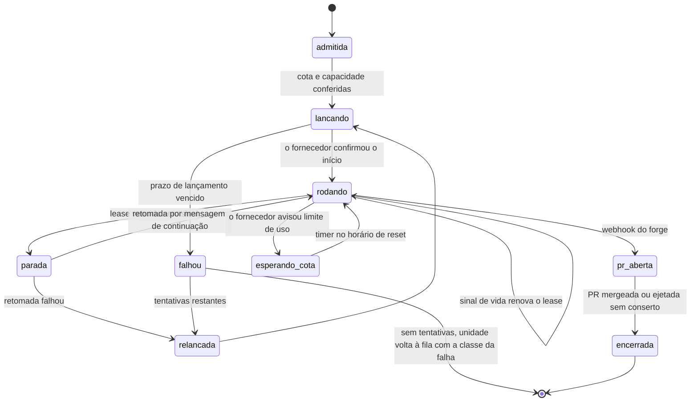

# 12. A unidade de trabalho e as sessões dos fornecedores

> **Referência e histórico.** A fonte da verdade da fase 1 é a [arquitetura-alvo](ARQUITETURA-ALVO.md), e o plano
> para implementá-la está no [plano de implementação](PLANO-DE-IMPLEMENTACAO.md); onde este documento divergir dela,
> vale ela.

> **Na fronteira de 12:19** ([22 §3](22-tres-camadas.md#3-o-inventário-peça-por-peça)): infraestrutura no que é
> execução. Do contrato de §2 ficam o identificador, a entrada (o brief, opaca), o executor, o limite e a saída ([22
> §4](22-tres-camadas.md#4-o-contrato-entre-a-infraestrutura-e-a-gestão)); saem para a gestão o objetivo, o escopo, o
> aceite e as capacidades exigidas, que são critérios dela para escolher o executor e julgar a saída. O ciclo da
> sessão e o corretor (§3 a §5) são o adaptador de um tipo de executor, a sessão de IA; a escolha por degrau (§6) é da
> liderança.

Responde às classes K4 e K6 de [09](09-avaliacao-10-0.md): sessões que param sem ninguém retomar, pedidos de decisão,
fim de turno que deixa o fluxo parado, e unidade enviada a um ambiente sem a capacidade que ela pede. Aqui "unidade de
trabalho" é o item da fila que vira uma PR (as linhas `F<n>` de hoje), não a unidade de código do manifesto
(`units/<id>/unit.json`), que continua sendo a dona dos caminhos. No modelo refinado de [16](16-modelo-de-dominio.md),
ela é o **processo** do METODO, executado por **tentativas**, e a sessão é filha de uma tentativa.

## 1. O estado da arte em uma frase

Toda plataforma que roda trabalho longo e falível em volume usa o mesmo molde: **uma fila durável com lease (prazo de
posse), um workflow com estado por item, efeitos idempotentes por chave, prazos e retomada como timers duráveis, e
eventos empurrados (webhook ou stream) em vez de consulta**. É o que fazem o SQS com o prazo de visibilidade e a fila
de mensagens mortas [C12], o Temporal e o Cadence com workflows que sobrevivem a qualquer queda [C23, C24], o Step
Functions com espera por token [C25] e a Stripe com chaves de idempotência em toda chamada que pode ser repetida
[C34]. Uma sessão de agente é só mais um trabalho longo e falível; o motor de hoje a trata como um processo vigiado
por script.

## 2. O contrato da unidade de trabalho

| Parte | Conteúdo | Regra |
|---|---|---|
| Identidade | a chave do processo (`F<n>`), estável, e o número da tentativa | a chave de idempotência é `F<n>#<tentativa>`; o branch é determinístico (`work/F<n>`), então relançar continua a mesma PR em vez de abrir outra |
| Entrada | objetivo e brief (das instruções versionadas, C03), escopo (as unidades de código e os caminhos que ela pode tocar), base (branch e sha), critério de aceite (as baterias e o tier 1 que têm de ficar verdes), orçamento (tokens, tempo de parede, tentativas), capacidades exigidas (root, rede, banco de teste, tempo máximo), prioridade, prazo, dependências | a admissão recusa a unidade sem escopo, sem critério ou sem orçamento |
| Saída | a PR (número, head sha), a evidência (veredito do tier 1, digest das entradas, tokens e custo, link dos logs) ou a falha com a classe (`code`, `env`, `contract`, `provider`, `quota`, `timeout`) | a saída é um evento no banco, nunca o relato da sessão |
| Estado | três ciclos separados ([16 §5.4](16-modelo-de-dominio.md#54-ciclos-de-vida)): o do processo (`proposed → ready → active → done`, com `failed` e `cancelled`), o da tentativa e o da PR; parada, espera de cota e bloqueio são condições (`stalled`, `waiting_quota`, `blocked`), não estados | cada transição é uma escrita condicional no banco e um evento; ninguém pula estado |
| Lease | o corretor de sessões segura a unidade com prazo (ex.: 15 min), renovado a cada sinal da sessão | lease vencido sem sinal vira `stalled` e o workflow age (seção 4) |
| Prazos | lançamento ≤ 5 min; sinal de vida ≤ 10 min; PR aberta ≤ 60 min; tier 1 verde ≤ 30 min depois da PR; parede total ≤ 2 h (A = 1) | todo prazo é um timer durável do workflow, não um laço de consulta |
| Retentativa | até 2 por fornecedor; depois sobe um degrau na escada de modelos (que o motor já tem, [PORTS.md](../architecture/PORTS.md)) ou troca de fornecedor | a falha `contract` nunca é retentada: vai para quem desenha a unidade |
| Decisão | a sessão nunca pede decisão a pessoas: escolhe a opção reversível, registra o caminho de volta e segue (AGENTS.md, "Act, don't ask"); um pedido de decisão vira evento e incidente, não espera | o contrato do brief diz isso; o workflow trata o evento |
| Cancelamento | `cancel(unit_id)` para a sessão, fecha a PR se ainda não entrou na fila e libera o claim | idempotente |

## 3. O ciclo de uma sessão, com qualquer fornecedor

No modelo refinado ([16 §5.4](16-modelo-de-dominio.md#54-ciclos-de-vida)) este ciclo se divide: os estados são da
tentativa (`pending`, `launching`, `running`, `succeeded`, `failed`), e a parada e a espera de cota são condições dela
(`stalled`, `waiting_quota`, com o horário de reset). Os nomes em português do diagrama são os do texto; os
identificadores são os de [16](16-modelo-de-dominio.md).

O que isso resolve, caso a caso:

- **I-2012f37d (cota resetou e nada retomou):** o estado `esperando_cota` guarda o horário de reset que o fornecedor
  informou e um timer durável acorda o workflow nesse horário. Ninguém precisa estar acordado.
- **I-0d1c3a25 (a sessão encerrou o turno e o fluxo parou):** a sessão não é mais o motor; o workflow é. Se a sessão
  para de dar sinal, o lease vence e o workflow manda a mensagem de continuação ou relança.
- **I-ddaca17c e I-10901f05 (pedido de decisão):** o contrato proíbe esperar; o evento de pedido vira incidente e a
  sessão segue com a opção reversível.
- **I-986a5daf (fornecedor sem root):** a capacidade exigida está na unidade e a matriz de capacidades do corretor só
  despacha para quem a tem.

## 4. A porta do corretor de sessões

A mesma porta para todo fornecedor, como a porta de agente que o motor já declara ([PORTS.md](../architecture/PORTS.md)):

| Operação | Entrada | Saída |
|---|---|---|
| `capabilities()` | — | o que o fornecedor oferece: forges, root, rede, duração máxima, concorrência, modelos |
| `launch(unit, attempt)` | o contrato da unidade e a credencial de sessão | `session_id` (idempotente pela chave da unidade) |
| `observe(session_id)` | — | assinatura de eventos (webhook ou stream) do fornecedor, traduzidos para os eventos do envelope do motor |
| `nudge(session_id, mensagem)` | — | continuação de uma sessão parada |
| `stop(session_id)` | — | sessão encerrada ou arquivada |
| `usage()` | — | cota restante e horário de reset, quando o fornecedor informa |

Os eventos traduzidos vão no envelope que o motor já tem ([contracts/events/envelope.v1.json](../../contracts/events/envelope.v1.json)),
com os nomes do catálogo de [16 §7.2](16-modelo-de-dominio.md#72-eventos): `session.started` e `session.ended` na
sessão; `attempt.stalled`, `attempt.quota_waiting` e `attempt.resumed` na tentativa, porque parar e esperar cota são
da tentativa, que pode trocar de sessão; `pr.opened` na PR. O sinal de vida renova o lease e não vira evento. A chave
natural é (processo, tentativa, sessão).

## 5. Os fornecedores, lado a lado

Medido e lido em 04/11/2026 [A28–A45]; "(t)" marca o que veio só de trecho de busca.

| Fornecedor e forma | Lançar | Eventos | Retomar e encerrar | Limites | Forges | Credencial e preço | Automação |
|---|---|---|---|---|---|---|---|
| **Agente próprio em sandbox nosso** (Claude Code `-p` ou Agent SDK, `codex exec`, Gemini CLI em contêiner efêmero) | processo no contêiner | do nosso processo: `stream-json`/JSONL e hooks HTTP de fim de sessão [A30] | `--resume`; SIGTERM; teto de gasto por sessão (`--max-budget-usd`) | os nossos | qualquer, inclusive o Origin pela CLI | chave de API ou Bedrock/Vertex; Claude no Bedrock ao preço da Anthropic [A34] | sim: é o caminho que a Anthropic indica para produtos [A31]; **adaptador futuro** (gatilhos da seção 6) |
| **Claude Managed Agents** (beta) | `POST /v1/sessions` [A32] | stream SSE e webhooks assinados; o webhook tenta até 3 vezes, sem ordem, e depois descarta | eventos de usuário; interromper, arquivar, apagar | 300 criações/min e 1.200 leituras/min por organização; teto de sessões não publicado | GitHub como recurso; outro git por sandbox próprio | chave do Console; tokens + US$ 0,08 por hora de sessão rodando | sim |
| **Cursor Cloud Agents API** | `POST /v1/agents` com chave de idempotência, repositórios, modelo, PR automática; nuvem da Cursor ou pool próprio [A36] | stream SSE retomável; webhook `statusChange` com HMAC (t) [A37] | nova execução no mesmo agente; cancelar, arquivar, apagar | 8 agentes simultâneos no Pro (t) [A38] | GitHub; o Origin é da própria Cursor e o agente abre PR nele pela ferramenta dele | chave de usuário ou de conta de serviço; preço de API do modelo (t) [A39] | sim (API vendida para isso); **adaptador principal no degrau atual** |
| **AWS AgentCore Runtime** | `InvokeAgentRuntime` com id de sessão [A41] | resposta em stream da chamada aberta | mesma sessão enquanto viva; `StopRuntimeSession` | uma microVM por sessão; ociosa 15 min e vida de 8 h por padrão, até 14 dias; 25 sessões novas/s e 5.000 ativas em us-east-1 (t) | qualquer (nós clonamos) | IAM; US$ 0,0895 por vCPU·h + US$ 0,00945 por GB·h | sim |
| **Jules API** (v1alpha) | `POST /v1alpha/sessions` [A42] | só consulta | mensagem e aprovação de plano; arquivar | 15/dia e 3 simultâneas no grátis; 100 e 15 no Pro (t) | só GitHub | chave de API | sim |
| **Claude Code em nuvem** (assinatura) | `claude --cloud`; tarefa agendada com disparo por API, em prévia [A28, A29] | nenhuma API pública de eventos | `claude -p "..." --cloud <id>`; arquivar só na interface | disparo por API: 100/h por conta (~2.400/dia); teto de sessões simultâneas por organização não publicado | GitHub para clonar e abrir PR | conta claude.ai; consome o plano | **adaptador principal no degrau atual** (uso pessoal, interno e não comercial), dentro dos limites do plano [A31] |
| **Codex na nuvem** | `codex cloud exec`; sem API pública [A40] | só consulta | só na interface | janelas de 5 h e semanal do plano (t) | GitHub | login do ChatGPT | **adaptador principal no degrau atual**; a documentação indica chave de API para CI (t) |
| **Kiro (agente autônomo)** | sem API pública; rótulo ou comentário no GitHub (t) [A43] | — | — | 10 tarefas simultâneas (t) | GitHub, GitLab (t) | créditos | só pela CLI |

## 6. A escolha, por degrau

**Decisão de Daniel (04/11/2026 00:35 BRT):** "Nesse primeiro momento, enquanto o uso é pessoal, interno e não
comercial, vamos utilizar o Claude Code, Cursor, Codex etc." A escolha fica assim:

1. **No degrau atual, os adaptadores principais são os agentes de nuvem das assinaturas que Daniel já tem**: Claude Code
   em nuvem (as contas Max e Pro), os agentes da Cursor (pela API, que tem webhook) e o Codex na nuvem. O corretor de
   sessões os dirige pelas superfícies que cada um oferece (`claude --cloud` e o disparo por API das tarefas agendadas
   [A28, A29]; `POST /v1/agents` na Cursor [A36]; `codex cloud exec` [A40]) e esconde atrás da porta a consulta
   periódica de quem não empurra eventos. O workflow durável, o lease, os prazos e o estado `esperando_cota` valem do
   mesmo jeito: são da fábrica, não do fornecedor.
2. **O agente próprio em contêiner, com modelos no Bedrock, fica como adaptador futuro**, desenhado na mesma porta e
   testado em sombra com poucas unidades, pronto para quando um gatilho de troca disparar.
3. **A Cursor em nuvem cobra pelo preço de API do modelo** mesmo com assinatura (t) [A39]; o Claude Code e o Codex
   consomem as janelas do plano (5 h e semanal) [A28, A40].

**O que os termos dizem (registro).**

- Anthropic: os limites anunciados dos planos Pro, Max e Ultra "assumem uso individual comum do Claude Code e do Agent
  SDK"; quem constrói produtos, inclusive com o Agent SDK, deve usar chave de API do Console ou um provedor de nuvem;
  os Termos de Consumidor vedam acesso automatizado salvo por chave de API ou permissão explícita; a Anthropic pode agir
  sem aviso prévio [A31]. Ela mesma documenta superfícies de automação dentro do plano: sessões em nuvem, tarefas
  agendadas com disparo por API (100 por hora por conta) [A29] e o `claude setup-token`, "um token OAuth de longa
  duração para CI e scripts" [A47].
- Cursor: a API de agentes em nuvem é vendida para uso programático e cobra pelo preço de API do modelo (t) [A39].
- OpenAI: a documentação do Codex indica autenticação por chave de API para fluxos programáticos como CI (t); os Termos
  de Uso vedam extrair dados ou saídas de forma automática ou programática (t) [A40].

**Os gatilhos de troca** para o adaptador próprio com Bedrock. Basta um:

| Gatilho | O que dispara | Como se mede |
|---|---|---|
| G1 Natureza do uso | o uso deixa de ser pessoal, interno ou não comercial: um cliente, um produto, receita, ou terceiros operando a fábrica | decisão registrada de Daniel |
| G2 Volume | a meta do degrau pede mais sessões simultâneas do que os planos dão (Cursor Pro: 8 agentes (t) [A38]; disparo das sessões do Claude por API: 100/h por conta [A29]), ou as sessões passam mais de 20 % do tempo de uma semana em `esperando_cota` | o estado `esperando_cota` e a concorrência, medidos pelo workflow |
| G3 Aviso do fornecedor | aviso, limitação ou ação na conta por uso automatizado, ou mudança dos termos | o evento registrado como incidente |
| G4 Capacidade | a unidade pede o que a superfície da assinatura não dá (as sessões em nuvem do Claude só clonam e abrem PR no GitHub [A28]; root; duração) | a matriz de capacidades do corretor |

**Até onde as assinaturas vão** [E]: com três frentes, a janela de 5 h ficou em 33 % e a semana em 5 % (AGENTS.md, 03/11)
e a melhor hora teve 41 PRs; se a relação fosse linear, uma conta Max chegaria a ~0,03 PR/s, e as assinaturas somadas
ficariam na faixa de ~0,03 a ~0,1 PR/s. É estimativa: o workflow mede o teto de verdade, e G2 dispara quando ele não
alcança a meta.

**A conta de concorrência** (Little [Q1]): a 1 PR/min, o dimensionamento de agora (Daniel, 04/11 01:06), com ~15 min
de sessão por PR e A = 1, são ~15 sessões simultâneas, dentro do que as assinaturas somadas sustentam. A 1 PR/s são
~900; com A ≥ 10, ~90. Isso está muito além dos planos (G2) e é o tamanho do adaptador próprio: o AgentCore
admite 5.000 sessões ativas e 25 novas por segundo (t) [A41]; um contêiner de 2 vCPU e 4 GB por sessão no Fargate custa
~US$ 0,079 por hora em ARM sob demanda [C46], ~US$ 51 mil/mês para 900 sessões (~US$ 5 mil com A ≥ 10). O custo total
dos agentes, nos dois regimes, está em [14 §3](14-custos-e-migracao.md#3-agentes).
