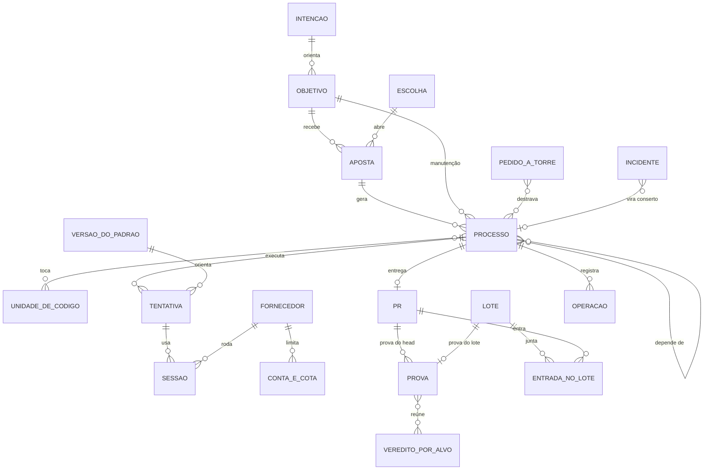
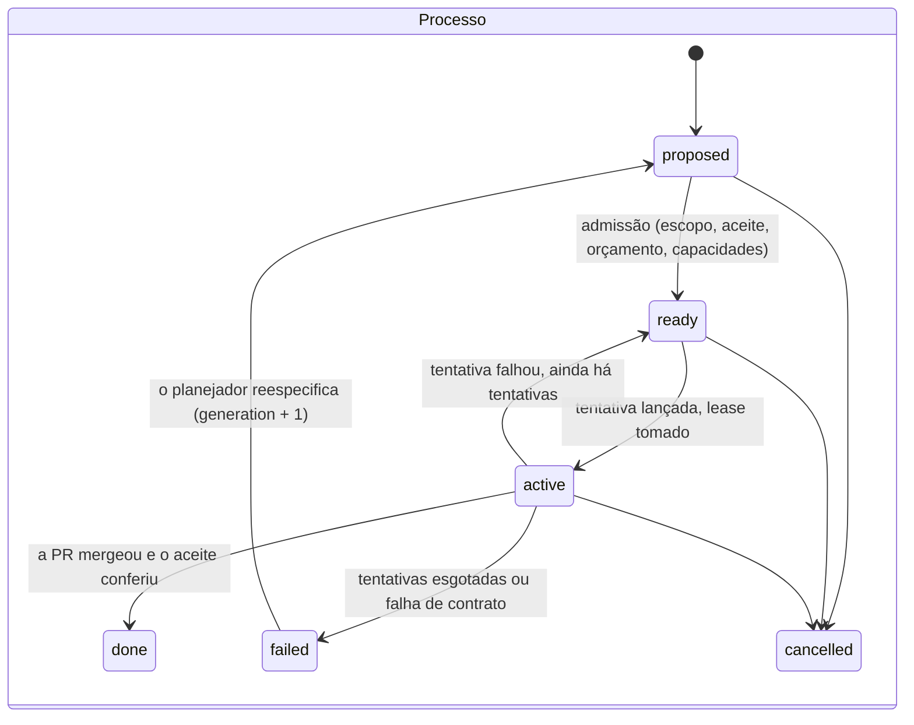
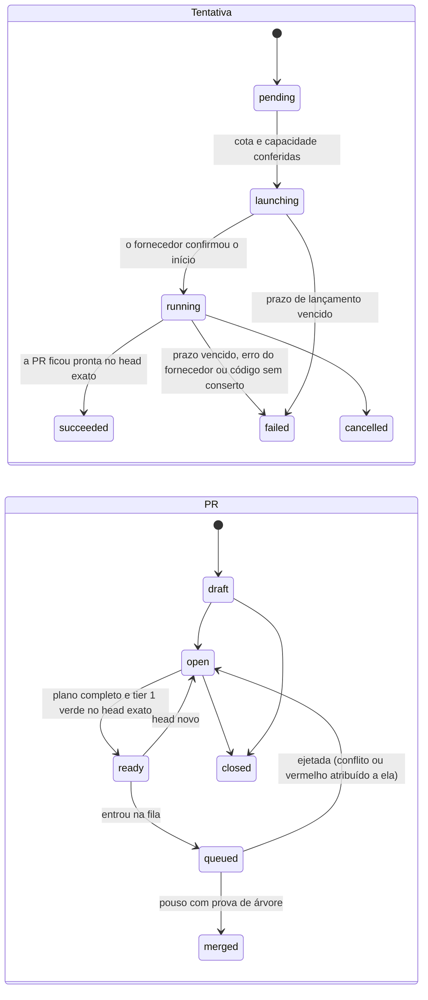

# 16. O modelo de domínio: o de hoje, onde ele falha e o refinado

> **Referência e histórico.** A fonte da verdade da fase 1 é a [arquitetura-alvo](ARQUITETURA-ALVO.md), e o plano
> para implementá-la está no [plano de implementação](PLANO-DE-IMPLEMENTACAO.md); onde este documento divergir dela,
> vale ela.

> **Na fronteira de 12:19** ([22 §3](22-tres-camadas.md#3-o-inventário-peça-por-peça)): é o modelo da gestão, com a
> infraestrutura extraída em [22 §5](22-tres-camadas.md#5-as-tabelas-da-infraestrutura). Ficam na infraestrutura o
> trabalho e a execução (do contexto Trabalho), o executor e a capacidade (do contexto Execução), as regras de §5.5 e
> o envelope de §7.2, como o registro do que ela observa. São da gestão ou da liderança, nas tabelas delas, o
> processo, o plano, as etapas, a PR com `ready` e `queued`, o lote, a prova, a Direção, a Governança, o Aprendizado e
> o Padrão; a chave humana (`F98`, `D-303`) é da gestão, e a infraestrutura só tem o UUID.

Daniel, 04/11/2026 00:43 BRT: "Hoje ainda não temos bem definido a arquitetura das nossas entidades de negócios, né?
Programas, Projetos, Sessões... Será que isso afetará nos esquemas. Tabelas, bancos, eventos etc?" E às 00:44: "Então,
mas temos que refinar. O modelo atual é falho, e temos que trabalhar em cima dele." Este documento levanta o modelo como
ele existe hoje no repositório, mostra onde ele falha, compara com o estado da arte e propõe o modelo refinado, de que
as tabelas, os eventos e os workflows derivam.

## 1. A resposta curta

**Afeta os esquemas, não os componentes.** O modelo de domínio decide as tabelas (chaves, relações, índices), os
nomes e os contratos dos eventos e a fronteira de cada workflow (um por entidade com ciclo de vida). Não decide o
banco, o orquestrador, a fila nem o armazém: RDS PostgreSQL, DBOS, SQS e S3 continuam ([10](10-arquitetura-10-0.md)).

**É por isso que o banco é relacional.** Num banco relacional dá para criar o modelo agora e estendê-lo depois, quando
surgem perguntas novas; no DynamoDB, o próprio guia da AWS diz para não desenhar o esquema antes de conhecer as perguntas
que ele vai responder [C53]. Com o modelo ainda em refino, o PostgreSQL deixa cada mudança ser uma migração versionada,
com DDL transacional, e o DBOS mora no mesmo banco. A leitura da Torre citava chaves de partição do DynamoDB: elas valem
só para a opção A2, que não é a recomendada.

**O modelo de hoje é insumo, não base** (Daniel, 00:44). A cadeia que a Torre sugeriu (intenção → programa → projeto →
unidade → tentativa/sessão → PR → lote) é um bom ponto de partida e tem três pontos fracos, que o modelo refinado
corrige: junta tentativa e sessão, que são coisas diferentes (uma tentativa pode atravessar várias sessões, numa
retomada ou num relançamento); deixa de fora os níveis que o [METODO](../padrao/METODO.md) já define (portfólio, fase,
processo, operação); e mantém "unidade", que hoje nomeia quatro coisas.

## 2. O modelo de hoje

Levantado no repositório em 04/11/2026 por duas leituras independentes do código, dos contratos e dos documentos.

| Entidade | Onde vive hoje | Identidade | Estados | Quem escreve |
|---|---|---|---|---|
| Intenção | prosa em [SEMENTE](../SEMENTE.md) §3 e §6 | nenhuma; o título diz "v1" depois de três PRs `intencao:` | — | Daniel; a trava (`Intention-Change: approved by Daniel`) não é conferida por nenhum script |
| Portfólio, programa, projeto, processo, operação | os níveis estão em [METODO](../padrao/METODO.md) §1; só o programa tem forma guardada | programa: o nome da pasta em `docs/programs/` | nenhum guardado | o nível, o critério de encerramento e o dono que o METODO pede de cada item não são guardados em lugar nenhum |
| Programa | `docs/programs/<p>/plan.md` (bloco `program.v1`) e linhas `plan.changed` no ramo `plan/live` | a pasta (`vazao`, `gate-speed`) | o estágio de cada unidade do plano é recalculado dos eventos a cada leitura | `scripts/program` ou à mão; `vazao` e `gate-speed` não têm `plan.md` |
| Unidade da fila | uma tabela em markdown, `docs/programs/vazao/fila.md` | `F<n>` (F37) | nenhum: a linha é apagada ao fechar | à mão, por PR; o domínio é uma etiqueta em negrito que nenhum código lê |
| Unidade de código | `units/<id>/unit.json`, 56 manifestos | `engine-train` | — | à mão; o dono é `engine-lane` nas 56 |
| Lane e frente | o ramo `units/<fxx>`, o `lane_id` de `work.assigned`, `{program}/{unit}#{attempt}` e o dono do manifesto | três esquemas de nome (`engine-lane`, 1 a 5, A/G/P) | a frente é calculada: uma lane cuja PR não mergeou | livro local `~/.cache/the-tower/lanes.jsonl` |
| Sessão do fornecedor | nenhum registro | `session_…` no resultado do coordenador, `cse_…` no dono da trava | — | — |
| Tentativa e claim | a tentativa é o número de `session.failed` mais um; o claim não é guardado (é uma PR aberta, um ramo ou uma atribuição) | `{program}/{unit}#{attempt}` | — | `scripts/coordinator` |
| PR | o número no Origin; o estado é recalculado dos eventos | 262 | `ready`, `merged`, `conflicted`, `ejected` (calculados) | gate, trem, `deliver`, o Worker |
| Veredito do gate | `.gate/records`, `.gate/verdicts`, eventos `gate.*`, fatos do Worker, status `tower/gate` | `gate:<modo>:<dir>`; a prova é um digest da PR inteira com o sha da base | `PASSED`, `FAILED`, `UNOBSERVABLE` | `gate_report` |
| Lote | só os eventos `train.batch.*` | `b-` + 12 hex | `started`, `shards`, `green`, `red` | o trem |
| Evento | envelope v1 (`event_id` = sha256 do produtor, do tipo e da chave natural); 77 tipos; dois diários (git-ref `train/events` e o log `ev:` do Worker) | `event_id` | — | ~25 emissores; ao menos 15 tipos sem emissor |
| Decisão | `docs/domain/DECISIONS.md` (280 linhas) e `docs/domain/decisions/D-NNN.md` | `D-NNN`, numerado localmente | `recorded`, `proven`, `superseded`… | `scripts/decision-record` |
| Premissa | `docs/process/premises/<slug>.yml` | `P-NN`, numerado localmente | `inferred` … `refuted`, `superseded` | `scripts/premises` |
| Incidente | `docs/operations/incidents/I-*.md`, mais três lugares | `I-` + 8 hex | `open`, `closed` | `scripts/incident`, o push guard |
| Atrito, lição, retrospectiva | `~/.cache/the-tower/frictions.jsonl`; `docs/process/lessons/*.yml`; a retrospectiva em quatro lugares | atrito sem id; `LR-<hex>` | lição: `proposed`, `applied`, `retired` | `scripts/friction`, `lessons.py` |
| Nota do diário | um commit por nota no ramo `train/events` do Origin | `event_id` | — | `scripts/plan`, `deliver` |
| Pedido à Torre | um parágrafo `PEDIDO À TORRE:` na resposta da sessão | nenhuma | — | — |

## 3. Onde ele falha

| # | Falha | Evidência | O que causou ou causa |
|---|---|---|---|
| 1 | **"Unidade" nomeia quatro coisas**: o manifesto, a unidade do plano do programa (CO1), a linha da fila (F37) e as 188 pastas de `docs/units/`; o campo `unit` dos eventos é definido como o id do manifesto e carrega `co1` ou `f37` | `contracts/events/defs.v1.json:32`; `scripts/lib/program.py:123-137`; `scripts/lib/deliver.py:243-245` | métrica e consulta por unidade misturam código e trabalho; [12](12-unidade-e-sessoes.md) teve de desfazer a ambiguidade à mão |
| 2 | **Os níveis do METODO não existem como dado** (portfólio, projeto, fase, processo, operação) | `docs/padrao/METODO.md:14-26`; nada em `scripts/`, `config/` ou `contracts/` | o critério de encerramento e o dono de cada item não são conferíveis; nada mede o fechamento de um projeto |
| 3 | **Posse sem registro**: o claim é uma PR aberta, um ramo ou uma atribuição; a lane é ao mesmo tempo sessão, dona de unidades e nome de ramo | `docs/RETOMAR.md:59-64`; `scripts/lib/lane_collect.py:14-17`; os 56 manifestos com dono `engine-lane` | K1 de [09](09-avaliacao-10-0.md#3-o-que-trava-hoje-por-classe): dois escritores no mesmo branch, 8 das 19 recusas de push |
| 4 | **A sessão não é entidade**: nenhum registro, dois formatos de id, a tentativa contada pelas falhas | `scripts/lib/coordinator.py:93-95,169-173` | K4: a sessão parada ou sem cota não tinha quem a retomasse (I-2012f37d, I-0d1c3a25) |
| 5 | **Ciclo de vida calculado, não guardado**: o estágio da unidade e o estado da PR são recalculados dos eventos em cada leitura; a linha da fila fecha sendo apagada | `scripts/lib/program.py:127-155`; `docs/programs/vazao/fila.md:21` | leituras de janela inteira sem orçamento e a regeneração recusada quando a janela perdeu o snapshot (I-5102f4e9, I-f080dca5) |
| 6 | **O mesmo fato em vários lugares**: o merge em seis, o veredito em cinco, dois diários de eventos, e só o do Worker recebe `pr.opened` | `scripts/lib/train.py:578`; `services/control-plane/src/core.js:800,806,1059-1062`; `scripts/lib/program.py:144-145` | leitores discordam; o cálculo do programa lê um diário que não tem `pr.opened` |
| 7 | **Identidade sem dono**: D-NNN e P-NN numerados localmente, embora os documentos digam que vêm de um claim ou do trem; a PR identificada só pelo número do forge | `scripts/lib/decision_record.py:22-26`; `scripts/lib/premises.py:250-254` | duas sessões podem tomar o mesmo número; com Origin e GitHub pela mesma porta, o número sozinho não identifica |
| 8 | **Contrato e documento divergem**: `head_sha` nos documentos e `sha` nos esquemas; o `base_sha` de `work.assigned` prometido e ausente; padrões do registro (`train.enabled`, `delivery.batch`) diferentes do que os documentos dizem | `docs/process/EVENTS.md:33-43,311`; `config/registry/train/train.enabled.json`; `config/registry/delivery/delivery.batch.json` | quem lê o documento opera um sistema que não existe |
| 9 | **A intenção sem versão nem trava conferida, e duas definições para o mesmo nome**: programa é "um conjunto de projetos" no METODO e "um conjunto de PRs" no padrão v8; a métrica é PRs por segundo na semente e commits por dia no METODO | `docs/SEMENTE.md:11,118-121`; `docs/padrao/METODO.md:14,21`; `docs/padrao/v8/program.md:3` | o que a fábrica otimiza depende do documento lido |
| 10 | **Entidades que faltam**: o pedido à Torre, a prova de um head e o veredito por alvo, a cota do fornecedor, a alocação de frentes por domínio | AGENTS.md; [11 §5](11-gate-merge-fila-origin.md#5-o-caminho-de-baixa-vazão-da-pr-pronta-à-mergeada-em-até-1-s) | pedidos e esperas vivem em conversa; a entrega em 1 s precisa de um veredito por alvo que hoje não existe |

Nenhuma dessas falhas é de esforço: são de forma, como as classes K1 a K7. Um modelo que não guarda posse, sessão nem
ciclo de vida obriga cada script a reconstruí-los do jeito dele.

## 4. O que o estado da arte ensina

| Lição | De onde | Como entra no modelo |
|---|---|---|
| O agregado é a fronteira de consistência e de transação; outros agregados se referenciam pela identidade; fora da fronteira, consistência eventual; agregados pequenos | Evans [W10]; Vernon [W11] | um agregado por ciclo de vida, uma transação por agregado, um único escritor por agregado |
| O contexto delimitado é onde um modelo vale, e a fronteira inclui o esquema do banco | Evans [W10] | seis contextos, um esquema do PostgreSQL para cada |
| A identidade de negócio é separada da de execução: Workflow Id e Run Id; retentativa e continue-as-new formam uma cadeia com o mesmo Workflow Id | Temporal [W1, W2] | processo (negócio) separado de tentativa (execução); o id do workflow é o do processo |
| O desejado é separado do observado (`spec` e `status`); `generation` e `observedGeneration`; condições com tipo, status, motivo e hora em vez de fases, porque um enum novo quebra os leitores | Kubernetes [W4] | `spec`, `status`, `generation`, `observed_generation` e `conditions` em toda entidade com ciclo de vida |
| Dono por referência (`ownerReferences` com UID) e remoção segurada por finalizers; o controlador aproxima o observado do desejado | Kubernetes [W5] | toda filha aponta o dono; nada fecha com filha viva; os workflows reconciliam |
| Cada tentativa é uma linha própria e só a última está viva; estados de espera explícitos (`up_for_retry`, `deferred`) | Airflow [W7] | tentativa como linha; `waiting_quota` como condição com o horário de reset |
| A suíte de checks é por app e por commit; o check run separa status de conclusão | GitHub [W8] | a prova tem `status` (`queued`, `in_progress`, `completed`) e `conclusion` (`success`, `failure`…) |
| A mudança, a posição dela na fila e o conjunto de builds de um estado futuro do repositório são três coisas | Zuul [S10]; a entrada da fila do GitHub [W9] | PR, entrada no lote e prova são entidades diferentes |
| O envelope de evento tem `id`, `source`, `type` e `specversion` obrigatórios, `subject`, `time` e `dataschema` opcionais; `source` + `id` é único, e a repetição pode ser tratada como duplicata | CloudEvents [W6] | o envelope do motor já tem `event_id` determinístico; ganha `subject` e `causation_id` |
| O evento é gravado na mesma transação do dado (outbox) e o consumidor tolera duplicata; a saga desfaz por compensação; o process manager guarda o estado da sequência | [W14, W12, W13] | o workflow do processo é o process manager; a tabela de eventos é a outbox |
| Evolução de esquema: compatibilidade para trás, para a frente e plena, transitiva ou não; expandir, migrar, contrair; evento com versão e escrita dupla | Confluent [W15]; [W16]; Young [W17] | contratos aditivos dentro da versão (o `scripts/schema-compat` já impõe), migrações em três tempos |
| Nos agentes, o fornecedor separa o agente da execução (Cursor: `ACTIVE`/`IDLE`/`ARCHIVED` e execuções `CREATING`…`EXPIRED`, com chave de idempotência), a tarefa das tentativas (Codex, best-of-N), e retoma ou bifurca uma sessão pelo id (Claude Agent SDK); LangGraph separa thread, execução e checkpoint; OpenHands liga a observação à ação que a causou | [A36, A40, W18, W20, W19] | a sessão é do fornecedor e pertence a uma tentativa; uma tentativa pode ter várias sessões |

## 5. O modelo refinado

O modelo usa os nomes do [METODO](../padrao/METODO.md), que já resolve a hierarquia: portfólio, programa e projeto
(melhoria, PDCA), processo e operação (rotina, SDCA), com a frase que liga tudo à fábrica: "uma PR é um conjunto de
operações". O **processo** é a unidade de trabalho que leva algo da versão 1 à versão 2 e é entregue inteira: na
fábrica, o trabalho que vira uma PR (a F37 de hoje). A **operação** é o ato (lançar uma sessão, empurrar, provar,
pousar), que "encerra quando foi feito e registrado": o registro dela é o evento. "Unidade" fica só para a unidade de
código (`units/<id>`), a dona dos caminhos.

**Revisto no passo zero** ([19](19-direcao-ideal.md#2-os-níveis-quais-ficam-e-quais-saem)): partindo da intenção de origem,
e não do METODO, a direção fica com quatro níveis com dono e estado (intenção, objetivo, aposta, processo). O portfólio
vira o degrau-alvo da intenção, a fase vira marco dentro do grafo de uma aposta, o programa passa a ter uma definição
só (um objetivo medido) e o projeto vira aposta, com efeito esperado e veredito. As tabelas e o diagrama abaixo já
estão na forma revista.

### 5.1 Contextos, agregados e donos

| Contexto | Agregados (a raiz primeiro) | Único escritor | Desejado | Observado |
|---|---|---|---|---|
| **Direção** ([19](19-direcao-ideal.md)) | **Intenção** (com versão e o degrau-alvo); **Objetivo** (o programa: métrica, alvo, guardas); **Aposta** (o projeto: prova binária, efeito esperado, apetite); **Escolha** do planejador | Daniel valida a intenção; o planejador escreve objetivos, apostas e escolhas | git: a semente e a intenção | banco: status, escolhas e medidas |
| **Trabalho** (SDCA) | **Processo** (uma PR; hoje `F<n>`), com suas dependências, as unidades de código que toca, as etapas concluídas e o **plano de commits** (itens, dependências, caminho crítico; [17 §3](17-ciclo-do-processo.md#3-o-plano-de-commits-como-dado)); **Tentativa** | o planejador escreve a especificação; o workflow do processo escreve o status, o lease e as tentativas | banco: a especificação versionada (o contrato de [12 §2](12-unidade-e-sessoes.md#2-o-contrato-da-unidade-de-trabalho)) | banco |
| **Execução** | **Fornecedor** (capacidades e termos); **Conta e cota** (janelas, concorrência, reset); **Sessão** | o corretor de sessões | git: o catálogo de fornecedores (`contracts/adapters/`) | banco |
| **Integração** | **PR** (no forge e no banco), que mostra o plano do processo renderizado no corpo; **Lote**, com as entradas e o pouso | o workflow da PR e a fila | o forge | banco |
| **Verificação** | **Prova** (o certificado de um head ou de um lote); veredito por alvo; estágio | os runners | git: baterias, estágios e contratos | banco e S3 |
| **Governança** ([19 §6](19-direcao-ideal.md#6-a-governança)) | Decisão de Daniel, premissa, **pedido à Torre**, limite; a intervenção como evento | Daniel nas decisões, a Torre nas respostas, o sistema nos pedidos | git: o texto e a prova das decisões | banco: estado e a alocação do número |
| **Aprendizado** ([20](20-sistema-de-aprendizado.md)) | Sinal, retrospectiva, lição, hipótese, experimento, veredito; o incidente e o atrito como evidência | o workflow de aprendizado | — | banco |
| **Padrão** ([19 §5](19-direcao-ideal.md#5-o-padrão)) | Versão, regra, pacote de instruções por papel | a adoção pelo aprendizado; Daniel nas regras que são dele | git: as regras e as versões candidatas | banco: qual versão cada tentativa usou |

Os dois que atravessam tudo: o **evento**, que todo contexto emite e ninguém reescreve, e a **unidade de código**, que
fica em git. O **domínio** (capacidade, eficiência, administração) é um atributo de programa e de processo, e a
**frente** deixa de ser entidade: é o número de processos simultâneos que o gerente aloca a cada domínio.

Todo processo tem um pai só: a aposta de que faz parte ou, quando é manutenção (o conserto de uma falha noturna, a
terceira ação manual que vira automação), o objetivo que ele mantém.

### 5.2 Identidade

1. **Toda entidade tem um `id` interno** (UUIDv7, ordenado no tempo, gerado por quem escreve) e uma **chave humana
   única por tipo** (`F98`, `D-303`, `P-58`, `I-<8 hex>`, `LR-<hex>`), alocada pelo banco na mesma transação, com uma
   sequência por tipo. Acaba a numeração local (falha 7).
2. **Identidade externa é atributo com unicidade**: a PR é `(forge, repo, number)`; a sessão é `(fornecedor, id
   externo)`; o commit é o sha.
3. **Negócio e execução separados**: o processo é o workflow; a tentativa é `(processo, n)`, como Workflow Id e Run Id
   [W1].
4. **O `event_id` continua determinístico** (sha256 do produtor, do tipo e da chave natural): o motor já faz o que o
   CloudEvents pede de `source` + `id` [W6].

### 5.3 Relações



O veredito por alvo é compartilhado: um mesmo veredito, pela chave das entradas do alvo, serve a todas as provas cujo
alvo tem as mesmas entradas. É o que faz a entrega em 1 s
([11 §5](11-gate-merge-fila-origin.md#5-o-caminho-de-baixa-vazão-da-pr-pronta-à-mergeada-em-até-1-s)).

### 5.4 Ciclos de vida





Os outros ciclos são curtos: a **sessão** vai de `starting` a `running`, alterna com `idle` e termina em `ended`, com o
motivo (`finished`, `stopped`, `errored`, `expired`), traduzido dos estados de cada fornecedor [A36, A40]; o **lote** vai
de `forming` a `verifying`, e daí a `green`, `landing` e `landed`, ou a `red` e `bisecting`, que gera lotes novos; a
**prova** vai de `queued` a `in_progress` e `completed`, com a conclusão à parte [W8]; o **projeto** vai de `proposed` a
`active` e fecha em `closed` com a prova binária e a retrospectiva; a **intenção** vai de `proposed` a `validated`, só
por Daniel, e a `superseded`.

Dentro de `active`, o processo tem o subestado da **etapa** (preparação, auditoria, planejamento, execução,
verificação, entrega e retrospectiva, as do METODO §3), detalhado em [17](17-ciclo-do-processo.md).

As **condições** são ortogonais ao estado, como no Kubernetes [W4]: `stalled` (lease vencido sem sinal), `waiting_quota`
(com o horário de reset), `blocked` (dependência ou pedido à Torre em aberto, sem parar o resto) e `stale` (a base andou
e mudou a entrada de algum alvo).

### 5.5 Regras que valem para todas as entidades

1. **Um escritor por agregado** (fecha K1 e a falha 3): os outros mandam comando ou reagem a evento.
2. **Toda transição é uma escrita condicional** pela `version` da linha (o `resourceVersion` do Kubernetes [W4]) e emite
   um evento na mesma transação.
3. **Fechar é um estado, nunca apagar a linha** (falha 5).
4. **Lease com fencing token**: o processo guarda quem tem a posse, até quando, e um contador que sobe a cada nova posse;
   uma sessão velha que volta depois do prazo é recusada pelo contador.
5. **Uma fonte por fato** (falha 6): o merge, o veredito e o estado ficam numa tabela; arquivos, diários e o forge são
   projeções ou registros de fora.

## 6. Do modelo de hoje para o refinado

| Hoje | No modelo refinado | O que muda |
|---|---|---|
| a linha da fila `F<n>` em markdown | **processo** (tabela, chave `F<n>` mantida) | fechar vira estado; uma linha que pedia várias PRs vira um projeto com vários processos |
| a unidade do plano do programa (CO1) | processo de uma fase do projeto do programa | o estado passa a ser gravado pelo workflow, não recalculado a cada leitura |
| `units/<id>/unit.json` | **unidade de código**, em git | o campo `unit` dos eventos passa a ser só ela; o processo ganha o campo `process` |
| as 188 pastas de `docs/units/` | documentos de projeto ou de processo, em git | cada pasta aponta o id do projeto ou do processo |
| lane, frente, dono `engine-lane` | saem como entidade: a posse é o lease do processo; a frente é a alocação por domínio | K1 e K4 |
| sessão sem registro | **sessão** (fornecedor, id externo), filha da tentativa | um formato de id |
| tentativa contada pelas falhas | **tentativa**, uma linha com `n` | retomada e relançamento ficam visíveis |
| PR calculada dos eventos, merge em seis lugares | **PR** (forge, repo, number) e o pouso no lote (sha do merge, método, prova de árvore) | um lugar só |
| veredito em cinco lugares, digest da PR inteira | **prova** (de um head ou de um lote) e **veredito por alvo** | a chave sem o sha da base ([11 §5](11-gate-merge-fila-origin.md#5-o-caminho-de-baixa-vazão-da-pr-pronta-à-mergeada-em-até-1-s)) |
| lote só como eventos | **lote** e entradas no lote | consulta direta |
| programa (pasta, `program.v1`); projeto, fase e portfólio só em prosa | **objetivo** e **aposta** como entidades; o portfólio vira o degrau-alvo da intenção e a fase, marco ([19 §2](19-direcao-ideal.md#2-os-níveis-quais-ficam-e-quais-saem)) | a direção passa a ser conferível |
| intenção em prosa, "v1" sem versão | **intenção** com versão; a trava vira regra conferida no `structure-check` | só Daniel valida |
| decisão e premissa com número local | o mesmo registro em git, com o número alocado pelo banco | sem colisão |
| incidente em quatro lugares | um registro: relato em git, estado no banco, ligado ao processo e à PR | — |
| atrito num JSONL local | tabela de atritos; o terceiro atrito igual vira processo (a regra da terceira vez) | — |
| nota do diário no ramo `train/events` e o log `ev:` do Worker | eventos do tipo `plan.note` na tabela de eventos, uma só | um diário |
| o parágrafo `PEDIDO À TORRE:` | **pedido à Torre** (`open`, `answered`, `resolved`, `declined`), que bloqueia só o que depende dele | — |

## 7. O que deriva do modelo

### 7.1 Tabelas

**Na fase 1, o DDL é o da infraestrutura, em [22 §5](22-tres-camadas.md#5-as-tabelas-da-infraestrutura)**: 10 tabelas em
`work` e `log`. O que segue é o modelo inteiro, com o que é da gestão, insumo da fase 2. Um esquema do PostgreSQL por contexto (`direction`, `work`,
`execution`, `integration`, `verification`, `knowledge`, `events`) e, em cada um, uma tabela por agregado; o DBOS guarda os workflows no esquema `dbos`, à parte. O núcleo, que
rodou no PostgreSQL 18.6 do toolchain (16 tabelas; as regras de um pai só, da identidade da PR e da tentativa por
processo recusaram o que deviam) [M]:

```sql
create sequence work.process_key start 98;                       -- depois do F97 de hoje
create table work.process (                                      -- o processo do METODO: uma PR
  id uuid primary key default uuidv7(),
  key text unique not null default ('F' || nextval('work.process_key')),
  bet_id uuid references direction.bet, objective_id uuid references direction.objective,
  domain text not null check (domain in ('capacity','efficiency','administration')),
  spec jsonb not null,                                           -- o contrato de 12 §2
  generation int not null default 1, observed_generation int,
  status text not null default 'proposed'
    check (status in ('proposed','ready','active','done','failed','cancelled')),
  conditions jsonb not null default '[]',
  lease_attempt_id uuid, lease_expires_at timestamptz, fencing_token bigint not null default 0,
  version int not null default 1,
  check ((bet_id is null) <> (objective_id is null)));          -- um pai só: a aposta ou o objetivo
create table work.attempt (
  id uuid primary key default uuidv7(), process_id uuid not null references work.process, n int not null,
  provider text not null, model text, pattern_version text not null,      -- a versão do padrão (19 §5)
  status text not null default 'pending'
    check (status in ('pending','launching','running','succeeded','failed','cancelled')),
  failure_class text check (failure_class in ('code','env','contract','provider','quota','timeout')),
  conditions jsonb not null default '[]', unique (process_id, n));
create table work.session (
  id uuid primary key default uuidv7(), attempt_id uuid not null references work.attempt,
  provider text not null, external_id text not null,
  status text not null check (status in ('starting','running','idle','ended')), end_reason text,
  unique (provider, external_id));
create table integration.pr (
  id uuid primary key default uuidv7(), process_id uuid unique references work.process,
  forge text not null check (forge in ('origin','github')), repo text not null, number int not null,
  head_sha text, base_ref text not null,
  status text not null check (status in ('draft','open','ready','queued','merged','closed')),
  conditions jsonb not null default '[]', version int not null default 1, unique (forge, repo, number));
create table verification.target_verdict (                      -- o cache atestado; só os runners escrevem
  target text not null, input_digest text not null,
  conclusion text not null check (conclusion in ('success','failure','cancelled','timed_out','skipped')),
  runner text not null, signature bytea not null, log_uri text, at timestamptz not null default now(),
  primary key (target, input_digest));
create table events.event (                                     -- as operações; só anexo; é a outbox
  event_id text not null, type text not null, version int not null, occurred_at timestamptz not null,
  producer text not null, subject text not null, correlation_id text, causation_id text,
  payload jsonb not null, published_at timestamptz,
  primary key (occurred_at, event_id)) partition by range (occurred_at);
```

As outras tabelas seguem a mesma forma: `direction.intention`, `objective`, `bet` e `choice`;
`work.dependency` e `work.touches` (as unidades de código de cada processo); o plano, os itens, as dependências entre
eles e as etapas, em `work.plan`, `work.plan_item`, `work.plan_dependency` e `work.stage`
([17 §5](17-ciclo-do-processo.md#5-o-que-muda-no-modelo-do-16)); `execution.provider` e `quota_window`;
`integration.batch` e `batch_member` (com a posição, o head, o resultado e o sha do merge);
`verification.proof` (de um head ou de um lote, nunca dos dois); `knowledge.decision`, `premise`, `incident`,
`friction`, `lesson` e `escalation`; e `events.received`, que deduplica o ingresso pelo `event_id`. A tabela de eventos
é partida por mês, para que a retenção seja apagar uma partição.

### 7.2 Eventos

O envelope v2 é o v1 de hoje ([contracts/events/envelope.v1.json](../../contracts/events/envelope.v1.json)) com dois
campos a mais, `subject` (o agregado: `process/F98`, `pr/origin/the-tower/264`) e `causation_id` (o evento que causou
este, obrigatório em todo evento interno; só um evento que chega de fora, como o webhook do forge, pode não ter causa no
motor), e o campo `unit` do payload restrito à unidade de código. Ele mapeia no CloudEvents [W6]: `event_id` é o `id`,
`producer` é o `source`, `occurred_at` é o `time` e o contrato do tipo é o `dataschema`. A sequência de ponta a ponta
de uma PR, com emissor e causa de cada evento, está em [17 §4](17-ciclo-do-processo.md#4-as-máquinas-de-estado-e-os-eventos).

Uma transição, um evento, com o nome `<agregado>.<particípio>`. O catálogo reusa os nomes que já existem e só cria os
que faltam:

| Agregado | Eventos | Hoje |
|---|---|---|
| processo | `process.proposed`, `.ready`, `.started`, `.stage_completed`, `.done`, `.failed`, `.cancelled`, `.respecified`, `.retrospected` | só `work.assigned`; a linha é apagada |
| plano e item do plano ([17](17-ciclo-do-processo.md)) | `plan.proposed`, `plan.accepted`, `plan.revised`; `plan_item.started`, `.committed`, `.proven`, `.dropped` | só a lista marcada no corpo da PR e os trailers `Plan: N` |
| tentativa | `attempt.launched`, `.running`, `.stalled`, `.quota_waiting`, `.resumed`, `.succeeded`, `.failed` | `session.failed` contado; `engine.session.stalled` |
| sessão | `session.started`, `session.ended` (o sinal de vida renova o lease e não vira evento) | `session.{cold,ended,failed}` existem no contrato sem emissor; `engine.session.heartbeat` é gravado |
| PR | `pr.opened`, `.pushed`, `.ready`, `.queued`, `.ejected`, `.merged`, `.closed` | os mesmos nomes, de emissores diferentes; `pr.merged` só vem do trem |
| prova | `gate.started`, `gate.passed`, `gate.failed`, com a lista de vereditos por alvo | `gate.*` v3 e v4, com o digest da PR inteira |
| lote | `train.batch.started`, `.green`, `.red`, `.shards` | os mesmos |
| conhecimento | `decision.recorded`, `premise.confirmed`, `premise.refuted`, `incident.opened`, `incident.closed`, `escalation.opened`, `.answered`, `.resolved`, `lesson.*`, `friction.recorded` | `premise.*` só impressos; `lesson.*`; os outros não existem |
| direção | `intention.proposed`, `intention.validated` (só Daniel), `objective.*`, `bet.*`, `choice.recorded` | `plan.changed` |
| aprendizado e padrão ([20 §6](20-sistema-de-aprendizado.md#6-tabelas-e-eventos)) | `signal.detected`, `lesson.recorded`, `hypothesis.proposed`, `experiment.started`, `experiment.stopped`, `verdict.recorded`, `pattern.version_adopted`, `pattern.version_reverted` | `lesson.*` sem medida de efeito |
| governança | `intervention.recorded`, com a classe da parada ([21 §1](21-revisao-geral.md#1-a-execução)) | não existe: a parada só vira registro quando alguém abre um incidente |

### 7.3 Workflows

Um workflow durável por agregado com ciclo de vida longo, com o id do agregado como id do workflow [W1]: o do processo
(que é o process manager [W13]: lança as tentativas, guarda os prazos e reage aos eventos da PR), o da tentativa como
filho dele (um filho por recurso serializa as operações daquele recurso [W3]), o da PR, o do lote e o job da prova.
Programa, projeto, fase e intenção mudam pouco e por PR: não precisam de workflow, só de eventos e de visões. Nada consulta ninguém em laço: cada workflow dorme até o evento ou o prazo.

### 7.4 Versionamento

1. **O modelo tem versão.** Este documento é o modelo v1; mudar uma entidade é uma PR que muda juntos o documento, o
   contrato e a migração.
2. **Contratos aditivos dentro da versão.** O `scripts/schema-compat` já impõe: nenhum campo removido sem `deprecated`
   antes, nada que passe a ser obrigatório, nenhum tipo estreitado; versão nova só depois da anterior (é a
   compatibilidade plena dentro da versão [W15]).
3. **Migrações do banco em três tempos** [W16]: expandir (a coluna ou tabela nova convive com a velha), migrar
   (escritores e leitores passam), contrair (a velha sai). O gate roda cada migração no PostgreSQL 18.6 do toolchain,
   como rodou o núcleo da seção 7.1.
4. **Eventos com escrita dupla durante a troca** [W17]: o produtor emite o tipo novo e o velho até o último leitor
   passar; um tipo só sai quando nenhum arquivo o nomeia (a regra de aposentadoria que o `schema-compat` já tem).

## 8. Onde entra na migração e o que fica aberto

**Na migração** ([14 §4](14-custos-e-migracao.md#4-o-plano-de-migração)), o modelo v1 entra antes do estado sair do
repositório (passo 2.5): os contratos das entidades e do envelope v2, a migração inicial do banco e o carregamento da fila
de hoje para a tabela de processos, sem perda. Os passos de 3 em diante gravam já no modelo refinado.

**O que fica aberto:**

1. **A métrica do portfólio.** A semente mede PRs por segundo; o METODO fala em commits por dia. O modelo conta PRs
   mergeadas, que são os merge commits na base, o que concilia os dois; mudar a métrica da intenção é de Daniel (a
   trava da semente).
2. **"Unidade" na prosa.** Os documentos e scripts que chamam o processo de "unidade" (o AGENTS.md, a fila, o
   coordenador) mudam numa unidade própria, por PR; este documento não toca neles.
3. **O pai de rotina.** O programa como pai do processo que não é de uma fase é a escolha reversível da seção 5.1; se
   o METODO preferir outro, muda uma coluna.
