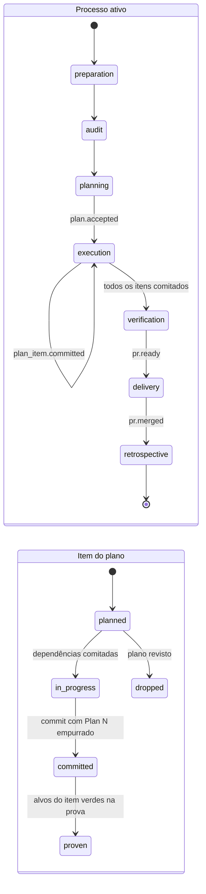

# 17. O ciclo do processo: etapas, plano de commits e eventos, do primeiro push ao merge

> **Referência e histórico.** A fonte da verdade da fase 1 é a [arquitetura-alvo](ARQUITETURA-ALVO.md), e o plano
> para implementá-la está no [plano de implementação](PLANO-DE-IMPLEMENTACAO.md); onde este documento divergir dela,
> vale ela.

> **Na fronteira de 12:19** ([22 §3](22-tres-camadas.md#3-o-inventário-peça-por-peça)): gestão. As oito etapas, o
> plano de commits, a sequência de eventos de §4 e a retrospectiva são o nosso método. Na infraestrutura, um processo
> é um ou mais trabalhos (o de código, as checagens, o pouso), e as etapas são o que o executor relata, bruto, no
> registro.

Daniel, 04/11/2026 01:56 BRT: "Temos o mapeamento dos eventos dentro de uma PR?" E às 01:57: "dentro de uma unidade de
trabalho hoje, a gente realiza várias etapas, né? Realiza etapa de auditoria, realiza etapa de planejamento, realiza
etapa de execução pra cada um dos pontos do planejamento, na execução, é, organizado o caminho crítico pra realização
de cada um dos commits, etc. Hoje a gente não tem essa boa e toda habilidade. A gente mapeou isso?"

## 1. A resposta curta

**Ainda não.** O [16](16-modelo-de-dominio.md) tem o processo, a tentativa, a PR e o catálogo de eventos por agregado,
mas não as etapas de dentro do processo nem o plano de commits como dado. O [METODO](../padrao/METODO.md) §3 já
prescreve a forma ("as operações como um grafo, com o caminho crítico, a preparação que remove a restrição e quem faz o
quê"), e o motor guarda o plano só como uma lista marcada no corpo da PR, sem dependência entre itens, sem caminho
crítico e sem registro das etapas (seção 6). Este documento mapeia o que faltava e corrige o 16 onde precisa.

**Uma escolha que orienta tudo:** um processo é uma PR, e as etapas dele não são PRs. O METODO diz que "uma PR é um
conjunto de operações" e que intake, pesquisa e análise de causa raiz "nunca são exigidos de toda unidade de trabalho
nem de toda PR"; essas etapas longas pertencem ao projeto (PDCA), não ao processo. Dentro do processo, cada etapa é um
evento com o produto dela guardado; cada item do plano é um commit.

## 2. As etapas de um processo

| # | Etapa (METODO §3) | Entrada | Produto | Critério de fim | Quem executa | Forma |
|---|---|---|---|---|---|---|
| 1 | Admissão | a especificação do processo (o contrato de [12 §2](12-unidade-e-sessoes.md#2-o-contrato-da-unidade-de-trabalho)) | o processo `ready` | escopo, aceite, orçamento e capacidades presentes | o workflow do processo | evento `process.ready` |
| 2 | Preparação | a base (sha), o toolchain | checkout limpo na base, ambiente conferido, estado da base conhecido | `env-check` verde; base verde, ou vermelha e classificada | a sessão (a tentativa) | evento `process.stage_completed` (`preparation`) |
| 3 | Auditoria do processo | a especificação e o código real | a nota de auditoria: arquivos, dependências, ciclos, compartilhados, literais, dono, com arquivo e linha | nota gravada; não é pesquisa nem cadeia de porquês | a sessão | evento (`audit`) com a nota como artefato |
| 4 | Planejamento do processo | a auditoria | **o plano como dado** (seção 3): itens, dependências, estimativas e o caminho crítico | o grafo é acíclico, cada item tem escopo e teste, 1 a 8 itens, caminho crítico calculado | a sessão; a admissão do plano confere | eventos `plan.proposed` e `plan.accepted` |
| 5 | Execução, item a item | o plano aceito | um commit por item, com o trailer `Plan: N`, empurrado sozinho | os testes do item verdes no commit dele | a sessão, na ordem do caminho crítico | commit e eventos `pr.pushed`, `plan_item.committed` |
| 6 | Verificação | o head | o tier 1 da sessão e a prova do runner no head exato | todos os itens comitados, tier 1 e prova verdes | a sessão e o runner, em paralelo | eventos `gate.passed` e `pr.ready` |
| 7 | Entrega | a PR pronta | o merge na base, com prova de árvore | `pr.merged` | a fila ([11 §5](11-gate-merge-fila-origin.md#5-o-caminho-de-baixa-vazão-da-pr-pronta-à-mergeada-em-até-1-s)) | eventos `pr.queued`, `pr.merged` |
| 8 | Retrospectiva | os eventos do processo e a nota da sessão | o que aconteceu, o que se aprendeu, o que muda no padrão | gravada; uma mudança de padrão vira processo novo | a sessão, com o rascunho montado dos eventos pelo workflow | evento `process.retrospected` e, se houver, `lesson.proposed` |

As etapas 2, 3, 4 e 8 não produzem commit: o produto delas é um artefato guardado (a nota, o plano) e um evento. A
única etapa que produz commits é a 5, um por item. Uma etapa é um registro de 1 a 4 ao longo da vida do processo, não
uma entidade com dono próprio: quem a escreve é a tentativa que a executou.

## 3. O plano de commits como dado

| Campo do item | O que guarda |
|---|---|
| `n` | a posição no plano; o plano tem quantos itens o conteúdo pedir (Daniel, 04/11 12:37) |
| `title` | o que o commit entrega, em uma frase |
| `scope` | os caminhos e as unidades de código que o item toca |
| `tests` | os testes que provam o item (os alvos da prova por alvo de [11 §5](11-gate-merge-fila-origin.md#5-o-caminho-de-baixa-vazão-da-pr-pronta-à-mergeada-em-até-1-s)) |
| `depends_on` | os itens que precisam estar comitados antes deste |
| `estimate` | minutos de execução estimados |
| `status` | `planned`, `in_progress`, `committed`, `proven`, `dropped` |
| `commit_sha` | o commit que o entregou, ligado pelo trailer `Plan: N` |

**O grafo e o caminho crítico.** As dependências formam um grafo acíclico; o caminho crítico é o caminho mais longo pelas
estimativas, e a folga de cada item é quanto ele pode atrasar sem atrasar o processo. A sessão executa na ordem
topológica e, entre os itens prontos, primeiro o do caminho crítico. Um plano com ciclo ou com item sem teste é recusado na admissão do plano, antes do primeiro commit. O número de itens
não tem teto: "Não podemos limitar nossos PRs por causa de burocracia de planejamento" (Daniel, 04/11 12:37). A PR se
divide pelo conteúdo, uma unidade coerente e revisável, nunca por um contador.

**Uma tentativa por processo, não por item.** Um branch tem um escritor só (K1), então os itens de uma PR são
executados em sequência por uma tentativa. O ganho do grafo dentro da PR é a ordem certa e a retomada exata: uma
tentativa nova começa no primeiro item ainda não comitado, porque o plano e os trailers dizem o que já foi entregue.
**O paralelismo vem entre processos.** Um subgrafo independente e grande vira um processo próprio, numa PR própria, e
roda em paralelo noutra sessão; um item que depende de outro processo vira uma PR empilhada, como as pilhas de PRs
dependentes. É o planejador que decide, pelo tamanho do subgrafo e pela folga.

**O plano tem versão.** Mudar o plano depois de aceito (um item novo, uma dependência descoberta) é uma revisão
(`plan.revised`, `generation` + 1), não uma edição silenciosa do corpo da PR; os itens já comitados ficam.

## 4. As máquinas de estado e os eventos

O processo ganha a etapa como subestado de `active`; a tentativa e a PR são as de [16 §5.4](16-modelo-de-dominio.md#54-ciclos-de-vida);
o item do plano tem ciclo próprio:



**Do primeiro push ao merge**, cada evento com quem o emite e o que o causou (`causation_id`). Todos levam o mesmo
`correlation_id`, a chave do processo (`F<n>`), para que a história inteira de uma PR seja uma consulta:

| # | Evento | Emissor | Causado por |
|---|---|---|---|
| 1 | `process.ready` | o workflow do processo | a especificação aceita |
| 2 | `attempt.launched` | o workflow do processo | 1 |
| 3 | `session.started` | o corretor de sessões | 2 |
| 4 | `process.stage_completed` (preparação, depois auditoria) | a tentativa | 3, depois o anterior |
| 5 | `plan.proposed` e `plan.accepted` | a tentativa; a admissão do plano | a auditoria; a proposta |
| 6 | `pr.opened` | o ingresso (webhook do forge) | o primeiro push |
| 7 | `pr.pushed` | o ingresso | o push de cada item |
| 8 | `plan_item.committed` | o workflow do processo | 7 (o trailer `Plan: N` do commit) |
| 9 | `gate.started` e `gate.passed` (prova do head, por alvo) | o runner quente | 7 |
| 10 | `gate.passed` (tier 1 da sessão no head exato) | a sessão | 7 |
| 11 | `pr.ready` | o workflow do processo | o último entre 8 e 10 |
| 12 | `pr.queued` | a fila | 11 |
| 13 | `train.batch.started` e `train.batch.green` (lote de uma, certificado conferido) | a fila | 12; 9 |
| 14 | `pr.merged` (sha do merge, prova de árvore) | a fila | 13 |
| 15 | `integration.advanced` | a fila | 14 |
| 16 | `attempt.succeeded`, `session.ended` | o workflow; o corretor | 11; 16 |
| 17 | `process.done` e `process.retrospected` | o workflow do processo | 14; a nota de retrospectiva |

No regime de 1 PR/min, de 11 a 14 passa ~1 s; de 7 (o último push) a 11 passa o maior entre a prova do runner e o
tier 1 da sessão, que rodam em paralelo.

## 5. O que muda no modelo do 16

1. **O plano sai da PR e vai para o processo.** O 16 punha os itens do plano no contexto de integração, como filhos da
   PR; eles são do processo (contexto de trabalho), porque existem antes da PR e sobrevivem a uma tentativa nova. A PR
   só mostra o plano renderizado no corpo, como hoje.
2. **O processo ganha o subestado `stage`** dentro de `active` (preparação, auditoria, planejamento, execução,
   verificação, entrega, retrospectiva) e o registro de cada etapa concluída, com o artefato.
3. **O `causation_id` passa a ser obrigatório** em todo evento interno; só o evento de fora (o webhook do forge, o do
   fornecedor) pode não ter causa no motor.
4. **Eventos novos no catálogo** de [16 §7.2](16-modelo-de-dominio.md#72-eventos): `process.stage_completed`,
   `process.retrospected`, `plan.proposed`, `plan.accepted`, `plan.revised`, `plan_item.started`,
   `plan_item.committed`, `plan_item.proven`, `plan_item.dropped`.
5. **Tabelas novas**, no esquema `work`, que rodaram no PostgreSQL 18.6 do toolchain com o núcleo do 16 [M]. Pela
   fronteira de 12:19, o plano, os itens e as etapas são da gestão, nas tabelas dela, e a infraestrutura guarda só o
   relato bruto do executor ([22 §5](22-tres-camadas.md#5-as-tabelas-da-infraestrutura)):

```sql
create table work.plan (                                        -- o plano de um processo, com versão
  process_id uuid not null references work.process, generation int not null,
  status text not null check (status in ('proposed','accepted','revised')),
  critical_path int[] not null default '{}',                    -- os n do caminho crítico, em ordem
  primary key (process_id, generation));
create table work.plan_item (
  process_id uuid not null references work.process, n int not null check (n >= 1),
  title text not null, scope jsonb not null, tests jsonb not null, estimate_min int,
  status text not null default 'planned'
    check (status in ('planned','in_progress','committed','proven','dropped')),
  commit_sha text, started_at timestamptz, committed_at timestamptz,   -- a duração de cada item (21 §1)
  primary key (process_id, n));
create table work.plan_dependency (                             -- as arestas do grafo
  process_id uuid not null, n int not null, depends_on int not null,
  primary key (process_id, n, depends_on), check (n <> depends_on),
  foreign key (process_id, n) references work.plan_item,
  foreign key (process_id, depends_on) references work.plan_item);
create table work.stage (                                       -- as etapas concluídas
  process_id uuid not null references work.process, attempt_id uuid references work.attempt,
  stage text not null check (stage in ('preparation','audit','planning','execution','verification','delivery','retrospective')),
  artifact_uri text, started_at timestamptz not null, completed_at timestamptz not null default now(),
  primary key (process_id, stage, completed_at));
```

O banco garante a forma (itens numerados a partir de 1, aresta entre itens que existem, nenhum item dependendo de si); a ausência de
ciclo maior e o caminho crítico são conferidos pela admissão do plano, numa ordenação topológica.

## 6. O que falha hoje e o que o estado da arte ensina

### 6.1 O que falha hoje

Levantado no repositório em 04/11/2026, na base `058607f99`.

| # | Falha | Evidência | O que causou ou causa |
|---|---|---|---|
| 1 | **As etapas não são registradas.** Não existe tipo de evento para auditoria, plano, execução ou retrospectiva; os arquivos de etapa que o padrão v8 pedia aparecem em 1 das 265 merges desde 03/11 | `docs/padrao/v8/intake-and-research.md:3,9`; `docs/padrao/v8/audit-and-plan.md:6`; o histórico da base | o plano e a retrospectiva que o METODO pede não ficam em lugar nenhum |
| 2 | **O plano não é grafo**: uma lista numerada sem dependência, dono, arquivos, paralelismo nem caminho crítico; o único caminho crítico do motor é o dos estágios do gate | `scripts/lib/plan_tick.py:20-30`; `scripts/lib/gate_status.py:148-151`; `docs/padrao/METODO.md:61` | o caminho crítico dos commits não existe como dado |
| 3 | **O plano é escrito depois do fato**: o `scripts/pr-body` monta a lista a partir dos trailers dos commits que já existem, com toda caixa marcada, e a checagem de estrutura sugere editar o corpo para casar com os commits | `scripts/lib/pr_body.py:31-38`; `scripts/lib/structure.py:423-424` | o plano descreve o que foi feito, em vez de guiar o que fazer |
| 4 | **O plano não é imposto**: o regime de exceção, ligado por padrão, transforma as recusas do commit-check e da checagem de estrutura em avisos | `scripts/lib/commit_check.py:185-206`; `scripts/lib/structure.py:790-797,835` | as regras do plano viram sugestão |
| 5 | **O paralelismo dentro da PR quebra**: o v8 manda executar os commits do grafo em paralelo por subagentes, e subagentes paralelos numa cópia de trabalho só tiveram recusado o push de um commit limpo | `docs/padrao/v8/audit-and-plan.md:9-11`; I-00f78cc7 | confirma a escolha da seção 3: uma tentativa por processo, paralelismo entre processos |
| 6 | **Dois escritores no mesmo branch**: o `deliver` mescla a base no branch da PR e empurra com `--no-verify` de outra cópia, enquanto a sessão também empurra | `scripts/lib/deliver.py:127-130,329-357`; I-cfe21b97, I-dc6e9e49, I-f76ac711, I-bb39f9df, I-a8693b10 | K1, a maior classe de recusas de push |
| 7 | **Nenhum evento diz o que o causou**, e a correlação é por execução de ferramenta (`gate:<modo>:<execução>`, o nome do branch, o id do webhook), nunca por PR; as rodadas de gate repetidas não se ligam | `contracts/events/envelope.v1.json`; `scripts/lib/forge_events.py:396-399`; `scripts/lib/gate_publish.py:35-38` | a história de uma PR não é uma consulta, é uma reconstrução |
| 8 | **Eventos que faltam no caminho único**: fora do trem, o motor não emite `pr.opened`, `pr.pushed`, `pr.merged`, `integration.advanced` nem `pr.conflicted`; os `session.*` não têm emissor | `services/control-plane/src/core.js:492-501`; `scripts/lib/program.py:142-149` | os estágios "aberta" e "mergeada" do coordenador não disparam por esse caminho |
| 9 | **Documento e código divergem sobre o mesmo plano**: 1 a 8 itens no código e "3–8" no AGENTS.md; `pr.ready` "precisa de `pr.checked`" no documento, e o código não lê `pr.checked`; a PR rascunho é o primeiro ato no METODO e só nasce na entrega na lane | `AGENTS.md:42`; `scripts/lib/commit_check.py:40-54`; `docs/process/EVENTS.md:39`; `docs/padrao/METODO.md:93`; `docs/process/lane.md:35` | lanes pararam para perguntar se um plano de 2 itens bastava (I-10901f05) |
| 10 | **A sessão é o motor do fluxo**: o progresso fica na máquina da sessão (`~/.cache/the-tower`) e nada retoma uma lane parada | `docs/process/lane.md:47`; I-0d1c3a25 (33 min parado depois de um merge) | K4 |

**Uma correção à leitura da Torre.** O padrão v8 não separa intake, pesquisa, auditoria, plano e execução em PRs e
sessões distintas: põe cada etapa como arquivo, com commit próprio, na mesma PR, coordenada por uma sessão com um
subagente por etapa (`docs/padrao/v8/agent-tree.md:3`, `docs/padrao/v8/no-probe-prs.md:3`). O ciclo da seção 2 mantém a
mesma PR e muda o registro: a etapa vira evento com artefato, não arquivo commitado, porque arquivo de estado mergeado
é a forma da classe K3 e a regra foi seguida em 1 de 265 merges.

### 6.2 O que o estado da arte ensina

| Lição | De onde | Como entra no ciclo |
|---|---|---|
| O workflow pai inicia filhos com id idempotente e espera o resultado; um passo concluído nunca roda de novo; a fila limita a concorrência e deduplica | DBOS [W21, W22]; Temporal [W3] | o workflow do processo é o pai e a tentativa é filha; cada item do plano é um passo, e um item comitado não é refeito numa tentativa nova |
| O grafo declara as dependências; o padrão espera todos os pais com sucesso, e uma falha para o que depende dela, não o resto | Argo [W23]; Airflow [W24]; GitHub Actions [W26]; Buildkite [W27] | `depends_on` com a regra "todos os pais comitados"; um item vermelho bloqueia só os descendentes |
| O caminho crítico é a cadeia mais longa, fixa a duração mínima e tem folga zero; o Bazel mede o caminho crítico realizado e quanto se ganharia tirando cada nó | Kelley e Walker [W28]; PERT [W29]; Bazel [W25] | o plano calcula o caminho crítico antes; o motor mede o realizado depois, por processo, para mostrar onde cortar |
| Numa pilha, o dependente só entra depois dos ancestrais; o custo é refazer a base e resolver conflito em cada PR, e reescrever a pilha publicada pede force-push | Gerrit [W30]; Phabricator [W31]; ghstack [W32]; Sapling [W33]; git-branchless [W34]; Graphite [W35] | um item que depende de outro processo vira PR empilhada, mergeada de baixo para cima por merge commit, sem rebase nem force-push, como a #264 sobre a #263 |
| Uma mudança autocontida, com os testes e o build verde depois dela; declarar "depende do patch X" | Google [W36]; Linux [W37]; Git [W38] | é a regra do item que o motor já tem; o `depends_on` é a declaração explícita |
| O agente planeja com uma lista de tarefas com estado e dependências, uma em andamento por vez, nunca concluída com teste vermelho e persistida; replaneja o resto; um DAG deixa paralelizar | Claude Code [W39]; OpenHands [W40]; LangGraph [W41]; LLMCompiler [W42] | o plano deixa de ser a lista em memória da sessão e vira o plano do processo no banco; `plan.revised` é o replanejamento |

### 6.3 Onde entra na migração

O plano como dado entra com o contrato da unidade (passo 0.4 de [14 §4](14-custos-e-migracao.md#4-o-plano-de-migração))
e com o modelo de domínio v1 (passo 2.5): itens, dependências, estimativas e etapas nos contratos, e a admissão do plano
antes do primeiro commit. O workflow do processo executa os itens no passo 6. Até lá, no motor de hoje, um passo sem
custo resolve as falhas 3 e 9: o `scripts/pr-body` passa a escrever o plano antes dos commits, com as dependências
numa linha "depende de" por item, e o tamanho do plano fica um só nos documentos e no código.
