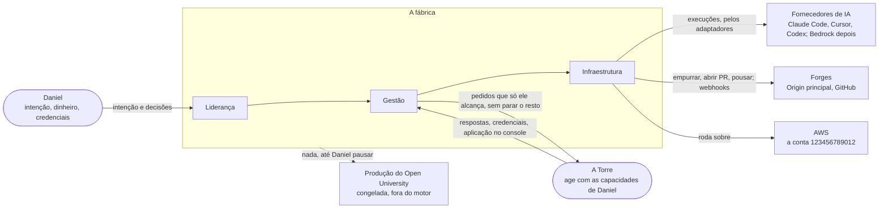
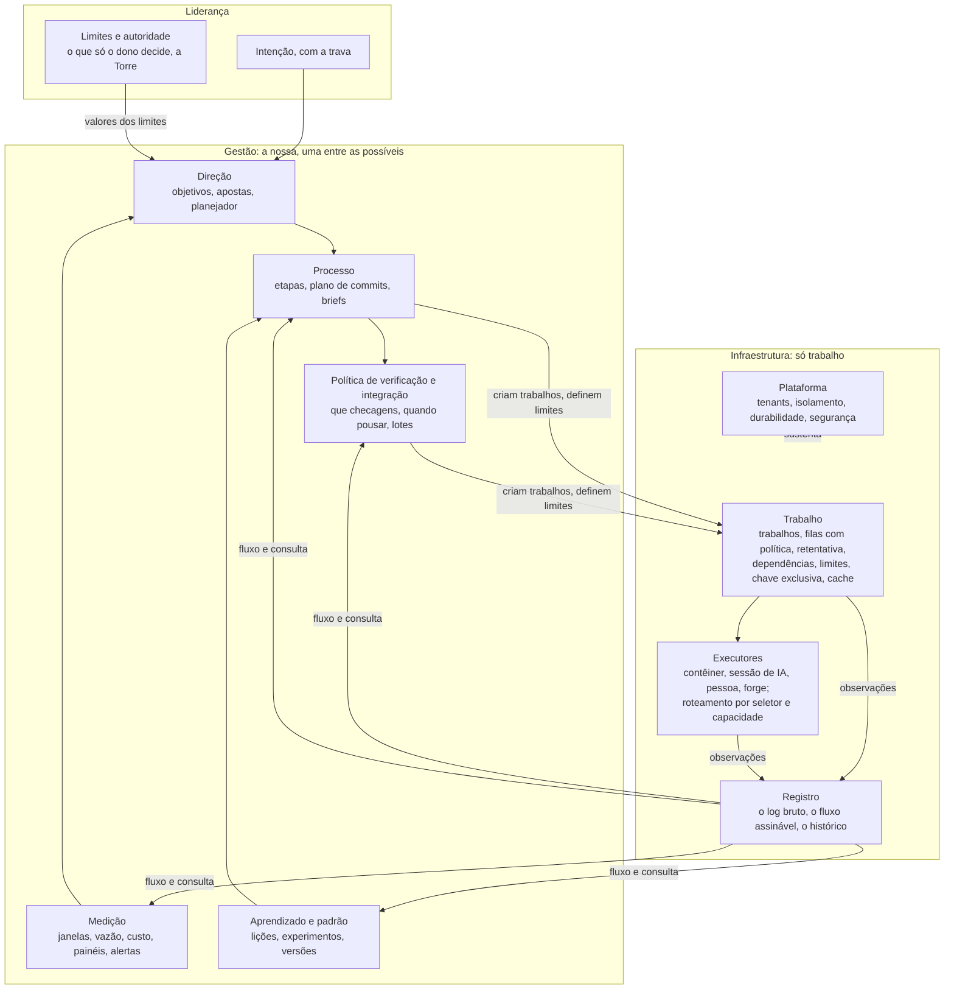

# 18. A planta geral do motor: sistema, subsistemas, conexões e contratos

> **Referência e histórico.** A fonte da verdade da fase 1 é a [arquitetura-alvo](ARQUITETURA-ALVO.md), e o plano
> para implementá-la está no [plano de implementação](PLANO-DE-IMPLEMENTACAO.md); onde este documento divergir dela,
> vale ela.

> **Camada:** a planta dos três sistemas, liderança, gestão e infraestrutura, pela fronteira que Daniel aprovou em 04/11
> 12:19 ([22 §1](22-tres-camadas.md#1-a-fronteira-decisão-de-daniel-1219)). As seções 1 e 2 valem para os três; de 3 a 7, a
> planta está na forma da fronteira.

Daniel, 04/11/2026 10:46 BRT: "hoje a gente não tem a planta dos nossos sistemas. A gente não consegue olhar pro nosso
sistema e falar, ok, esse é o sistema, esses são os subsistemas, assim que se conectam." E às 10:44: partir da intenção,
não do que existe, porque "isso nunca foi revisado" e "tem tudo para dar errado quando for escalar". Este documento é o
primeiro passo do passo zero: como os melhores desenham e documentam sistemas, e a planta do motor desenhada a partir
da intenção de origem. Os documentos 19 (direção), 20 (aprendizado) e 21 (revisão geral) detalham as partes, e o 22 traça
a fronteira entre a infraestrutura e a gestão.

## 1. A intenção como ponto de partida

**A intenção de origem** (Daniel, 04/11): "fornecer uma estrutura que possibilite janelas mais longas de autonomia dos
agentes". A [SEMENTE](../SEMENTE.md) §3 diz o mesmo de outro jeito: o sistema é "cem por cento autônomo", "depende o
mínimo possível" de Daniel, prefere "continuidade a rajadas" e trata "toda parada do fluxo" como incidente. Mas mede
só PRs por segundo. A vazão é consequência; o que a intenção pede de forma direta é **que as paradas fiquem raras e
curtas**.

**Uma janela de autonomia** é o tempo entre duas paradas que exigem alguém de fora (Daniel ou a Torre): uma pergunta,
uma credencial, um conserto à mão, uma sessão que ninguém retoma. Toda parada tem uma causa, e as causas formam classes.
Daí a regra que organiza a planta:

> **Cada subsistema existe para que uma classe de parada não aconteça.** A saúde dele é a taxa dessa classe, e a planta
> inteira se mede pelo tamanho das janelas.

| Classe de parada | Exemplo real | Quem a evita, na fronteira de 12:19 |
|---|---|---|
| não há próximo trabalho, ou ele está mal especificado | lanes paradas perguntando se um plano de 2 itens bastava (I-10901f05) | a gestão: a direção |
| a sessão morre, encerra o turno ou bate a cota, e ninguém retoma | 33 min parado depois de um merge (I-0d1c3a25); a cota voltou e nada retomou (I-2012f37d) | a infraestrutura: a durabilidade e o novo despacho; a gestão, para o que decide refazer |
| o fornecedor não tem a capacidade pedida | o Codex sem root (I-986a5daf) | a infraestrutura: a capacidade de cada executor; a gestão: qual executor pedir |
| alguém precisa conferir se está certo | a prova no relato da sessão, não no head exato | a gestão: que checagens provam um head, sobre o cache de resultado da infraestrutura |
| dois escritores, conflito, merge serial | 8 das 19 recusas de push (K1) | a infraestrutura: a chave exclusiva por ramo e o pouso com compare-and-swap; a gestão: o lote |
| o mesmo erro de novo | a mesma recusa três vezes em um minuto (I-cfe21b97) | a gestão: o aprendizado |
| instrução velha ou contraditória | 1 a 8 itens no código e "3–8" no AGENTS.md | a gestão: o padrão |
| ninguém sabe o que está acontecendo | o estado recalculado a cada leitura em arquivos e git-ref | a infraestrutura dá o registro bruto e o acesso; a gestão mede |
| uma decisão que o sistema esperou de alguém | pedidos de decisão a Daniel (I-ddaca17c) | a liderança: os limites e a autoridade |
| o ambiente quebrou | credencial do forge nas sessões (I-113901d1); o remote que volta ao GitHub | a infraestrutura: a plataforma |

**Por que a estrutura, e não o modelo, é o gargalo.** O horizonte de 50 % do METR (a duração das tarefas que um agente
termina sozinho metade das vezes) dobrou a cada ~7 meses de 2019 a 2025, mais rápido desde 2024, e a fronteira chegou a
~12 h em maio de 2026 [L1, L2, L3, L4]. Uma estrutura que para o agente a cada pergunta, merge ou fim de cota desperdiça
esse horizonte. As paradas legítimas são uma lista fechada, como a condição de parada explícita de um agente bem
construído [L5]; todas as outras são defeito de alguma parte de um dos três sistemas.

## 2. Como os melhores desenham e documentam sistemas

| Prática | De onde | O que a planta adota |
|---|---|---|
| Quatro níveis (contexto, contêineres, componentes, código), usando só os que ajudam; o contêiner é a fronteira de execução e a unidade implantável; cada fila é um contêiner; diagramas de apoio de implantação, um por ambiente; o diagrama como código | C4 e Structurizr [B1, B2, B3] | o contexto (seção 3) e os contêineres (seção 6); os subsistemas como visão lógica; a implantação está em [10 §2](10-arquitetura-10-0.md#2-onde-cada-componente-roda); os diagramas passam a ser gerados do catálogo (seção 7) |
| Doze seções fixas, com a visão de blocos obrigatória; cada bloco como caixa-preta: propósito, interfaces com as qualidades e o desempenho, riscos | arc42 [B4, B5] | a tabela de contratos da seção 5 é a caixa-preta de cada subsistema; os documentos desta pasta cobrem as seções do arc42 (contexto: 18; blocos: 18; execução: 17; implantação: 10; conceitos: 16; decisões: os D-NNN; qualidade: 11 e 19; riscos: 15; glossário: 16) |
| A descrição de arquitetura parte dos interessados e das preocupações deles; pontos de vista, vistas e regras de correspondência entre elas | ISO/IEC/IEEE 42010 [B6, B7] | os interessados são Daniel, a Torre e os agentes, e a preocupação central é a janela de autonomia; a regra de correspondência é o teste do catálogo |
| Quatro vistas (lógica, de processo, de desenvolvimento, física) e os cenários como a quinta, que descobre e valida | Kruchten, 4+1 [B8] | a lógica são os subsistemas; o processo é [17](17-ciclo-do-processo.md); o desenvolvimento são as unidades de código; a física é [10](10-arquitetura-10-0.md); os cenários são as classes de parada da seção 1, cada uma uma situação que a planta tem de aguentar |
| O mapa de contextos, com os padrões de relação (camada anticorrupção, linguagem publicada, serviço aberto, cliente e fornecedor), e a ficha de cada contexto: propósito, classificação (núcleo, apoio, genérico), comunicação de entrada e de saída, linguagem, decisões, premissas e métricas | DDD Crew [B9, B10] | cada subsistema é um contexto delimitado com a sua ficha condensada na seção 5; núcleo: direção, trabalho e aprendizado; apoio: os outros; genérico: a plataforma |
| Um catálogo de domínios, sistemas, componentes, APIs e recursos, com dono único e relações aos pares (fornece e consome, depende de, parte de) | Backstage [B11, B12] | o catálogo da seção 7 |
| Decisões como registros curtos: contexto, decisão, consequências, estado (proposta, aceita, obsoleta, substituída); numeração crescente e nunca reutilizada; a confirmação de que a decisão vale | Nygard, MADR [B13, B14] | as decisões D-NNN, com o número alocado pelo banco ([16 §5.2](16-modelo-de-dominio.md#52-identidade)) e o teste que prova cada uma como confirmação |

## 3. A planta: o contexto

O nível 1 do C4: o sistema, as pessoas e os sistemas de fora com que ele fala.

## 4. Os três sistemas e as conexões

Três sistemas, cada um só com o que é dele. A **liderança** diz o que se quer; a **gestão** transforma isso em trabalho
definido; a **infraestrutura** executa e registra, em quatro partes: o trabalho, os executores, o registro e a plataforma.
A gestão desenhada aqui é a nossa (os documentos 17, 19 e 20); outra gestão, com ou sem meta, com chefe ou com
trabalhadores autônomos, troca o bloco do meio inteiro sem mudar o de baixo. A infraestrutura é adaptável a parâmetros, e
nunca tira um (Daniel, 12:40): cada mecanismo tem os seus, e quem a usa escolhe os valores.

**Como eles se ligam.** A gestão chega à infraestrutura só pela porta de [22 §4](22-tres-camadas.md#4-o-contrato-entre-a-infraestrutura-e-a-gestão):
criar e cancelar trabalho, definir limites e executores, assinar e consultar o registro. A infraestrutura não chama nada
acima dela: publica o registro, e quem quiser o lê. Os eventos da gestão ficam no registro da gestão. Os fornecedores e os
forges entram por adaptadores, que traduzem o modelo deles e não o deixam vazar para dentro (a camada anticorrupção do
DDD). Nenhuma parte lê a tabela de outra; a infraestrutura não lê nenhuma tabela da gestão.

## 5. O contrato de cada parte

| Sistema | Parte | Existe para | Escritor único | Comandos que aceita | Eventos |
|---|---|---|---|---|---|
| Infraestrutura | **Trabalho** | o trabalho não se perder nem rodar duas vezes onde não pode, na ordem e com a retentativa que quem o cria escolher | o workflow de cada trabalho | criar, cancelar, retomar; configurar fila; definir limite e preço | `job.*`, `limit.*`, `cache.*` |
| Infraestrutura | **Executores** | qualquer tipo de executor rodar trabalho pela mesma porta | o corretor de execução | registrar executor | `run.*`, `executor.*`, `capacity.*` |
| Infraestrutura | **Registro** | tudo o que se observa ficar acessível, sem ninguém escolher o que importa | só anexo, por quem observa | assinar, consultar | — |
| Infraestrutura | **Plataforma** | o ambiente não quebrar e cada tenant ficar isolado | o deployer | registrar tenant; deploy só por PR mergeada e pela campainha | `platform.*`, `forge.*` (o ingresso) |
| Gestão | **Direção** ([19](19-direcao-ideal.md)) | haver sempre próximo trabalho, valioso e bem especificado | o planejador | definir objetivo, abrir aposta, criar processo | os da gestão, no registro dela |
| Gestão | **Processo** ([17](17-ciclo-do-processo.md)) | cada processo seguir o método | o workflow do processo | iniciar processo, revisar plano | idem |
| Gestão | **Política de verificação e integração** ([11](11-gate-merge-fila-origin.md)) | ninguém conferir à mão e um escritor por ramo | a política | pedir checagens, pousar, ejetar | idem |
| Gestão | **Medição** ([21 §4](21-revisao-geral.md#4-a-medição)) | ninguém agir às cegas | só leitura do registro da infraestrutura e do dela | — | idem |
| Gestão | **Aprendizado e padrão** ([20](20-sistema-de-aprendizado.md), [19 §5](19-direcao-ideal.md#5-o-padrão)) | o mesmo erro não voltar e a instrução ser única | o workflow de aprendizado; a adoção | registrar lição, adotar versão | idem |
| Liderança | **Intenção e autoridade** ([19 §6](19-direcao-ideal.md#6-a-governança), a [SEMENTE](../SEMENTE.md)) | o porquê e os limites | Daniel; a Torre nas respostas | validar a intenção, decidir | as decisões |

O que cada parte mede de si é escolha da gestão, a partir do registro; a infraestrutura não escolhe a própria métrica de
saúde, só deixa tudo o que observa acessível.

## 6. Onde cada parte roda

O nível 2 do C4, na A1 de [10 §2](10-arquitetura-10-0.md#2-onde-cada-componente-roda):

| Contêiner | O que hospeda |
|---|---|
| ingresso (API Gateway, Lambda, SQS) | a porta da infraestrutura e os webhooks do forge e dos fornecedores |
| serviço de workflows (DBOS) | o workflow de cada trabalho; a gestão roda os dela num serviço dela, que pode usar o mesmo orquestrador |
| banco (RDS PostgreSQL) | os esquemas `work` e `log` da infraestrutura; os da gestão ficam em outro banco, ou em esquemas dela na mesma instância, que a infraestrutura nunca lê |
| executores | o contêiner (Fargate), as sessões de IA pelas assinaturas, a pessoa, o forge |
| armazém (S3) | as entradas e as saídas dos trabalhos e os relatos grandes |
| deployer (CodeBuild e a campainha) e o Parameter Store | a plataforma |
| git no Origin | o código, os contratos e, da gestão e da liderança, o padrão e as decisões |

## 7. A planta como código

Uma planta desenhada à mão envelhece. A planta do motor vira um catálogo versionado no repositório, no formato do
catálogo do Backstage: domínio (os três sistemas), sistema (cada parte), componente (cada workflow e serviço), API
(cada comando e cada tipo de evento), recurso (cada tabela, fila e balde). Cada item tem dono, e as relações são
explícitas: quem fornece e quem consome cada API, de que recurso depende. Um teste confere o que um desenho não confere
sozinho: todo evento consumido tem quem o produza; toda tabela tem um escritor só; nenhuma parte depende da tabela de
outra, e nada da infraestrutura depende da gestão. Os diagramas desta página passam a ser gerados do catálogo, e a planta fica conferível a cada PR.
