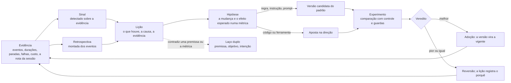

# 20. O sistema de aprendizado autônomo, no lugar da retrospectiva

> **Referência e histórico.** A fonte da verdade da fase 1 é a [arquitetura-alvo](ARQUITETURA-ALVO.md), e o plano
> para implementá-la está no [plano de implementação](PLANO-DE-IMPLEMENTACAO.md); onde este documento divergir dela,
> vale ela.

> **Na fronteira de 12:19** ([22 §3](22-tres-camadas.md#3-o-inventário-peça-por-peça)): gestão (fase 2): todo o ciclo,
> nas tabelas da gestão. Da infraestrutura ele lê o registro bruto e usa a execução em sombra, que é um trabalho que a
> gestão não pousa ([22 §4](22-tres-camadas.md#4-o-contrato-entre-a-infraestrutura-e-a-gestão)). Insumo da fase 2, sem
> implementação agora.

Daniel, 04/11/2026 10:46 BRT: "a gente tem uma etapa de retrospectiva que tá muito gambiarra [...] implementar, de
fato, um sistema de aprendizado [...] autônomo". O aprendizado é o subsistema que existe para **o mesmo erro não
voltar** ([18 §5](18-planta-geral.md#5-o-contrato-de-cada-parte)): ele transforma o que aconteceu em mudança do
padrão, e só adota a mudança que se mostrou melhor nos números. É o que faz as janelas de autonomia crescerem com o
tempo, em vez de dependerem de alguém lembrar.

## 1. O que existe hoje

A auditoria do passo zero (04/11, sobre o repositório e o log de eventos de 03/11 17:15 a 04/11 12:06 UTC, 522 eventos)
achou um ciclo aberto em todos os elos:

| Elo | O que existe | O que falta |
|---|---|---|
| Captura | `scripts/retro` guarda o log de cada sessão: "Receive and keep, nothing else: no summary, no analysis, no score" (`scripts/lib/retro.py`); nada o chama, e o armazenamento dele não existe | a retrospectiva montada dos eventos |
| Retrospectiva | 167 arquivos `retro.md` em 188 pastas de unidade, 80 com a seção 5 que o ingestor lê, ingeridos à mão; as unidades da fila do VAZÃO não têm pasta, e o documento da lane nunca pede retrospectiva; 4 das 7 retrospectivas de programa são esqueleto, e o VAZÃO não tem nenhuma | a retrospectiva por processo, sem custo, e as de aposta e objetivo |
| Lição | 16 lições em `docs/process/lessons/`, todas `proposed`, todas de 27/10, de três unidades; nenhuma aplicada, nenhuma aposentada, nenhuma candidata ao padrão; todo `effect` é nulo, e 8 não têm sinal para medir | o sinal que acha o problema sozinho, e a lição com evidência |
| Hipótese e experimento | nenhum; das 115 notas do diário, uma é lição e descreve as propostas ao padrão como "não aplicadas"; o log não tem evento `lesson.*` | o experimento com controle e guardas |
| Adoção | o brief de lançamento só leva lições aplicadas, e não há nenhuma; levar uma lição ao padrão está "not built here" (`config/registry/lessons.json`); o padrão v8 mudou pela última vez em 31/10, e o METODO o sobrepõe | a versão do padrão adotada por veredito |
| Efeito | `scripts/lib/lessons_effect.py` compara contagens antes e depois de uma lição aplicada, mas nenhuma foi, então nunca deu resultado; dos 14 blocos de medição de fase, 13 registram `passed: false` | o veredito medido |
| Paradas | 27 incidentes, um só do tipo `owner-stop`, 19 de push recusado; nenhum código lê o tipo; o atrito fica em cada máquina e não tem causa para parada do dono; o log não tem `plan.input`, o evento da entrada do dono | a intervenção como evento, que é o denominador da janela de autonomia |

Das 15 regras do padrão v8, 13 citam Daniel, e nenhuma veio de uma lição com efeito medido: o padrão muda quando alguém
escreve uma regra, não quando a evidência mostra que uma regra ajuda. É isso que o ciclo abaixo troca.

## 2. O que o estado da arte ensina

| Lição | De onde | Como entra no aprendizado |
|---|---|---|
| O horizonte dos agentes cresce depressa: o horizonte de 50 % dobrou a cada ~7 meses de 2019 a 2025, mais rápido desde 2024, e a fronteira chegou a ~12 h em maio de 2026, perto das 16 h acima das quais a medida deixa de ser confiável | METR [L1, L2, L3, L4] | a estrutura não pode ser o gargalo; o que os agentes aguentam sozinhos cresce, e o aprendizado precisa aposentar as peças que deixaram de ser necessárias |
| "Every component in a harness encodes an assumption about what the model can't do on its own" | Anthropic [L9] | cada regra do padrão registra a suposição que carrega, e o aprendizado a testa de novo quando os modelos mudam |
| Trabalho longo pede memória fora do contexto e passagem estruturada: um arquivo de progresso e uma lista de funcionalidades em JSON, uma por sessão, comitada; compactar não basta; ler a memória primeiro e atualizar por último, "assume interruption" | Anthropic [L6, L7, L8, L10] | o registro do processo (plano, etapas, itens; [17](17-ciclo-do-processo.md)) é o arquivo de progresso, e a passagem entre tentativas é o plano com os artefatos das etapas |
| A escrita fica numa linha só, e os agentes compartilham o rastro inteiro, não só mensagens | Cognition [L11, L12] | um escritor por branch e uma tentativa por processo; o aprendizado lê o rastro inteiro, não só resumos |
| Uma pessoa entra quando um limite de falhas é passado ou antes de uma ação de alto risco; a execução pausa e retoma do estado | OpenAI [L13, L14] | a lista fechada de paradas, a classe de reversibilidade de cada ação e a intervenção como evento |
| Agentes aprendem da experiência: reflexão escrita depois de falhar; regras com votos que sobem e descem e saem a zero; habilidades guardadas só depois que um crítico confirma o sucesso; rotinas induzidas dos sucessos; um arquivo de versões em que toda mudança é validada num benchmark | Reflexion, ExpeL, Voyager, AWM, Darwin Gödel Machine [L15, L16, L17, L18, L19] | lições viram regras com contagem de apoio; procedimentos viram parte do padrão só depois de um sucesso verificado; toda versão candidata passa por reexecução antes de ir ao vivo; o padrão guarda o arquivo de versões |
| Retrospectiva sem culpa, com gatilhos definidos antes; cada ação com um dono, uma prioridade e acompanhamento, porque ação sem acompanhamento é esquecida | Google SRE [L20, L21] | a retrospectiva dispara por evento e cada ação vira hipótese acompanhada até o veredito |
| Laço simples corrige a ação; laço duplo questiona o objetivo e as normas | Argyris [L22] | o laço duplo da seção 3 |
| Condição-alvo medida e com data; cada experimento compara o resultado previsto com o real; um obstáculo por vez | Toyota Kata [L23] | toda hipótese diz o efeito previsto, e o veredito o compara com o real; uma restrição por vez |
| Métricas de vazão e de instabilidade em tensão, nunca uma métrica como objetivo; partir da linha de base e atacar a restrição principal | DORA [L24, L25] | a métrica-norte com guardas |
| Guardas que não podem piorar, alarme nelas e parada automática do teste que faz mal; adotar só se nenhuma guarda piorar além de uma margem definida antes e ao menos uma métrica de sucesso melhorar | Microsoft ExP, Spotify [L26, L27] | a regra do veredito |

## 3. O ciclo, da evidência à mudança medida

| Entidade | Por que existe | Identidade | Estados | Quem cria | Quem consome |
|---|---|---|---|---|---|
| **Sinal** | achar o problema sem esperar alguém notar | `SIG-<n>` | `detected` → `explained` ou `dismissed` | o workflow de aprendizado, por visões sobre os eventos (uma causa de parada que se repete, uma etapa cuja duração cresceu, uma guarda fora, um atrito frequente) | a lição |
| **Retrospectiva** | registrar cada processo sem custo extra | o processo | `drafted` → `closed` | o workflow, dos eventos (duração por etapa, tentativas, falhas por classe, intervenções, custo), mais três linhas da sessão: o que surpreendeu e o que mudaria | a lição |
| **Lição** | explicar: o que houve, a classe da causa, a evidência | `LR-<hex>` | `recorded` → `hypothesized` ou `archived` | o workflow, de um sinal ou de uma retrospectiva | a hipótese |
| **Hipótese** | uma mudança com efeito esperado numa métrica nomeada, as guardas e o custo | `H-<n>` | `proposed` → `testing` → `confirmed` ou `refuted` | o workflow de aprendizado (uma sessão curta no papel de analista) | o experimento |
| **Experimento** | provar ou refutar a hipótese | `EXP-<n>` | `designed` → `running` → `stopped` | o workflow de aprendizado | o veredito |
| **Veredito** | decidir com número, não com opinião | o experimento | `adopted`, `rejected` ou `inconclusive` | a regra de parada do experimento | o padrão e a direção |

**Duas saídas para uma hipótese.** Se a mudança é de regra, de instrução ou de prompt, ela vira uma versão candidata do
padrão ([19 §5](19-direcao-ideal.md#5-o-padrão)), aplicada só a uma parte das tentativas; se é de código ou de
ferramenta, ela vira uma aposta na direção, com o mesmo efeito esperado. As duas terminam num veredito medido.

**Antes do vivo, a reexecução.** Toda versão candidata passa primeiro por um conjunto fixo de processos passados, com o
resultado conhecido, como o Darwin Gödel Machine valida cada mudança num benchmark [L19]; só a que não piora ali vai
para um experimento com tentativas reais. Com efeitos grandes, poucas dezenas de casos bastam para ver a diferença [L6].

**A regra do veredito, escrita antes.** A versão candidata é adotada se nenhuma guarda piorar além da margem definida no
desenho do experimento e a métrica de sucesso melhorar [L27]; se uma guarda piora durante o experimento, ele para
sozinho [L26]. As regras ganham contagem de apoio: cada caso que as confirma soma, cada caso que as contradiz subtrai, e
a regra que chega a zero sai [L16].

**O laço duplo.** Quando a evidência contradiz uma premissa, ou mostra que a métrica do objetivo não mede o que se
quer, o aprendizado propõe mudar a premissa ou o objetivo; quando o problema é a própria intenção, ele propõe a Daniel,
porque a intenção é travada.

## 4. A retrospectiva, refeita

1. **Por processo**, montada dos eventos e sem custo de tokens: quanto durou cada etapa de
   [17 §2](17-ciclo-do-processo.md#2-as-etapas-de-um-processo), quantas tentativas, que falhas e de que classe, que
   intervenções, quanto custou. A sessão acrescenta três linhas: o que surpreendeu, o que mudaria, o que faltou.
2. **Por aposta**, quando ela é avaliada: o efeito medido contra o esperado.
3. **Por objetivo**, quando ele é atingido ou abandonado.

Toda retrospectiva liga a evidência e produz zero ou mais lições com a classe da causa. Texto livre sem evidência não
conta como retrospectiva.

## 5. O que dá para provar a 1 PR/min e a 1 PR/s

Quantas PRs um experimento precisa para ver um efeito (bicaudal, α = 0,05, poder de 80 %) [I]:

| Efeito a detectar | PRs no total | A 1 PR/min | A 1 PR/s |
|---|---|---|---|
| uma taxa de 10 % para 9 % (por exemplo, vermelho na fila) | ~27 mil | ~19 dias | ~7,5 h |
| intervenções de 5 para 4 por 100 PRs | ~13 mil | ~9 dias | ~4 h |
| uma taxa de 10 % para 7 % | ~2,7 mil | ~2 dias | ~1 h |
| uma etapa 10 % mais curta (desvio igual à média) | ~3,1 mil | ~2 dias | ~1 h |
| uma etapa 25 % mais curta | ~500 | ~8 h | minutos |

**O que isso quer dizer.** A 1 PR/min, o teste A/B sobre taxas raras leva semanas; o aprendizado de agora prefere:
mudanças de efeito grande; medidas contínuas, como a duração das etapas, que pedem menos amostras; testes sequenciais,
que param cedo quando o efeito é claro; e **reexecução** de processos passados com a versão candidata, num conjunto
fixo de casos, que custa tokens e devolve o resultado em horas. A 1 PR/s, o A/B comum fecha em horas. A forma é a
mesma; muda o tamanho do efeito que se consegue ver por dia.

## 6. Tabelas e eventos

Um esquema `learning` com `signal`, `lesson`, `hypothesis`, `experiment` e `verdict`; um esquema `pattern` com
`version`, `rule` e `bundle` (o pacote de instruções de cada papel); e a coluna `pattern_version` em `work.attempt`,
porque sem ela não há como comparar versões. Os eventos: `signal.detected`, `lesson.recorded`,
`hypothesis.proposed`, `experiment.started`, `experiment.stopped`, `verdict.recorded`,
`pattern.version_adopted` e `pattern.version_reverted`.

## 7. Como se mede o próprio aprendizado

| Medida | O que diz |
|---|---|
| tempo de uma lição ao veredito | se o ciclo gira ou emperra |
| lições que viram hipóteses; hipóteses adotadas | se o aprendizado produz mudança ou só registro |
| efeito acumulado das versões adotadas na janela de autonomia | se o aprendizado cumpre a intenção de origem |
| custo do aprendizado (tokens das reexecuções e das sessões de análise) | se ele se paga |
| paradas repetidas da mesma classe depois de uma adoção | se o mesmo erro voltou |
