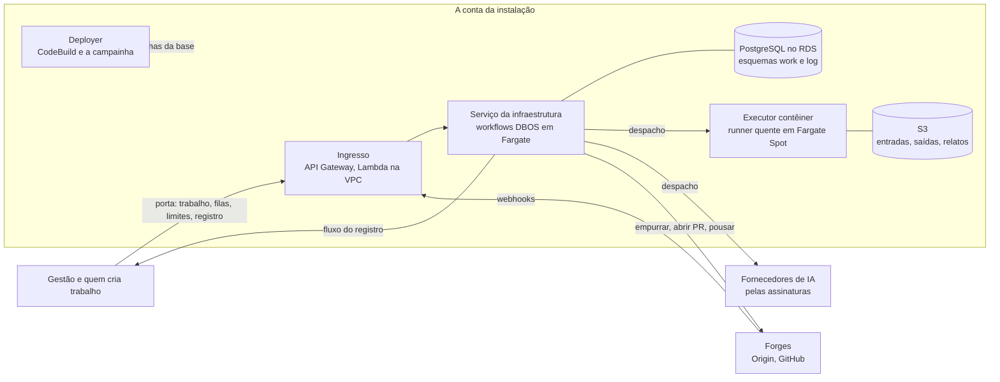

# A arquitetura-alvo da fase 1: a infraestrutura

**O que é este documento.** A fonte da verdade da fase 1, a infraestrutura da fábrica (Daniel, 04/11/2026 12:56: "essa é
a arquitetura alvo pretendida [...] um documento único [...] pra que disso [...] o próximo passo seja implementar"). Ele
consolida os documentos 09 a 22 sob a fronteira que Daniel aprovou às 12:19 e as correções de 12:37 e 12:40; onde
qualquer outro documento desta pasta divergir dele, vale ele. Os outros ficam como referência e histórico do caminho. O
plano para implementá-lo, em projetos, fases e PRs, está em [PLANO-DE-IMPLEMENTACAO](PLANO-DE-IMPLEMENTACAO.md).

**O alvo de agora é 1 PR/min**, a A1 de D-303; 1 PR/s é a mesma forma com números maiores, quando um gatilho medido pedir.

**O que está fora.** A gestão (fase 2) e a liderança (fase 3) rodam sobre esta infraestrutura e não estão aqui. Duas
decisões estão adiadas por Daniel (12:53): a métrica-norte e a gestão de hoje como primeiro programa; este documento não
as toma. A pessoa como executor fica dormente (13:18): a infraestrutura a aceita como extensão futura, sem implementá-la
agora (seção 6).

## 1. A fronteira

**Três sistemas, só três** (12:11). A **liderança** diz o que se quer. A **gestão** transforma o querer em trabalho
definido, do macro ao job. A **infraestrutura** executa e registra trabalho, sem saber por quê.

**A infraestrutura conhece só trabalho** (12:19):

1. o **trabalho**: um identificador, uma entrada opaca e o estado do ciclo;
2. o **executor**, plugado por adaptador: um script ou contêiner, uma IA por assinatura ou por API, um modelo próprio, uma
   pessoa, o forge; a sessão de IA é um tipo de executor, e rodar um script nunca abre uma;
3. a **saída**, como o executor a produziu;
4. o **registro** bruto de tudo o que ela observa;
5. o **acesso** completo a esse registro: um fluxo assinável e a consulta ao histórico;
6. as **propriedades físicas** de qualquer modelo: o isolamento entre tenants, a durabilidade, a segurança e o limite.

**Ela não conhece**, e cada gestão guarda o que for dela no sistema dela, referenciando o id do trabalho: meta, objetivo,
solicitante, projeto, programa no sentido de gestão, hierarquia, a razão de uma prioridade; quais informações importam
(tempo, custo e sucesso são dados do registro que a gestão escolhe ler); métricas, painéis, alertas, relatórios,
cobrança; que executor usar para que trabalho; quem pode criar trabalho (a gestão com chefe, a sem meta e o trabalhador
autônomo usam a mesma porta). Nenhum campo livre de contexto (12:15).

**Mecanismo e valor** (12:19 e 12:40). A infraestrutura oferece mecanismos com parâmetros; quem a usa escolhe os valores.
Ela é adaptável a parâmetros e nunca resolve a adaptabilidade tirando um: uma fila sem prioridade, ou uma falha sem
retentativa, seria ela escolhendo um comportamento. Todo padrão é um valor que se troca.

**Os três testes de cada peça.** (a) Existiria em qualquer modelo de gestão, com ou sem meta, com chefe ou autônomo, por
IA ou por pessoa? Então é infraestrutura. (b) Se ninguém ler, ela continua correta? Então é observação: ela registra e
expõe. (c) Expressa preferência sobre o que é bom ou importante? Então é gestão ou liderança.

**A regra de dependência.** A liderança fala com a gestão; a gestão fala com a infraestrutura só pela porta da seção 5;
a infraestrutura não chama ninguém acima dela, só publica o registro.

## 2. A forma: os componentes e onde rodam

A forma definitiva desde o primeiro dia, dimensionada para 1 PR/min e crescendo só em números até 1 PR/s (Daniel, 04/11
00:38, 01:06 e 01:08), na A1 que Daniel aprovou às 01:39 (D-303):

| Componente | Serviço | A 1 PR/min | A 1 PR/s (só números) |
|---|---|---|---|
| ingresso: a porta e os webhooks | API Gateway HTTP e uma Lambda na VPC que confere o token ou a assinatura e grava no banco numa transação; sem SQS na fase 1 (D-309) | ~0,1 requisição/s, na franquia grátis | ~5 requisições/s |
| serviço da infraestrutura: os workflows de cada trabalho | DBOS em contêiner, Fargate ARM | uma tarefa de 0,5 vCPU e 1 GB (0,25 vCPU até 13/11, quando o merge do pouso, o CLI do Origin começando na CPU da tarefa, deu p99 de 7,15 s; 0,5 GB até 13/11, quando a tarefa foi morta por falta de memória) | duas de 1 vCPU e 2 GB, em duas zonas |
| estado e registro | RDS PostgreSQL em sub-rede privada, backup contínuo; a fila do DBOS no mesmo banco | db.t4g.micro numa zona, 20 GB | db.t4g.medium Multi-AZ, 100 GB (a réplica entra a partir de 0,1 PR/s) |
| armazém | S3 | entradas, saídas e relatos grandes | o mesmo, com retenção |
| executor contêiner | Fargate Spot: um runner quente de 2 vCPU, e tarefas de rajada que escalam a zero | um quente; rajada quase nunca | um quente e rajada até ~50 vCPU |
| executor sessão de IA | os agentes de nuvem das assinaturas (Claude Code, Cursor, Codex); depois de um gatilho, um adaptador próprio com modelos no Bedrock | ~15 sessões simultâneas | ~900, ou ~90 se cada sessão gerar dez PRs |
| executor forge | o adaptador do Origin (principal) e o do GitHub, pela mesma porta | — | — |
| segredos e identidade | Parameter Store (SecureString), um papel IAM por componente, nenhuma chave de longa duração, acesso humano pelo IAM Identity Center | — | — |
| logs da própria plataforma | CloudWatch na franquia grátis | — | retenção maior |
| rede | VPC em duas zonas, sem NAT; tarefas em sub-rede pública com IP público e grupo de segurança sem entrada; banco em sub-rede privada; endpoint de S3 | 2 IPs públicos | 3, mais os da rajada |
| deploy | o bootstrap sem chave: o limite `tower-boundary`, o deployer em CodeBuild que só aplica pilhas `tower-app-*` da base, e a campainha | — | — |
| custo por mês | — | **~US$ 53** (o crédito de US$ 1.100 dura ~21 meses; o teto é US$ 60, D-303) | ~US$ 552–1.495, mais os agentes |

Sem NAT porque ele custaria ~US$ 32 por mês por zona; o banco começa na menor classe e muda de classe sem migração; o
runner quente custa ~US$ 22 por mês e é o que faz a verificação não pagar a partida de uma tarefa fria (7,0 s medidos,
§11 [M]).

## 3. O modelo de dados: os esquemas work e log

Treze tabelas em dois esquemas, mais o `dbos` do orquestrador. O DDL completo, com as funções e os gatilhos dos
mecanismos, está em [anexos/infra-v1.sql](anexos/infra-v1.sql), e o teste de aceite em
[anexos/infra-v1-aceite.sql](anexos/infra-v1-aceite.sql); os dois rodaram no PostgreSQL 18.6 do toolchain [M].

| Tabela | O que guarda |
|---|---|
| `work.tenant` | o isolamento: quem divide a infraestrutura sem se ver |
| `work.executor` | quem ou o que executa: o nome, o adaptador, se é da instalação ou de um tenant só, a configuração e as propriedades técnicas que um seletor pode pedir |
| `work.capacity` | a capacidade física de cada executor: vagas, a cota que zera, a agenda |
| `work.queue` | uma fila de um tenant e a política de ordenação dela, com os parâmetros |
| `work.job` | o trabalho: a entrada por referência e digest, a fila e os parâmetros de ordenação, o executor exato ou o seletor, a política de retentativa, as chaves de idempotência e de exclusão, o reaproveitamento de saída, o estado, a saída e o lease |
| `work.dependency` | um trabalho que espera outro terminar, ou terminar com sucesso |
| `work.run` | cada despacho do trabalho a um executor, com o desfecho e o erro como o adaptador o nomeou |
| `work.limits` | o limite: escopo (tenant, executor, trabalho), medidor, máximo, uso, e parar ou recusar |
| `work.meter_rate` | o preço de um medidor em outro (tokens em dólares, por exemplo) |
| `work.result_cache` | a saída de uma entrada idêntica, assinada pelo executor |
| `log.event` | tudo o que a infraestrutura observa, bruto e só anexado, partido por mês |
| `log.received` | o ingresso já visto, para não gravar duas vezes |
| `log.subscription` | o fluxo assinável: quem lê, que tipos, até onde já leu |

**Regras de todas as tabelas.** Um escritor por agregado; toda transição é uma escrita condicional pela versão da linha e
emite o evento na mesma transação; fechar é um estado, nunca apagar; o lease leva um contador (fencing token) que recusa a
execução velha que volta depois do prazo; uma fonte por fato. O identificador é um UUIDv7; chaves humanas, como `F135`,
são da gestão.

**O vocabulário.** Nenhuma tabela, coluna ou visão nomeia gestão ou liderança, um campo de contexto, uma medida escolhida
ou um tipo de executor. Uma trava na #265 (a D-306) recusa isso em todo SQL sob `infra/`, e este DDL passa nela sem nenhum
problema.

## 4. Os mecanismos

Cada mecanismo, com os parâmetros, o padrão (um valor) e quem escolhe o valor:

| Mecanismo | Parâmetros | Padrão | Quem escolhe |
|---|---|---|---|
| **ordenação** | a política da fila (`fifo`, `rank`, `deadline` ou outra que se plugue) e, no trabalho, `rank`, `not_before` e `deadline` | a ordem de chegada | quem configura a fila e quem cria o trabalho |
| **roteamento** | o executor exato, ou um seletor: uma lista em ordem (`any_of`), um adaptador, propriedades técnicas; a capacidade decide entre os aceitos | o executor exato | quem cria o trabalho |
| **retentativa** | número de tentativas, espera inicial, fator e espera máxima, os desfechos que pedem outra (`retry_on`) e os erros que nunca pedem | uma tentativa; 10 s, fator 2, máximo 10 min; `failed` e `timed_out` | quem cria o trabalho |
| **durabilidade** | o lease com prazo e contador | o executor que some é redespachado sem contar tentativa | a infraestrutura (é física) |
| **dependências** | os trabalhos esperados e a condição (`succeeded` ou `ended`) | nenhuma | quem cria o trabalho |
| **exclusão mútua** | a chave exclusiva: um trabalho por vez rodando ou esperando na mesma chave | nenhuma | quem cria o trabalho (o ramo de um pouso, por exemplo) |
| **cache de resultado** | `memoize`; a chave é o executor e o digest da entrada; a saída é assinada | não reaproveitar | quem cria o trabalho |
| **limite** | escopo, medidor, máximo, parar ou recusar | nenhum | quem tem o valor e a razão |
| **preço por medidor** | medidor de origem, medidor derivado, taxa | nenhum | quem tem o preço |
| **retomada** | um conteúdo opaco que o executor recebe | — | quem está de fora (uma pessoa, a gestão) |
| **idempotência** | a chave de idempotência por tenant | nenhuma | quem cria o trabalho |
| **isolamento** | o tenant; o executor privado de um tenant | o executor da instalação serve a todos | a instalação |

As funções do anexo implementam a ordenação (`work.next_job`, que só considera trabalhos com as dependências satisfeitas
e o `not_before` passado), o roteamento (`work.route`, só entre os executores da instalação e os do próprio tenant), a
retentativa (`work.finish_run`) e, em gatilhos, o isolamento, o limite que recusa, a soma do uso nos limites e nos
medidores derivados e o tipo de evento observado.

## 5. A porta: comandos, consultas e o registro

**A porta é a mesma para qualquer sistema de gestão e para qualquer trabalhador.**

| Comando | Quem chama | O que acontece |
|---|---|---|
| registrar um tenant | a instalação | as linhas, as execuções e o registro dele ficam isolados |
| registrar um executor, com as propriedades técnicas | a instalação, ou um tenant com a chave dele | o adaptador passa a conduzi-lo; a capacidade é acompanhada |
| configurar uma fila | quem cria trabalho no tenant | a política passa a ordenar a fila |
| definir um limite; definir um preço por medidor | quem tem o valor | o uso relatado passa a somar; ao passar, para ou recusa |
| criar um trabalho | qualquer um com acesso ao tenant | entra na fila e é despachado pela política quando as dependências estão satisfeitas, há capacidade num executor aceito e a chave está livre |
| cancelar; retomar um trabalho em espera | idem | cancela, ou entrega o conteúdo ao executor e retoma |
| consultar um trabalho; consultar o registro com filtros e agregações que quem consulta define; assinar o fluxo | idem | devolve o estado, a saída e o registro bruto, sem escolher o que importa |

**O registro** leva só os tipos que a infraestrutura observa: `job.*`, `run.*` (inclusive `run.reported`, o relato bruto
do executor, e `run.usage`, o uso com o medidor e a quantidade), `executor.*`, `capacity.*`, `limit.*`, `cache.*`,
`forge.*` (o ingresso dos webhooks, bruto) e `platform.*`. Os eventos da gestão ficam no sistema dela. O envelope é o do
CloudEvents, com `subject`, `correlation_id` e `causation_id`, e o `event_id` é determinístico.

## 6. Os executores e os adaptadores

**O contrato de um adaptador.** Recebe um despacho (a entrada, o limite de tempo, a referência dos segredos) e relata à
infraestrutura: que começou, que espera algo de fora, o que produziu, o que usou (um medidor e uma quantidade) e como
terminou (o desfecho e o erro, no vocabulário dele). Aceita a retomada com um conteúdo. Mantém a capacidade do executor
atualizada (as vagas, a cota que zera). Recusa a entrada que não entende.

| Adaptador | Na fase 1 | O que ele relata |
|---|---|---|
| **contêiner** | o runner quente em Fargate Spot e a rajada: roda um comando sobre um checkout, para scripts e checagens | segundos de CPU; a saída no S3; a assinatura da saída para o cache |
| **sessão de IA** | as sessões de nuvem pelas assinaturas (Claude Code, Codex, Cursor), lançadas, acompanhadas, retomadas e encerradas pela mesma porta; a retomada automática quando a cota volta; e, pelo mesmo contrato, as APIs dos fornecedores (D-310, D-311): a Anthropic, o Amazon Bedrock (Claude, Nova, Llama, Mistral e os outros), a OpenAI e as que falam o formato dela (Gemini API, xAI, Mistral, DeepSeek, Azure OpenAI, Groq, OpenRouter, Together), o Vertex AI e a API de agentes da Cursor, cada uma só com os modelos que a configuração do serviço nomeia | tokens por modelo (de entrada e de saída, numa chamada por API) e os segundos da chamada; os commits pelo forge; as marcas que o brief pedir |
| **forge** | o Origin e o GitHub: empurrar, abrir PR, juntar a base no ramo, pousar com o head esperado (compare-and-swap) e o método de merge como parâmetro | o sha do merge, ou a recusa por head mudado; os webhooks do Origin no registro, crus (`forge.*`), verificados pela assinatura Ed25519 dele (P4 F2b) |
**Dormentes, como extensão futura.** Uma pessoa como executor (Daniel, 13:18: "Bom seria, mas não precisa implementar
isso agora não"), um modelo próprio ou outra nuvem entram como adaptadores novos, sem migração e sem mudar a
infraestrutura (a IA por API, que estava nesta lista, entrou em 04/11 pela D-310 e pela D-311, sem migração nenhuma): o adaptador é um nome em `work.executor`, a capacidade é uma linha em `work.capacity` (a agenda,
no caso de uma pessoa), o uso é um medidor (minutos, no caso dela), e a espera e a retomada pela porta já existem.
Nenhum deles tem PR na fase 1.

## 7. O gate e o trem continuam

O gate e o trem não somem (Daniel, 12:57): os mecanismos são da infraestrutura, e as regras são configuração da gestão.
As regras de hoje entram como a **configuração padrão da nossa gestão**, para que nada se perca na migração; ela é
`config/management/gate-train.json` (GATE-INFRA 1), uma regra por linha desta tabela, e `scripts/tests/test_gate_train_config.py`
confere que nenhuma falta e que cada mecanismo existe na infraestrutura:

| Regra de hoje | Mecanismo da infraestrutura | Configuração padrão da nossa gestão |
|---|---|---|
| as checagens locais antes do push (`.githooks/pre-push`, `commit-check --local`, ~5 s) | nenhum: rodam no ambiente do executor | o brief de todo trabalho de código manda rodá-las antes de empurrar, como o hook faz hoje |
| as nove etapas sempre presentes (`pr metadata`, `no GitHub Actions workflows`, `secret scan (tree)`, `structure check`, `production guard`, `gate maps`, `generated drift`, `schema compat`, `secret scan (history)`) | trabalhos de checagem no executor contêiner, com cache de resultado | as nove, em todo head de PR |
| os testes de script escolhidos pelo mapa de áreas (`scripts/lib/gate-areas.json`) e pelos covers (`scripts/tests/covers/`) | um trabalho por teste escolhido, com a saída reaproveitada pelo digest das entradas | o mapa e os covers de hoje, sem mudança |
| a verificação no head exato (`gate-dev --pr`) | a entrada do trabalho é a árvore exata, e a chave do cache vem dela | uma PR fica pronta quando toda checagem exigida passou no head dela |
| juntar a base no ramo antes do gate, só com merge commit, nunca rebase | o adaptador do forge junta a base no ramo; o método de merge é parâmetro do pouso | merge commit, nunca rebase |
| julgar de novo quando a base anda durante o gate | o cache torna a nova checagem barata; as dependências se reavaliam | a mesma regra |
| pousar com `--expect-head` | o pouso pelo forge com o head esperado e a chave exclusiva do ramo | a mesma regra |
| a disciplina de commits (o plano com pelo menos um item e sem máximo, D-307; os trailers `Plan: N`; nenhum commit de conserto; um commit por push; nenhum force push; a mudança de gate que cita uma decisão aprovada) | nenhum: são checagens | a etapa `structure check` |
| os trailers `Fit-Review` e `Premises` | nenhum | a etapa `structure check` |
| o lote na caixa com `delivery.batch` em `auto` (D-297): quem acha dois ou mais esperando lidera um lote, provado pelo veredito verde do lote e pela prova de árvore | um pouso cuja entrada leva vários heads; as checagens no head da união; as dependências; a chave exclusiva | lotear quando dois ou mais esperam |
| a prova de árvore depois do pouso | uma checagem que depende do pouso | a mesma regra |
| a entrega sem teste de script fora da trava da caixa (D-301) | a trava da caixa deixa de existir: as checagens rodam em paralelo pela capacidade, e só o pouso tem chave exclusiva | sem efeito; fica como histórico |
| com o gate desligado, os testes de script ainda rodam e um vermelho reprova (D-302) | nenhum | a mesma regra |
| o regime de exceção (D-260): toda trava se levanta, menos dinheiro e pessoas | nenhum | a mesma configuração, até Daniel encerrá-lo |
| o teto de 180 s do gate, que só avisa (D-064 f) | o registro tem o início e o fim de cada trabalho | a mesma medida, lida do registro |
| a classe de uma etapa vermelha: código, ambiente ou contrato (D-027) | o desfecho e o erro, brutos | a mesma classificação |
| a bateria inteira à noite na base (`gate-noite`) e a fuga de seleção | trabalhos com `not_before` | a mesma agenda |
| a reexecução de um teste suspeito de flake | a retentativa | a mesma política para os trabalhos de checagem |

**A entrega em ~1,6 s**, no caminho de baixa vazão, sai dos mecanismos: quando a PR fica pronta, o pouso já tem as
dependências satisfeitas e as checagens estão no cache; o sinal chega pela porta (≤ 150 ms), o pouso vira o próximo da
fila do ramo, o forge faz o merge com o head esperado (no Origin, p50 1,43 s [M], §11) e o evento sai na mesma
transação. Como o merge do Origin passou de 0,6 s, a meta de ~1 s virou o número do forge mais o nosso ~0,2 s (P6 F1):
~1,6 s, com o p99 fixado quando houver umas cem amostras. Rodar os testes continua levando o tempo deles, mas durante a
produção da PR, não na entrega; o gate mais rápido medido hoje leva 10,5 s quente e 16,8 s frio [M].

## 8. A segurança e a instalação

- **Deploy sem chave.** O bootstrap (#265) cria o limite de permissões que todo papel leva, o papel de execução do
  CloudFormation, o deployer em CodeBuild, que só aplica pilhas `tower-app-*` a partir do head da base, e a campainha que
  dispara o deploy com um token que não é credencial da AWS. O orçamento fica fora do pipeline.
- **Segredos** no Parameter Store, só por referência nos executores; **um papel por componente**; os executores rodam em
  sandbox; a saída que vai para o cache é assinada pelo executor, e só os executores escrevem nele.
- **A instalação não é a infraestrutura.** A conta, a região, o repositório, o e-mail de alerta e o teto de gasto são
  valores de uma instalação, passados como parâmetros; o modelo usa a conta e a região da pilha. A instalação de hoje é a
  nossa: a conta 123456789012, us-east-1, o orçamento `torre-motor-teto-60`.
- **Os dois modos futuros** (11:45) ficam possíveis sem mudar a infraestrutura: na conta de quem usa, com as chaves
  dessa pessoa (cada chave é um executor privado do tenant que a trouxe), e gerenciada por nós com vários clientes (o
  tenant em toda linha; as políticas de linha do PostgreSQL entram quando houver mais de um cliente).

## 9. A escala, só em números

| | A 1 PR/min | A 1 PR/s |
|---|---|---|
| trabalhos | ~3 por PR (o de código, as checagens que o cache não resolve, o pouso) | ~11 mil por hora |
| registro | algumas dezenas de eventos por PR | ~100 mil por hora, partição por mês |
| pouso | lote de uma PR quase sempre | lotes de até 24, mais filas por ramo |
| banco | db.t4g.micro numa zona | db.t4g.medium Multi-AZ |
| serviço | uma tarefa de 0,25 vCPU | duas de 1 vCPU |
| executor contêiner | um runner quente | o quente e rajada até ~50 vCPU |
| sessões de IA | ~15 simultâneas | ~900, ou ~90 com dez PRs por sessão |
| tenants, filas, políticas, executores | um tenant, poucas filas | os que houver; uma política ou um executor novo é uma linha e um módulo |

Nada é trocado no caminho: mudam a classe do banco, o número de tarefas, o tamanho do lote e as partições.

## 10. O teste de aceite

1. **Estático.** Os esquemas são `work`, `log` e o `dbos`; nenhum nome de gestão, de liderança, de campo de contexto, de
   medida escolhida ou de tipo de executor (a trava da D-306).
2. **Dinâmico** ([anexos/infra-v1-aceite.sql](anexos/infra-v1-aceite.sql), no PostgreSQL 18.6 [M]): duas gestões, uma com
   metas nas tabelas dela e outra de trabalhadores autônomos sem tabela nenhuma; o mesmo trabalho por um script, sem
   sessão de IA, e por uma sessão de IA; uma pessoa como executor, só no esquema, para provar que ela cabe sem migração;
   a mesma função de fila escolhendo pela prioridade,
   pela chegada e pelo prazo, conforme a política; o roteamento pulando a sessão sem vaga; a retentativa com espera
   crescente, o padrão de uma tentativa, o erro não retentável e o redespacho do executor que sumiu; o pouso esperando as
   checagens; o limite em dinheiro pelo preço do token; a saída do cache; e recusados o executor privado de outro
   tenant, o trabalho sem executor nem seletor, o trabalho além de um limite de recusa, dois pousos no mesmo ramo, um
   evento de gestão no registro e a mesma chave de idempotência duas vezes.
3. **De instalação.** Nenhum modelo em `infra/` fixa conta ou região (a D-304 na #265).
4. **De sistema**, quando o serviço existir: o mesmo teste pela porta, e nenhum módulo da infraestrutura importa um da
   gestão ou um adaptador.

## 11. As decisões em que ela se apoia, e o que está aberto

| Decisão | O que diz | Onde |
|---|---|---|
| D-303 | a A1 a 1 PR/min, com o runner quente, e o teto de US$ 60 por mês no AWS Budgets | #265 |
| D-304 | as três camadas e a infraestrutura agnóstica ao programa, ao método e à conta | #265 |
| D-305 | a execução de trabalho como unidade, não a sessão de IA | #265 |
| D-306 | a fronteira: a infraestrutura conhece só trabalho; esquemas `work` e `log` | #265 |
| D-307 | o plano de commits sem máximo de itens (é regra da gestão, aqui só por contexto) | #268 |
| D-308 | a correção de 12:40: adaptável a parâmetros, nunca tirar o parâmetro; o esquema dela é a primeira migração, `infra/db/migrations/0001_work_log.sql`, provada pelo teste de aceite em `scripts/tests/test_infra_db.py` | #271 |
| D-309 | a porta e o ingresso dos webhooks gravam direto no banco, de uma Lambda na VPC, sem SQS na fase 1 | #276 |
| D-310 | o executor sessão também por API, pelos fornecedores; o uso diário segue nas assinaturas; uma prova de baixo custo pelo Bedrock | #294 |
| D-311 | os principais fornecedores por uma camada comum e quatro dialetos; só os modelos que a configuração nomeia | #295 |
| D-312 | o usuário IAM da Torre como exceção aceita pelo dono; a fábrica segue sem chave | #300 |

**Medido em 04/11 (MEDIR 1 e 2, `scripts/medir`) [M]:** o merge pela API do Origin, p50 1,39 s e máximo 1,64 s em 17
merges pelo CLI do `scripts/deliver` (a partida do CLI é ~0,24 s e uma leitura de PR, ~0,82 s); a partida de uma tarefa
fria do runner, 7,0 s do início do pull da imagem ao runner no ar (1 amostra, na AWS); a primeira chamada por API (D-310),
o Claude Haiku 4.5 pelo Bedrock, 3,4 s pela porta e US$ 0,000039 lidos do registro; e, com a chave do forge na AWS, as
primeiras checagens do gate pela infraestrutura: cada head julgado entre 30 s e 290 s numa vaga do runner (de 6 a 35
checagens, ~7 s cada), e os mesmos vereditos da caixa nos 14 primeiros PRs da retroação (GATE-INFRA 5). **Mais tarde
em 04/11 [M]:**

- **Pronto → pousado em sombra.** Com o forge que responde `merged` (GATE-INFRA 6), p50 2,07 s em 3 entregas. Na #306
  foram 0,62 s de espera do tique de 1 s do despachante e 1,35 s da leitura da PR no Origin, o mesmo que o merge da
  caixa. O tique sai com o despertar por NOTIFY (INFRA-SVC 5, 3 a 5 ms medidos no PostgreSQL local).
- **O runner, em 376 execuções.** Parede p50 3,5 s para CPU p50 0,7 s, 0,50 s de intervalo entre uma execução e a
  seguinte, ocupado 63% do tempo. O setup antes de cada checagem e o intervalo eram o grosso: a INFRA-EXE 1c faz o
  setup uma vez por tarefa para as mesmas entradas, e a 1e põe duas vagas na tarefa de 2 vCPU.
- **A sombra.** Os mesmos vereditos da caixa em 46 PRs, com as cabeças antigas julgadas pelo próprio plano e pelo
  `gate-check` de hoje (GATE-INFRA 7 e 8). Seis divergências, todas caixa verde e sombra vermelha, cada uma uma
  diferença do runner já corrigida:
  - o python do setup (#304, em #281, #285 e #286);
  - a memória do registro (#305, na #304);
  - os segredos do teste do runner (#306, na #305);
  - o `memory_git` num relógio grosso (#312, na #310).

  O `uid0-probe`, que pede root, roda como root desde a #313.

**Aberto, para medir:** a latência dos webhooks do Origin (o ingresso existe, P4 F2b; espera o app do Origin), o
pronto → pousado e a checagem por vaga depois do deploy da INFRA-SVC 5 e da INFRA-EXE 1c a 1e, o p99 do merge (pede
umas cem amostras) e o merge pelo executor do forge na AWS, que chega com a primeira entrega depois da virada. **Nomeado:** o tópico do bootstrap é `tower-platform-events` (#284).
**Adiado por Daniel:** a métrica-norte e a gestão de hoje como primeiro programa.

## 12. Os documentos de referência

| Documentos | O que são agora |
|---|---|
| [00](00-avaliacao.md) a [08](08-verificacao.md) | a arquitetura de referência para 10^9 PRs/s (#263): o horizonte, não a fase 1 |
| [09](09-avaliacao-10-0.md) a [14](14-custos-e-migracao.md) | a arquitetura de 1 PR/min a 1 PR/s (#264), escrita antes da fronteira: os números, os custos e as escolhas de serviço continuam valendo e estão absorvidos aqui |
| [15](15-verificacao-10-0.md) | a verificação de cada entrega |
| [16](16-modelo-de-dominio.md) e [17](17-ciclo-do-processo.md) | o modelo de domínio e o ciclo do processo: insumo da gestão (fase 2) |
| [18](18-planta-geral.md) a [21](21-revisao-geral.md) | o passo zero (#266): a planta, a direção, o aprendizado e a revisão; insumo das fases 2 e 3 |
| [22](22-tres-camadas.md) | a derivação da fronteira, peça por peça (#267) |
| [referencias](referencias.md) | as fontes, por identificador |
