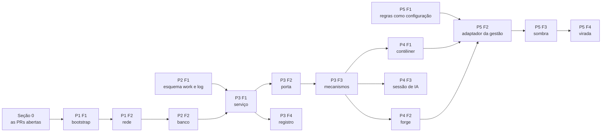

# O plano de implementação da fase 1

Da [arquitetura-alvo](ARQUITETURA-ALVO.md) aos projetos, dos projetos às fases e das fases às PRs, cada uma com o
critério de pronto e as dependências (Daniel, 04/11/2026 12:57: "Tem arquitetura alvo, aí o projeto, aí separa em
fases, aí vai implementando essas coisas"). O ponto de partida é o esquema da infraestrutura, `work` e `log`. A
métrica-norte e a gestão de hoje como primeiro programa ficam fora, adiadas por Daniel (12:53).

**O alvo de agora é 1 PR/min.** O escopo da fase 1 são os projetos P1 a P6, na A1 dimensionada para 1 PR/min (D-303).
O P7, a escala até 1 PR/s, fica dormente até um gatilho medido pedir; a forma é a mesma, e só os números mudam.

**Dormente, sem PR agora: a pessoa como executor** (Daniel, 13:18: "Bom seria, mas não precisa implementar isso agora
não"). A infraestrutura já a aceita como extensão futura, sem migração e sem mudança nela (seção 5).

## 0. As PRs abertas: dependências e ordem de merge

| PR | O que tem | Base | Depende de |
|---|---|---|---|
| [#263](https://cursor.com/codebase/openuniversity-si/open-university/pull/263) | a referência para 10^9 PRs/s (00 a 08) | `mod/roadmap-integration` | — |
| [#264](https://cursor.com/codebase/openuniversity-si/open-university/pull/264) | a arquitetura de 1 PR/min a 1 PR/s (09 a 17) | #263 | #263, pelos links |
| [#265](https://cursor.com/codebase/openuniversity-si/open-university/pull/265) | a fundação na AWS: o bootstrap, o orçamento, a rede, a D-303 a D-306 e as travas | #264 | #264, só pelos links do runbook ao documento 14 |
| [#266](https://cursor.com/codebase/openuniversity-si/open-university/pull/266) | o passo zero (18 a 21) | #264 | #264 |
| [#267](https://cursor.com/codebase/openuniversity-si/open-university/pull/267) | as três camadas e a fronteira (22) | #266 | #266 |
| [#268](https://cursor.com/codebase/openuniversity-si/open-university/pull/268) | o plano de commits sem teto (D-307) | `mod/roadmap-integration` | — |
| [#269](https://cursor.com/codebase/openuniversity-si/open-university/pull/269) | este plano e a arquitetura-alvo | #267 | #267 |

**O único conflito** é o registro de decisões: a #265 e a #268 acrescentam linhas no mesmo ponto de
`docs/domain/DECISIONS.md` (a D-303 a D-306, e a D-307). A segunda a entrar junta a base no ramo, com merge commit, e
mantém os dois blocos em ordem; `scripts/decision-table --check` confirma. Nenhum outro arquivo é tocado por duas delas.

**A ordem proposta:**

1. **A #268**, já: é pequena, não depende de nada e tira o teto antes que o fim do regime de exceção volte a recusar PRs.
2. **A pilha de documentos pelo topo**: a #269 contém a #263, a #264, a #266 e a #267, todas só documentos; uma entrega
   dela leva as cinco de uma vez, com as sete etapas do gate que um diff de documentos pede, e as outras quatro se fecham
   como entregues por ela. Se o forge não reconhecer as quatro como mergeadas, a alternativa é entregar de baixo para
   cima, apontando cada uma para `mod/roadmap-integration` depois que a anterior entrar.
3. **A #265**, depois de juntar a base no ramo (o diff dela fica só com a infraestrutura e as decisões), com o bootstrap
   já atualizado pela Torre a partir do head dela; ao entrar, o deployer aplica a pilha de rede da base.

A entrega de cada uma é `scripts/deliver --pr <n>`, que roda o gate; quem a faz é a sessão que pode rodar o gate, porque
esta não roda (a restrição do projeto ARQ-REF).

## 1. Os projetos

| Projeto | Objetivo | Pronto quando | Depende de |
|---|---|---|---|
| **P1. Fundação na AWS** | o acesso sem chave, o deployer, o orçamento e a rede | o bootstrap aplicado e a pilha de rede no ar, pelo deployer | a #265 (seção 0) |
| **P2. O esquema e o banco** | as 13 tabelas de `work` e `log`, testadas, e o banco que as recebe | o teste de aceite verde no gate; o RDS no ar | — (o esquema começa já; o banco espera a P1) |
| **P3. O serviço da infraestrutura** | os workflows de cada trabalho, a porta e o registro | o teste de aceite pela porta, com dois tenants, verde | P2 |
| **P4. Os executores** | o contêiner, o forge e a sessão de IA, pelo mesmo contrato; a pessoa fica dormente, aceita como extensão futura | o mesmo trabalho por script e por sessão de IA pela porta | P3 |
| **P5. O gate e o trem sobre a infraestrutura** | as regras de hoje como configuração padrão da nossa gestão, sem perder nenhuma | as entregas passam pela infraestrutura, com os mesmos vereditos, e a caixa sai do caminho crítico | P4 |
| **P6. Medir e operar** | os números que faltam ao caminho de 1 s e a operação da plataforma | o merge do Origin, os webhooks e a partida fria medidos | P1, P3 |
| **P7. A escala até 1 PR/s** (dormente) | os mesmos componentes, maiores | 1 PR/s sustentado por uma hora | P5 e um gatilho medido |

## 2. P1, a fundação na AWS

| Fase | O que é | Pronto quando | Depende de |
|---|---|---|---|
| F1. Atualizar o bootstrap | a Torre aplica o `infra/aws/bootstrap.json` do head da #265 pelo comando do runbook (§6) e tira a permissão posta à mão | a pilha em `UPDATE_COMPLETE`; a campainha responde 401 sem token e 202 com ele; o build termina `SUCCEEDED`; uma mensagem do tópico chega | — |
| F2. Entregar a #265 | o merge na base; o deployer aplica `tower-app-network` | a pilha de rede em `CREATE_COMPLETE`; nenhum usuário nem chave no IAM | F1 e a seção 0 |

## 3. P2, o esquema e o banco

| Fase | PR | O que tem | Pronto quando | Depende de |
|---|---|---|---|---|
| F1. O esquema `work` e `log` | INFRA-DB 1 | o DDL do anexo como a primeira migração sob `infra/`; o teste de aceite do anexo como teste de script, no PostgreSQL 18.6 do toolchain; a decisão da correção de 12:40, com esse teste como prova | o teste verde no gate; a trava da D-306 passa | — |
| F2. O banco | INFRA-AWS 2 | a pilha `20-data`: RDS PostgreSQL db.t4g.medium numa zona, 20 GB, backup contínuo, nas sub-redes privadas, com entrada só do grupo das tarefas; a senha mestra por referência a um SecureString do Parameter Store; o serviço entra por autenticação IAM | a pilha no ar pelo deployer, dentro do limite de permissões; o custo dentro do teto da D-303 | P1 F2 |

## 4. P3, o serviço da infraestrutura

| Fase | PR | O que tem | Pronto quando | Depende de |
|---|---|---|---|---|
| F1. O serviço | INFRA-SVC 1 | a imagem (Python e DBOS), o serviço em Fargate (0,25 vCPU) na sub-rede pública sem entrada, as migrações aplicadas na partida, a saúde | o serviço no ar; o esquema aplicado no RDS; uma tarefa derrubada volta sozinha | P2 F1, P2 F2 |
| F2. A porta | INFRA-SVC 2 | API Gateway e a Lambda na VPC que autentica e grava no banco (D-309; sem SQS na fase 1), os comandos (tenant, executor, fila, limite, preço, criar, cancelar, retomar) e as consultas (trabalho, registro com filtros e agregações) | o teste de aceite pela porta, com dois tenants, verde | F1 |
| F3. Os mecanismos | INFRA-SVC 3 | um workflow por trabalho: a ordenação, o roteamento, as dependências, a exclusão mútua, o cache, os limites, a retentativa, o lease e o novo despacho | os cenários do teste de aceite pelo serviço; o serviço derrubado no meio de um trabalho e o trabalho retomado | F2 |
| F4. O registro e o acesso | INFRA-SVC 4 | a tabela de saída para `log.event`; as assinaturas entregues por SNS ou webhook, com cursor; a releitura de um ponto | um assinante recebe cada evento do tenant dele uma vez; a releitura devolve o histórico | F1 |

## 5. P4, os executores

| Fase | PR | O que tem | Pronto quando | Depende de |
|---|---|---|---|---|
| F1. Contêiner | INFRA-EXE 1 | o runner quente em Fargate Spot e a rajada: roda o comando da entrada num checkout, guarda a saída no S3, assina a saída, relata segundos de CPU | uma checagem pela porta; a segunda, com `memoize`, sai do cache; a interrupção do Spot redespacha | P3 F3 |
| F2. Forge | INFRA-EXE 2 | o adaptador do Origin e o do GitHub: empurrar, abrir PR, juntar a base no ramo, pousar com o head esperado e o método de merge; os webhooks no registro | o pouso com head velho é recusado; o pouso com o head certo faz o merge commit; os webhooks aparecem no registro | P3 F3 |
| F3. Sessão de IA | INFRA-EXE 3 | os adaptadores das sessões de nuvem pelas assinaturas (Claude Code, Codex, Cursor): lançar, acompanhar, retomar, encerrar; tokens por modelo; a cota que zera | o mesmo trabalho pelo contêiner e por uma sessão de IA, pela porta; a cota esgotada põe o trabalho em espera, e ele volta no reset | P3 F3 |

**Dormente: a pessoa como executor** (Daniel, 13:18). Não entra na fase 1 nem tem PR agora; fica o requisito de que
ela caiba depois como extensão, sem migração e sem mudança na infraestrutura. O esquema já cumpre: o adaptador é um nome
em `work.executor`, a capacidade de uma pessoa é uma agenda em `work.capacity`, o uso dela é um medidor (minutos), e a
espera e a retomada pela porta já existem; o teste de aceite registra uma pessoa como executor só no esquema, para
provar isso. Quando ela for preciso, entra uma PR com o adaptador, e nada mais.

## 6. P5, o gate e o trem sobre a infraestrutura

Os mecanismos são da infraestrutura; as regras de hoje entram como a configuração padrão da nossa gestão, regra por
regra, como na tabela de [ARQUITETURA-ALVO §7](ARQUITETURA-ALVO.md#7-o-gate-e-o-trem-continuam). Este projeto não decide a
gestão de hoje como primeiro programa, que está adiada: ele só leva o gate e o trem.

| Fase | PR | O que tem | Pronto quando | Depende de |
|---|---|---|---|---|
| F1. As regras como configuração | GATE-INFRA 1 | a tabela de §7 como um arquivo de configuração da nossa gestão: as checagens exigidas (as sete etapas sempre presentes e os testes pelo mapa de áreas e pelos covers), o método de merge, o lote, a regra do gate desligado, a agenda da bateria noturna | toda regra de hoje tem a sua linha, e um teste confere que nenhuma falta | — |
| F2. O adaptador da nossa gestão | GATE-INFRA 2 | um componente da nossa gestão, fora da infraestrutura, que para cada head cria os trabalhos de checagem e, quando passam, o pouso com as dependências, a chave do ramo e o método de merge: o `scripts/deliver` sobre a infraestrutura | uma PR entregue de ponta a ponta em sombra (sem pousar de verdade) | F1, P4 F1, P4 F2 |
| F3. Em sombra | — | a caixa e a infraestrutura julgam os mesmos heads | os mesmos vereditos em pelo menos 50 PRs; pronta → mergeada p50 ≤ o merge do forge mais ~0,2 s (~1,6 s pelo merge de 04/11) medido em sombra | F2 |
| F4. A virada | GATE-INFRA 3 | as entregas passam pela infraestrutura; a trava da caixa e a VM saem do caminho crítico | uma semana de entregas sem piora no vermelho e com a vazão de hoje ou maior | F3 |

## 7. P6, medir e operar

| Fase | PR | O que é | Pronto quando | Depende de |
|---|---|---|---|---|
| F1. O caminho de 1 s | MEDIR 1 | medir o merge pela API do Origin, a latência dos webhooks e a partida de uma tarefa fria, e pôr os números na arquitetura-alvo | os três números com p50 e p99; se o merge passar de 0,6 s, a meta de 1 s passa a usar o número do forge | P3, P4 F2 |
| F2. A plataforma | INFRA-AWS 3 | o tópico `tower-alerts` vira `tower-platform-events`; a tag de custo ativada no faturamento (Torre); o runbook atualizado | o tópico renomeado; a tag ativa | P1 |

## 8. P7, a escala até 1 PR/s (dormente)

Dormente até o gatilho medido; quando ele vier, só números: a 0,1 PR/s, a réplica do banco em outra zona e duas tarefas do serviço; a 1 PR/s, o
banco db.t4g.medium, a rajada do runner, os lotes de até 24 e mais filas por ramo; o adaptador próprio de IA com modelos no
Bedrock quando o gatilho de [12 §6](12-unidade-e-sessoes.md#6-a-escolha-por-degrau) disparar. Cada degrau fica pronto
quando a vazão dele se sustenta por uma hora.

## 9. O caminho crítico

O que pode começar já, em paralelo com a seção 0: o esquema (P2 F1) e as regras como configuração (P5 F1), porque não
dependem da AWS.

## 10. As PRs, contadas

| Projeto | PRs novas | Quais |
|---|---|---|
| P1 | 0 | a #265, já aberta, e a ação da Torre no bootstrap |
| P2 | 2 | INFRA-DB 1, INFRA-AWS 2 |
| P3 | 4 | INFRA-SVC 1 a 4 |
| P4 | 3 | INFRA-EXE 1 a 3 |
| P5 | 3 | GATE-INFRA 1 a 3 (a fase em sombra não tem PR) |
| P6 | 2 | MEDIR 1, INFRA-AWS 3 |
| **Fase 1** | **14** | mais as sete já abertas da seção 0, entre elas a #265 |
| P7 e a pessoa como executor | 0 | dormentes |

## 11. Os riscos

| Risco | O que se faz |
|---|---|
| o merge pela API do Origin passa de 0,6 s | a meta de 1 s passa a ser a do forge mais o nosso ~0,2 s (P6 F1); aconteceu: p50 1,43 s em 04/11, a meta é ~1,6 s |
| a cota da API do forge | ≤ 27 pontos por PR; os webhooks no lugar de consultas |
| a interrupção do Spot no runner quente | o redespacho sem contar tentativa; a rajada sob demanda se o Spot faltar |
| o teto de US$ 60 com ~US$ 53 de base | o banco e o runner entram na menor classe; o orçamento da AWS avisa a 50, 80 e 100 % |
| os termos das sessões de nuvem das assinaturas | o adaptador próprio, testado em sombra, entra pelo gatilho de 12 §6 |
