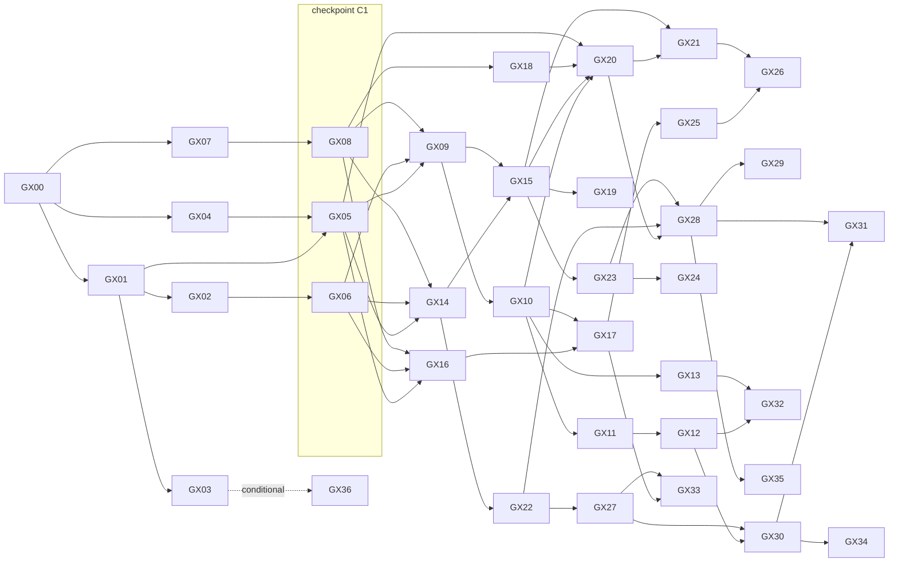

# Gate excellence — plan (GA3, program step 3)

> **Superseded graph:** the live plan is [plan-v2.md](plan-v2.md) (GA4, adopted 27/10 15:13 BRT); the `program.v1` block below equals its §6.1. Where the two differ, plan-v2 wins.

Status: final (GA3, 27/10/2026); ready to execute as written in step 4 (§7). Base: `mod/roadmap-integration` at `2e423b7e` (re-read at start of GA3; unchanged since GA1/GA2). Branch `mod/ga3`. Plan only: no code, no PR, no measurement was needed.
Inputs: GA1 `origin/mod/ga1:docs/programs/gate-excellence/audit-1-fable.md` (`bed976b1`) and GA2 `origin/mod/ga2:docs/programs/gate-excellence/audit-2-opus.md` (`6c842b2d`); GA2 wins where they conflict. Every file list and line reference below was re-checked on `2e423b7e` (BRIEF STANDARD v2 rule 2); where GA2's line numbers are cited they hold on this base.

Naming used here. **GX-NN** is a plan unit (one PR). In the `program.v1` data block (§3.4) the same unit is written `GXNN` (the contract's id pattern has no hyphen) and its wave is the plan wave + 1 (the contract's waves start at 1). Program premises keep the audits' names prefixed **GA-** (GA-P01, GA-PG1 …) because the repository's own premise register already uses P-01 … P-41 for other statements (`docs/process/premises/*.yml`); GX-00 records them in that register (§1.2 D-A1).

## 0. Executive summary

1. **37 units in 4 waves** (GX-00 … GX-36): wave 0 = 9 units (stop losing green work, and make step 4 safe to run), wave 1 = 12 (the proof becomes a trustworthy v4 object; one of them, GX-36, is conditional), wave 2 = 8 (the proof becomes reusable: carry-over, one merge rule, narrow inputs), wave 3 = 8 (shared, parallel, enforced; GX-35, the shared store, runs inside R2's free allowance, D-073).
2. **Two changes to GA2's order.** The pinned gate (B-09, GA-PG1) moves from wave 1 to wave 0 (GX-05) because every step-4 PR is a gate PR and would otherwise grade itself; and the derived test map (B-13) moves to wave 0 (GX-08) because `gate-script-tests.json` is the file every later unit would collide on (G-14).
3. **Critical path:** GX-00 → GX-01 → GX-02 → GX-06 → [checkpoint C1] → GX-09 → GX-10 (v4 producer) → GX-20 (carry-over, the RETRO case): ≈ 10.5 session-hours; to the end of wave 3 it continues GX-11 → GX-12 → GX-30 → GX-31 (≈ 14.5 h). Run two at a time, the whole program is 19 slots.
4. **First to launch:** GX-00 (decision record, docs only, ≈ 30 min), then two lanes in parallel: GX-01 (preflight first, classified aborts) and GX-04 (pr.ready from the gated sha); then GX-03 (gate sized to its container) and GX-02 (train halts, never ejects, on env).
5. **The train gets a real batch soonest** by dogfooding: after wave 0 (GX-02, GX-05, GX-06) the train is switched on in one designated session and merges the step-4 PRs themselves (checkpoint C1, §6–§7). The paused engine means the base moves only through the train, so the halt-on-base-move problem (GA2 Q6) does not bite.
6. **Paused units:** HD1 #677 lands as is (GX-07); AR1 #671 is resumed inside GX-24; TR2 `eaa408de` is GX-02's first commit; BD1 #667, GS2 #683 and MQ1 #680 are closed and harvested into GX-03/GX-13/GX-22/GX-25/GX-30/GX-32; GV1 stays on hold for Daniel's design call (§5).
7. **GX-35 shared store, free tier only (D-073):** Daniel approved the free path on 2026-10-28 ("Siga esse caminho, de modo a não gastarmos dinheiro agora"), so the store is built inside R2's permanent free allowance (10 GB-month storage, 1 M Class A writes, 10 M Class B reads), LRU-capped at 10 GB, and falls back to the git-ref store instead of ever billing; nothing is spent. The paid path stays deferred under P-45, and §8 keeps its prices as what a paid path would cost if Daniel ever lifts that cap. GX-34 (sharded tier 2) is a design unit only; its build is re-planned at checkpoint C3.
8. **Vercel stays untouched** (GA-P03); B-24 is split into GX-17 (our own `tower/gate` commit status, wave 1) and GX-33 (branch protection, wave 3, only after GX-17 is stable on real PRs).
9. **Cost:** ≈ 51 session-hours of agent time plus GX-35's ≈ 4 h (30 opus-tier, 21 sonnet-tier; ≈ 66 with a 20 % rework margin), two sessions at a time, ≈ 4 working days of wall; no money at all — GX-35 runs inside R2's free allowance (D-073).
10. **For Daniel:** no decision. Two **actions** that only an account owner can take, both late and neither blocking earlier units: give the gate's identity `statuses:write` (GX-17, the cloud token gets 403 today, `forge_github.py:3-5`), and turn on branch protection (GX-33). GX-35's spend is answered: the free path is approved (D-073, §9.1 item 3).

## 1. Binding decisions

### 1.1 Premise decisions (A Torre, 27/10 13:03, under Daniel's delegation; verbatim)

* P-01 YES: proof is content-addressed (tree + base + toolchain); a docs-only commit carries test/build results, but the structure/metadata check always reruns, and script tests that read docs (G-15) rerun when docs change.
* P-02 YES, strict: tier 2 reuses a proof only when its key matches the exact merged tree and toolchain being tested (attested); never tier-1 box-local markers. Until attestation exists, B-07 enforces D-065 (5) (no reuse).
* P-03: our own GitHub commit status/check from the gate via the API (no GitHub Actions); Vercel untouched. Branch protection requiring that check comes only as a later unit, after the check has been stable on real PRs.
* P-04 DEFERRED: costs money; plan it as wave 3 with an estimated cost; nothing paid without Daniel's OK.
* P-G1 YES: the verdict comes from the pinned gate on the base tip; the PR's own gate code runs as code under test plus report-only.
* P-G3 YES behind a registered config switch (no literals), default OFF; turned on only after the train has merged a real batch. Merge commits only, no rebase, stays.
* All other premises: as the GA2 auditor decided.

Note on P-03 vs GA2 B-24: B-24's "remove the Vercel integration" is OUT; Vercel stays untouched (A Torre already disabled only the Vercel preview check on PRs at 12:01, Daniel-approved; production deploy intact). B-24 is split into (a) the gate's own status/check (GX-17) and (b) a later branch-protection unit gated on (a) being stable on real PRs (GX-33).

"As the GA2 auditor decided" therefore fixes: GA-P05 verified (eaa408de not on base), GA-P06 … GA-P12 as in GA2 §8.1, GA-PG2 (one designated train session), GA-PG4 (sizing from vCPUs), GA-PG5 (adding per-stage timeouts is not a loosening), GA-PG6 (wall-clock perf budgets stay blocking until a D-NNN moves them), GA-PG7 (GV1 waits for Daniel's design call), GA-PG8 (`train.enabled` not in one machine's change log), GA-PG9 (B-06 before any other wave-1 block).

### 1.2 Further decisions taken by this plan (DECIDE, THEN REPORT)

| ID | Decision | Reason | Reversible? |
|---|---|---|---|
| D-A1 | Program premises are named GA-P01, GA-P02, GA-P03, GA-P04, GA-PG1, GA-PG3 in this plan; GX-00 records each in the repository register with `scripts/premises propose` (ids assigned by the tool, expected P-42 …), status `confirmed`, source "A Torre 27/10 13:03 under Daniel's delegation", and every GX PR body cites the register ids on its `Premises:` line. | The register already has P-01 … P-41 with different meanings (e.g. P-02 = github-source-of-truth); citing the audits' ids would make `structure-check` resolve the wrong premise (D-066). | Yes (docs). |
| D-A2 | One program decision **D-070 "Gate excellence program"** is written in `docs/domain/DECISIONS.md` by GX-00 before any code unit: it records §1.1, the pinned-gate rule, the P-02 strict reading of D-065 (5) and the P-G3 switch, and is the D-NNN every GX PR cites for the D-025 gate-change rule (`commit_check.gate_errors`, `scripts/lib/commit_check.py:113-122`). | Every GX unit touches `scripts/gate-*` or `scripts/lib/gate*`; without one approved D-NNN each body is refused by the structure check. One record, not 37. | Yes (later D-NNN can amend). |
| D-A3 | The pinned gate (B-09) moves to **wave 0** (GX-05), right after GX-01 and GX-04. Until it lands, the verdict of record for a GX PR is a `scripts/gate-dev --pr <n>` run **from a clean checkout of the base tip** (the existing tool-root behaviour, `gate-local:21,65-67`: the tooling is the checkout that runs it, the head is only code under test); the PR's own-checkout run stays as the pr.ready producer and as the report-only view. | Every step-4 PR changes the gate (G-12); a self-graded gate PR is the failure GA-PG1 exists to stop. The interim protocol needs no code. | Yes. |
| D-A4 | Tier-2 executor shape (GA2 open Q1): **one long train-role cloud session**, not the coordinator's session. | D-065 (3) and P-21 (long session per lane); the coordinator's session restarts for unrelated reasons; a dedicated session has one checkout on the base tip, which is also what the pinned gate wants. | Yes. |
| D-A5 | Pinned-gate mechanics (GA2 open Q2): a **base-tip tool worktree per (base sha, gate slot)**, reused while the base sha is the same, not a released gate ref. GX-05's first commit measures the worktree cost in a throwaway worktree and records it in its PR body. | No new ref to maintain or advance; the base sha is already known for every run (`gate-local:97-99`); per-slot paths already exist (`gate-isolation.sh`). | Yes. |
| D-A6 | Covers derivation (GA2 open Q3): **header declaration** in each script test now (GX-08), trace verification later and Python-first (inside GX-29). | Headers are mechanical to migrate (generated from today's JSON) and remove the collision now; tracing shell tests needs a spike that should not block wave 0. | Yes. |
| D-A7 | The derived test map (B-13) moves to **wave 0** (GX-08). | G-14: all five paused gate units and most GX units would otherwise edit `scripts/lib/gate-script-tests.json`; removing that aggregate first raises the parallel capacity of waves 1–3. | Yes. |
| D-A8 | The bash → `gate_graph.schedule` scheduler swap (F-10, O-02 second half) is **dropped from this program**; the graph keeps its current roles (resources, script tests) and GX-26 fixes the docs that claim otherwise. Revisit at checkpoint C3. | GA2 O-02: "the scheduler swap buys little until stages are smaller"; it rewrites `gate-fixed.sh`, the hottest driver file, for no measured gain. | Yes. |
| D-A9 | Wall-clock tests stay blocking (GA-PG6). A class fix of the 18 clock-reading script tests and 3 perf tests (GA2 Q11) is **conditional** (GX-36): it runs only if, after GX-03, a cold base gate on an idle 4-vCPU container still fails a timing assertion. | B-04 removes the self-inflicted load first (G-08); moving a blocking check to report-only is a loosening that needs evidence. | Yes. |
| D-A10 | Paused units: HD1 #677 lands as is (GX-07); AR1 #671 resumes inside GX-24; `eaa408de` is cherry-picked as GX-02's first commit; MQ1 #680 is closed at the start of step 4 (its per-PR merge path contradicts D-065 (4)); BD1 #667 and GS2 #683 are closed by the coordinator once the units that harvest them merge (§5); GV1 stays on hold. | §5 gives the per-unit reasons; closing avoids two `merge.json` owners and four `gate-script-tests.json` editors. | Closing is reversible (reopen). |
| D-A11 | How GX PRs merge: until checkpoint C1 by the current rule (gate-dev green on the exact head from the base-tip checkout per D-A3, `--match-head-commit`, merge commit), done by the coordinator, never by the unit session; from C1 on, through the train in its designated session (dogfood). | AGENTS.md "do not merge your own PR"; the train must merge a real batch soonest (§6). | Yes. |
| D-A12 | Execution lanes are **sub-lanes of `engine-lane`** (every gate file's unit manifest says `owner: engine-lane`, `units/engine-*/unit.json`): `gx-program`, `gx-driver`, `gx-proof`, `gx-train`, `gx-meta`, `gx-select`, `gx-out`, `gx-defects`. They exist for file ownership in step 4 only; the train's ownership check still sees `engine-lane`. | Avoids touching unit manifests or `train_ownership` for a planning concept. | Yes. |
| D-A13 | Generated files (`CODEOWNERS`, `scripts/lib/generated/*`, `contracts/generated/*`, `contracts/events/schemas.lock.json`) are never hand-merged: on a conflict the unit merges the base and reruns `scripts/generate` (and the contract lock tool). Units that add an event contract still serialize (§4). | These are aggregates (D-065 V4, P-10); hand merges are where they rot. | — |
| D-A14 | Every number a unit introduces is a registry key with a default and `x-readers` (D-068, P-41); the defaults proposed in §3 are starting values, not literals in code. Status contexts and event names are registry values too (`tower/gate` follows the internal `tower-*` naming rule of AGENTS.md; it is not user-visible product text). | No literals. | — |
| D-A15 | The program-gate metric is the registered `prs_merged_per_day` with target ≥ 1 000 (the D-065 goal); it is evaluated after the engine resumes. Gate-specific outcomes (re-gates per PR, cold base gate green, tier-2 wall) are unit done criteria and checkpoint measures, not new metrics. | `coordinator.metrics` registers only `prs_merged_per_day` and `prs_merged_per_hour`; adding a metric is not worth a unit now. | Yes. |
| D-A16 | Measurements a unit needs (GX-03 sizing, GX-05 worktree cost, GX-16 request count, GX-23 access trace) are the unit's **first commit's** job, run in a throwaway worktree, never through a PR, never touching Neon, Vercel, production or secrets; the numbers go in the PR body. | Planning did not need them; units do, and they are cheap there. | — |

## 2. Wave plan

General to specific (P-31); each wave raises the capacity of the next.

| Wave | Goal | Units | Capacity it unlocks for the next wave |
|---|---|---|---|
| **0 — safe to proceed** | Stop losing green work and make step 4 itself safe: environment failures are classified before they blame anyone; the train halts instead of ejecting; the gate stops overloading its own container; the verdict comes from a pinned gate; the test-map aggregate stops being a collision point; pr.ready no longer depends on where the gate ran. | GX-00 … GX-08 (9) | Wave-1 units are judged by a trusted gate, can run two at a time without colliding on `gate-script-tests.json`, and land through the train (C1). The base gate is green cold, so a red verdict means the change. |
| **1 — the proof is an object** | Every verdict is a v4 proof bound to (head tree, base sha, toolchain, gate version, tier), tier 2 obeys D-065 (5) and leaves evidence, known-defect adjudication is reproducible, the structure check judges the gated sha and caches its tree part, the status comment is cheap, GitHub shows our own status. | GX-09 … GX-19 (11) + GX-36 conditional | Wave 2 can verify instead of re-run: carry-over needs `head_tree`/`base_sha`/`gate_version`; one merge rule needs the metadata check bound to the gated sha; ETA needs stage start times and tiers. |
| **2 — the proof is reusable** | One full gate per unit (the RETRO commit carries the proof), no forced base merge once the switch is on, narrow web inputs so base merges stop missing every cache, pr.ready never asks for a new head, lifecycle events instead of polling. | GX-20 … GX-27 (8) | Gates per PR drop by ≈ 80 % (GA2 Q3: pure-behind + still-red + docs-only re-gates); the train is the only merger, so wave 3 can make tier 2 cheap and parallel without fighting other mergers. |
| **3 — shared, parallel, enforced** | Attested, hermetic proofs; tier 2 runs the union plan and reuses only exactly-matching attested proofs; base health is a signal; the forge refuses merges without our status; the design for sharded tier 2; the shared store inside R2's free allowance (D-073). | GX-28 … GX-35 (8; GX-35 last, free tier) | Past the one-lock ceiling (≈ 48–68 PRs/h, G-09) toward 10k–100k PRs/day: proofs travel between containers and executors. |

## 3. Units

### 3.1 Conventions for every unit

- **One PR**, 3–8 commits with a `Plan: N` trailer each (AGENTS.md), branched from and targeting `mod/roadmap-integration`, body ending with `Fit-Review: not reviewed (Daniel 2026-10-25: no review step)`, `Decision: D-070` cited (D-A2) and a `Premises:` line with the register ids of the GA- premises it rests on (D-A1) plus any existing register premise listed in its row.
- **Done** for every unit, in addition to its own criteria: gate-dev green on the exact head **from a base-tip checkout** until GX-05 merges, by the pinned gate after (D-A3); merged by the coordinator or the train, never by its session (D-A11); its RETRO written at `docs/units/GXNN/retro.md` (the existing padrão; after GX-20 the RETRO commit carries the proof).
- **New files** are added to their owning unit manifest (`units/engine-*/unit.json`, the owner named in each row) and `CODEOWNERS` is regenerated with `scripts/generate`, never hand-edited (D-A13). A new registry key gets a default, `x-unit`, a description and `x-readers`, and its generated module is regenerated (D-068, D-A14).
- **Rollback** is always available as a revert PR of the unit's merge commit (`git revert -m 1`, merge commits only). Units that change a verdict or a merge decision also ship a registry switch, so the first rollback is a one-key change through `scripts/config` and the shared registry default, never a machine-local change log (GA-PG8).
- **Before GX-08 merges**, a unit that needs a script test adds it to an already registered test file where it can (e.g. `test_pr_ready.py`, run by `plan-tick.test.sh`) and touches `scripts/lib/gate-script-tests.json` only for a `covers` line; after GX-08, it declares covers in its test's header.
- **Effort** is agent session time at the suggested tier (opus-tier for design-heavy or verdict-changing work, sonnet-tier for mechanical or well-specified work); it excludes gate wall time.
- **Blast radius** labels: CRITICAL only for scope, money, production or source-of-truth items (all CRITICAL premises are already decided in §1.1); otherwise high / medium / low as in the register.

### 3.2 Unit index

| ID | Title | Wave | Lane | Deps | Blocks (B) | Tier · effort |
|---|---|---|---|---|---|---|
| GX-00 | Program record: D-070, premises, program graph | 0 | gx-program | — | — | sonnet · 0.5 h |
| GX-01 | Preflight first; classified driver aborts; machine class line | 0 | gx-driver | GX-00 | B-01, B-05, B-02 (line) | opus · 1.5 h |
| GX-02 | Train halts on env/contract, never ejects (lands `eaa408de`) | 0 | gx-train | GX-01 | B-02 | opus · 1.5 h |
| GX-03 | Size the gate to its container | 0 | gx-driver | GX-01 | B-04 (sizing) | sonnet · 2 h |
| GX-04 | pr.ready from the gated sha and the recorded base | 0 | gx-meta | GX-00 | B-16 (G-03 part) | sonnet · 1 h |
| GX-05 | Pinned gate: the base tip's tooling judges | 0 | gx-driver | GX-01, GX-04 | B-09 | opus · 2 h |
| GX-06 | Designated tier-2 executor; `train.enabled` shared | 0 | gx-train | GX-02 | B-03, B-27 | opus · 1.5 h |
| GX-07 | HD1 #677 landed as is | 0 | gx-select | GX-00 | B-19 (readiness part) | sonnet · 0.5 h |
| GX-08 | Test map from per-test headers | 0 | gx-select | GX-07 | B-13 | sonnet · 2 h |
| GX-09 | `gate.passed|failed` v4 contract and readers | 1 | gx-proof | C1 | B-06 (contract) | opus · 1.5 h |
| GX-10 | v4 producer: proof fields, `.pass` fields, stage start, cost | 1 | gx-proof | GX-09 | B-06 (producer) | opus · 2 h |
| GX-11 | Tier is explicit; D-065 (5) made true | 1 | gx-proof | GX-10 | B-07 | opus · 1.5 h |
| GX-12 | Tier 2 leaves evidence | 1 | gx-train | GX-11 | B-08 | sonnet · 1 h |
| GX-13 | Known defects against a recorded base | 1 | gx-defects | GX-10 | B-10 | opus · 1.5 h |
| GX-14 | Structure metadata judged on the gated sha, REST cut | 1 | gx-meta | C1 | B-11 (metadata) | opus · 1.5 h |
| GX-15 | Structure tree part cached; `pr metadata` stage; `pr.checked`; local checks | 1 | gx-meta | GX-14, GX-09 | B-11 (tree), F-15 | opus · 2 h |
| GX-16 | Status comment cost, shape and hygiene; REST counter | 1 | gx-out | C1 | B-12 | sonnet · 1.5 h |
| GX-17 | Our own `tower/gate` commit status | 1 | gx-out | GX-16, GX-10 | B-24 (a) | sonnet · 1.5 h |
| GX-18 | Docs area runs the script tests that read docs | 1 | gx-select | GX-08 | G-15 fix | sonnet · 1 h |
| GX-19 | Per-stage timeouts; report and build-cache eviction | 1 | gx-driver | GX-15 | B-04 (timeouts), Q13 | sonnet · 1 h |
| GX-36 | *Conditional:* clock-reading tests class fix | 1 | gx-select | C1 trigger | Q11 | sonnet · 1.5 h |
| GX-20 | Carry-over by delta (the RETRO case) | 2 | gx-proof | C2 (GX-10, GX-15, GX-18, GX-05) | B-14 | opus · 2 h |
| GX-21 | pr.ready completeness at gate time; never an empty commit | 2 | gx-meta | GX-20, GX-15 | B-16 (rest) | sonnet · 1 h |
| GX-22 | One merge rule in the registry; P-G3 switch (default OFF) | 2 | gx-meta | C2 (GX-14) | B-18 | opus · 1.5 h |
| GX-23 | Narrow web stage inputs (fail closed) | 2 | gx-select | C2 (GX-15) | B-15 (web) | opus · 2 h |
| GX-24 | AR1: database area by import graph (fail closed) | 2 | gx-select | GX-23 | B-15 (DB area) | sonnet · 1 h |
| GX-25 | Gate lifecycle events, ETA from the ledger, `gate.slow` | 2 | gx-out | C2 (GX-17) | B-17 (machine part) | sonnet · 1.5 h |
| GX-26 | `--explain` / `--why`; retire drifted docs | 2 | gx-proof | GX-25, GX-21 | B-25, B-26 | sonnet · 1 h |
| GX-27 | P-G3 switch ON | 2 | gx-meta | GX-22 + train merged a real batch | B-18 | sonnet · 0.5 h |
| GX-28 | Attestation in keys and proof | 3 | gx-proof | C3 | B-19 (attestation) | opus · 1.5 h |
| GX-29 | Hermetic network; DB residue; covers trace check | 3 | gx-driver | GX-28 | B-19 (hermetic), B-13 (trace) | sonnet · 2 h |
| GX-30 | Train: union plan, proven-prefix merge, rebuild on base move, queue index | 3 | gx-train | C3 | B-20 (a), F-16, G-09 | opus · 2 h |
| GX-31 | Tier-2 reuse of exactly-matching attested proofs | 3 | gx-train | GX-28, GX-30 | B-20 (b) | opus · 1.5 h |
| GX-32 | Base health signal (`base.red` / `base.green`) | 3 | gx-defects | C3 (GX-12, GX-13) | B-22 | opus · 1.5 h |
| GX-33 | Branch protection requiring `tower/gate` | 3 | gx-out | GX-17 stable (C4) | B-24 (b) | sonnet · 0.5 h + account action |
| GX-34 | Sharded tier 2: design | 3 | gx-design | GX-30 | B-21 | opus · 1.5 h |
| GX-35 | Shared store (free tier only, D-073) | 3 | gx-design | GX-28 | B-23 | opus · 2 × 2 h (est.) |

C1, C2, C3, C4 are the checkpoints of §7.

### 3.3 Unit details

#### Wave 0 — safe to proceed

**GX-00 — Program record: D-070, premises, program graph**
- Implements: D-A1, D-A2; no B block. Closes nothing by itself; unblocks every unit's structure check.
- Goal / done: `docs/domain/DECISIONS.md` has D-070 (§1.1 verbatim, D-A3 pinned-gate rule, P-02 strict reading of D-065 (5), the P-G3 switch default OFF, Vercel untouched) with its proving test named per row ("the test that proves each": `test_gate_pin.py` for the pin rule, `test_gate_result_cache.py` for no tier-2 reuse, `test_commit_check.py` for the switch); six premise records exist (`scripts/premises propose`, then `confirmed`) for GA-P01, GA-P02, GA-P03, GA-P04 (status confirmed as *deferred spend*), GA-PG1, GA-PG3; `scripts/program check gate-excellence` passes (today it fails only on the three missing files; the data block already validates: `program.load('gate-excellence')` → 37 units, checked by GA3); `scripts/structure-check --pr-body` accepts a sample GX body citing D-070 and the new ids.
- Files: `docs/domain/DECISIONS.md`, `docs/process/premises/<six new>.yml`, `docs/programs/gate-excellence/{brief,audit,retro}.md` (the program folder needs all four files for `scripts/program check`: `brief.md` = the step-1/2/3 briefs' common text; `audit.md` = an index; the two audits copied verbatim from `origin/mod/ga1` and `origin/mod/ga2` as `audit-1-fable.md` and `audit-2-opus.md`, one commit each, so the base holds them; `retro.md` = the template, filled at program end), this `plan.md` brought from `mod/ga3` unchanged, `docs/units/GX00/{plan,retro}.md`. Docs only.
- Tests: `scripts/run test units`, `scripts/run test premises`, `scripts/run test program` (they read these docs, G-15).
- Config keys: none. Contracts: none.
- Premises: the six above; P-30 (premise system), P-11 (one decision per file, inferred: D-070 is one entry).
- Risk / rollback: low; revert.

**GX-01 — Preflight first; classified driver aborts; machine class line**
- Implements: B-01, B-05, the gate side of B-02. Closes: F-03 (driver part), G-07 (detection part), F-12 (env failures now visible).
- Goal / done: `scripts/gate-local` runs a gate preflight **before** the flock, the slot and the worktree (today `:75-159`); any gap prints `FAIL env: <gap>` and exits 2 within seconds; with `--pr`, the abort publishes `gate.failed` with `class: env` and the mode's expected stages in `missing_stages` (the exit trap at `:126-127` passes mode and PR, so `gate_report.py` gets its five arguments, `:233-234`); every driver abort and every red stage prints one machine line `<prefix> <stage>\t<class>`; `gate_classify.ENV` matches the driver abort strings (`local postgres did not start`, `could not create/reset the local test database`, `missing TEST_DATABASE_URL`). Observable: on a container with PostgreSQL stopped, `scripts/gate-dev --pr <n>` exits 2 in < 10 s, prints the gap and the class line, and posts `gate.failed class=env`; no slot or worktree is left.
- Files: `scripts/gate-local`, `scripts/lib/preflight.py` (new `gate` probe set: database, toolchain, browser system libraries; reuses `database_problems()`, `:87-103`), `scripts/lib/gate_classify.py`, `scripts/lib/gate-runner.sh` (class line at `:39`), `scripts/lib/gate_report.py` (abort path), `config/registry/gate.json`, `config/registry/env.json`.
- Tests: `test_preflight.py`, `test_gate_classify.py`, `test_gate_report_skips.py` (abort with PR → one `gate.failed` env event via the forge fake); `scripts/run test preflight`, `gate-classify`, `gate-report-skips`.
- Config keys: `gate.class_line_prefix` (default `GATE-CLASS:`), `gate.preflight_enabled` (true), `env.gate_preflight_probes` (["database", "toolchain", "browser_libraries"]).
- Contracts / decisions: D-070, D-027 (classes), no contract change (`gate.failed` v3 already carries `class`).
- Premises: GA-PG5 (low), P-26 cloud hosts reachable (low).
- Risk / rollback: low; a false positive preflight blocks every gate on that machine → `gate.preflight_enabled=false`.

**GX-02 — Train halts on env/contract, never ejects (lands `eaa408de`)**
- Implements: B-02 (train side), TR2 item 7. Closes: F-03 (train part), F-12 (`env.drift` gets its producer).
- Goal / done: commit 1 cherry-picks `eaa408de` unchanged (a new commit on this branch; merge commits only, no rebase); then `engine_role.CommandGate` reads the class line (GX-01) instead of the first `^FAIL` line and the 2000-char tail regex; the train raises `TrainHalt` on `env` or `contract` for the combined head and for every bisection probe, emits `env.drift` (`contracts/events/env.drift.v1.json`, today with no producer) and ejects only on `code`; `docs/operations/train.md` says so. Observable: the 27/10 fixture (tier 2 aborting with `FAIL local postgres did not start`) halts with `env.drift` and no `pr.ejected`, in `test_train.py`.
- Files: `scripts/lib/engine_role.py`, `scripts/lib/train.py`, `scripts/tests/test_train.py`, `scripts/tests/test_train_role.py`, `docs/operations/train.md`, `units/engine-train/unit.json` (TR2 already edits it), `config/registry/train.json`.
- Tests: `scripts/run test train`, `scripts/run test train-role`.
- Config keys: `train.halt_classes` (["env", "contract"]), retiring the tail-regex dependency on `train.tier2_log_chars` (kept for the log excerpt only).
- Contracts / decisions: D-070; producer of `env.drift.v1` (documented in `docs/process/EVENTS.md`, this unit's line only).
- Premises: GA-P05 (verified), P-18 train sole merger (medium).
- Risk / rollback: low; `train.halt_classes=[]` restores eject-on-anything.

**GX-03 — Size the gate to its container**
- Implements: B-04 (sizing half), GS2's longest-first script-test order. Closes: G-08, F-05 (self-inflicted part), KF3's load class.
- Goal / done: first commit measures, in a throwaway worktree on an idle 4-vCPU container, a cold `gate-dev --sha <base>` at script-test concurrency 4 and 8 (GA2 open Q8) and records walls and pass/fail in the PR body; then script-test concurrency = `min(gate.script_tests_concurrency, floor(nproc × gate.script_tests_per_vcpu))`, `gate.slots` = `max(1, floor(nproc × gate.slots_per_vcpu))` unless overridden, script tests start longest-first from their last measured duration (`engine.step.measured`, falling back to declared order). Observable: a **cold** base gate on an idle 4-vCPU container passes (today: 614 s FAILED, GA2 Q1) and its wall is recorded.
- Files: `scripts/lib/gate_test_cache.py` (concurrency at `:140`, ordering), `scripts/lib/gate-isolation.sh` (slot count), `config/registry/gate.json`, `scripts/tests/test_gate_test_cache.py`, `scripts/tests/gate-isolation.test.sh`.
- Tests: `scripts/run test gate-test-cache`, `gate-isolation`, `gate-heavy-db`; the cold measurement above.
- Config keys: `gate.script_tests_per_vcpu` (1.0), `gate.slots_per_vcpu` (0.25 → 1 slot on 4 vCPUs; the measurement may raise it), `gate.slots` becomes an optional override, `gate.script_tests_concurrency` stays as the cap.
- Contracts / decisions: D-070; D-064 (f) ceiling unchanged (P-09).
- Premises: GA-PG4 (low), P-36 speed sustainable (medium).
- Risk / rollback: fewer slots per container → more queueing of a lane's own gates; reported by GX-25's ETA later. Rollback: set `gate.slots` and `gate.script_tests_concurrency` back to 3 and 8.

**GX-04 — pr.ready from the gated sha and the recorded base**
- Implements: B-16 (the G-03 part). Closes: G-03, Q10 (no hand-emitted `pr.ready`).
- Goal / done: `pr_ready.ready_after_gate` decides from the gated sha and the **subject root** the gate exported (`OU_SUBJECT_ROOT`, `gate-local:168`), never the tool checkout's `HEAD`; plan ticks are counted over `baseRefOid..sha` read once from the forge port, not over the local `origin/…` ref (`pr_ready.py:62-83`, `plan_tick.py:30-50`); `lane_id` is derived at the merge base of that recorded base. Observable: a gate run from a checkout that is **not** on the head (coordinator-style) emits `pr.ready` for a green, fully ticked PR; a stale local remote-tracking ref changes nothing.
- Files: `scripts/lib/pr_ready.py`, `scripts/lib/plan_tick.py`, `scripts/tests/test_pr_ready.py`.
- Tests: `scripts/run test plan-tick` (it runs `test_pr_ready.py`).
- Config keys: none new (`plan-tick.base_ref` stays the fallback when the forge is unreachable, and the fallback is reported).
- Contracts / decisions: D-070; `pr.ready.v1` unchanged.
- Premises: P-02 github source of truth (high, confirmed).
- Risk / rollback: low; revert.

**GX-05 — Pinned gate: the base tip's tooling judges**
- Implements: B-09, GA-PG1. Closes: G-12; the gate side of G-13.
- Goal / done: first commit measures the cost of `git worktree add` of the base tip into the pin directory (D-A5) and records it; then `scripts/gate-local`, when invoked with `--pr` or `--sha` and not already pinned, resolves the base sha (PR: `baseRefOid` in the same REST call the driver already makes; `--sha`: the fetched tip of `gate.batch_base_ref`, i.e. the train's batch base), reuses or creates the tool worktree for that sha (one per base sha, guarded by a lock), and re-executes **that** worktree's `scripts/gate-local` with `OU_GATE_PINNED=<base sha>` and the caller's checkout as the record root; the verdict, events and status come from the pinned tooling; when the PR's diff touches the gate (`commit_check.GATE_FILE`), a second run with the head's own tooling and `--report-only` (no events, no record, no status, no pr.ready) prints its verdict and the status comment shows it as advisory. The gate prints `gate: pinned to <base sha>` first. Observable: a PR that deliberately breaks `gate-local` (fixture) is judged red by the pinned gate while its own report-only run says green; `gate_version` is printed (and becomes a v4 field in GX-10).
- Files: `scripts/gate-local` (tool-root resolution `:65-67`), `scripts/lib/gate_pin.py` (new), `config/registry/gate-pin.json` (new, owner `gate-pin`; keeps `gate.json` free for GX-03), `scripts/tests/test_gate_pin.py` + `scripts/tests/gate-pin.test.sh` (new), `units/engine-gate-run/unit.json`.
- Tests: `scripts/run test gate-pin` (fixture repo with a base and a head whose gate differs), `scripts/run test gate-isolation`.
- Config keys: `gate-pin.enabled` (true), `gate-pin.dir` (under the existing slot directory), `gate-pin.report_only_on_gate_change` (true), `gate-pin.keep_worktrees` (2 base shas per machine, older ones removed).
- Contracts / decisions: D-070 (GA-PG1; changes what "the gate" is, D-025). The pinned tooling reads its own registry; code under test reads the head's.
- Premises: **GA-PG1 CRITICAL (source of truth of the verdict; decided)**; P-13 exclusive unit ownership (medium).
- Risk / rollback: medium. Two tool roots in one run; the tool worktree has no `.toolchain/` (PATH and env.sh come from the caller's checkout, which the SessionStart hook already sets); a head that needs a new gate behaviour cannot be proven green until its gate change merges (that is the intent; the report-only run shows it). Rollback: `gate-pin.enabled=false`.

**GX-06 — Designated tier-2 executor; `train.enabled` shared**
- Implements: B-03, B-27, D-A4. Closes: G-07, G-13, F-16 (lock-owner reuse part).
- Goal / done: `train_trigger` no longer starts `scripts/train run` in the producer's container (Transport v0 still emits `pr.ready`); a documented train-role session (`docs/operations/train.md`: one long cloud session on a base-tip checkout, preflighted by GX-01, started and restarted by the coordinator) runs the train on `pr.ready`; the lock lease is `train.tier2_timeout_s + train.lock_lease_margin_s` instead of 3600 s; the lock owner is the session id (unique); `train.enabled` is read from the shared registry default and the train **refuses** to run when a machine-local change log overrides it (`OU_CONFIG_STORE=file`); until GX-11, the runbook sets `GATE_TEST_CACHE_DIR` to a fresh directory per tier-2 run so tier 2 reuses no marker (P-02 strict meanwhile). Observable: emitting `pr.ready` from a lane container starts no process there; a train started with a local override prints the refusal; killing the train session frees the lock within the new lease.
- Files: `scripts/lib/train_trigger.py`, `scripts/lib/engine_role.py` (lease, owner), `scripts/lib/train.py` (enabled guard), `config/registry/train.json`, `docs/operations/train.md`, `scripts/tests/test_train_role.py`.
- Tests: `scripts/run test train-role`, `scripts/run test train`.
- Config keys: `train.trigger_mode` (`emit_only`; `detached` = today's behaviour), `train.lock_lease_margin_s` (300), `train.lock_lease_s` retired (derived), `train.enabled` default becomes true in GX-06's **last** commit (safe because, with `train.trigger_mode=emit_only`, only the designated train-role session ever runs the train; until that session is started at C1, nothing runs).
- Contracts / decisions: D-070, D-065 (3); GA-PG2, GA-PG8.
- Premises: P-21 long session per lane (low), P-33 everything in the cloud (medium).
- Risk / rollback: medium: the train's liveness becomes the train session's; the coordinator restarts it on its heartbeat. Rollback: `train.trigger_mode=detached`.

**GX-07 — HD1 #677 landed as is**
- Implements: the rest-fake readiness part of B-19; HD1's own plan. Closes: HD1's "rest fake did not start" flake.
- Goal / done: `mod/hd1` merges the base (merge commit), is re-gated per D-A3 and merged; no scope change. Observable: #677 merged; `rest-fake-ready.test.sh` green in the gate.
- Files: as in #677 (`config/registry/delivery.json`, `scripts/tests/{gate-db,invoker-tooling,merge-phase,rest-fake-ready}.test.sh`, `scripts/tests/rest_fake.py`, `scripts/tests/rest-fake-start.sh`, `scripts/lib/gate-script-tests.json`, two `absolute-literals-baseline` files, HD1 docs).
- Tests: as in #677.
- Config keys: HD1's (`delivery.*`), unchanged.
- Contracts / decisions: HD1's; D-070 only if its gate-file touch requires the citation (the existing #677 body already cites its decision; add D-070 if the structure check asks).
- Premises: as in #677.
- Risk / rollback: low (the PR is done and has a RETRO); revert.

**GX-08 — Test map from per-test headers**
- Implements: B-13 (declaration half), D-A6, D-A7. Closes: G-14 (the collision), part of F-08 (covers become checkable).
- Goal / done: each `scripts/tests/*.test.sh` registered today declares its covers in a header block (`# gate-covers: <glob>` lines) generated **mechanically** from today's `scripts/lib/gate-script-tests.json` by a `--migrate` command that is idempotent (so a unit that merges after this one reruns it instead of hand-merging); `gate_script_tests.py` builds the map from the headers (plus the `fallback` list, which moves to the registry); the JSON is deleted from git (built on demand, D-065 V4; GA3 checked its readers on `2e423b7e`: only `gate_script_tests.py`, `gate_test_cache.py` and a path entry in `config/registry/production.json`); the structure check refuses a new `*.test.sh` without a header. Observable: `git log` of later GX units shows no edit to `gate-script-tests.json`; the script-test cache keys of all 79 tests are unchanged by the migration (asserted by a test that compares keys before and after on the base).
- Files: `scripts/lib/gate_script_tests.py`, `scripts/lib/gate-script-tests.json` (deleted), `scripts/lib/gate_test_cache.py` (reader only), `scripts/tests/*.test.sh` (header lines only, 79 files), `scripts/lib/structure.py` (one module rule), `config/registry/production.json` (the path entry), `config/registry/gate.json` (`gate.script_tests_fallback`), `units/engine-gate-plan/unit.json`.
- Tests: `scripts/run test gate-test-cache`, a new `test_gate_script_tests.py` (header parse, migration idempotence, key equality), `structure-check`.
- Config keys: `gate.script_tests_header_prefix` (`# gate-covers:`), `gate.script_tests_fallback` (today's `fallback` list).
- Contracts / decisions: D-070; D-065 V4 (no aggregate committed by a PR); P-10.
- Premises: P-10 aggregates not written by PRs (medium), P-19 split common files by context (low).
- Risk / rollback: medium; touches 79 files' first lines, so it runs alone in its slot (§4). A wrong migration is a cache-correctness bug, caught by the key-equality test. Rollback: revert (the JSON returns).

#### Wave 1 — the proof is an object

**GX-09 — `gate.passed|failed` v4 contract and readers**
- Implements: B-06 (contract half), GA-PG9 (first in wave 1). Closes: F-09 (no base binding, contract side), GA2 §6 changes (1)–(3).
- Goal / done: `contracts/events/gate.passed.v4.json` and `gate.failed.v4.json` exist as additive versions of v3 with the GA2 §6 fields (`tier`, `head_tree`, `base_sha`, `base_tree`, `gate_version`, `toolchain_id`, `selection.digest`, `input_digest`, per-stage `started_at`, `raw_result`, `class`, `inputs_digest`, `carried_from`, `cost {wall_s, cpu_s, rest_calls, queue_wait_s, cache_hits, cache_misses}`, `lane_id`); `schemas.lock.json` and the generated modules are regenerated; every reader accepts v3 and v4 (`pr_ready.py:45-50`, `train.py:64-81`, `slo.py`, `stall_report.py`); `docs/process/EVENTS.md` documents v4, the `input_digest` recipe (sha256 over head_tree, base_sha, plan, selection digest, toolchain_id, gate_version; GA2 Q14) and that tier-2/3 verdicts go to the repository channel. Observable: a fixture v4 event round-trips through `event_contracts` and is accepted by pr.ready and the train queue; a v3 event still is.
- Files: `contracts/events/gate.passed.v4.json`, `contracts/events/gate.failed.v4.json`, `contracts/events/schemas.lock.json`, `contracts/generated/typescript/contracts_events_gate_{passed,failed}_v4.ts`, `scripts/lib/generated/contracts_events_gate_{passed,failed}_v4.py`, `scripts/lib/pr_ready.py`, `scripts/lib/train.py` (queue_entry reader), `scripts/lib/slo.py`, `scripts/lib/stall_report.py`, `docs/process/EVENTS.md`.
- Tests: `scripts/run test event-contracts`, `plan-tick`, `train`, `slo`.
- Config keys: none (event names are contract ids).
- Contracts / decisions: new contracts v4 (additive); D-070.
- Premises: GA-P01 **CRITICAL (decided)**, P-34 forge agnostic (high).
- Risk / rollback: low (additive); revert.

**GX-10 — v4 producer: proof fields, `.pass` fields, stage start, cost**
- Implements: B-06 (producer half), O-12, GA2 open Q5. Closes: F-01 (proof bound to content, recording part), F-09 (local `.pass` carries the same binding), F-08 (hit/miss telemetry).
- Goal / done: `gate-local` exports `OU_GATE_BASE_SHA` (the `baseRefOid` it already reads at `:97-99`, or the batch base) and `OU_GATE_VERSION` (the pinned tooling sha, GX-05); `gate_report.py` publishes v4 with every field it can know (tree from `git rev-parse <sha>^{tree}`, `toolchain_id` from `toolchain_manifest.install_id()`, stage `started_at` from `step`, CPU seconds from `/proc` deltas, REST calls from the counter once GX-16 lands, else null); the `.pass` record (`gate-local:414-419`) carries `head_tree`, `base_sha`, `gate_version`, `toolchain_id`, `input_digest`; `lane_id` is computed at the gate with GX-04's function. Observable: the next gate on any PR posts a v4 event whose `input_digest` a verifier recomputes from git and the toolchain manifest alone (a test does exactly that).
- Files: `scripts/lib/gate_report.py`, `scripts/gate-local` (exports, record fields), `scripts/lib/gate-runner.sh` (`started_at` in `<stage>.stage.json`), `scripts/tests/test_gate_report_skips.py` (or a new `test_gate_report_v4.py`).
- Tests: `scripts/run test gate-report-skips`, `event-contracts`, a recompute-the-digest test.
- Config keys: `forge-events.gate_event_version` (4; 3 restores v3 production).
- Contracts / decisions: produces v4 (GX-09); D-070.
- Premises: GA-P01 **CRITICAL (decided)**.
- Risk / rollback: low; `forge-events.gate_event_version=3`.

**GX-11 — Tier is explicit; D-065 (5) made true**
- Implements: B-07, GA-P02 interim. Closes: G-01.
- Goal / done: `gate-local --tier 1|2|3` (default 1 with `--pr`, required otherwise); `train.tier2_command` passes `--tier 2`, the battery passes `--tier 3`; every cache guard (`gate_result_cache.py:32,39-41`, `gate_test_cache.key()` `:66-98`) and the KD1 switch (`forge-events.tier1_gate_modes`, `gate_report.py:99,122`) key on the tier, not the mode; tier 2 and 3 neither read nor write box-local stage or script-test markers; the verdict's `tier` field is set. GX-06's runbook workaround (fresh `GATE_TEST_CACHE_DIR`) is removed. Observable: a tier-2 run on a warm container reports `cached_tests: []` and runs every selected script test; a tier-1 run on the same container still hits.
- Files: `scripts/gate-local` (flag), `scripts/lib/gate_result_cache.py`, `scripts/lib/gate_test_cache.py`, `scripts/lib/gate_report.py`, `config/registry/forge-events.json` (replace `tier1_gate_modes` by `forge-events.adjudicated_tiers`), `config/registry/train.json` (`tier2_command`), `config/registry/battery.json`, `docs/operations/train.md` (runbook line).
- Tests: `scripts/run test gate-test-cache`, `gate-result-cache`, `train`, `battery`.
- Config keys: `gate.cacheable_tiers` ([1]), `forge-events.adjudicated_tiers` ([1, 2]).
- Contracts / decisions: D-070, D-065 (5); GA-P02.
- Premises: **GA-P02 CRITICAL (decided)**, P-12 tier 1 is the unit battery (medium).
- Risk / rollback: tier 2 gets slower by the script-test stage (≈ 300 s cold, GA2 Q1/Q6) until GX-31; accepted by GA-P02. Rollback: `gate.cacheable_tiers=[1,2]` (only with a D-NNN, since it breaks D-065 (5)).

**GX-12 — Tier 2 leaves evidence**
- Implements: B-08. Closes: G-02.
- Goal / done: a gate without `--pr` and with a full sha publishes its v4 verdict and its `engine.step.measured` on the repository channel (`sha` = combined head, `pr` null, `tier` 2), bisection probes too (`train.py:314`); the train's batch comment links the verdict's `event_id`. Observable: after one train batch, the repository channel holds a tier-2 v4 verdict with per-stage durations.
- Files: `scripts/lib/gate_report.py` (`:233-234` publish condition), `scripts/lib/train.py` (judge, batch comment), `scripts/tests/test_train.py`.
- Tests: `scripts/run test train`, `gate-report-skips`.
- Config keys: none (the channel is `forge-events.github_log_issue`).
- Contracts / decisions: D-070; v4.
- Premises: P-22 GitHub write rate (low).
- Risk / rollback: low; revert.

**GX-13 — Known defects against a recorded base**
- Implements: B-10, GA2 Q5 rule; harvests BD1 #667's defect-lifecycle parts. Closes: G-06, F-11, F-02 (machine dependence).
- Goal / done: `adjudicate_known_defects` receives the proof's `base_sha` (tier 1: `baseRefOid`; tier 2: batch base) instead of resolving `gate.batch_base_ref` locally (`defect_detect.py:45-49`); the base is fetched; the base re-run uses the base's own install, not the head's `node_modules` (`:81-83`); a failing test whose own file or declared covers the PR changed is **never** excused (the #662 case); an excused stage keeps `raw_result: FAIL` and the defect id in the published verdict, so SLOs count it (F-11); `open` defects are verified on every adjudication and a defect that no longer reproduces moves to `resolved` (closing KD-024bbecb and KD-4db6e693). Observable: two sessions with different local refs adjudicate the same PR identically; the #662 fixture stays red.
- Files: `scripts/lib/defect_detect.py`, `scripts/lib/gate_report.py` (KD1 call `:116-134`), `config/registry/defects.json`, `docs/process/defects/*.yml` (status transitions by the tool), `scripts/tests/test_defect_detect.py`, `scripts/tests/test_defect_lifecycle.py`.
- Tests: `scripts/run test defect-detect`, `defect-lifecycle`, `defects`.
- Config keys: `defects.never_excuse_touched` (true), `defects.verify_open` (true).
- Contracts / decisions: D-070; `defect.v1` unchanged.
- Premises: none beyond D-070 (low).
- Risk / rollback: low; switches.

**GX-14 — Structure metadata judged on the gated sha, REST cut**
- Implements: B-11 (metadata half). Closes: G-05 (live-head and per-commit cost parts), F-15 (#607 comment flip).
- Goal / done: `commit_check.fetch` compares `base...$sha` for the **gated** sha (`commit_check.py:142,160`), reads commit files from local git instead of one `commits/<sha>` call per commit, reads one PR commits page; `decision_wait` judges only comments older than the gated head's push. Observable: REST calls of `structure-check --pr` on a 12-commit PR drop from ≈ 20 to ≤ 6 (counted with GX-16's counter if merged, else by a fake); a push during a gate no longer changes that gate's structure verdict.
- Files: `scripts/lib/commit_check.py`, `scripts/lib/structure.py` (`:522-534` call), `scripts/lib/decision_wait.py`, `scripts/tests/test_commit_check.py`, `scripts/tests/test_structure.py`.
- Tests: `scripts/run test commit-check`, `structure-check`.
- Config keys: none new (`github-client.*` paging stays).
- Contracts / decisions: D-070, D-025 (the rule's content is unchanged; only its subject is fixed).
- Premises: P-02 github source of truth (high).
- Risk / rollback: low; revert.

**GX-15 — Structure tree part cached; `pr metadata` stage; `pr.checked`; local checks**
- Implements: B-11 (tree half), F-15. Closes: G-05 (cost), F-15, the decision-wait flip; prepares GX-21.
- Goal / done: the structure check splits into `structure check (tree)` (the 24 tree modules, declared `deterministic` in `gate-stages.json`, cached by (head tree, base tree, gate_version)) and `pr metadata` (commit plan, pushes, comments, premises line), which publishes `pr.checked v1 {repo, pr, sha, base_sha, result, errors[]}` and can run alone (`scripts/structure-check --pr <n> --metadata`) after any push or comment; `config/registry/local-checks.json` gains the base-relative tree modules within its budget (GA2 Q2: config_check, literal_census, vendor, unit_check, perf_tests). Observable: a re-gate of an unchanged tree spends < 1 s in the tree part; `pr.checked` appears after each gate.
- Files: `scripts/lib/structure.py`, `scripts/lib/gate-stages.json`, `scripts/gate-local` (prerequisite list `:277-285`), `config/registry/local-checks.json`, `scripts/lib/local_checks.py`, `contracts/events/pr.checked.v1.json` (+ lock, generated), `docs/process/EVENTS.md`, `scripts/tests/test_structure.py`.
- Tests: `scripts/run test structure-check`, `local-checks`, `event-contracts`.
- Config keys: `local-checks.checks` (entries), `structure.tree_cache_enabled` (true).
- Contracts / decisions: new `pr.checked.v1`; D-070.
- Premises: GA-P01 **CRITICAL (decided)** (the metadata check always reruns).
- Risk / rollback: medium (a module wrongly declared tree-only would be cached past a metadata change; the split follows GA2 Q2's list exactly). Rollback: `structure.tree_cache_enabled=false`.

**GX-16 — Status comment cost, shape and hygiene; REST counter**
- Implements: B-12, F-14, GA2 open Q6. Closes: F-14, G-10 (status paging part), F-10 (double `begin`).
- Goal / done: first commit adds a request counter to `github_api` (per process, by method and endpoint) and records the real count of one gate in the PR body; one status comment per PR, edited across heads, superseded heads collapsed; PATCH only at stage end and at most once per `gate.status_min_interval_s` (raised to 60 s); `begin` posts once (the call at `:299` only replans); the D-027 class and the log path in every red row; a failed PATCH retries the PATCH instead of POSTing a duplicate (`forge_github.py:215-228`); failure signatures pass through `redact()`; a verdict above the body limit is split, never fails the gate (`forge_github.py:64-68`); a secondary-rate-limit 403 backs off and retries instead of being fatal auth (`github_api.py:84-90`). Observable: content-creating calls per gate ≤ 10 on a 4–7 min gate (today ≈ 25, GA2 Q7).
- Files: `scripts/lib/gate_status.py`, `scripts/lib/forge_github.py`, `scripts/lib/github_api.py`, (the second `begin` call, `gate-local:299`, becomes a replan inside `gate_status.py`; `gate-local` is not touched because GX-10 owns it in the same slot), `config/registry/gate.json` (status keys), `config/registry/github-client.json`, `scripts/tests/test_gate_status.py`.
- Tests: `scripts/run test gate-status`, `github-cli`.
- Config keys: `gate.status_min_interval_s` (60), `gate.status_one_per_pr` (true), `github-client.secondary_limit_retries` (3), `github-client.secondary_limit_backoff_s` (60).
- Contracts / decisions: D-070.
- Premises: P-22 GitHub write rate (low).
- Risk / rollback: low; switches.

**GX-17 — Our own `tower/gate` commit status**
- Implements: B-24 (a), GA-P03. Closes: G-11 (visibility half), F-09 (the only visible check was Vercel).
- Goal / done: the forge port gains `set_status(repo, sha, context, state, description, url)`; the GitHub adapter writes `POST /repos/{repo}/statuses/{sha}`; `gate_status` sets `pending` at `begin` and `success`/`failure` from the verdict (description: tier, plan, wall, `input_digest` prefix); a 403 is non-fatal and printed once per run (`status: unavailable (403)`), so the unit is useful even before the identity has the scope; nothing touches Vercel. Observable: on a PR head gated after merge, `GET commits/<sha>/status` shows `tower/gate` with the gate's result — **or**, while the identity lacks the scope, every gate prints the 403 line and the §9 action is pending.
- Files: `scripts/lib/forge_events.py` (port method), `scripts/lib/forge_github.py`, the forge fake adapter used by tests, `scripts/lib/gate_status.py`, `config/registry/forge-events.json`, `docs/process/EVENTS.md` (the `:176-178` paragraph), `scripts/tests/test_forge_events.py`.
- Tests: `scripts/run test forge-events`, `gate-status`.
- Config keys: `forge-events.status_enabled` (true), `forge-events.status_context_gate` (`tower/gate`), `forge-events.status_description_chars` (140).
- Contracts / decisions: D-070; GA-P03.
- Premises: **GA-P03 CRITICAL (decided; account scope pending, §9)**, P-34 forge agnostic (high: the status goes through the port).
- Risk / rollback: low; `forge-events.status_enabled=false`.

**GX-18 — Docs area runs the script tests that read docs**
- Implements: the area fix GA2 attaches to G-15. Closes: G-15.
- Goal / done: the `docs` area in `scripts/lib/gate-areas.json` gains the `script-tests` group, filtered per test by declared covers (after GX-08, from headers), so a docs-only PR runs exactly the script tests whose covers meet its diff (e.g. `lessons`, `coordinator` on `docs/units/*/retro.md`; `program` on `docs/programs/**`; `units` on `DECISIONS.md`; `event-contracts` on `EVENTS.md`; `premises` on `docs/process/premises/*.yml`). Observable: a docs-only fixture touching `EVENTS.md` selects `event-contracts.test.sh` and no unrelated script test.
- Files: `scripts/lib/gate-areas.json`, `scripts/lib/gate_areas.py`, `scripts/lib/gate_policy.py` (if the filter needs it), `scripts/tests/test_gate_areas.py`.
- Tests: `scripts/run test gate-areas`, `gate-test-cache`.
- Config keys: none (areas are data in `gate-areas.json`).
- Contracts / decisions: D-070.
- Premises: GA-P01 **CRITICAL (decided)**, P-10 narrowing fails closed (as GA-P10).
- Risk / rollback: low (it only adds runs); revert.

**GX-19 — Per-stage timeouts; report and build-cache eviction**
- Implements: B-04 (timeouts half), GA2 Q13, F-08 (eviction, rename race). Closes: F-05 (no per-stage timeout), F-08 (hygiene).
- Goal / done: `step` enforces `gate.stage_timeout_s[<stage>]` (set above the field p99 from GA2 Q4, never shorter; GA-PG5) and a timed-out stage is red with class `env` and its log tail; at exit the driver keeps the newest `gate.reports_keep` report directories per (sha, mode) and the newest `gate.build_cache_keep` build entries per target; `gate-build.py:116-117` renames atomically. Observable: a fixture stage that sleeps past its timeout ends with a classified red in the configured time; report directories stop growing past the bound.
- Files: `scripts/lib/gate-runner.sh` (`step`), `scripts/gate-local` (exit trap call), `scripts/lib/gate_gc.py` (new) or `scripts/gate-gc` (new), `scripts/lib/gate-build.py`, `config/registry/gate.json`, tests.
- Tests: new `test_gate_gc.py`; `scripts/run test gate-fixed`.
- Config keys: `gate.stage_timeout_s` (map: script tests 1 200, integration 900, unit 600, lint 600, others 300 — starting values above GA2 Q4 p90s), `gate.reports_keep` (3), `gate.build_cache_keep` (4).
- Contracts / decisions: D-070; GA-PG5.
- Premises: GA-PG5 (low).
- Risk / rollback: low; raise the map entry.

**GX-36 — *Conditional:* clock-reading tests class fix**
- Trigger: at C1, a cold base gate on an idle 4-vCPU container (GX-03's measurement repeated) still fails a timing assertion. Otherwise dropped with the measurement as the reason.
- Implements: GA2 Q11. Goal / done: each of the 18 clock-reading script tests and the 3 web perf tests reads its budget from the registry and asserts only when its inputs changed or when run alone (they already run after `join_steps`, `gate-local:392-398`); no budget is loosened without a D-NNN (GA-PG6). Observable: the cold base gate passes twice in a row.
- Files: the failing tests only (named by the trigger run), `config/registry/tests.json`. Tests: those tests. Premises: GA-PG6. Risk / rollback: low; revert.

#### Wave 2 — the proof is reusable

**GX-20 — Carry-over by delta (the RETRO case)**
- Implements: B-14, GA-P01. Closes: F-01 (RETRO and docs-only re-gates), F-06 (the RETRO-last plan item no longer costs a second full gate).
- Goal / done: when the PR has a passed v4 proof for an ancestor head `H0` with the **same** `base_sha`, `toolchain_id` and `gate_version`, the gate classifies `delta(H0, H)` instead of `base...H`; if the delta is inside the `docs` area, the plan is the always-stages (the structure tree part and the metadata check always rerun) **plus** every script test whose covers meet the delta (GX-18), and every other stage is carried with `carried_from {event_id, sha, delta_files[]}`; any other delta, a different base, toolchain or gate version means a normal gate. pr.ready accepts a carried proof only when `pr.checked` passed on the new head. Observable: on a fixture PR, a RETRO commit after a green head gets a carried v4 proof in ≤ 30 s of stage time (GA2 Q1 estimate) and `pr.ready` fires on it; a docs commit touching `EVENTS.md` also runs `event-contracts.test.sh`.
- Files: `scripts/lib/gate_policy.py`, `scripts/lib/gate_areas.py` (delta classification), `scripts/gate-local` (plan source), `scripts/lib/gate_report.py` (`carried_from`), `scripts/lib/pr_ready.py` (accept carried), new `scripts/tests/test_gate_carry.py`.
- Tests: `scripts/run test gate-carry` (new), `plan-tick`, `gate-areas`.
- Config keys: `gate.carry_over_enabled` (true), `gate.carry_over_areas` (["docs"]).
- Contracts / decisions: v4 `carried_from` (GX-09); D-070.
- Premises: **GA-P01 CRITICAL (decided)**, P-29 no avoidable rework (high), GA-P10 fails closed.
- Risk / rollback: medium (a false carry-over passes a regression; mitigated by the same-base/toolchain/gate-version rule, the docs-only scope, G-15 tests, and tier 2/3 as the net). Rollback: `gate.carry_over_enabled=false`.

**GX-21 — pr.ready completeness at gate time; never an empty commit**
- Implements: B-16 (rest), O-09. Closes: F-06.
- Goal / done: plan completeness (every plan item ticked) and lane decidability become errors of the `pr metadata` check (GX-15), known at gate time; `pr.ready` never asks for an empty `Plan: N` commit: an item ticked only by the RETRO commit is satisfied by GX-20's carried proof on that head; `lane undecidable` is refused at the gate with the units listed (not at the train). Observable: the #615 fixture (item 3 unticked) is red in `pr metadata` with a message, and its fix is a body edit or a real commit, never an empty one.
- Files: `scripts/lib/pr_ready.py`, `scripts/lib/structure.py` (metadata module), `scripts/lib/plan_tick.py`, tests.
- Tests: `scripts/run test plan-tick`, `structure-check`.
- Config keys: none new.
- Contracts / decisions: D-070, D-022 (no WIP/empty commits).
- Premises: none beyond D-070.
- Risk / rollback: low; revert.

**GX-22 — One merge rule in the registry; P-G3 switch (default OFF)**
- Implements: B-18, O-10; harvests BD1 #667's `merge_behind.py` and MQ1 #680's `merge.json` idea. Closes: F-07, G-05 (`rebase_errors` part).
- Goal / done: `config/registry/merge.json` (owner `merge`, one file, one unit) holds `merge.max_behind_base`, `merge.require_exact_head` (true), `merge.require_mergeable` (true) and the P-G3 switch `merge.tier1_requires_base_merge` (default **true** = today's rule; "switch OFF" in GA-PG3's sense means the relaxation is off); `commit_check.rebase_errors` (`:92-104`), `merge-phase` (`:95`) and the train read it; `merge-phase` reads the proof from the event log (v4) instead of a local `.pass` file. Observable: the registry value is shown in the verdict line ("N behind, limit M"); flipping the switch in a fixture removes the `rebase_errors` refusal while merge commits stay mandatory (FP1 untouched).
- Files: `config/registry/merge.json` (new) + generated module, `scripts/lib/commit_check.py`, `scripts/merge-phase`, `scripts/lib/train.py` (read only), `scripts/lib/merge_behind.py` (from BD1, reviewed), tests.
- Tests: `scripts/run test commit-check`, `merge-phase`, `merge-behind` (from BD1).
- Config keys: the four above.
- Contracts / decisions: D-070, D-025/FP1 (unchanged: merge commits only).
- Premises: **GA-PG3 CRITICAL (decided)**, P-18 train sole merger (medium).
- Risk / rollback: low (default keeps today's behaviour); revert.

**GX-23 — Narrow web stage inputs (fail closed)**
- Implements: B-15 (web stages), O-02 first half. Closes: F-08 (whole-tree keys), F-01 (base merges that touch only scripts/docs miss every web cache).
- Goal / done: first commit runs one access trace (GA2 open Q4) of lint, typecheck, unit and integration on the base in a throwaway worktree and records the read set outside `apps/web/**`; then `gate-stages.json` declares those stages' `inputs` (`apps/web/**`, lockfiles, configs, `units/**`, `contracts/generated/typescript/**`, plus what the trace found), anything undeclared stays `**` (GA-P10); `gate_result_cache` keys on the declared inputs. Observable: a base merge that touches only `scripts/**` hits the lint, typecheck, unit and integration caches; a fixture change in a traced-but-undeclared file is a miss (fail closed).
- Files: `scripts/lib/gate-stages.json`, `scripts/lib/gate_result_cache.py`, `scripts/lib/gate-fixed.sh` (only if a stage's cache call needs the input list), tests.
- Tests: `scripts/run test gate-result-cache`, `gate-graph`.
- Config keys: `gate.stage_cache_version` bumped (one-time churn).
- Contracts / decisions: D-070; GA-P10.
- Premises: GA-P10 (medium), P-20 graph selection tier 1 (low).
- Risk / rollback: medium (under-declared input = false hit; tier 3 is the net). Rollback: inputs back to `**` (one JSON edit).

**GX-24 — AR1: database area by import graph (fail closed)**
- Implements: B-15 (DB area); AR1 #671 resumed. Closes: AR1's complaint (DB gate on directory globs).
- Goal / done: `mod/ar1` merges the base (merge commit) and gains one commit that proves it fails closed (an unresolvable import keeps the DB area); re-gated per the pinned gate and merged; its RETRO is updated. Observable: #671 merged; a fixture with an unresolvable import selects the DB area.
- Files: as in #671 (`config/registry/gate-areas.json`, `scripts/lib/gate-areas.json`, `scripts/lib/gate_areas.py`, `scripts/lib/gate_policy.py`, generated module, `scripts/tests/test_gate_areas.py`, AR1 docs).
- Tests: as in #671 plus the fail-closed fixture.
- Config keys: AR1's (`gate-areas.*`).
- Contracts / decisions: AR1's decision plus D-070.
- Premises: GA-P10 (medium).
- Risk / rollback: low; revert.

**GX-25 — Gate lifecycle events, ETA from the ledger, `gate.slow`**
- Implements: B-17 (machine-facing part), O-03 minus the board, GS2's timing report; F-12 producers. Closes: F-04 (nobody is told), G-04, F-12 (`gate.slow`, `slo.breached` triggered by events).
- Goal / done: `gate.started v1 {repo, pr|null, sha, tier, plan, expected_wall_s, critical_path[]}` is published at `begin`; the verdict event is the wake (no new `gate.finished`: the v4 verdict already is it); expected per stage = p50/p90 by stage × plan from `engine.step.measured` (via `slo.step_stats`), wall = critical path over `gate_graph` (not the sum, `gate_status.py:89-92`); `forge_events.gate_slow` and `scripts/slo evaluate` are called on each tier-1 verdict (event-driven, P-32); GS2's `gate_timing_report.py` lands as the CLI over the same data. The human board waits for GV1 (GA-PG7). Observable: every gate posts `gate.started` with an ETA on a fresh container (no "no history"); the ETA's error over 20 gates is printed by the timing report.
- Files: `contracts/events/gate.started.v1.json` (+ lock, generated), `docs/process/EVENTS.md`, `scripts/lib/gate_status.py`, `scripts/lib/slo.py`, `scripts/lib/gate_timing_report.py` (from GS2), tests.
- Tests: `scripts/run test gate-status`, `slo`, `gate-timing-report`, `event-contracts`.
- Config keys: `gate.eta_quantile` (0.5), `gate.eta_history_events` (50), `slo.*` windows unchanged.
- Contracts / decisions: new `gate.started.v1`; D-070.
- Premises: P-32 events never a clock (high), GA-PG7.
- Risk / rollback: low; revert.

**GX-26 — `--explain` / `--why`; retire drifted docs**
- Implements: B-25, B-26, O-13, O-16. Closes: F-12 (docs drift), F-10 (docs part).
- Goal / done: `scripts/gate-dev --pr <n> --explain` prints plan, selection, carried stages, expected wall (GX-25), predicted cache hits and the preflight result without running; a red gate prints `--why` (failing test, class, log path, base status from GX-13); AGENTS.md, `docs/operations/local-gate.md` and ADR notes are corrected (`.gate/logs` → `.gate/records/reports`, `gate-quiet`'s real plan, the one budget D-064 (f), D-065 (5) wording after GX-11, the graph's real role per D-A8). Observable: `--explain` on a docs-only PR shows the carried plan; `rg '.gate/logs' AGENTS.md` is empty.
- Files: `scripts/lib/gate_explain.py` (new), `scripts/gate-dev` (flag), `AGENTS.md`, `docs/operations/local-gate.md`, `docs/adr/ADR-28*`, `docs/adr/ADR-33*`, tests.
- Tests: new `test_gate_explain.py`.
- Config keys: none.
- Contracts / decisions: D-070.
- Premises: none beyond D-070.
- Risk / rollback: low; revert.

**GX-27 — P-G3 switch ON**
- Trigger: the train has merged at least one real batch (≥ 2 members) in its designated session (C1 onward) **and** GX-22 is merged.
- Implements: B-18 (activation), GA-PG3. Closes: G-05/F-07 head churn (≈ 65 % of re-gates, GA2 Q3).
- Goal / done: `merge.tier1_requires_base_merge` default becomes false in the registry; the lane briefs' "0 behind" line is removed from the padrão launch text; the train is the only merger (the coordinator stops per-PR merges). Observable: the next 10 PRs reach `pr.ready` without a base-merge commit; merge commits stay the only integration form.
- Files: `config/registry/merge.json`, generated module, `docs/padrao/v1/*` (the "0 behind" line only).
- Tests: `scripts/run test commit-check`.
- Config keys: the flip only.
- Contracts / decisions: D-070.
- Premises: **GA-PG3 CRITICAL (decided)**.
- Risk / rollback: low; flip back.

#### Wave 3 — shared, parallel, enforced

**GX-28 — Attestation in keys and proof**
- Implements: B-19 (attestation), O-05. Closes: F-17 (attestation part).
- Goal / done: `toolchain_id` covers observed versions (PostgreSQL, gitleaks, gh, node, pnpm, python, Chromium) and the digest of the effective registry (including any machine-local change log), never the preflight stamp's cached answer (`preflight.py:49-55`); cache keys and the v4 proof carry it; Vercel CLI's dependency tree is pinned (`toolchain.py:168-170`). Observable: a container with a stale `.toolchain` produces a different `toolchain_id` and misses every cache.
- Files: `scripts/lib/toolchain_manifest.py`, `scripts/lib/preflight.py`, `scripts/cloud/toolchain.py`, `scripts/cloud/toolchain.json`, `scripts/lib/gate_result_cache.py`, `scripts/lib/gate_test_cache.py`, `scripts/lib/gate_report.py`, tests.
- Tests: `scripts/run test preflight`, `toolchain-check`, `toolchain-pins`, `gate-test-cache`.
- Config keys: `toolchain.observed_tools` (list).
- Contracts / decisions: D-070; v4 `observed_versions`.
- Premises: GA-P02 **CRITICAL (decided)** (attestation is its precondition).
- Risk / rollback: one-time cache churn; revert.

**GX-29 — Hermetic network; DB residue; covers trace check**
- Implements: B-19 (hermetic), B-13 (trace half, D-A6), GA2 Q9 residue. Closes: F-17 (network, residue), G-14 (correctness boundary).
- Goal / done: `PLAYWRIGHT_BROWSERS_PATH`, pnpm `store-dir`, the media cache and `fonttools[woff]` are seeded by setup, so a dev gate runs with network denied after install (proved by one run under the hermetic harness's denial extended to the gate's shell); per-fixture `tower_test_*` databases are dropped (the `tower_test_f02` leak); for Python script tests the hermetic harness records opened files and the gate warns (report-only first) when a read file is outside the test's declared covers. Observable: the network-denied run passes; the leak count after two gates is 0; the trace report lists any under-declared covers.
- Files: `scripts/cloud/setup.sh`, `scripts/cloud/fonts.py`, `scripts/lib/hermetic.py`, `scripts/lib/test_db.py`, `scripts/lib/gate-fixed.sh` (media cache flag), `scripts/lib/gate_script_tests.py` (trace compare), tests.
- Tests: `scripts/run test hermetic`, `claude-session`, `gate-fixed`.
- Config keys: `gate.covers_trace_mode` (`report`), `cloud.offline_seed_paths` (list).
- Contracts / decisions: D-070.
- Premises: P-26 cloud hosts reachable (low).
- Risk / rollback: medium (setup changes); revert.

**GX-30 — Train: union plan, proven-prefix merge, rebuild on base move, queue index**
- Implements: B-20 (a), O-07 (b)(d)(e)(f), GA2 G-09/G-10 queue cost; harvests MQ1's merge-order idea. Closes: F-16, G-09 (queue rebuild cost), F-10 (`gate-batch` documented but unused).
- Goal / done: tier 2 runs `scripts/gate-batch` (the union plan of the members, `gate_batch.py:55-69`) instead of the full dev plan; a forge refusal on one member no longer stops the merge of the proven prefix (`train.py:268-275`); a base move between build and merge rebuilds the batch instead of halting (`:265-267`), up to `train.rebuild_max`; the queue is rebuilt from `pr.ready` events newer than the last batch and the heads of those PRs only, not from every open PR's whole log (`:141-149`); bisection order follows the members' critical path. Observable: a batch of app-only PRs runs no script-test stage; a simulated forge refusal merges the rest; REST calls per queue build drop to O(new ready PRs).
- Files: `scripts/lib/train.py`, `scripts/lib/engine_role.py`, `scripts/lib/gate_batch.py`, `config/registry/train.json`, `scripts/tests/test_train.py`.
- Tests: `scripts/run test train`, `gate-batch`.
- Config keys: `train.tier2_command` (`["scripts/gate-batch", "--tier", "2"]`), `train.rebuild_max` (2), `train.queue_since_last_batch` (true).
- Contracts / decisions: D-070, D-065 (4).
- Premises: P-14 combined-head failure rate (medium), P-15 tier-2 cloud duration (medium).
- Risk / rollback: medium (union plan under-selects; tier 3 is the net). Rollback: `train.tier2_command` back to `gate-dev --sha --tier 2`.

**GX-31 — Tier-2 reuse of exactly-matching attested proofs**
- Implements: B-20 (b), GA-P02. Closes: O-07 (c), the cost GX-11 added.
- Goal / done: tier 2 reuses a proof only when its `input_digest` matches the **exact** combined tree, base, plan, selection, `toolchain_id` (GX-28) and `gate_version` being tested, read from verified v4 events (author association + `event_id`), never a box-local marker; anything else runs. Observable: rebuilding an unchanged batch (GX-30) costs no stage run; a one-byte change anywhere in the inputs re-runs.
- Files: `scripts/lib/train.py`, `scripts/lib/engine_role.py`, `scripts/lib/gate_report.py` (lookup helper), tests.
- Tests: `scripts/run test train`.
- Config keys: `train.reuse_attested_proofs` (true).
- Contracts / decisions: D-070 amends nothing (GA-P02 strict is already its wording).
- Premises: **GA-P02 CRITICAL (decided)**.
- Risk / rollback: low (exact-key only); `train.reuse_attested_proofs=false`.

**GX-32 — Base health signal (`base.red` / `base.green`)**
- Implements: B-22, O-08; harvests BD1 #667's per-stage-kind adjudication. Closes: F-02 (the wave mechanism).
- Goal / done: tier 3 on `integration.advanced` (the battery role) publishes `base.red {tests, since, base_sha}` and `base.green`; adjudication excuses a red test of **any** stage kind when `base.red` lists it for the proof's `base_sha` and the PR did not touch its file or covers (GX-13 rule), without the 20-minute re-run; re-gate asks pause while the base is red. Observable: a fixture base defect in a vitest test makes N PRs' verdicts `MERGEABLE — only known base defects` with zero base re-runs.
- Files: `contracts/events/base.red.v1.json`, `base.green.v1.json` (+ lock, generated), `docs/process/EVENTS.md`, `scripts/lib/defect_detect.py`, `scripts/lib/defect_adapters.py` (from BD1), battery role module, `config/registry/defects.json`, tests.
- Tests: `scripts/run test defect-detect`, `battery`, `event-contracts`.
- Config keys: `defects.stages` (all stage kinds), `defects.base_signal_enabled` (true).
- Contracts / decisions: new `base.red.v1`, `base.green.v1`; D-070.
- Premises: none beyond D-070 (medium masking risk, mitigated by the GX-13 rule).
- Risk / rollback: medium; `defects.base_signal_enabled=false`.

**GX-33 — Branch protection requiring `tower/gate`**
- Trigger (C4): `tower/gate` was written and agreed with the v4 verdict on ≥ 50 consecutive gated PR heads over ≥ 2 days, with zero missing statuses, **and** the train is the only merger (GX-27).
- Implements: B-24 (b), GA-P03. Closes: G-11.
- Goal / done: branch protection on `mod/roadmap-integration` (and `main` at the next release) requires `tower/gate`, merge commits allowed, force pushes refused; the train's identity can still merge. Observable: `GET branches/<name>/protection` shows the requirement; a merge attempt of a head without `tower/gate: success` is refused by GitHub. The unit's PR is docs + runbook (`docs/operations/branch-protection.md`) and the apply step is the **account action** listed in §9 (the session identity gets 403 on the protection endpoint today).
- Files: `docs/operations/branch-protection.md`, `docs/process/RELEASES.md` (one line).
- Tests: none (docs); the observation above.
- Config keys: none in code; the protected branches are named in the runbook from `train.base_branch` and the release config.
- Contracts / decisions: D-070, D-054 (production untouched: protection on `main` is applied only at the next release, by its pipeline owner).
- Premises: **GA-P03 CRITICAL (decided; account action)**.
- Risk / rollback: medium (a broken status blocks all merges); rollback is removing the requirement (account action), documented in the runbook.

**GX-34 — Sharded tier 2: design**
- Implements: B-21 (design only), O-14 first step, GA2 open Q7. Closes: nothing yet; G-09 stays open until its build.
- Goal / done: `docs/programs/gate-excellence/design-sharded-tier2.md` compares lane-partitioned executors (disjoint units → disjoint batches, merged in order by a final tree check) with speculative batches on predicted tips; simulates both and an adaptive batch size under red streaks on the 27/10 merge log; names the units of the build (re-planned at C3). Observable: the doc exists with the simulation numbers and a recommended design.
- Files: that doc only. Tests: none. Config keys: none. Premises: P-27 thousand a day is the start (high). Risk: none (docs).

**GX-35 — Shared store (free tier only, D-073)**
- Status: **approved 2026-10-28 inside R2's free allowance** (D-073): nothing is spent. Last unit of the program, launched after C3 (§9.1 item 3).
- Implements: B-23, O-06. Would close: F-08 (unshared), G-10 (proof store paging), the cold start of every lane container.
- Shape: a second `providers.storage_adapter` (R2, already in the stack, the same account the Tower uses for media) for stage/test markers, build outputs with `.next/cache`, and v4 proofs, content-addressed by `input_digest`, verified on read, writable only by gates, with **LRU eviction capped at 10 GB**; two PRs (adapter + readers).
- Free-tier rule (D-073): **Standard class only**; at most 10 GB-month of storage, 1 M Class A writes and 10 M Class B reads per month (egress free). Crossing or approaching any of those limits is a hard stop that falls back to the free git-ref store, never an overage. Infrequent Access is excluded — it has no free tier and adds retrieval fees.
- Premises: **GA-P04 answered for the free tier by D-073; P-45 keeps the paid path deferred**.

### 3.4 Program graph (data; `contracts/programs/program.v1.json`)

Waves here are plan wave + 1 (the contract starts at 1); ids drop the hyphen (GX-05 = `GX05`). `program.load('gate-excellence')` validates it today (schema and graph: 37 units, no cycle, no forward-wave dependency); `scripts/program check gate-excellence` passes once GX-00 adds the folder's other three files. Dependencies on checkpoints (C1–C4, §7) are encoded as dependencies on the last units before them; the checkpoint itself is the coordinator's gate.

```json program.v1
{
  "contract": "program.v1",
  "program": "gate-excellence",
  "complaint": {"symptom": "the gate proves the head sha, not content, judges itself, overloads its container and blames PRs for machine faults; tier 2 is one global serial point", "evidence": "GA1 F-01..F-17 and GA2 G-01..G-15: 151 of 231 re-gates were base merges, 37 RETRO re-gates, cold base gate fails on an idle 4-vCPU container, 3 green PRs ejected on 27/10", "goal": {"metric": "prs_merged_per_day", "comparator": "gte", "target": 1000, "unit": "prs/day"}},
  "units": [
    {"id": "GX00", "title": "Program record: D-070, premises, program graph", "depends_on": [], "owner": "gx-program", "model": "sonnet", "wave": 1, "done": ["D-070 and six premise records merged", "scripts/program check gate-excellence passes"], "area": ["docs/domain/DECISIONS.md", "docs/process/premises/**"]},
    {"id": "GX01", "title": "Preflight first; classified driver aborts", "depends_on": ["GX00"], "owner": "gx-driver", "model": "opus", "wave": 1, "done": ["gate exits 2 with FAIL env before flock/slot/worktree when a probe fails", "driver abort publishes gate.failed class env with --pr"], "area": ["scripts/gate-local", "scripts/lib/preflight.py", "scripts/lib/gate_classify.py", "scripts/lib/gate-runner.sh", "scripts/lib/gate_report.py"]},
    {"id": "GX04", "title": "pr.ready from the gated sha and the recorded base", "depends_on": ["GX00"], "owner": "gx-meta", "model": "sonnet", "wave": 1, "done": ["a gate run from a checkout not on the head emits pr.ready"], "area": ["scripts/lib/pr_ready.py", "scripts/lib/plan_tick.py"]},
    {"id": "GX07", "title": "HD1 #677 landed as is", "depends_on": ["GX00"], "owner": "gx-select", "model": "sonnet", "wave": 1, "done": ["#677 merged with the pinned or base-tip gate green"], "area": ["scripts/tests/rest_fake.py", "scripts/lib/gate-script-tests.json"]},
    {"id": "GX42", "title": "Adopt the plan-v2 graph", "depends_on": ["GX00"], "owner": "gx-program", "model": "sonnet", "wave": 2, "done": ["plan.md program.v1 block equals plan-v2.md section 6.1", "scripts/program check gate-excellence passes"], "area": ["docs/programs/gate-excellence/plan.md"]},
    {"id": "GX37", "title": "Contracts first: every program event contract locked once", "depends_on": ["GX00"], "owner": "gx-proof", "model": "sonnet", "wave": 2, "done": ["v4 verdicts, pr.checked, gate.started, base.red/green and plan.changed locked", "gate_digest.input_digest tested"], "area": ["contracts/events/schemas.lock.json", "docs/process/EVENTS.md", "scripts/lib/gate_digest.py"]},
    {"id": "GX38", "title": "Driver hooks and manifest pre-claims", "depends_on": ["GX01"], "owner": "gx-driver", "model": "sonnet", "wave": 2, "done": ["gate-local sources one hook file per concern; report unchanged on a fixture", "every program path pre-claimed; CODEOWNERS regenerated once"], "area": ["scripts/gate-local", "scripts/lib/gate-hooks/**", "scripts/lib/gate-runner.sh", "units/**"]},
    {"id": "GX39", "title": "Report and cache seams", "depends_on": ["GX01"], "owner": "gx-proof", "model": "sonnet", "wave": 2, "done": ["gate_report.py split into proof, adjudicate, publish, tier, carry, keys modules", "identical v3 payload on a fixture"], "area": ["scripts/lib/gate_report.py", "scripts/lib/gate_result_cache.py"]},
    {"id": "GX02", "title": "Train halts on env/contract; designated tier-2 executor (absorbs GX-06)", "depends_on": ["GX01"], "owner": "gx-train", "model": "opus", "wave": 2, "done": ["eaa408de landed", "27/10 fixture halts with env.drift and no pr.ejected", "pr.ready starts no process in the producer container", "train refuses a machine-local enabled override"], "area": ["config/registry/train.json", "docs/operations/train.md", "scripts/lib/engine_role.py", "scripts/lib/train.py", "scripts/lib/train_trigger.py"]},
    {"id": "GX03", "title": "Size the gate to its container", "depends_on": ["GX01"], "owner": "gx-driver", "model": "sonnet", "wave": 2, "done": ["cold base gate passes on an idle 4-vCPU container", "concurrency and slots derived from vCPUs"], "area": ["scripts/lib/gate_test_cache.py", "scripts/lib/gate-isolation.sh", "config/registry/gate.json"]},
    {"id": "GX08", "title": "Test map from per-test sidecar manifests", "depends_on": ["GX07"], "owner": "gx-select", "model": "sonnet", "wave": 2, "done": ["covers declared in scripts/tests/covers/<test>.json", "script-test cache keys unchanged by the migration", "gate-script-tests.json no longer committed by PRs"], "area": ["scripts/lib/gate_script_tests.py", "scripts/tests/covers/**"]},
    {"id": "GX14", "title": "Structure metadata judged on the gated sha, REST cut", "depends_on": ["GX00"], "owner": "gx-meta", "model": "opus", "wave": 2, "done": ["structure verdict bound to the gated sha", "REST calls per structure check <= 6 on a 12-commit PR"], "area": ["scripts/lib/commit_check.py", "scripts/lib/structure.py"]},
    {"id": "GX17", "title": "Our own tower/gate commit status", "depends_on": ["GX00"], "owner": "gx-out", "model": "sonnet", "wave": 2, "done": ["tower/gate status written per gated head, or a non-fatal 403 line while the scope is pending"], "area": ["scripts/lib/forge_events.py", "scripts/lib/forge_github.py", "scripts/lib/gate_status.py"]},
    {"id": "GX24", "title": "AR1: database area by import graph (fail closed)", "depends_on": ["GX00"], "owner": "gx-select", "model": "sonnet", "wave": 2, "done": ["#671 merged with a fail-closed fixture"], "area": ["scripts/lib/gate-areas.json", "scripts/lib/gate_areas.py", "scripts/lib/gate_policy.py"]},
    {"id": "GX34", "title": "Sharded tier 2: design", "depends_on": ["GX00"], "owner": "gx-design", "model": "opus", "wave": 2, "done": ["design doc with simulation on the 27/10 merge log"], "area": ["docs/programs/gate-excellence/design-sharded-tier2.md"]},
    {"id": "GX05", "title": "Pinned gate: the base tip's tooling judges", "depends_on": ["GX04", "GX38"], "owner": "gx-driver", "model": "opus", "wave": 3, "done": ["a PR that breaks gate-local is red under the pinned gate, green in its report-only run"], "area": ["scripts/gate-local", "scripts/lib/gate_pin.py", "config/registry/gate-pin.json"]},
    {"id": "GX09", "title": "gate.passed|failed v4 readers", "depends_on": ["GX37"], "owner": "gx-proof", "model": "opus", "wave": 3, "done": ["readers accept v3 and v4"], "area": ["scripts/lib/pr_ready.py", "scripts/lib/slo.py", "scripts/lib/stall_report.py"]},
    {"id": "GX10", "title": "v4 producer: proof fields, .pass fields, stage start, cost", "depends_on": ["GX37", "GX38", "GX39"], "owner": "gx-proof", "model": "opus", "wave": 3, "done": ["every gate posts a v4 verdict whose input_digest a verifier recomputes"], "area": ["scripts/lib/gate_report.py", "scripts/gate-local", "scripts/lib/gate-runner.sh"]},
    {"id": "GX12", "title": "Tier 2 leaves evidence", "depends_on": ["GX39"], "owner": "gx-train", "model": "sonnet", "wave": 3, "done": ["a train batch leaves a tier-2 v4 verdict on the repository channel"], "area": ["scripts/lib/gate_report.py", "scripts/lib/train.py"]},
    {"id": "GX13", "title": "Known defects against a recorded base", "depends_on": ["GX39"], "owner": "gx-defects", "model": "opus", "wave": 3, "done": ["adjudication identical across machines", "a test the PR edited is never excused"], "area": ["scripts/lib/defect_detect.py", "scripts/lib/gate_report.py"]},
    {"id": "GX18", "title": "Docs area runs the script tests that read docs", "depends_on": ["GX24"], "owner": "gx-select", "model": "sonnet", "wave": 3, "done": ["a docs-only diff selects exactly the script tests whose covers meet it"], "area": ["scripts/lib/gate-areas.json", "scripts/lib/gate_areas.py"]},
    {"id": "GX19", "title": "Per-stage timeouts; report and build-cache eviction", "depends_on": ["GX38"], "owner": "gx-driver", "model": "sonnet", "wave": 3, "done": ["a hung stage ends classified at its timeout", "report directories bounded"], "area": ["scripts/lib/gate-runner.sh", "scripts/gate-local", "scripts/lib/gate-build.py"]},
    {"id": "GX23", "title": "Narrow web stage inputs (fail closed)", "depends_on": ["GX39"], "owner": "gx-select", "model": "opus", "wave": 3, "done": ["a scripts-only base merge hits the web caches; undeclared inputs miss"], "area": ["scripts/lib/gate-stages.json", "scripts/lib/gate_result_cache.py"]},
    {"id": "GX41", "title": "Planning coordinator: event-driven re-plan", "depends_on": ["GX37"], "owner": "gx-program", "model": "opus", "wave": 3, "done": ["every coordinator event gets a re-plan judgment; changes published as plan.changed and folded into the live graph", "held units launch only on their trigger; launch order by remaining path"], "area": ["scripts/lib/replan.py", "scripts/lib/coordinator.py", "docs/operations/coordinator.md"]},
    {"id": "GX11", "title": "Tier is explicit; D-065 (5) made true", "depends_on": ["GX39", "GX03", "GX17"], "owner": "gx-proof", "model": "opus", "wave": 4, "done": ["a tier-2 run reuses no marker; tier 1 still hits"], "area": ["scripts/gate-local", "scripts/lib/gate_result_cache.py", "scripts/lib/gate_test_cache.py"]},
    {"id": "GX15", "title": "Structure tree part cached; pr metadata stage; pr.checked", "depends_on": ["GX14", "GX37", "GX38"], "owner": "gx-meta", "model": "opus", "wave": 4, "done": ["re-gate of an unchanged tree spends < 1 s in the tree part", "pr.checked published"], "area": ["scripts/lib/structure.py", "scripts/lib/gate-stages.json", "scripts/gate-local", "config/registry/local-checks.json"]},
    {"id": "GX16", "title": "Status comment cost, shape and hygiene; REST counter", "depends_on": ["GX17", "GX03"], "owner": "gx-out", "model": "sonnet", "wave": 4, "done": ["<= 10 content-creating calls per gate"], "area": ["scripts/lib/gate_status.py", "scripts/lib/forge_github.py", "scripts/lib/github_api.py"]},
    {"id": "GX22", "title": "One merge rule in the registry; P-G3 switch default OFF", "depends_on": ["GX14"], "owner": "gx-meta", "model": "opus", "wave": 4, "done": ["merge.json is the only merge rule; default keeps today's behaviour"], "area": ["config/registry/merge.json", "scripts/lib/commit_check.py", "scripts/merge-phase"]},
    {"id": "GX27", "title": "P-G3 switch ON", "depends_on": ["GX22", "GX02", "GX05"], "owner": "gx-meta", "model": "sonnet", "wave": 4, "done": ["only after the train merged a real batch; 10 PRs reach pr.ready without a base merge"], "area": ["config/registry/merge.json"]},
    {"id": "GX29", "title": "Hermetic network; DB residue; covers trace check", "depends_on": ["GX08"], "owner": "gx-driver", "model": "sonnet", "wave": 4, "done": ["a dev gate passes with network denied after install"], "area": ["scripts/cloud/setup.sh", "scripts/lib/hermetic.py", "scripts/lib/test_db.py"]},
    {"id": "GX30", "title": "Train: union plan, proven-prefix merge, rebuild on base move", "depends_on": ["GX02", "GX38"], "owner": "gx-train", "model": "opus", "wave": 4, "done": ["app-only batch runs no script-test stage; a forge refusal merges the rest"], "area": ["scripts/lib/train.py", "scripts/lib/engine_role.py", "scripts/lib/gate_batch.py"]},
    {"id": "GX32", "title": "Base health signal", "depends_on": ["GX13", "GX37"], "owner": "gx-defects", "model": "opus", "wave": 4, "done": ["a base defect of any stage kind is excused with zero base re-runs"], "area": ["scripts/lib/defect_detect.py", "contracts/events/base.red.v1.json"]},
    {"id": "GX36", "title": "Conditional: clock-reading tests class fix", "depends_on": ["GX02", "GX03", "GX05"], "owner": "gx-select", "model": "sonnet", "wave": 4, "done": ["only if C1's cold base gate still fails a timing assertion; then it passes twice in a row"], "area": ["scripts/tests/**"]},
    {"id": "GX20", "title": "Carry-over by delta (the RETRO case)", "depends_on": ["GX10", "GX18", "GX09"], "owner": "gx-proof", "model": "opus", "wave": 5, "done": ["a RETRO commit after a green head gets a carried v4 proof and pr.ready"], "area": ["scripts/lib/gate_policy.py", "scripts/lib/gate_areas.py", "scripts/gate-local", "scripts/lib/gate_report.py", "scripts/lib/pr_ready.py"]},
    {"id": "GX21", "title": "pr.ready completeness at gate time; never an empty commit", "depends_on": ["GX15"], "owner": "gx-meta", "model": "sonnet", "wave": 5, "done": ["plan completeness refused by pr metadata at gate time"], "area": ["scripts/lib/pr_ready.py", "scripts/lib/structure.py"]},
    {"id": "GX25", "title": "Gate lifecycle events, ETA from the ledger, gate.slow", "depends_on": ["GX16", "GX37", "GX09"], "owner": "gx-out", "model": "sonnet", "wave": 5, "done": ["gate.started with a critical-path ETA on a fresh container"], "area": ["contracts/events/gate.started.v1.json", "scripts/lib/gate_status.py", "scripts/lib/slo.py"]},
    {"id": "GX26", "title": "--explain / --why; retire drifted docs", "depends_on": ["GX20", "GX21", "GX25", "GX11", "GX02"], "owner": "gx-proof", "model": "sonnet", "wave": 5, "done": ["--explain shows the carried plan; AGENTS.md drift fixed"], "area": ["scripts/lib/gate_explain.py", "scripts/gate-dev", "AGENTS.md"]},
    {"id": "GX28", "title": "Attestation in keys and proof", "depends_on": ["GX10"], "owner": "gx-proof", "model": "opus", "wave": 5, "done": ["a stale toolchain changes toolchain_id and misses every cache"], "area": ["scripts/lib/toolchain_manifest.py", "scripts/lib/preflight.py", "scripts/lib/gate_result_cache.py"]},
    {"id": "GX31", "title": "Tier-2 reuse of exactly-matching attested proofs", "depends_on": ["GX30", "GX28"], "owner": "gx-train", "model": "opus", "wave": 5, "done": ["an unchanged rebuilt batch runs no stage; any input change re-runs"], "area": ["scripts/lib/train.py"]},
    {"id": "GX33", "title": "Branch protection requiring tower/gate", "depends_on": ["GX17", "GX27"], "owner": "gx-out", "model": "sonnet", "wave": 5, "done": ["protection requires tower/gate after >= 50 consecutive consistent heads and >= 2 train batches (account action)"], "area": ["docs/operations/branch-protection.md"]},
    {"id": "GX35", "title": "Shared store (free tier only, D-073)", "depends_on": ["GX28"], "owner": "gx-design", "model": "opus", "wave": 5, "done": ["the store stays inside R2's free allowance (10 GB-month storage, 1 M Class A writes, 10 M Class B reads, Standard class) and is LRU-capped at 10 GB", "crossing or approaching a free limit falls back to the git-ref store instead of billing"], "area": ["scripts/lib/adapters/**", "config/registry/providers.json"]}
  ]
}
```

## 4. Lanes and dependency graph

### 4.1 Lanes

Lanes are file-ownership groups inside `engine-lane` (D-A12). A unit borrows a file of another lane only in a slot where that lane runs nothing that touches it (§4.3 proves this slot by slot).

| Lane | Owns (main files) | Units |
|---|---|---|
| gx-program | `docs/domain/DECISIONS.md`, `docs/process/premises/`, `docs/programs/gate-excellence/` | GX-00 |
| gx-driver | `scripts/gate-local`, `scripts/lib/gate-runner.sh`, `gate-isolation.sh`, `gate-fixed.sh`, `gate_classify.py`, `gate_pin.py`, `config/registry/gate-pin.json`, `scripts/cloud/*` | GX-01, GX-03, GX-05, GX-19, GX-29 |
| gx-proof | `scripts/lib/gate_report.py`, `gate_result_cache.py`, `contracts/events/gate.*`, `config/registry/forge-events.json` | GX-09, GX-10, GX-11, GX-20, GX-26, GX-28 |
| gx-train | `scripts/lib/train.py`, `engine_role.py`, `train_trigger.py`, `gate_batch.py`, `config/registry/train.json`, `docs/operations/train.md` | GX-02, GX-06, GX-12, GX-30, GX-31 |
| gx-meta | `scripts/lib/structure.py`, `commit_check.py`, `pr_ready.py`, `plan_tick.py`, `config/registry/local-checks.json`, `config/registry/merge.json`, `scripts/merge-phase` | GX-04, GX-14, GX-15, GX-21, GX-22, GX-27 |
| gx-select | `scripts/lib/gate-script-tests.json` (until GX-08), `gate_script_tests.py`, `gate_test_cache.py`, `gate-areas.json`, `gate_areas.py`, `gate_policy.py`, `gate-stages.json`, `scripts/tests/*` headers | GX-07, GX-08, GX-18, GX-23, GX-24, GX-36 |
| gx-out | `scripts/lib/gate_status.py`, `forge_github.py`, `forge_events.py`, `github_api.py`, `config/registry/github-client.json` | GX-16, GX-17, GX-25, GX-33 |
| gx-defects | `scripts/lib/defect_detect.py`, `defect_adapters.py`, `config/registry/defects.json`, `docs/process/defects/` | GX-13, GX-32 |
| gx-design | design docs | GX-34, GX-35 |

### 4.2 Dependency graph



Critical paths (session-hours at the §3 estimates, unlimited parallelism): to the RETRO case (GX-20) GX-00 → GX-01 → GX-02 → GX-06 → [C1] → GX-09 → GX-10 → GX-20 ≈ 10.5 h; to the end of wave 3, the same chain → GX-11 → GX-12 → GX-30 → GX-31 ≈ 14.5 h. With two units at a time (§7) the 51 session-hours take 19 slots, ≈ 26 h of session time plus gate and merge waits.

### 4.3 Slot schedule (at most two units at a time, file-disjoint)

| Slot | Units | Why these two can run together |
|---|---|---|
| S1 | GX-00 | alone: every later body cites D-070 |
| S2 | GX-01 ∥ GX-04 | driver + `gate_report.py` vs `pr_ready.py`, `plan_tick.py` |
| S3 | GX-02 ∥ GX-03 | train files vs `gate_test_cache.py`, `gate-isolation.sh`, `gate.json` |
| S4 | GX-05 ∥ GX-07 | `gate-local`, `gate_pin.py`, `gate-pin.json` vs HD1's tests and `gate-script-tests.json` |
| S5 | GX-06 ∥ GX-08 | train files vs test headers, `gate_script_tests.py`, `gate_test_cache.py`, `gate.json` (GX-08 touches only the first lines of `*.test.sh`; GX-06 edits `test_train_role.py`, not a `.test.sh`) |
| **C1** | checkpoint | §7 |
| S6 | GX-09 ∥ GX-14 | contracts, `pr_ready.py`, `train.py` readers, `EVENTS.md` vs `commit_check.py`, `structure.py`, `decision_wait.py` |
| S7 | GX-10 ∥ GX-16 | `gate_report.py`, `gate-local`, `gate-runner.sh`, `forge-events.json` vs `gate_status.py`, `forge_github.py`, `github_api.py`, `gate.json` |
| S8 | GX-11 ∥ GX-18 | `gate-local`, caches, `gate_report.py`, registries of train/battery/forge-events vs `gate-areas.json`, `gate_areas.py`, `gate_policy.py` |
| S9 | GX-15 ∥ GX-12 | `structure.py`, `gate-stages.json`, `gate-local`, local checks, `pr.checked` + `EVENTS.md` vs `gate_report.py`, `train.py` (GX-12 does not edit `EVENTS.md`) |
| S10 | GX-13 ∥ GX-17 | `defect_detect.py`, `gate_report.py`, defects vs forge port, `gate_status.py`, `forge-events.json`, `EVENTS.md` |
| S11 | GX-19 (∥ GX-36 if triggered) | `gate-runner.sh`, `gate-local`, `gate.json` vs the failing tests and `tests.json` |
| **C2** | checkpoint | §7 |
| S12 | GX-20 ∥ GX-22 | selection + `gate-local` + `gate_report.py` + `pr_ready.py` vs `merge.json`, `commit_check.py`, `merge-phase`, `train.py` |
| S13 | GX-21 ∥ GX-23 | `pr_ready.py`, `structure.py`, `plan_tick.py` vs `gate-stages.json`, `gate_result_cache.py`, `gate-fixed.sh`, `gate.json` |
| S14 | GX-24 ∥ GX-25 | areas vs `gate.started` contract, `EVENTS.md`, `gate_status.py`, `slo.py` |
| S15 | GX-26 ∥ GX-27 | explain + docs vs `merge.json` (GX-27 waits here if its trigger is not met yet) |
| **C3** | checkpoint | §7 |
| S16 | GX-28 ∥ GX-30 | toolchain, preflight, caches, `gate_report.py` vs `train.py`, `engine_role.py`, `gate_batch.py`, `train.json` |
| S17 | GX-29 ∥ GX-32 | setup, hermetic, `test_db.py`, `gate-fixed.sh` vs `base.*` contracts, `EVENTS.md`, defects, battery |
| S18 | GX-31 ∥ GX-34 | `train.py` vs a design doc |
| **C4** | checkpoint | GX-33 when its stability trigger holds; GX-35 last, inside the free allowance of D-073 |

### 4.4 Collision points (called out)

| Shared file | Units, in slot order | Rule |
|---|---|---|
| `scripts/lib/gate-script-tests.json` (G-14, the hottest gate file) | GX-07 (S4), GX-08 (S5, removes it from PRs) | Serial; GX-08 runs alone in its lane; afterwards no unit edits it. Any unit that merges after GX-08 with a JSON edit reruns `--migrate` (D-A13). |
| `config/registry/merge.json` (BD1 and MQ1 both created it) | GX-22 (S12), GX-27 (S15) | One owner (GX-22); BD1 and MQ1 are closed (§5). |
| `scripts/lib/gate_report.py` | GX-01 S2, GX-10 S7, GX-11 S8, GX-12 S9, GX-13 S10, GX-20 S12, GX-28 S16 | Never two in one slot. GA-PG9 holds: GX-09/GX-10 (v4) precede every other wave-1 writer. |
| `scripts/gate-local` | GX-01 S2, GX-05 S4, GX-10 S7, GX-11 S8, GX-15 S9, GX-19 S11, GX-20 S12 | Never two in one slot; GX-16 deliberately avoids it. |
| Contract lock (`contracts/events/schemas.lock.json`, generated modules) and `docs/process/EVENTS.md` | GX-02 S3 (EVENTS line), GX-09 S6, GX-15 S9, GX-17 S10 (EVENTS only), GX-25 S14, GX-32 S17 | One contract unit per slot; lock and generated files regenerated, never hand-merged. |
| `config/registry/gate.json` (+ generated module) | GX-01 S2, GX-03 S3, GX-08 S5, GX-16 S7, GX-19 S11, GX-23 S13 | One per slot; the pin keys live in the new `gate-pin.json` so GX-05 stays out of it. |
| `scripts/lib/train.py` / `engine_role.py` | GX-02 S3, GX-06 S5, GX-09 S6, GX-12 S9, GX-22 S12, GX-30 S16, GX-31 S18 | One per slot. |
| `scripts/lib/pr_ready.py` | GX-04 S2, GX-09 S6, GX-20 S12, GX-21 S13 | One per slot. |
| `scripts/lib/structure.py` | GX-08 S5 (one rule), GX-14 S6, GX-15 S9, GX-21 S13 | One per slot. |
| `CODEOWNERS`, `units/engine-*/unit.json` | any unit that adds a file | Generated from manifests; regenerate after merging the base (D-A13). |

## 5. Mapping of the paused units

| Paused unit | State on 27/10 (read-only) | Decision | Why |
|---|---|---|---|
| **BD1 #667** (adjudicate base defects in every stage, load-sensitive, max-behind-base) | draft, 6 commits, 8 behind, 32 files incl. `merge.json`, `merge_behind.py`, `defect_adapters.py`, `defect.detected` contract | **Close** after GX-22 and GX-32 merge; harvest `merge_behind.py` into GX-22 and `defect_adapters.py` (per-stage-kind adjudication) into GX-32; its load-sensitive part is superseded by GX-03 (the load is self-inflicted, G-08) | Its adjudication still resolves the base locally (G-06) and excuses without the "PR never touched the test" rule (GA2 Q5); it creates a second `merge.json`; landing it as is would re-open what GX-13 fixes. |
| **GS2 #683** (timing report, critical-path scheduling) | draft, 7 commits, 14 behind, edits `gate-local`, `gate-stages.json`, `gate_graph.py`, `gate_test_cache.py`, `gate.json` | **Close** after GX-03 and GX-25 merge; harvest longest-first script-test order into GX-03 and `gate_timing_report.py` into GX-25 | Its scheduling edits the bash schedule D-A8 leaves alone and collides with four driver units; the measurable part (timing report) belongs with the ETA. |
| **AR1 #671** (DB area by import graph) | draft, 6 commits, 8 behind, has a RETRO, 9 files in the selection lane | **Resume as GX-24** (base merge + one fail-closed proof commit), merged in S14 | Done work in exactly B-15's shape; only the fail-closed proof (GA-P10) is missing. |
| **HD1 #677** (hermetic gate-db without Neon; rest-fake readiness) | draft, 7 commits, 8 behind, has a RETRO | **Merge as is as GX-07** (S4), before GX-08 | GA2: "its readiness fix stands alone"; it touches `gate-script-tests.json`, so it must land before the test-map migration. |
| **MQ1 #680** (merge on gate.passed, critical-path merge order, green-orphan detector) | draft, 5 commits, 8 behind, creates `merge.json`, `pr.orphaned` contract, `merge_on_pass.py`, edits `train.py` | **Close** now (in step 4's first coordinator action); merge order → GX-30 (bisection/critical path), `merge.json` → GX-22, orphan detector → the GV1 board (after Daniel's design call) | "Merge on gate.passed" is a per-PR merge path, the opposite of D-065 (4) (the train as the only merger) and of GX-27. |
| **GV1** (gate visibility, "something better") | no open PR; branches `claude/gv1-gate-status-comment-omraa4(-r1)` | **Hold** (GA-PG7) | Daniel's design call (11:05/11:09). GX-16, GX-17 and GX-25 are its machine inputs; none of them builds a human board. |
| **TR2 `eaa408de`** (TrainHalt on class env) | one commit on `claude/merge-train-pr-ready-f7mxzt`, 1 behind, not on base | **First commit of GX-02**, then generalised | GA2 Q8: it catches 27/10 only through the log tail; GX-02 reads the class line instead. |

## 6. How the gate serves the train

The train needs four things from the gate: a verdict it can **trust** (not the PR's own gate, not a machine fault), a proof it can **find** cheaply and **verify** (bound to exact content, base, toolchain, gate version and tier), a **merge rule** that does not make tier 1 re-prove what tier 2 proves anyway, and **room** (one serial lock is the scale wall, G-09).

| After | The train receives | It stops re-proving / stops doing | Still re-proved |
|---|---|---|---|
| **Wave 0** (C1) | A classified tier-2 result (GX-01 class line → GX-02): env/contract **halts** with `env.drift`, only code ejects; a designated train session on the base tip, preflighted, with a lease that a dead container cannot hold for an hour (GX-06); a verdict from the pinned gate, so the train's own code and the tier-2 gate are the base's, not the producing PR's (GX-05, G-12/G-13); `pr.ready` from any executor (GX-04); a base that passes its own gate cold (GX-03). | Ejecting green PRs for machine faults (3 on 27/10); hand-emitted `pr.ready`; trusting a lane container's environment. | Everything (tier 2 is still the full plan, and from GX-11 on it reuses nothing). |
| **Wave 1** (C2) | Member proofs as v4 objects with `head_tree`, `base_sha`, `gate_version`, `toolchain_id`, `tier`, `input_digest` (GX-09/10); `pr.checked` for the PR metadata the train never verified (GX-15, G-05 note); its own tier-2 runs as v4 evidence with stage times (GX-12), so tier-2 ETA and history exist; known-defect verdicts that are the same on every machine (GX-13); `tower/gate` on every head (GX-17). | Reading a member's PR comments page by page for a v3 verdict without a base; merging heads whose metadata it never checked; masking a member's own edited test as a base defect. | Everything, deliberately (GA-P02 strict until attestation): GX-11 makes tier 2 honest, at ≈ +300 s per batch. |
| **Wave 2** (C3) | One tier-1 proof per unit instead of 2–3 (GX-20: the RETRO commit carries the proof); no forced base merges (GX-22 → GX-27: tier 1 stops chasing the base; the train combines); narrow web inputs (GX-23/24), so member proofs survive unrelated base moves; `gate.started` and ETAs (GX-25). | Being fed ≈ 80 % fewer heads (GA2 Q3: pure-behind, still-red and docs-only re-gates); being the halting victim of other mergers (GX-27 makes the train the only merger, GA2 Q6). | Tier 2 still runs the full plan per batch. |
| **Wave 3** | `gate-batch` union plans (GX-30), proven-prefix merges, rebuild instead of halt on a base move, a queue built from new `pr.ready` only; reuse of a tier-2 proof whose key matches the **exact** merged tree, base, plan, selection, toolchain and gate version (GX-31, GA-P02); `base.red` so a base defect costs one fix, not a re-gate wave (GX-32); forge enforcement (GX-33); a sharding design (GX-34). | Running stages the batch's members cannot affect; re-running an unchanged rebuilt batch; per-PR re-gates on a red base. | The combination, once per distinct (tree, toolchain, gate version), which is tier 2's job. |

**Order that lets the train merge a real batch soonest.** The train needs only wave 0: GX-01 → GX-02 (no ejection on env), GX-05 (trusted tooling), GX-06 (designated session, `train.enabled` shared). At C1 the coordinator starts the train-role session, and from then on **the GX PRs themselves** are its batches (D-A11): the first real batch is the S6 pair (GX-09 + GX-14), ≈ 6 session-hours into the program. Because the rest of the engine is paused, the base moves only through the train, so the halt-on-base-move rule (`train.py:265-267`) does not fire (GA2 Q6). GX-27 (P-G3 ON) can follow as soon as GX-22 merges, since its trigger (a real batch merged) is met at C1 + one slot.

## 7. Execution protocol for step 4

**Launch.** The coordinator runs the slots of §4.3 in order, at most **two unit sessions at a time** (the limit that worked; six parallel sub-agents did not), each a fresh cloud session on branch `mod/gxNN` from `mod/roadmap-integration`, briefed with: §3.1 conventions, the unit's §3.3 section, the collision rules of §4.4 for its slot, and D-A3 (until GX-05 merges). A slot's second unit may start as soon as the first is launched; the next slot starts when **both** units of the current slot are merged (or one is merged and the other is explicitly carried to the next slot by the coordinator because its files do not collide with it).

**What "done" means per unit.** (1) Its own done criteria in §3.3 observed and quoted in its PR (numbers, not adjectives); (2) gate-dev green on the exact head, judged per D-A3 / the pinned gate; (3) RETRO written; (4) merged by the coordinator (S1–S5) or by the train (from S6); (5) its `program.v1` row's `pr` field filled by the coordinator (status itself is folded from events, never written). A unit over 2× its effort estimate stops, writes what it learned in its PR, and the coordinator re-plans that unit (it does not silently grow).

**How earlier proofs are reused by later units.** From GX-05 on, every unit is judged by the base tip's gate, i.e. by the units already merged; the report-only run shows its own new behaviour. From GX-10 on, every unit's verdict is a v4 proof, and the unit's done criteria cite the `input_digest` that proved them. From GX-20 on, each unit's RETRO commit carries its proof (one full gate per unit). From GX-17 on, each head carries `tower/gate`; GX-33's stability count is taken over the GX PRs themselves. Script-test proofs of a unit's own tests stay valid for later units through the per-test cache keyed by covers (GX-08 makes those keys checkable).

**Checkpoints (where the program re-plans).**

| Checkpoint | When | Measure / do | Re-plan if |
|---|---|---|---|
| **C1** | after S5 (wave 0 merged) | Repeat GX-03's cold base gate on an idle 4-vCPU container (→ GX-36 trigger); start the train-role session (GX-06 runbook); close MQ1 #680; confirm `scripts/program check gate-excellence` passes. | The cold base gate is still red (launch GX-36 in S11); the pinned gate costs more than its PR measured (revisit D-A5). |
| **C2** | after S11 (wave 1 merged) | From the v4 events of the GX PRs: full gates per unit, tier-2 wall per batch, content-creating REST calls per gate (GX-16 counter), structure-tree cache hit rate. | Tier-2 wall > `train.tier2_timeout_s` / 2 (pull GX-30's union plan forward); REST calls still > 10 per gate. |
| **C3** | after S15 (wave 2 merged) | Gates per unit (target ≤ 1.3), share of re-gates caused by base merges (target ≈ 0 with GX-27 on), web cache hits on base merges; decide GX-34's build units; revisit D-A8 (scheduler); fix GX-35's launch with C2/C3 numbers, inside the free allowance of D-073. | A carried proof was ever contradicted by tier 2 or tier 3 (switch `gate.carry_over_enabled` off and re-plan GX-20). |
| **C4** | GX-17 stable (≥ 50 consecutive gated heads over ≥ 2 days, status = verdict, none missing) and GX-27 on | Run GX-33 and hand the account action to its owner (§9). | Any status disagreement or gap: fix in a GX-17 follow-up first. |

**Stop rules.** A red base stops new launches until it is green (the base-tip gate judges everyone, so a red base reddens every unit). Any finding that contradicts a §1.1 decision stops the affected unit and goes to A Torre with the two conflicting rules (D-027 class `contract`). Nothing in step 4 touches Neon, Vercel or production (D-054); no unit runs `ship-tail`, `merge-phase` against production, `neon-migrate` or `vercel`.

## 8. Cost estimate

Agent time is subscription quota (P-37: stock and quota are not limits, but they are budgeted). **Nothing is spent:** GX-35 runs inside R2's permanent free allowance (D-073).

| Wave | Units | Session-hours | Tier mix | Gate wall (est.) |
|---|---|---|---|---|
| 0 | GX-00 … GX-08 | 12.5 | 4 opus-tier (GX-01, 02, 05, 06) / 5 sonnet-tier | cold measurements ≈ 3 × 10 min (GX-03, GX-05); gates ≈ 9 × 6 min |
| 1 | GX-09 … GX-19 (+ GX-36 if triggered) | 17.5 | 6 opus (GX-09, 10, 11, 13, 14, 15) / 6 sonnet (incl. GX-36) | gates ≈ 12 × 6 min; tier-2 batches from S6 on, ≈ 10 min each |
| 2 | GX-20 … GX-27 | 10.5 | 3 opus (GX-20, 22, 23) / 5 sonnet | GX-23's access trace ≈ 15 min; gates ≈ 8 × 5 min |
| 3 | GX-28 … GX-34 | 10.5 (+ GX-35 ≈ 4 h, free tier) | 5 opus (GX-28, 30, 31, 32, 34) / 2 sonnet | GX-29's network-denied run ≈ 10 min |
| **Total** | 36 launched + GX-35 last (free tier) | **≈ 51 h** (30 opus-tier, 21 sonnet-tier); **≈ 55 h** with GX-35's ≈ 4 h; **≈ 66 h** with a 20 % rework margin | | |

Per-unit hours are in §3.2. Two sessions at a time: ≈ 26 h of session time over 19 slots, ≈ 4 working days of wall with gate and merge waits.

**GX-35 (GA-P04) — D-073: free tier only, nothing spent. The tables below are what a paid path would cost if Daniel ever lifts that cap.** Store: Cloudflare R2 (already in the stack for media, the same account). The approved scope is the **permanent free allowance, Standard class only** — 10 GB-month of storage, 1 M Class A writes and 10 M Class B reads per month, egress free — with the cache LRU-capped at 10 GB; approaching or crossing any of those limits stops the adapter and it falls back to the free git-ref store, never an overage (D-073). Infrequent Access is excluded: no free tier and retrieval fees. Prices below were read from the vendor's public list on 2026-10-28 (last updated 2026-10-26): ≈ US$ 0.015 per GB-month storage, ≈ US$ 4.50 per million writes, ≈ US$ 0.36 per million reads, no egress fee; **re-verify before any future decision to pay**. Workload model: per gate ≈ 100 marker objects (packed into **one** object per gate in the design, which cuts writes ≈ 100×) plus build outputs on misses (≈ 109 MB per cold run, GA2 Q13), LRU-capped.

What a **paid** path would cost (deferred under P-45; the approved path is the free allowance, D-073):

| Volume | Storage (LRU cap) | Writes / month | Reads / month | Estimated cost if the cap were lifted |
|---|---|---|---|---|
| Today (≈ 350 gates/day, 27/10) | 50 GB | ≈ 0.01–1 M | ≈ 0.1–1.5 M | **US$ 0–10 per month** (mostly inside the free allowance) |
| 1k PRs/day (≈ 2 000 gates/day) | 100 GB | ≈ 0.06–6 M | ≈ 0.6–9 M | US$ 2–30 per month |
| 10k PRs/day (≈ 20 000 gates/day) | 200 GB | ≈ 0.6–60 M | ≈ 6–90 M | **US$ 30–300 per month** (low end with packed markers) |

What it buys: every lane container starts warm instead of cold (each lane is its own container, F-13 corrected), tier 2 and release gates start warm, the proof store stops being paged PR comments (G-10), and it is the precondition of an executor pool (O-14). The free alternative (a git ref or release assets on GitHub) costs no money but competes with the GitHub rate limits the gate already strains (GA2 Q7); after D-073 it is the **fallback** whenever the R2 free allowance is reached, not only the answer to a decline.

## 9. Remaining open questions and premises

### 9.1 For Daniel (critical only)

No decision is open. Two items need an account owner (both late in the program and neither blocking an earlier unit); the third is answered by D-073 and kept below for the record:

| # | Item | Kind | When | If not done |
|---|---|---|---|---|
| 1 | Give the gate's GitHub identity permission to write commit statuses (`statuses:write`; for the Claude GitHub App or the fine-grained PAT the gate uses). Today the cloud token gets 403 on status writes (`forge_github.py:3-5`, `EVENTS.md:176-178`). | Account action (GA-P03, CRITICAL, decided) | Before C4; GX-17 works without it (prints a non-fatal 403 line) | `tower/gate` stays invisible; GX-33 cannot start. |
| 2 | Turn on branch protection requiring `tower/gate` on `mod/roadmap-integration` (GX-33 runbook); the session identity gets 403 on the protection endpoint. | Account action (GA-P03) | At C4 | "The train is the only merger" stays a convention (G-11). |
| 3 | ~~Approve or decline the GX-35 spend (§8).~~ **Answered 2026-10-28: the free path only** (D-073, "Siga esse caminho, de modo a não gastarmos dinheiro agora"). The paid tiers stay deferred under P-45 and lifting them needs a new decision by Daniel. | Money (GA-P04) | Answered; GX-35 launches after C3 with C2/C3 numbers, inside the free allowance | Nothing to do; if the free allowance is ever not enough, GX-35 falls back to the git-ref store instead of billing. |

### 9.2 Decided here (non-critical; DECIDE, THEN REPORT)

| Question | Decision | Blast radius |
|---|---|---|
| GA2 open Q1: tier-2 executor shape | One long train-role session (D-A4). | low |
| GA2 open Q2: pinned-gate mechanics | Base-tip tool worktree per base sha (D-A5), measured in GX-05. | medium |
| GA2 open Q3: covers derivation | Headers now (GX-08), Python trace later (GX-29, report-only first) (D-A6). | medium |
| GA2 open Q4: web stage inputs | Measured by an access trace in GX-23's first commit; undeclared stays `**`. | medium |
| GA2 open Q5: sum vs wall | Per-stage `started_at` in v4 (GX-10); field wall from the verdict, not quotes. | low |
| GA2 open Q6: secondary rate limits | Request counter in GX-16's first commit; backoff on secondary-limit 403. | low |
| GA2 open Q7: adaptive batch size / bisection cost | Simulated in GX-34; no change before C3. | low |
| GA2 open Q8: concurrency 4 vs 8 | Measured in GX-03's first commit. | low |
| GA2 open Q9: what the docs area runs | Always-stages + covers-matching script tests (GX-18, GX-20). | medium |
| Starting values of new keys (slots per vCPU 0.25, status interval 60 s, stage timeouts, reports kept 3, ETA quantile 0.5, stability 50 heads / 2 days) | As written in §3; all are registry defaults (D-A14), tuned at checkpoints. | low |
| The `program.v1` goal metric | `prs_merged_per_day ≥ 1000` (D-A15). | low |
| Scheduler swap (F-10) | Dropped from this program (D-A8). | low |
| Wall-clock tests | Stay blocking; GX-36 only on evidence (D-A9). | low |

### 9.3 Premises this plan itself rests on

| Premise | If false (blast radius) | Mitigation | Status |
|---|---|---|---|
| The rest of the engine stays paused until this program ends or C3, so the base moves only through GX merges. | Medium: the base moves every ≈ 90 s again (27/10 peak), the train halts on base moves until GX-30, and GX PRs collide with lane PRs on gate files. | GX-30 (rebuild on base move) moves before GX-28 at C2; lane PRs touching §4.4 files wait. | Given (Daniel's pause) |
| The GX PRs can be the train's first real batches (dogfood). | Medium: if the train cannot merge them, P-G3's trigger (GX-27) and C4's stability count wait. | The coordinator keeps merging by the current rule (D-A11) until the train merges one batch. | Decided |
| The paused branches (HD1, AR1) still merge with the base cleanly enough to land as planned. | Low: a conflict turns GX-07/GX-24 into a re-implementation of their scope. | Re-plan the unit at its slot; their RETROs keep the knowledge. | Inferred |
| The gate identity can be given `statuses:write` without a new identity. | Medium: GX-33 waits for a new identity. | GX-17 is non-fatal on 403. | To validate (§9.1 item 1) |
| GA2's measurements on one 4-vCPU container represent lane containers. | Low: sizing defaults change. | Every sizing value is a registry key measured again in GX-03 and at C1. | Inferred |

## Appendix A. Traceability matrix

Every GA1 finding (F), GA2 finding (G), GA2 building block (B), GA1 opportunity (O) and GA2 measurement-derived item (Q) → unit, or dropped with the reason.

### A.1 Findings

| Finding | Unit(s) | Note |
|---|---|---|
| F-01 proof bound to head sha | GX-10, GX-20 (and GX-23 for base merges) | v4 binds content; carry-over uses it |
| F-02 red base reddens every PR | GX-13, GX-32 | recorded base; base health signal |
| F-03 train blames PR for env failure | GX-01, GX-02, GX-06 | preflight first; halt not eject; designated executor |
| F-04 nobody is told a gate ended | GX-25 (machine part); human board → GV1 (hold) | GA-PG7 |
| F-05 2–7× the ceiling | GX-03, GX-19, GX-23 (+ GX-36 if triggered) | ceiling teeth = `gate.slow` in GX-25 |
| F-06 pr.ready refusals force new heads | GX-04, GX-21, GX-20 | |
| F-07 four "behind" rules | GX-22, GX-27 | |
| F-08 caches wide, unshared, unevicted | GX-23 (wide), GX-19 (eviction, race), GX-10 (telemetry), GX-35 (unshared; free tier, D-073) | secret-scan state slot thrash: **dropped** (per-container now, F-13 corrected; no measured cost) |
| F-09 two proof stores, Vercel only check | GX-10 (`.pass` carries v4 fields), GX-22 (`merge-phase` reads the event log), GX-17 | Vercel untouched (GA-P03) |
| F-10 decorative graph, docs disagree | GX-26 (docs, double `begin` in GX-16) | scheduler swap **dropped** (D-A8) |
| F-11 KD1 flip vs quarantine | GX-13 (`raw_result` kept, never excuse touched tests) | |
| F-12 promised events never emitted | GX-02 (`env.drift`), GX-25 (`gate.started`, `gate.slow`, `slo.breached` on events) | `session.ended`, `pr.pushed`: **dropped** from this program (session/push events, not the gate's; owner: coordinator program) |
| F-13 box saturates (refuted) | replaced by G-09 → GX-30, GX-34 | |
| F-14 comment hygiene | GX-16 | |
| F-15 gate as structure discovery loop | GX-14, GX-15 | |
| F-16 train single points of failure | GX-30 (prefix merge, rebuild), GX-06 (unique lock owner) | approvals-vs-lane-ids (`train_ownership.py:55-56`): **dropped** here, it is ownership policy not gate proof; noted for the train program |
| F-17 not hermetic, not attested | GX-28, GX-29 | |
| G-01 tier 2 reuses tier-1 markers | GX-11 (GX-06 runbook meanwhile) | |
| G-02 tier 2 leaves no evidence | GX-12 | |
| G-03 pr.ready depends on checkout | GX-04 | |
| G-04 ETA per checkout and a sum | GX-25 | |
| G-05 structure judges live forge state; REST per commit | GX-14, GX-15, GX-22 | |
| G-06 KD1 against local base view | GX-13 | |
| G-07 train ran on the box | GX-06 (+ GX-01 detects the gap) | |
| G-08 gate overloads its container | GX-03 | |
| G-09 tier 2 single global serial point | GX-30, GX-31, GX-34 (build re-planned at C3) | |
| G-10 proof store is paged comments | GX-16 (status paging), GX-30 (queue index), GX-35 (store; free tier, D-073) | |
| G-11 nothing on GitHub enforces the gate | GX-17, GX-33 | |
| G-12 the PR's own gate judges the PR | GX-05 | |
| G-13 train runs in whichever container | GX-06 | |
| G-14 hand-kept test map aggregate | GX-08 (+ GX-29 trace) | |
| G-15 docs-only skips docs-reading tests | GX-18, GX-20 | |

### A.2 Building blocks

| Block | Unit(s) | Block | Unit(s) |
|---|---|---|---|
| B-01 preflight first | GX-01 | B-15 narrow inputs | GX-23, GX-24 |
| B-02 classified tier-2 result | GX-01 (line), GX-02 | B-16 pr.ready from forge state | GX-04, GX-21 |
| B-03 designated tier-2 executor | GX-06 | B-17 lifecycle events, ETA | GX-25 (board → GV1 hold) |
| B-04 size the gate | GX-03, GX-19 | B-18 one merge rule | GX-22, GX-27 |
| B-05 classifier gaps | GX-01 | B-19 attestation, hermetic | GX-07 (readiness), GX-28, GX-29 |
| B-06 v4 proof | GX-09, GX-10 | B-20 train verifies proofs | GX-30, GX-31 |
| B-07 tier explicit | GX-11 | B-21 sharded tier 2 | GX-34 (design; build at C3) |
| B-08 tier-2 evidence | GX-12 | B-22 base health | GX-32 |
| B-09 pinned gate | GX-05 | B-23 shared store | GX-35 (free tier, D-073) |
| B-10 KD1 recorded base | GX-13 | B-24 forge enforcement | GX-17 (a), GX-33 (b); Vercel removal **out** (GA-P03) |
| B-11 structure split | GX-14, GX-15 | B-25 `--explain`/`--why` | GX-26 |
| B-12 status cost and shape | GX-16 | B-26 retire drift | GX-26 |
| B-13 derived test map | GX-08, GX-29 (trace) | B-27 `train.enabled` off one machine | GX-06 |
| B-14 carry-over | GX-20 | | |

### A.3 Opportunities and measured items

| Item | Unit(s) / disposition |
|---|---|
| O-01 content-addressed proof | GX-09, GX-10, GX-20 |
| O-02 delta-aware inputs + scheduler | inputs: GX-23, GX-24; scheduler **dropped** (D-A8) |
| O-03 ledger and board | ledger/ETA: GX-25; board: GV1 hold |
| O-04 classify before blame | GX-01, GX-02 (persistent train cache dir: superseded by GX-11/GX-31, P-02 strict) |
| O-05 attestation | GX-28 |
| O-06 shared store | GX-35 (free tier, D-073) |
| O-07 train consumes proofs | GX-30, GX-31 |
| O-08 base health | GX-13, GX-32 |
| O-09 pr.ready without new heads | GX-04, GX-20, GX-21 |
| O-10 one merge rule | GX-22 |
| O-11 visible GitHub check | GX-17 |
| O-12 cost accounting | GX-10 (cost fields), GX-16 (REST counter) |
| O-13 `--explain`/`--why` | GX-26 |
| O-14 executor pool | GX-34 is its first step; the pool itself is **out of this program** (next program, after C3) |
| O-15 smaller stages | GX-15 (structure split), GX-03 (longest-first); unit tests per unit as sub-steps **dropped** until C3 (GA2: no gain before inputs narrow); perf tests out of tier 1 → GX-36 conditional / GA-PG6 |
| O-16 retire outgrown | GX-26 |
| GA2 Q1 unloaded baseline | GX-03 (re-measured), C1 |
| GA2 Q5 KD1 masking rule | GX-13 |
| GA2 Q9 test DB residue | GX-29 |
| GA2 Q11 clock-reading tests | GX-36 (conditional) |
| GA2 Q13 disk per run | GX-19 |
| GA2 Q14 proof signature | GX-09 (`input_digest` recipe); executor keys **out** until untrusted executors (O-14) |
| Paused units | §5: BD1 → GX-13/22/32 (close), GS2 → GX-03/25 (close), AR1 → GX-24, HD1 → GX-07, MQ1 → close (GX-22/30/GV1), GV1 → hold, TR2 `eaa408de` → GX-02 |
