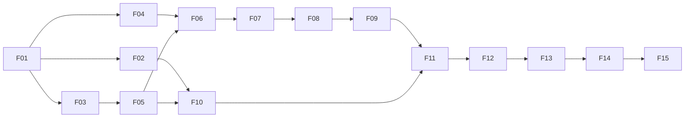
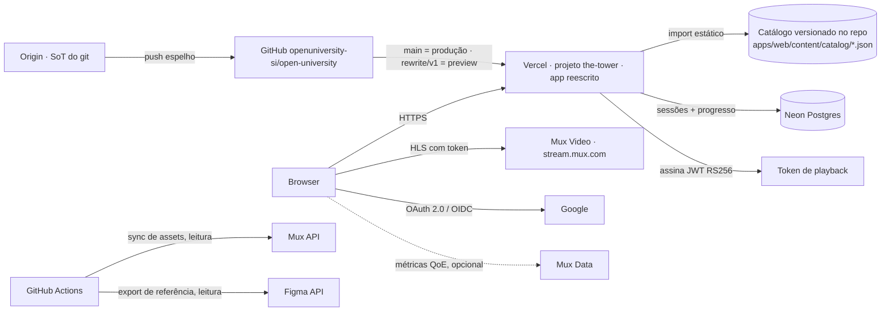

# The Tower — Projeto de implementação da v1 (Fase 1, revisão 2.1)

**Status: APROVADO pelo Daniel em 8/out/2026 08:27 (BRT). Em execução, fase a fase (ver Adendo 2.2 logo abaixo, que prevalece sobre o resto do documento onde divergir).**

Versão 2.1 · 8 de outubro de 2026 · Autor: revisão de arquitetura (Claude Opus 5.5) · Aprovação: Daniel.
O que mudou na 2.1 (respostas do Daniel, 8/out 07:55): reescrita **no mesmo repositório** `openuniversity-si/open-university` e no **mesmo projeto Vercel** `the-tower` (branch `rewrite/v1`, cutover por merge na `main`), Vercel fica no **Hobby**, números reais do Mux (126/126 `ready`, custos e teto de US$ 25), lançamento com os 5 cursos completos, textos editoriais gerados a partir dos dossiês de capas, perguntas renumeradas. Ainda na 2.1 (pedidos do Daniel, 08:02–08:03): implementação em **15 fases** com gate de autoverificação do agente (Parte B), **sem aprovação intermediária** do Daniel (ele revisa só a entrega final, B.5) e **testes automatizados que nunca tocam vídeo** (ADR-11).
Arquivo: `projeto/PROJETO-FASE1-v2.1.md`. A versão 2.0 continua em `projeto/PROJETO-FASE1-v2.md` como histórico.
Substitui a suíte 1.0 de 7/out (Codex Sol 6.1), que fica em `projeto/` como histórico. O log do que mudou e por quê está em [`REVISAO-OPUS-PROJETO.md`](REVISAO-OPUS-PROJETO.md).

> ## Adendo 2.3 — direção de 09/10/2026 (prevalece sobre tudo abaixo)
>
> **F13, F14 e F15 estão APOSENTADAS.** Único usuário: Daniel. Objetivo: 1 versão por dia (v01 de 100). Ficam fora, por decisão: CSP em enforce, exclusão de conta, monitoramento, rotina diária `mux-cost.yml`, ensaios de merge/rollback, revisão final B.5, 7 dias de observação, desativação do legado em 30 dias, `fidelity --all` e `-done.md`. Menções a elas no restante do texto são históricas. Ciclo vigente: `docs/project/CICLO-DIARIO.md`. Pendências para um eventual público: `docs/project/ANTES-DE-ABRIR-AO-PUBLICO.md`.

> ## Adendo 2.2 — decisões do Daniel em 8/out/2026 08:27–08:28 (prevalece sobre o texto abaixo)
>
> 1. **Sem `next.thetower.si` e sem nenhum subdomínio ou mudança de DNS.** O domínio é só `thetower.si` / `www.thetower.si`. Onde o documento diz `next.thetower.si`, leia: a URL automática de preview da Vercel (alias da branch, `the-tower-git-<branch>-the-tower-si.vercel.app`) durante o trabalho numa branch, e `www.thetower.si` depois que a branch entra na `main`. Nenhum registro no Cloudflare é criado.
> 2. **O site não tem usuários hoje.** Não é preciso proteger o site no ar: **a partir da F01, `thetower.si` pode mudar.** Fluxo escolhido (o mais simples e seguro para o agente): a F01 é feita na branch `rewrite/v1`; quando o gate da F01 passa (CI verde + preview conferido), `rewrite/v1` entra na `main` por merge commit e a produção em `thetower.si` passa a servir o app novo (com `noindex` até a F14). Da F02 em diante, cada fase é feita em branches curtas `v1/fNN-<nome>` com PR contra a `main`; o merge só acontece com CI verde e o gate da fase registrado em `docs/phases/FNN-done.md` (via `scripts/merge-phase`). Não há cerimônia longa de cutover: a F15 vira "ligar indexação + smoke + observação".
> 3. **Backup do legado:** tag `legacy-final` (anotada, no commit `134c168` da `main`), branch `legacy` no mesmo commit e tag `rewrite-base` — **criadas no GitHub em 8/out 08:29**. São permanentes.
> 4. **Banco:** sem retenção de 30 dias "para usuários" (não há usuários). A v1 continua num banco novo (`tower_v1`); **o banco antigo do Neon não é apagado sem perguntar ao Daniel.**
> 5. **Fonte de verdade do git na prática:** não existe repositório `the-tower` no Origin (verificado em 8/out: o Origin só tem `project_artemis`, espelho de entrada). Os PRs #51–#55 foram integrados no GitHub. Portanto o GitHub `openuniversity-si/open-university` é o repositório de trabalho: branches, PRs, Actions e merges acontecem nele (merge commit, só com CI verde, pelo `scripts/merge-phase`). As menções ao "Origin → espelho" no resto do documento ficam obsoletas.
> 6. **Vercel:** projeto `the-tower-si/the-tower`, Hobby, Production Branch `main`, Root Directory `apps/web`, "Include source files outside Root" ligado, Node 22.x. Os previews **não** têm Vercel Authentication hoje (ssoProtection nulo), então a URL de preview abre sem bypass; o `noindex` vem do app (`X-Robots-Tag` + meta) enquanto `SITE_INDEXABLE` não for `true`.

> ## Adendo 2.3 — nomes em inglês e "The Tower" (decisão do Daniel, 8/out/2026 09:16; prevalece sobre o texto abaixo)
>
> Todo componente e identificador, inclusive interno, fica em inglês e usa "The Tower" (`tower-`, `Tower`, `the-tower`), nunca "A Torre"/"Torre" nem nomes em português. Convenção: tokens CSS `--tower-*` (gerados do Figma, onde as variáveis já se chamam `tower-*` desde 8/out 09:20), componentes `Tower*` (ex.: `TowerMark`), banco `tower_v1` e role `tower_v1_app`, env vars novas `TOWER_*`, pacote `the-tower-web`, alias `@tower/playback-engine`, registros de fase em `docs/phases/FNN-done.md`, e `docs/operations/`, `docs/security/`, `docs/final-review/`, `docs/catalog/`, `docs/project/`. Conteúdo dos arquivos do repositório (README, docs, mensagens de scripts e testes) em inglês; relatórios para o Daniel continuam em português.
> **Código da F01 (`rewrite/v1`)**: os nomes antigos que ainda existem (`torre-web`, `TORRE_BUILD_TARGET`/`TORRE_APP_VERSION`/`TORRE_BUILD_COMMIT`, `@torre/playback-engine`, `torre-playback-engine:*`, `__torreNoVideoReport`, `--torre-surface`, título "A Torre", usuário/banco `torre`/`torre_test` do CI, `docs/fases/F01-concluida.md`, `docs/seguranca/audit-excecoes.md`, `docs/projeto/`, mensagens do `scripts/merge-phase` em português) são renomeados no **primeiro PR da próxima fase** (o `merge-phase --closes` passa a ler `docs/phases/FNN-done.md`). Exceção consciente: a lista de nomes de segredo procurados no bundle mantém os nomes legados reais (`TORRE_ADMIN_SECRET`, `TORRE_PUBLISH_SECRET`) enquanto essas variáveis existirem na Vercel.
> **Infraestrutura renomeada em 8/out 09:36–09:38 (aprovação do Daniel 09:35):** time Vercel "The Tower", slug `the-tower-si` (`the-tower` e `thetower` já estavam em uso na Vercel), projeto Vercel `the-tower` (id `prj_HJ0ueSZq4QBI0RYiNqDCxFux1ScO`, Git → `openuniversity-si/open-university` intacto); previews novos em `the-tower-git-<branch>-the-tower-si.vercel.app` (aliases antigos `*-a-torre.vercel.app` já atribuídos continuam respondendo); o projeto órfão `web` foi desconectado do Git (não apagado); páginas do Figma em inglês. **Ainda com nome antigo** (ver `projeto/NAMING-PROPOSAL.md`): store/projeto Neon `torre-progress` (`wispy-sun-55356617`; renomear exige o painel), store Blob `torre-covers` e env vars legadas `TORRE_*` (saem depois do cutover), domínio extra `atorre.digital` no projeto, pastas do box `/workspace/torre/…` e `torre-media/`. Onde este documento cita esses nomes, eles descrevem a infraestrutura real.

Fonte de verdade visual: Figma Desired Spec `t1sPlxRI6pcEk9LRxotS4w`, página aprovada `18:3`, Components `18:2`, Spec `288:4` (Specs 00–10). Quando este documento e a página `18:3` divergirem, vale a `18:3`, a menos que a divergência esteja listada na tabela D (§8.9) e você a tenha aprovado.

---

# Parte A — Resumo para o Daniel

## O que vamos construir

Um site novo, escrito do zero, em `https://www.thetower.si`. Ele nasce **no mesmo repositório** (`openuniversity-si/open-university`) e **no mesmo projeto Vercel** (`the-tower`) do site atual: o código antigo é substituído por inteiro, não remendado. São três telas e login:

1. **Home**: o destaque (Billboard) de um curso, a fileira "Continue Watching" (só para quem está logado e já assistiu algo) e uma fileira por autor (Jordan B. Peterson; John Vervaeke).
2. **Course**: a página do curso, com a lista completa das aulas, o painel "About this course" e o botão Start/Resume.
3. **Player**: o vídeo tocando pelo **Mux**, com os controles The Tower (play prata, barra de progresso, tempo), aula anterior/próxima, "Mark complete", "View lectures" e a lista de aulas ao lado (desktop) ou abaixo (mobile).
4. **Login só com Google**: "Sign in" no topo, menu da conta com "Sign out", aviso discreto quando o login falha ou é cancelado. Quem não está logado vê tudo e **assiste a tudo**; só não tem progresso salvo nem "Continue Watching".

Catálogo da v1: **5 cursos completos, 126 aulas** (Genesis 17, Maps of Meaning 2017 12, Personality 2017 20, Awakening from the Meaning Crisis 51, After Socrates 26). **As 126 aulas já estão prontas no Mux** (176,8 horas de vídeo). Não haverá curso pela metade. Visual: exatamente o do Figma: prata metálico, preto, nada de dourado, vermelho ou laranja, nada claro, sem barra inferior e sem rodapé no celular, primeiro toque num card destaca o curso e o segundo abre.

## O que **não** vamos construir na v1

Nada de pagamento, assinatura, livro, página de autor, busca, "My List", área de membros, comunidade, recursos de IA, Neo4j, AWS nem painel de administração. O site antigo não é remendado nem reaproveitado: o código dele sai do ar no dia da troca, mas fica **guardado no próprio repositório** (uma etiqueta `legacy-final` e uma branch `legacy`) como plano de volta. Dados podem ser migrados; interface, não.

## Como trabalhamos sem mexer no site que está no ar

- O site novo é construído numa **branch separada** (`rewrite/v1`) do mesmo repositório. Enquanto isso, a `main` continua servindo o site antigo, sem mudança.
- Cada versão da branch nova ganha um endereço de teste na Vercel; o endereço fixo é **`next.thetower.si`** (protegido, fora do Google): o agente o usa durante o trabalho e é lá que você fará a revisão final.
- **A troca** é juntar a branch nova à `main` (um *merge*). A Vercel publica a nova versão e só então passa o domínio para ela, sem tirar o site do ar.
- **Voltar atrás** leva minutos: um botão da Vercel ("Instant Rollback") devolve o site ao deploy anterior, que é o do site antigo. Se esse botão não servir mais, desfazemos o merge no git e a Vercel publica de novo o código antigo.

## Como saberemos que ficou fiel ao Figma

Toda fase com tela passa pela mesma régua, automática e repetível:

- exportamos do Figma as telas aprovadas em 390, 1366 e 1920 de largura;
- o site roda com dados de teste fixos (o mesmo "Genesis, aula 4, 52:14" do Figma);
- um robô fotografa o site nos mesmos tamanhos e compara **região por região** (topo, destaque, botões, cards, lista, player…): posição e tamanho com no máximo 1 px de diferença, cor com no máximo 2/255 por canal, e no máximo 0,5% de pixels diferentes por região;
- o relatório mostra, lado a lado, Figma, site e a sobreposição das diferenças;
- o agente só passa para a fase seguinte quando tudo está dentro da régua; **você não precisa aprovar nada no meio do caminho**;
- **você revisa uma vez, no fim**, antes da troca: abre o `next.thetower.si` no computador e no celular e recebe o relatório consolidado de todas as telas (Parte B, B.5).

Além do visual, testamos o funcionamento: pausa, avanço, erro com "Try again", login, progresso que volta no mesmo segundo. **Os testes automáticos nunca tocam vídeo** (para não gastar minutos do Mux nem disparar reprodução sozinha): usam um player simulado e conferem a assinatura dos tokens. O vídeo real você vê na revisão final.

## Quanto custa

| Serviço | Custo mensal estimado | Observação |
|---|---|---|
| Mux (vídeo) | Fatura de **US$ 0 a ~US$ 5,46** com até 100 mil minutos assistidos por mês | O armazenamento das 126 aulas custa no máximo US$ 25,46 brutos; o Mux abate US$ 20 de crédito por mês, e os primeiros 100 mil minutos assistidos são grátis. Acima disso, US$ 8 a cada 10 mil minutos |
| Vercel | US$ 0 (plano Hobby) | Mudamos para o Pro só quando algum gatilho do §12.3 acontecer |
| Neon (banco) | US$ 0 (plano gratuito, a confirmar na F02) | O banco guarda só contas e progresso |

O Mux **não tem alerta de cobrança nem teto de gasto**. Seu teto é US$ 25/mês. Propomos duas proteções: um **cartão virtual com limite de US$ 25** como teto duro e uma **rotina diária** que estima o gasto e avisa em US$ 20 e US$ 25 (perguntas 7 e 8).

## Quanto risco

| Risco | Nível | O que fazemos |
|---|---|---|
| Vídeo: tokens assinados do Mux mal configurados deixam aulas sem tocar | Médio | Conferência automática da assinatura e do aceite do token pelo Mux (sem baixar vídeo); reprodução real na sua revisão final, antes da troca; tela de erro com "Try again" que gera token novo |
| Gasto do Mux passar do teto sem aviso (o Mux não tem alerta nem teto) | Médio | Cartão virtual de US$ 25 + estimativa diária com aviso em US$ 20 e US$ 25 |
| Limites do plano Hobby da Vercel (uso não comercial, voltar só ao deploy anterior, cotas mensais) | Médio | Volta atrás em duas camadas, acompanhamento das cotas e gatilhos claros para mudar para o Pro (§12.3) |
| Login Google bloqueado na troca (tela de consentimento em modo "Testing", endereço de retorno faltando) | Baixo | Checklist do Google Cloud antes da troca; login testado no `next.thetower.si` |
| Fidelidade "quase igual" escapar | Baixo | Comparação automática por região como condição para fechar cada fase + relatório consolidado na sua revisão final |
| Problemas aparecerem só no fim, já que você não revisa no meio | Médio | Fases pequenas com gates estritos e regressão completa; correções da revisão final voltam à fase de origem |
| Troca do site derrubar o ar | Baixo | A Vercel só passa o domínio quando a versão nova está pronta; volta atrás em minutos com o Instant Rollback, ensaiado antes |

## O que precisamos de você

**Decidir** (detalhe em §13): trailers; controles extras do player; "assistida" automática; seta das fileiras; link de privacidade; aprovar a tabela D de divergências (§8.9); se o teto de US$ 25 do Mux vale para a **fatura** ou para o **uso bruto**; e se quer o cartão virtual de US$ 25 como teto duro.

**Fazer** (são ações só suas, ou de quem tiver acesso às contas): (1) aprovar este projeto; (2) dar à Engenharia acesso ao Mux para criar uma *signing key* e um *access token* só de leitura (vídeo e Mux Data); (3) no Google Cloud, adicionar os endereços de retorno do `next.thetower.si` e publicar a tela de consentimento; (4) revisar e aprovar os textos editoriais na planilha "Textos editoriais — v1 (revisão)", coluna "Aprovado?"; (5) se decidir pelo teto duro, criar o cartão virtual de US$ 25 e cadastrá-lo no Mux; (6) fazer a **revisão final** no `next.thetower.si` (~30 min, com roteiro) e dar o "go"; (7) autorizar o dia da troca.

## Fases de implementação

A implementação está dividida em **15 fases pequenas**, descritas na **Parte B** (logo abaixo), cada uma com objetivo, escopo, entregáveis, telas do Figma, critérios de aceite e um gate que o agente precisa passar antes de seguir:

F01 Fundação (repositório, branch, CI, preview) → F02 Banco → F03 Tokens, tipografia e régua de fidelidade → F04 Catálogo, vídeos e textos → F05 Moldura das telas → F06 Home deslogada → F07 Course deslogado → F08 Player sem vídeo → F09 Player com Mux → F10 Login Google → F11 Progresso e Continue Watching → F12 Estados, acessibilidade e tamanhos intermediários → F13 Segurança, desempenho, privacidade e custo → F14 Ensaio da troca e **sua revisão final** → F15 Troca e observação.

Estimativa total: **34 a 49 dias de engenharia** (~7 a 10 semanas), sem contar as esperas por ações suas e os 7 dias de observação depois da troca.

---

# Parte B — Fases de implementação

Esta parte é o roteiro do **agente implementador** (Claude) e de quem o acompanha na Engenharia. A implementação é dividida em **15 fases pequenas e fechadas**, executadas em ordem. As fases existem para dar contexto claro e escopo fechado ao agente e evitar erros. **O Daniel não aprova nada nas fases intermediárias:** cada fase termina com uma **autoverificação** (checks automáticos, testes, fidelidade contra os nós do Figma da fase e um gate explícito de "concluída") que o agente executa e registra antes de começar a próxima. O Daniel revisa **uma vez, no fim** (B.5), antes do cutover. As fases não são deployadas separadamente para revisão; os previews e o `next.thetower.si` são ferramentas do agente e do CI.

As decisões já tomadas pelo Daniel estão na Parte A e nos ADRs (Parte C, §4) e não se rediscutem nas fases; as que ainda faltam estão no §13.

## B.1 Índice das fases

| Fase | Nome | Entrega em uma linha | Esforço (estimativa, dias) |
|---|---|---|---|
| F01 | Fundação: repositório, branch, CI e preview | `rewrite/v1` sem o legado, app vazio em `apps/web`, pipeline e `next.thetower.si` funcionando | 2–3 |
| F02 | Banco e ambientes de dados | `tower_v1`, role, branches `v1-staging`/`v1-preview`, Drizzle e migração 0001 | 1–2 |
| F03 | Tokens, tipografia e harness de fidelidade | `tokens.css`, fontes pinadas, classes `.t-*`, referências Figma congeladas e `fidelity/compare.ts` provado | 3–4 |
| F04 | Catálogo, sync Mux e textos editoriais | JSON da v1 com 5 cursos / 126 aulas, `video-assets.json` validado, textos gerados dos dossiês na planilha | 3–4 |
| F05 | Shell: TopNav, Footer, estados vazios e erros | Moldura comum das telas (deslogada), 404/500, skip link, skeleton | 2–3 |
| F06 | Home deslogada | Billboard, CTA, fileiras por autor, CourseCard Poster, 1º/2º toque | 3–4 |
| F07 | Course deslogado | Página do curso com lista completa, About e Start | 2–3 |
| F08 | Player: layout, lista e navegação (sem vídeo) | Rota do Player no estado pôster, PlayerRail, anterior/próxima, View lectures, About da aula | 2–3 |
| F09 | Player: engine Mux, tokens assinados e estados | `mux-video` + Media Chrome, controles The Tower, Loading/Error/Try again, token RS256 e refresh, testes sem vídeo | 3–4 |
| F10 | Login Google | Better Auth, Sign in, "Continuing with Google", feedback, menu da conta, Sign out | 2–3 |
| F11 | Progresso e Continue Watching | `lesson_progress`, checkpoints, Mark complete, Resume, telas logadas fiéis | 3–4 |
| F12 | Estados, acessibilidade e responsivo | Todos os estados de comportamento, contratos responsivos, teclado e axe | 2–3 |
| F13 | ~~Segurança, desempenho, privacidade e operação~~ | APOSENTADA (09/10/2026) | — |
| F14 | ~~Ensaio de cutover e revisão final~~ | APOSENTADA (09/10/2026) | — |
| F15 | ~~Cutover e observação~~ | APOSENTADA (09/10/2026) | — |
| | **Total** | | **34–49 dias de engenharia** (1 dev sênior com agente; ~7–10 semanas), sem contar esperas por ações do Daniel e os 7 dias de observação |

## B.2 Regras comuns a todas as fases (DoD e gate)

**Fluxo.** Cada fase é desenvolvida em uma ou mais branches `v1/fNN-<nome>` saídas de `rewrite/v1` (1 a 3 PRs por fase), integradas no Origin pelo script `scripts/merge-phase` (§10.2). Uma fase só começa quando o gate da anterior está registrado na `rewrite/v1`.

**Definition of Done comum** (vale para toda fase, além dos critérios próprios):

- `pnpm lint`, `pnpm typecheck`, `pnpm test` (unit), `pnpm test:int` (integração com Postgres em container), `pnpm build` (build de produção) e `pnpm build:test` (o mesmo build com o engine de vídeo trocado pelo `FakeEngine`, ADR-11) passam sem aviso;
- `pnpm e2e`, `pnpm a11y` e `pnpm fidelity` passam para **tudo o que já existe**, não só para o que a fase acrescentou (regressão zero nas fases anteriores);
- `pnpm verify:no-video` passa: zero requisições do navegador para `*.mux.com`/`*.litix.io` e zero chamadas reais de `play()` em toda a suíte (ADR-11);
- `pnpm bundle:check` e `pnpm audit --audit-level high` passam;
- nenhuma dívida (§10.3); ADR atualizado se alguma decisão mudou; CI verde no Actions para o commit que fecha a fase;
- fidelidade, quando a fase tem tela: protocolo do §9 nos frames da fase, em 390/1366/1920 e DPR 1/2: **geometria ≤ 1 px, cor ≤ 2/255 por canal, ≤ 0,5% de pixels diferentes por região**; máscara só nas regiões D1. O agente **não afrouxa tolerância** e não cria exceção para geometria, fonte, peso, quebra de linha ou crop; para os efeitos da Spec 05 (blur, glow, gradiente metálico), uma diferença que persista depois da calibração fica registrada com evidência no relatório e é levada à revisão final (B.5), sem bloquear a fase.

**Gate de conclusão.** Ao fim de cada fase, o agente executa todos os comandos acima e os itens do gate da fase, e registra o resultado em **`docs/phases/FNN-done.md`**: data, commit, saída resumida de cada comando (código de saída e números), resumo do relatório de fidelidade por frame e região, itens "a confirmar" resolvidos na fase, desvios e o que fica para a fase seguinte. O arquivo entra no último PR da fase; o `scripts/merge-phase --closes FNN` recusa o merge se o arquivo faltar ou se algum item do gate estiver vazio. Com algum item vermelho, a fase não conclui: o agente corrige dentro da fase.

**Contexto mínimo sempre carregado:** a Parte B (B.2 e o cartão da fase), §10.3 (zero dívida), Spec 00 (precedência, `288:4`) e o gate da fase anterior. Cada fase lista o restante.

## B.3 Dependências



| Fase | Depende de (fases) | Ações do Daniel ou de contas necessárias antes de começar |
|---|---|---|
| F01 | — | Projeto aprovado; acesso da Engenharia ao Origin, ao projeto Vercel `the-tower` (token da conta) e ao Cloudflare (registro `next`) |
| F02 | F01 | Acesso ao projeto Neon do legado |
| F03 | F01 | Token de leitura do Figma |
| F04 | F01 | Access token **só de leitura** do Mux (Video e Mux Data); acesso à planilha Google para criar "Textos editoriais — v1 (revisão)" |
| F05 | F03 | — |
| F06 | F04, F05 | — |
| F07 | F06 | — |
| F08 | F07 | — |
| F09 | F08 | **Signing key** do Mux criada para a v1 |
| F10 | F02, F05 | Redirect URIs do `next.thetower.si` no Google Cloud |
| F11 | F09, F10 | — |
| F12 | F11 | — |
| F13 | F12 | Decisão da pergunta 5 (privacidade); se aprovado o item "Privacy", o nó desenhado no Figma (pelo Grok, a pedido do Daniel) |
| F14 | F13 | Textos editoriais obrigatórios aprovados na planilha; tela de consentimento do Google publicada; respostas do §13; cartão virtual cadastrado, se a pergunta 8 for "sim" |
| F15 | F14 | "Go" do Daniel na revisão final e data autorizada |

A ordem de execução é linear (F01 → F15). Pela tabela, F02 e F04 poderiam correr em paralelo a F03, e F10 em paralelo a F06–F09; com um único agente, a ordem linear é a recomendada, porque mantém um contexto por vez.

## B.4 As fases

### F01 · Fundação: repositório, branch, CI e preview

**1. Objetivo.** Deixar a `rewrite/v1` pronta para receber o app: legado removido, app vazio que builda, pipeline completo e preview em `next.thetower.si`, sem tocar a produção do legado.

**2. Escopo.** *Dentro:* tag `rewrite-base` e branch `rewrite/v1` no Origin; primeiro commit removendo o legado (código, 134 testes, workspace pnpm, admin, Publish API, Blob, `catalog/`); app Next pinado em `apps/web` (TS strict, ESLint, stylelint, Vitest, Playwright); `apps/web/vercel.json` próprio; workflows do Actions; `scripts/merge-phase`; espelho com `rewrite/v1`, `v1/*` e tags; domínio `next.thetower.si` atribuído à branch; env vars por escopo (§11.1), sem valores no repo; guarda de rede sem vídeo (ADR-11); rota `/api/health`. *Fora:* banco (F02), tokens e telas (F03+), qualquer mudança na `main`.

**3. Entregáveis.** `apps/web/package.json` (scripts do B.2), `apps/web/tsconfig.json`, `eslint.config.mjs`, `stylelint.config.mjs`, `vitest.config.ts`, `playwright.config.ts` com a fixture `e2e/fixtures/no-video-guard.ts`, `apps/web/vercel.json`, `src/app/api/health/route.ts`, `.github/workflows/ci.yml`, `scripts/merge-phase`, `README.md` da raiz descrevendo o fluxo Origin → espelho e a regra "nada se escreve no GitHub", `docs/phases/F01-done.md` com a lista de "a confirmar na F01" respondida.

**4. Dependências.** Nenhuma fase. Contas: Origin, projeto Vercel `the-tower`, Cloudflare (registro `next` em "DNS only").

**5. Telas e nós do Figma.** Nenhuma tela. Spec 00 (precedência) como contexto.

**6. Critérios de aceite.** PR trivial contra `rewrite/v1` roda o pipeline inteiro e fica verde; preview servido em `next.thetower.si` com `noindex` e protegido; `/api/health` responde 200 com a versão do build; `git diff --stat rewrite-base rewrite/v1` mostra o legado removido; smoke do legado do README (`/`, curso Genesis, aula 1 em 390/430) **igual antes e depois** em `www.thetower.si`; nenhum segredo no repositório (varredura do CI); itens "a confirmar na F01" respondidos: escopo de branch no Preview, bypass de automação, concorrência de builds, redeploy/promote no Hobby, composição do time `the-tower-si`, termos de uso comercial, integração Neon ↔ Vercel, cota do Actions, Better Auth (ADR-05), se o manifesto da sonda conta como entrega no Mux (ADR-11), preços.

**7. Gate de conclusão.** DoD comum (fidelidade não se aplica); `curl -sI https://next.thetower.si/api/health` (com bypass) 200 e `X-Robots-Tag: noindex`; registro do smoke do legado antes/depois; `scripts/merge-phase --dry-run` recusando um commit com check vermelho; `docs/phases/F01-done.md`. **Contexto mínimo:** ADR-01, ADR-02, ADR-11, §3, §10.2, §11.1, §12.1–12.3, README do repositório (fluxo Origin).

**8. Esforço e riscos.** 2–3 dias (estimativa). Riscos: escopo de branch ou bypass indisponíveis no Hobby (mitigação: nomes exclusivos e shareable link, §12.2); o espelho não propagar branches novas; preview da reescrita atrasando build do legado.

### F02 · Banco e ambientes de dados

**1. Objetivo.** Criar o banco da v1 ao lado do legado, sem mexer nele, com migrações versionadas e ambientes isolados.

**2. Escopo.** *Dentro:* banco `tower_v1`, role `tower_v1_app`, branches Neon `v1-staging` e `v1-preview` (expand, §12.4); Drizzle e `drizzle-kit`; migração 0001 (tabelas do Better Auth + `lesson_progress`, §5.2); seed sintético; Postgres em container no CI; `APP_DATABASE_URL*` por ambiente. *Fora:* lógica de auth (F10) e de progresso (F11); qualquer mudança no banco do legado.

**3. Entregáveis.** `src/db/schema.ts`, `drizzle/0001_init.sql`, `drizzle.config.ts`, `scripts/db-seed.ts`, `scripts/db-migrate.ts` (usa `APP_DATABASE_URL_UNPOOLED`), serviço Postgres em `.github/workflows/ci.yml`, `docs/operations/database.md` (ambientes, restore por branch nova, PITR conferido), `docs/phases/F02-done.md`.

**4. Dependências.** F01. Acesso ao projeto Neon.

**5. Telas e nós do Figma.** Nenhuma.

**6. Critérios de aceite.** Migração 0001 aplicada em container, `v1-preview`, `v1-staging` e `tower_v1`, nessa ordem; `drizzle-kit check` sem drift; teste de integração cria e lê `lesson_progress` com FK para `user` e `ON DELETE CASCADE`; o banco do legado sem nenhuma alteração (lista de tabelas e contagem de linhas iguais antes e depois); região do Neon igual à das funções Vercel; janela de PITR e limites do plano gratuito registrados.

**7. Gate de conclusão.** DoD comum; `pnpm db:migrate --target container|v1-preview|v1-staging|prod --dry-run` sem pendência; comparação antes/depois do banco do legado anexada; `docs/phases/F02-done.md`. **Contexto mínimo:** ADR-04, §5.2, §11.1, §12.4.

**8. Esforço e riscos.** 1–2 dias (estimativa). Riscos: limite de branches do plano gratuito; integração Neon ↔ Vercel sobrescrevendo variáveis (mitigação: nomes `APP_*`); schema do Better Auth mudar entre versões (fixar versão).

### F03 · Tokens, tipografia e harness de fidelidade

**1. Objetivo.** Ter a régua pronta antes de qualquer tela: tokens e tipografia idênticos ao Figma e um comparador de fidelidade que comprovadamente acusa diferença.

**2. Escopo.** *Dentro:* `tokens.css` gerado das variáveis do Figma (Spec 05, codeSyntax da Spec 10), snapshot e teste; fontes Inter e Libre Caslon Text pinadas; classes `.t-*` (Spec 02); constantes de layout (Spec 01); regras de stylelint contra valores soltos; congelamento das referências (§9.2 passo 1) com `geometry.json`; `fidelity/compare.ts`, `fidelity/regions.ts` (esqueleto), relatório HTML; páginas de teste fora do build de produção. *Fora:* componentes de tela (F05+).

**3. Entregáveis.** `src/ui/tokens/tokens.css`, `src/ui/tokens/layout.ts`, `src/ui/typography.css`, `design/figma-tokens.snapshot.json`, `public/fonts/*` (arquivos fixados), `design/reference/<versionId>/` (Git LFS) + `geometry.json`, `fidelity/compare.ts`, `fidelity/regions.ts`, `fidelity/report/`, `src/app/(test)/_specimen/` (excluído do build de produção), `docs/fidelity/F03.md`, `docs/phases/F03-done.md`.

**4. Dependências.** F01. Token de leitura do Figma.

**5. Telas e nós do Figma.** Variáveis e estilos locais do arquivo `t1sPlxRI6pcEk9LRxotS4w`; Spec 01 (layout), Spec 02 (tipografia), Spec 05 (tokens, translúcidos, degradês, efeitos), Spec 10 (mapa de nomes); export de **todos** os frames do §9.2 (logados `24:2`, `53:1391`, `29:399`, `29:241`, `53:1429`, `64:1666`, `26:124`, `53:1467`, `29:551`, `42:554`, `53:1518`, `43:662`; deslogados `154:16670…154:18201`; `154:18397…`, `224:4298…`; estados `293:14604`) em 390/1366/1920, escala 1 e 2.

**6. Critérios de aceite.** Teste `tokens.css` × snapshot passa; nenhum `tower-accent*` no CSS; specimen: família, peso e tamanho computados de cada `.t-*` iguais à Spec 02 após `document.fonts.ready`; amostras de cor dos swatches com Δ ≤ 2/255; **autoteste do harness**: referência comparada consigo mesma dá 0%, e uma captura deslocada 2 px ou com cor alterada em 3/255 **falha** com geometria e cor acusadas; relatório HTML gerado com Figma | site | sobreposição | heatmap; stylelint recusa um hex de teste fora dos tokens.

**7. Gate de conclusão.** DoD comum; `pnpm fidelity:selftest` verde; `pnpm tokens:check`; versão do Figma registrada em `docs/fidelity/F03.md`; `docs/phases/F03-done.md`. **Contexto mínimo:** ADR-02, ADR-09, §8.1, §8.2, §8.4, §9 inteiro, Specs 01/02/05/10.

**8. Esforço e riscos.** 3–4 dias (estimativa). Riscos: efeitos (blur, glow, gradiente) difíceis de igualar em 2/255; diferença de renderização de fonte entre Docker e Figma (mitigação: imagem Docker do Playwright pinada, fontes no repo); volume das referências no Git LFS.

### F04 · Catálogo, sync Mux e textos editoriais

**1. Objetivo.** Dados da v1 corretos, validados no build e rastreáveis, com os 126 vídeos confirmados e os textos editoriais gerados para a revisão do Daniel.

**2. Escopo.** *Dentro:* schemas Zod e invariantes (§5.1); `catalog:import-legacy` a partir de `rewrite-base`; `catalog:sync-mux` (as 126 já estão `ready`; o sync valida e grava) e o modo `--check` semanal no Actions; geração dos textos em inglês a partir dos dossiês de capas e do catálogo → `textos/textos-editoriais-v1.csv` + planilha "Textos editoriais — v1 (revisão)" com a coluna "Aprovado?"; `catalog:editorial` lendo o CSV exportado; imagens da Spec 09; relatório C1–C7. *Fora:* aprovação dos textos (é do Daniel, em paralelo; exigida só no build de produção, F14); telas.

**3. Entregáveis.** `src/catalog/schema.ts`, `src/catalog/load.ts`, `src/catalog/queries.ts`, `content/catalog/{authors,courses,lessons,home,video-assets}.json`, `scripts/catalog-import-legacy.ts`, `scripts/catalog-sync-mux.ts`, `scripts/catalog-editorial.ts`, `scripts/editorial-generate.ts`, `.github/workflows/mux-check.yml`, `public/media/*` (nomes com hash), `docs/catalog/divergences.md` (C1–C7), `textos/textos-editoriais-v1.csv` (pasta `textos/` do projeto de pesquisa) e a planilha Google, `docs/phases/F04-done.md`.

**4. Dependências.** F01. Access token do Mux só de leitura; acesso para criar a planilha.

**5. Telas e nós do Figma.** Sem comparação visual. Dados conferidos contra a Spec 06 (fixture, `289:11290`), a Spec 09 (assets e hashes) e as cópias dos frames `26:124`, `42:554` ("Lecture 4 of 17", "Episode 12 of 51", "Background 9", "Lecture 17 · 1h 03m").

**6. Critérios de aceite.** Build valida **exatamente 5 cursos completos e 126 aulas, 126/126 `ready`**, `order` contíguo, slugs únicos, 0 assets `public`, durações ±2 s, hashes de imagem iguais à Spec 09; o build **de produção** (`VERCEL_ENV=production` ou `--require-approved`) recusa curso com campo obrigatório sem aprovação, enquanto previews e testes aceitam textos ainda não aprovados; aula sem About aprovado sai sem o bloco (D8); CSV com uma linha por campo e aula, origem (dossiê/catálogo) e coluna de aprovação; planilha criada e compartilhada com o Daniel; `--check` verde contra o Mux; o script do Mux só faz chamadas `GET`.

**7. Gate de conclusão.** DoD comum; `pnpm catalog:check`; `pnpm catalog:sync-mux --check` (126/126); `pnpm catalog:check --require-approved` executado e seu resultado (pendências esperadas) registrado; relatório C1–C7 anexado; `docs/phases/F04-done.md`. **Contexto mínimo:** ADR-03, ADR-08, §2.1, §5.1, §5.4, §7.8, Specs 06 e 09, dossiês em `capas-perfilamento/dossies/`.

**8. Esforço e riscos.** 3–4 dias (estimativa). Riscos: divergências entre snapshot, git e manifestos; textos gerados fracos (revisão do Daniel em lotes por curso); aprovação atrasar o cutover (não bloqueia as fases seguintes).

### F05 · Shell: TopNav, Footer, estados vazios e erros

**1. Objetivo.** Construir a moldura comum das três telas no estado deslogado, fiel ao Figma, mais as páginas de erro e os estados vazios.

**2. Escopo.** *Dentro:* `TopNav` (Device × Context Home/Course × Auth signed out; "‹" em Course/Player, D10), `Footer` e `TowerMark` (desktop/Present), ícones SVG, `CourseCardSkeleton` e `loading.tsx`, `EmptyCatalog`, 404/500 (D6), skip link (D7), CSS de foco por papel, layout raiz (`<html lang="en">`, fontes, tokens). *Fora:* avatar e menu da conta (F10), conteúdo das telas (F06+).

**3. Entregáveis.** `src/ui/TopNav/`, `src/ui/Footer/`, `src/ui/TowerMark/`, `src/ui/icons/`, `src/ui/CourseCardSkeleton/`, `src/ui/EmptyCatalog/`, `src/ui/focus.css`, `src/app/layout.tsx`, `src/app/not-found.tsx`, `src/app/error.tsx`, `src/app/loading.tsx`, regiões TopNav/Footer em `fidelity/regions.ts`, `docs/fidelity/F05.md`, `docs/phases/F05-done.md`.

**4. Dependências.** F03.

**5. Telas e nós do Figma.** TopNav `21:61`, Footer `21:155`, TowerMark `20:80`, ícones `20:8`/`20:27`/`20:33`, Skeleton `293:14477`, EmptyState `293:14484`, FocusRing `293:14464`; regiões TopNav e Footer dos frames deslogados da Home `154:16670`/`154:16878`/`154:16778` (390/1366/1920); Specs 01, 02, 05, 07, 08, 10. Sem BottomNav, LessonRow, AuthPanel nem Footer mobile (Spec 00/10).

**6. Critérios de aceite.** Fidelidade das regiões TopNav e Footer nos 3 frames e nos 3 tamanhos, DPR 1 e 2, dentro de ≤ 1 px / ≤ 2/255 / ≤ 0,5%; header 56/72, fixo e sobreposto com `tower-topnav-scrim`; mobile sem footer; 404/500 com TopNav normal e PrimaryCTA "Home" (composição do `EmptyCatalog`, verificada por DOM e pelas regiões de `293:14484`); skip link visível só com foco de teclado; alvos ≥ 44 medidos.

**7. Gate de conclusão.** DoD comum; `pnpm fidelity --phase F05` verde; `docs/fidelity/F05.md` com o resumo por região; `docs/phases/F05-done.md`. **Contexto mínimo:** §3.1, §8.3 (linhas TopNav, Footer, Skeleton/EmptyState), §8.4, §8.6, §8.7, §8.9 (D6, D7, D10), Specs 01/07/08/10.

**8. Esforço e riscos.** 2–3 dias (estimativa). Riscos: scrim do TopNav sobre o Billboard (calibrar contra o export); TowerMark com SVG divergente (usar o SVG oficial exportado).

### F06 · Home deslogada

**1. Objetivo.** Primeira tela completa e fiel: Home deslogada com Billboard, fileiras por autor e a interação de 1º/2º toque.

**2. Escopo.** *Dentro:* `Billboard` + `BillboardSelection` (hero por curso com crops da Spec 09), `PrimaryCTA` (Start, prata soft, largura hug), `RailHeader` (seta conforme pergunta 4), `CourseCard` Poster 140/208, fileiras Jordan B. Peterson e John Vervaeke (`home.json`), seleção no 1º toque e abertura no 2º, hover só em ponteiro fino, rota `/`. *Fora:* Continue Watching e Resume (F11), estados de foco combinados (F12).

**3. Entregáveis.** `src/ui/Billboard/`, `src/ui/PrimaryCTA/`, `src/ui/RailHeader/`, `src/ui/CourseCard/`, `src/ui/Rail/`, `src/app/page.tsx`, regiões da Home em `fidelity/regions.ts`, E2E `e2e/home.spec.ts`, `docs/fidelity/F06.md`, `docs/phases/F06-done.md`.

**4. Dependências.** F04 (catálogo e imagens), F05 (shell).

**5. Telas e nós do Figma.** Home deslogada `154:16670`/`154:16878`/`154:16778` e Tap1 deslogado (frames correspondentes na faixa `154:16670…154:18201`, ids exatos registrados no `geometry.json` na F03), em 390/1366/1920; Billboard `23:65`, PrimaryCTA `21:114`, RailHeader `21:128`, CourseCard `22:78` (Poster); Specs 01, 07 (toques e hover), 09 (crops).

**6. Critérios de aceite.** Fidelidade de todas as regiões (TopNav, texto do Billboard, CTA, cada card, RailHeader, Footer) da Home e do Tap1 deslogados, 3 tamanhos, DPR 1/2, dentro das tolerâncias; E2E: 1º toque seleciona (anel prata 2 px, Billboard troca, `-mobile-strong` no mobile), 2º abre o Course, Ctrl/Cmd/clique do meio abrem direto, hover não troca o hero; nenhuma consulta ao banco deslogado; sem Continue Watching e sem o espaço dele.

**7. Gate de conclusão.** DoD comum; `pnpm fidelity --phase F06`; `pnpm e2e --grep home`; `docs/fidelity/F06.md`; `docs/phases/F06-done.md`. **Contexto mínimo:** ADR-07, §5.1 (Course, Home), §8.3 (Billboard, PrimaryCTA, RailHeader, CourseCard), §8.4, §8.5, Specs 01/07/09, frames da Home deslogada.

**8. Esforço e riscos.** 3–4 dias (estimativa). Riscos: ângulo do `tower-silver-cta-soft` pela largura hug; crop do hero por device; ellipsis de 2 linhas nos cards.

### F07 · Course deslogado

**1. Objetivo.** Página do curso fiel, com a lista completa das aulas, o About e o Start.

**2. Escopo.** *Dentro:* Billboard do Course, `PlaylistItem` no contexto Course (sem checks), `CourseAbout` (monograma, "41 hours · 17 lectures", Level/Format), layout desktop `lectures = W − 160 − 64 − 380` + About 380, rota `/c/[courseSlug]`, rótulos por `kind`/`lessonNoun`. *Fora:* checks, Current e "3 of 17 watched" (F11).

**3. Entregáveis.** `src/ui/PlaylistItem/`, `src/ui/CourseAbout/`, `src/app/c/[courseSlug]/page.tsx`, regiões do Course em `fidelity/regions.ts`, E2E `e2e/course.spec.ts`, `docs/fidelity/F07.md`, `docs/phases/F07-done.md`.

**4. Dependências.** F06.

**5. Telas e nós do Figma.** Course deslogado `154:16986`/`154:17356`/`154:17200` em 390/1366/1920 (inclusive "Scroll content"); PlaylistItem `39:66`, About `287:12610`; Specs 01, 06 (durações e rótulos), 07.

**6. Critérios de aceite.** Fidelidade de todas as regiões dos 3 frames, DPR 1/2, dentro das tolerâncias; cursos de 17 e de 51 aulas sem overflow; títulos longos quebram conforme §8.6; rótulos "Lecture"/"Episode"/"Background"/"Trailer" corretos (C3/C4); Start leva à aula 1 (D4); URLs dos 5 cursos iguais às do site live.

**7. Gate de conclusão.** DoD comum; `pnpm fidelity --phase F07`; `pnpm e2e --grep course`; `docs/fidelity/F07.md`; `docs/phases/F07-done.md`. **Contexto mínimo:** §3.1, §5.1 (Lesson), §5.3 (durações), §8.3 (PlaylistItem, About), §8.4, Specs 01/06, frames do Course deslogado.

**8. Esforço e riscos.** 2–3 dias (estimativa). Riscos: altura da lista com 51 aulas e regiões abaixo da dobra; texto do About (fixture de fidelidade usa o texto do Figma, §9.2 passo 3).

### F08 · Player: layout, lista e navegação (sem vídeo)

**1. Objetivo.** Rota do Player completa no estado pôster, com lista de aulas, navegação e About, antes de qualquer integração de vídeo.

**2. Escopo.** *Dentro:* rota `/c/[courseSlug]/[lessonSlug]`, `PlayerFrame` só no estado `poster` (still + scrim + PlayButton + tempo `0:00 / duração`), `PlayerRail` (Device × Auth signed out), `PlaylistItem` no contexto Player, Previous/Next (D3), `LecturesAnchor` (View lectures, 300 ms ease-out), `LectureAbout` (D8), `CompletionToggle` visual (o clique deslogado é ligado ao login na F10, D2), "‹" para o Course (D10), `?t=` lido. *Fora:* engine, token, estados de mídia (F09); progresso (F11).

**3. Entregáveis.** `src/ui/PlayerFrame/` (pôster), `src/ui/PlayerRail/`, `src/ui/LectureAbout/`, `src/ui/CompletionToggle/`, `src/ui/LecturesAnchor/`, `src/app/c/[courseSlug]/[lessonSlug]/page.tsx`, regiões do Player em `fidelity/regions.ts` (com as máscaras D1), E2E `e2e/player-nav.spec.ts`, `docs/fidelity/F08.md`, `docs/phases/F08-done.md`.

**4. Dependências.** F07.

**5. Telas e nós do Figma.** Player deslogado `154:17886`/`154:18201`/`154:18053` em 390/1366/1920, com máscara D1 só em checks, tempo e scrubber; PlayerFrame `287:12440` (estado pôster), PlayerRail `287:13785`, PlaylistItem `39:66`, About `287:12619` (e `287:12614`), PlayerCompletionToggle `162:90`, PlayerLecturesAnchor `162:119`; Specs 01 (`main = min(W − 476, 1444)`, rail 380), 03, 07.

**6. Critérios de aceite.** Fidelidade das regiões dos 3 frames dentro das tolerâncias; 16:9 em 1444×812, 890×501, 390×219; deslogado sem checks e tempo `0:00 / duração` (D1); Previous omitido na aula 1 e Next na última (D3); View lectures rola até a PlayerRail sem trocar rota; About omitido sem texto aprovado (D8); E2E Home → Course → Player → prev/next → View lectures; nenhuma requisição ao Mux (o pôster é still próprio).

**7. Gate de conclusão.** DoD comum; `pnpm fidelity --phase F08`; `pnpm e2e --grep player-nav`; `pnpm verify:no-video`; `docs/fidelity/F08.md`; `docs/phases/F08-done.md`. **Contexto mínimo:** §7.1, §7.4, §8.3 (PlayerRail, PlayerFrame, About, CompletionToggle, LecturesAnchor), §8.4, §8.9 (D1, D2, D3, D8, D10, D11), Specs 01/03.

**8. Esforço e riscos.** 2–3 dias (estimativa). Riscos: rolagem interna da PlayerRail acompanhando a altura do main sem `100dvh`; quebra das ações do Player em 1024.

### F09 · Player: engine Mux, tokens assinados e estados

**1. Objetivo.** Ligar o vídeo de verdade (Mux assinado, controles The Tower, Loading/Error/Try again) **sem que nenhum teste toque vídeo**.

**2. Escopo.** *Dentro:* interface `PlaybackEngine` com `MuxVideoEngine` (produção, `mux-video` + Media Chrome) e `FakeEngine` (só no build de teste, ADR-11); controles React (PlayButton, TimeDisplay, PlayerScrubber com teclado ±5 s); máquina de estados do §7.2; assinatura RS256 no render da rota e server action `refreshPlaybackToken` com limite e `Origin` check; TTL do §7.3; estados `PlayerLoading` e `PlayerError`; sem autoplay e sem carregar HLS antes do gesto; Mux Data desligado em teste; CSP em report-only; sonda do manifesto (`scripts/mux-token-probe.ts`). *Fora:* checkpoints de progresso (F11); legendas e controles extras (pergunta 2, só se aprovados, com nós desenhados no Figma pelo Grok a pedido do Daniel).

**3. Entregáveis.** `src/playback/engine.ts`, `src/playback/mux-engine.tsx`, `src/playback/testing/fake-engine.ts`, `src/playback/token.ts` (`server-only`), `src/playback/actions.ts`, `src/ui/PlayButton/`, `src/ui/TimeDisplay/`, `src/ui/PlayerScrubber/`, `src/ui/PlayerLoading/`, `src/ui/PlayerError/`, `next.config.ts` (alias do build de teste), `scripts/mux-token-probe.ts`, `e2e/player-states.spec.ts`, `docs/adr/ADR-06-spike.md` (como o `mux-video` recebe o token, lido no código e na documentação, sem reproduzir), `docs/fidelity/F09.md`, `docs/phases/F09-done.md`.

**4. Dependências.** F08. **Signing key do Mux** criada para a v1 e gravada nas env vars de Production e Preview (`rewrite/v1`).

**5. Telas e nós do Figma.** PlayerFrame `287:12440` (Device Desktop/Present/Mobile × State: Poster, Loading, Error), PlayerScrubber `279:12025` (desktop trilha 4 + knob 12; mobile trilha 3 sem knob), estados do player em `293:14604`; regiões de controles nos frames `154:17886`/`154:18201`/`154:18053`; Spec 03.

**6. Critérios de aceite.** Fidelidade dos estados Loading e Error nos 3 devices (dirigidos pelo `FakeEngine` via store do Media Chrome) e das regiões de controles, dentro das tolerâncias; unit: claims (`sub`, `aud = "v"`, `exp`, `kid`) e assinatura verificada com a chave pública; nenhum segredo no bundle client; E2E com `FakeEngine`: gesto → loading → playing ⇄ paused → ended; erro → Try again chama o refresh e volta a loading; troca de aula descarta eventos atrasados; teclado no scrubber; **nenhum autoplay** (sem gesto, o engine não recebe `play`); sonda do manifesto: token válido → 200 e token inválido → 403, lendo só o manifesto principal; build de produção sem o `FakeEngine` e build de teste sem `mux-video` (análise do bundle); nenhum controle do provedor visível.

**7. Gate de conclusão.** DoD comum; `pnpm fidelity --phase F09`; `pnpm e2e --grep player-states`; `pnpm verify:no-video`; `pnpm mux:probe --once` (no máximo 2 requisições, registradas); análise de bundle anexada; `docs/phases/F09-done.md`. **Contexto mínimo:** ADR-06, ADR-11, §7.1–7.3, §7.7, §7.8, §11.2, Spec 03, nós `287:12440` e `279:12025`.

**8. Esforço e riscos.** 3–4 dias (estimativa). Riscos: forma de passar o token ao `mux-video` (resolvida no spike, por leitura); expiração em sessões longas (TTL generoso + refresh no erro; não há teste de reprodução longa); a sonda contar como entrega (a confirmar com o Mux; se contar, sai e fica só a verificação de claims e a revisão final).

### F10 · Login Google

**1. Objetivo.** Identidade real com Google, sign-out que encerra a sessão no banco e os estados de login fiéis ao Figma.

**2. Escopo.** *Dentro:* Better Auth com Google (§6), sessões em banco, cookie cache, Sign in no TopNav, tela "Continuing with Google", `SignInFeedback` Error/Cancelled (4 s, `history.replaceState`), avatar com inicial, `AccountMenu` + `AccountMenuOverlay`, Sign out na mesma rota, D2 (Mark complete deslogado inicia o login) e D11 (volta ao mesmo segundo, pausado), rate limit do Better Auth em banco, sessão de teste por cookie injetado. *Fora:* progresso e telas logadas completas (F11); item "Privacy" no menu (F13, se aprovado).

**3. Entregáveis.** `src/auth/config.ts`, `src/auth/session.ts` (`server-only`), `src/app/api/auth/[...all]/route.ts`, `src/ui/SignIn/`, `src/ui/SignInFeedback/`, `src/ui/AuthTransition/`, `src/ui/Avatar/`, `src/ui/AccountMenu/`, `e2e/fixtures/session.ts` (cria sessão no banco e injeta o cookie), `e2e/auth.spec.ts`, `docs/operations/google-oauth.md` (checklist do console), `docs/fidelity/F10.md`, `docs/phases/F10-done.md`.

**4. Dependências.** F02 (tabelas), F05 (TopNav). Redirect URIs do `next.thetower.si` no Google Cloud.

**5. Telas e nós do Figma.** SignInFeedback `257:1994`, "Continuing with Google" `224:4298…`, feedback e overlay da conta `154:18397…`, Account Menu `195:58`, AccountMenuOverlay `250:9385`, TopNav `21:61` Auth = signed in (avatar 36/32, hit 44), região TopNav dos frames logados `24:2`/`53:1391`/`29:399`; Spec 04 (sessão, identidade, cópia), Spec 07 (timers). Frames "Google external" e AuthPanel `153:154` não são implementados.

**6. Critérios de aceite.** Fidelidade de toasts, overlay da conta, tela de transição e TopNav logado nos 3 tamanhos, dentro das tolerâncias; integração: só Google habilitado (sem senha, magic link ou outros provedores), sign-out apaga a sessão no banco; E2E com sessão injetada: menu abre pelo avatar, fecha com Esc/clique fora e devolve o foco, Sign out fica na mesma rota; toasts somem em 4 s sem trocar rota, scroll ou seleção; D2 e D11 cobertos; verificação manual humana (o dev, não o agente) no `next.thetower.si`: login real, cancelamento e logout, registrada no gate.

**7. Gate de conclusão.** DoD comum; `pnpm fidelity --phase F10`; `pnpm e2e --grep auth`; registro da verificação manual de login; `docs/phases/F10-done.md`. **Contexto mínimo:** ADR-05, §5.2, §6 inteiro, §11.1 (`AUTH_*`), §11.3, Spec 04, nós de login e conta acima.

**8. Esforço e riscos.** 2–3 dias (estimativa). Riscos: OAuth em previews dinâmicos (usar `next.thetower.si` ou o plugin de OAuth proxy); estado do Better Auth (verificado na F01); consentimento ainda em "Testing" (resolvido até a F14).

### F11 · Progresso e Continue Watching

**1. Objetivo.** Continuidade confiável: salvar e retomar o ponto da aula, marcar concluída e mostrar as telas logadas exatamente como no Figma.

**2. Escopo.** *Dentro:* repositório `lesson_progress`, `POST /api/progress`, checkpoints e beacon (§7.5) a partir dos eventos do engine (no teste, do `FakeEngine`), `CompletionToggle` persistente com UI otimista, regras puras do §5.3 (aula atual, Continue, CTA, restante, durações), Continue Watching na Home, Resume no Billboard e no Course, Current/Watched, "3 of 17 watched" e 18%, D4/D5, conclusão automática se a pergunta 3 for aprovada. *Fora:* estados de comportamento combinados (F12).

**3. Entregáveis.** `src/progress/rules.ts` (100% testado), `src/progress/repo.ts`, `src/app/api/progress/route.ts`, `src/playback/progress-bridge.ts`, `src/ui/CourseCard/` (tipo Continue), atualizações de `PlaylistItem`, `Billboard`, `PlayerRail`, `fixtures/fidelity.ts` (Spec 06), `e2e/progress.spec.ts`, `docs/fidelity/F11.md`, `docs/phases/F11-done.md`.

**4. Dependências.** F09 (eventos do engine), F10 (sessão).

**5. Telas e nós do Figma.** Logados: Home `24:2`/`53:1391`/`29:399`; Tap1 `29:241`/`53:1429`/`64:1666`; Course `26:124`/`53:1467`/`29:551`; Player `42:554`/`53:1518`/`43:662` (390/1366/1920, DPR 1/2); CourseCard `22:78` (Continue), PlaylistItem `39:66` (Current, traço 3 px); Spec 06 (`289:11290`, fixture: Genesis aula 4 em 3134/9128 s, aulas 1–3 concluídas, "1h 40m left"), Spec 07 (Current + Watched).

**6. Critérios de aceite.** Fidelidade de todas as regiões dos 12 frames logados com a fixture da Spec 06, dentro das tolerâncias; unit: fórmulas da Spec 06 com a fixture oficial ("1h 40m left", "1h 03m", "52:14 / 2:32:08", "18%"); integração de `/api/progress`: 401 sem sessão, `Origin` errado recusado, clamp, throttle de 5 s, aula inexistente recusada; E2E com `FakeEngine`: checkpoint → recarregar → Resume no segundo salvo (±15 s) em outro contexto de navegador; duas abas não regridem a posição; Mark complete alterna e reverte em erro; Continue coerente nas três telas; deslogado não envia nada.

**7. Gate de conclusão.** DoD comum; `pnpm fidelity --phase F11`; `pnpm e2e --grep progress`; cobertura de `src/progress/rules.ts` em 100%; `pnpm verify:no-video`; `docs/phases/F11-done.md`. **Contexto mínimo:** §5.2, §5.3, §6 (comportamento por tela), §7.5, §8.9 (D4, D5), Specs 06/07, frames logados acima.

**8. Esforço e riscos.** 3–4 dias (estimativa). Riscos: concorrência entre dispositivos (último a escrever vence, documentado); custo de invocações dos checkpoints no Hobby (medido aqui e projetado na F13).

### F12 · Estados, acessibilidade e responsivo

**1. Objetivo.** Cobrir tudo o que não é frame estático: estados de comportamento, larguras intermediárias, teclado e leitores de tela.

**2. Escopo.** *Dentro:* hover/focus/pressed de CTA, card e playlist; foco + Selected e foco + Current; variantes de `293:14604`; contratos responsivos (§9.2 passo 6); títulos longos; sem histórico; catálogo vazio; `prefers-reduced-motion`; ordem de Tab, Enter/Espaço, Esc; `aria-current`, rótulos, `role=status`; alvos ≥ 44 sem sobreposição; WebKit 390; revisão manual de teclado e VoiceOver/TalkBack pelo dev. *Fora:* telas novas.

**3. Entregáveis.** `e2e/states.spec.ts`, `e2e/responsive.spec.ts`, `e2e/a11y.spec.ts`, `e2e/targets.spec.ts`, ajustes nos componentes, `docs/a11y/revisao-manual.md`, `docs/fidelity/F12.md`, `docs/phases/F12-done.md`.

**4. Dependências.** F11.

**5. Telas e nós do Figma.** Estados `293:14604` (todas as variantes), FocusRing `293:14464`, variantes de estado de PrimaryCTA `21:114`, CourseCard `22:78` e PlaylistItem `39:66`; Specs 01 (breakpoints 768–1023, 1024–1365, > 1920), 07, 08.

**6. Critérios de aceite.** Fidelidade de cada variante de `293:14604` dentro das tolerâncias; contratos em 767/768, 1023/1024, 1365/1366, 1440, 1920/1921 e 2560: sem overflow horizontal, `main = min(W − 476, 1444)`, About `min(720, main)`, cards de largura fixa, ações do Player quebrando só quando falta espaço; axe sem violações sérias/críticas em todas as rotas e estados; alvos ≥ 44 medidos por bounding box; reduced motion sem animação decorativa; revisão manual registrada sem bloqueador.

**7. Gate de conclusão.** DoD comum; `pnpm fidelity --phase F12`; `pnpm e2e --grep "states|responsive|targets"`; `pnpm a11y`; `docs/a11y/revisao-manual.md`; `docs/phases/F12-done.md`. **Contexto mínimo:** §8.4–8.7, §9.2 passos 6–7, Specs 01/07/08, nó `293:14604`.

**8. Esforço e riscos.** 2–3 dias (estimativa). Riscos: foco somado a Selected/Current com anéis sobrepostos; WebKit com diferenças de fonte (contratos por DOM, pixel só no Chromium de referência).

### F13 · ~~Segurança, desempenho, privacidade e operação~~ (aposentada)

**APOSENTADA** (decisão do Daniel, 09/10/2026: único usuário; objetivo = 1 versão por dia, v01 de 100). Sem escopo, sem gate e sem `-done.md`. O que sobra de útil está em `docs/project/ANTES-DE-ABRIR-AO-PUBLICO.md` (lista sem prazo); o ciclo vigente está em `docs/project/CICLO-DIARIO.md`.

### F14 · ~~Ensaio de cutover e revisão final~~ (aposentada)

**APOSENTADA** (decisão do Daniel, 09/10/2026: único usuário; objetivo = 1 versão por dia, v01 de 100). Sem escopo, sem gate e sem `-done.md`. O que sobra de útil está em `docs/project/ANTES-DE-ABRIR-AO-PUBLICO.md` (lista sem prazo); o ciclo vigente está em `docs/project/CICLO-DIARIO.md`.

### F15 · ~~Cutover e observação~~ (aposentada)

**APOSENTADA** (decisão do Daniel, 09/10/2026: único usuário; objetivo = 1 versão por dia, v01 de 100). Sem escopo, sem gate e sem `-done.md`. O que sobra de útil está em `docs/project/ANTES-DE-ABRIR-AO-PUBLICO.md` (lista sem prazo); o ciclo vigente está em `docs/project/CICLO-DIARIO.md`.

## B.5 Revisão final do Daniel (aposentada)

Aposentada junto com a F14 (09/10/2026). Não há revisão final formal, relatório consolidado de fidelidade nem observação de 7 dias; o Daniel revisa o site em uso, a cada versão diária.

---

# Parte C — Projeto técnico

## 1. Objetivos e não-objetivos

| ID | Objetivo da v1 | Evidência de aceite |
|---|---|---|
| O1 | Reproduzir Home, Course e Player com fidelidade ao Figma `18:3` | Relatório consolidado dentro das tolerâncias em 390/1366/1920 para todos os frames do §9.2 (gate da F14); revisão final do Daniel (B.5) |
| O2 | Tocar as 126 aulas via Mux com playback assinado e controles The Tower | Estados do player (pôster, loading, playing, paused, ended, error, retry) verificados com `FakeEngine`, sem vídeo (ADR-11); assinatura e claims do token testados; aceite do token pelo Mux provado pela sonda do manifesto; 126/126 assets `ready` validados por script; reprodução real na revisão final |
| O3 | Login real só Google, com sessão revogável | Testes automatizados com sessão injetada; login, logout e cancelamento reais conferidos à mão no staging (F10), na revisão final e no cutover; nenhum usuário fixo |
| O4 | Continuidade: retomar no ponto certo, em qualquer dispositivo logado | E2E: assistir → sair → reabrir em outro contexto → Resume no segundo salvo (±15 s); Continue Watching coerente nas três telas |
| O5 | Zero dívida técnica no código novo | Lint/typecheck sem supressões, nenhum valor visual fora dos tokens, cobertura das regras de domínio, ADRs registrados |
| O6 | Trocar o site sem downtime e com volta atrás em minutos | Procedimento de merge/revert ensaiado numa cópia do repositório (árvores conferidas); Instant Rollback ensaiado com um deploy neutro do legado (F14); runbook executado no cutover (F15, §12.5–12.6) |

**Não-objetivos da v1:** paywall, checkout ou assinatura; Members; livro e artefatos; página de autor; busca; My List; comentários ou comunidade; recursos de IA em runtime; Neo4j; AWS; CMS ou painel admin; app nativo; DRM; download offline; i18n (a interface fica em inglês, como no Figma, Spec 04 "Cópia"); legendas e controles fora do desenho, salvo decisão da pergunta 2.

## 2. Fatos de partida (verificados em 8/out/2026, só leitura)

| Tema | Fato | Fonte |
|---|---|---|
| Código live | `openuniversity-si/open-university` @ `134c168`, Next.js 15.5, `@torre/web` em `apps/web`, pnpm (workspace na raiz), 134 arquivos de teste na raiz do app, admin, Publish API para bot, snapshot em Blob. Sem GitHub Actions | `README.md`, `apps/web/package.json`, `CATALOG_SOT.md` |
| Fluxo git e deploy live | O **Origin** é a SoT do git; o GitHub `openuniversity-si/open-university` é **espelho de saída** (nada volta do GitHub para o Origin); a Vercel **Hobby**, projeto `the-tower`, importa o espelho. Configuração do projeto: Root Directory `apps/web`, "Include source files outside of the Root Directory" ligado, Node 22.x; comandos em `apps/web/vercel.json` | `README.md` ("Vercel ↔ Origin cutover") |
| Env vars do legado (só nomes) | `TORRE_ADMIN_SECRET`, `CATALOG_MODE`, `DATABASE_URL`, `DATABASE_URL_UNPOOLED`, `BLOB_READ_WRITE_TOKEN`, `AUTH_*` (Auth.js estacionado). O legado cria as próprias tabelas (`viewer_watch_progress`, `catalog_*`) no banco de `DATABASE_URL` | `grep process.env` em `apps/web`, `db/migrations/0001–0006` |
| Identidade live | Auto-login de fundador: `getViewerSession()` sempre retorna `founder`; Auth.js Google (`next-auth` 5.0.0-beta.32) estacionado | `USER_AUTH.md`, `apps/web/auth.ts` |
| Catálogo live | Neon é a SoT de escrita (Publish API); o público lê um snapshot em Blob. O git tem 35 cursos e 859 aulas, inclusive Marsili (cortado por você em 7/out) | `CATALOG_SOT.md`, `lib/catalog/README.md`, `catalog/*.json`, `torre-media/decisoes-cortes.md` |
| Progresso live | `viewer_watch_progress` por (viewer, course), só com `founder`: sem valor para migrar | `db/migrations/0001–0003` |
| Mux | **126 de 126 aulas `ready`**, todas 720p, qualidade `basic`, policy `signed`, `passthrough = youtube_id`; catálogo de **176,8 h = 10.608 min**; pipeline de upload concluído | Engenharia (8/out 07:55); `torre-media/_meta/mux-assets.csv` (126 linhas `ready`, conferido) |
| Custos Mux | Armazenamento do catálogo inteiro: US$ 25,46/mês (normal), US$ 15,28 (*infrequent*), US$ 10,18 (*cold*); entrega: 100 mil min/mês grátis, depois US$ 0,0008/min em 720p; crédito pay-as-you-go de US$ 20/mês; mínimo de 1 mês por asset `basic`; **sem alerta de cobrança e sem teto de gasto** no Mux | Engenharia (8/out 07:55); detalhe no §12.9 |
| Legendas | Das 126 aulas, 123 têm `.vtt`: inglês (faixa `en`/`en-GB`) em 104, só inglês automático (`en-orig`) em 17, português em 27 | `torre-media/*/*/*.vtt` (recontado em 8/out) |
| Auth Google | Cliente OAuth "Open University", no projeto Google Cloud "Open University" (desde 14/out/2026; o antigo "Torre Web" saiu de uso); `AUTH_GOOGLE_ID`, `AUTH_GOOGLE_SECRET`, `AUTH_SECRET` no projeto Vercel `the-tower-si/the-tower` (prod/preview/dev); `AUTH_URL` em produção. Como a reescrita usa o mesmo projeto, essas variáveis já estão no lugar | Brief |
| Textos editoriais | Dossiês de pesquisa de capas dos 5 cursos (em português) em `capas-perfilamento/dossies/`; saída prevista em `textos/textos-editoriais-v1.csv` | Decisão do Daniel (8/out) |
| Figma | 20 achados resolvidos, 0 abertos; Specs 00–10 cobrem precedência, layout, tipografia, player, sessão, tokens, fixture, comportamento, alvos, assets e mapa de nomes | `auditoria-fidelidade-codex-4.md`, MCP `288:4` |

### 2.1 Divergências de catálogo encontradas (fontes × v1)

| # | Divergência | Consequência no projeto |
|---|---|---|
| C1 | No git, `maps-of-meaning` tem **46** aulas (várias edições); a v1 usa as **12 de 2017** | O import filtra pela lista do pipeline (`manifest-*.json`), não pelo curso legado inteiro |
| C2 | `personality-and-its-transformations` tem **72** aulas no git; a v1 usa **20 (2017)** | Idem |
| C3 | Meaning Crisis: 51 = **1 trailer de 2 min + 50 episódios**. After Socrates: 26 = **1 teaser de estreia + 25 episódios**. O Figma conta os trailers ("Episode 12 of 51", 126 no total) | Pergunta 1 |
| C4 | Genesis: 17 = 15 lectures + 1 background (aula 9) + 1 compilation (aula 17). O Figma já rotula "Background 9" e "Lecture 17 · 1h 03m" | Rótulo vem de `kind` (§5.1) |
| C5 | `level` = "intermédio" (pt) só em Genesis; nos outros 4, `level` e `hours` estão vazios. Faltam também descrição do Billboard, About do curso, Format, títulos curtos de 126 aulas e "About this lecture" | Textos gerados a partir dos dossiês de capas e revisados por você (§5.4 passo 3); campo de curso obrigatório sem aprovação bloqueia a publicação; aula sem About aprovado fica sem o bloco (D8) |
| C6 | Títulos: Figma "Maps of Meaning (2017)", "Biblical Series: Genesis"; git "Maps of Meaning: The Architecture of Belief (Lecture Series)" | Campos separados `title` (original) / `displayTitle` / `shelfTitle` (§5.1) |
| C7 | O CSV do Mux bate 100% com o git: os 126 `youtube_id` existem no catálogo legado | Chave de junção = `youtube_id` (= `passthrough` no Mux) |

## 3. Arquitetura



**Um app, no mesmo repositório, sem monorepo.** O app reescrito fica em `apps/web/` porque o Root Directory do projeto Vercel `the-tower` é `apps/web` e é uma configuração do projeto, compartilhada pelos deploys do legado (`main`) e da reescrita (`rewrite/v1`): mudar o caminho antes do cutover quebraria um dos dois. Na branch nova, `apps/web/` é um pacote único (lockfile próprio, sem workspace pnpm); a raiz do repositório guarda só `README.md`, `docs/` e `.github/`. Há um único consumidor; packages compartilhados só existiriam com dois consumidores reais. Os caminhos abaixo são relativos a `apps/web/`.

| Módulo (`src/`) | Responsabilidade | Não pode |
|---|---|---|
| `catalog/` | Schemas Zod, carregamento e validação do catálogo; consultas puras (curso por slug, aula por slug, vizinhas) | Fazer I/O de rede ou banco |
| `progress/` | Regras de progresso, Continue Watching, CTA, fórmulas da Spec 06 (funções puras) + repositório Neon | Conhecer React ou o player |
| `auth/` | Configuração Better Auth, helpers `getSession()` (server-only) | Ser importado por client components |
| `playback/` | Assinatura de token Mux (server-only), adaptador do player, eventos → progresso | Ler segredo no client |
| `ui/` | Componentes 1:1 com o Figma (Spec 10), tokens, tipografia | Ter regra de negócio; usar valor visual solto |
| `app/` | Rotas (App Router), composição server/client | Conter lógica de domínio |

Regras verificadas no CI: `server-only` nos módulos com segredo; a importação de `src/ui` → `src/progress/repo` é proibida (eslint `no-restricted-imports`); nenhum hex ou px solto fora de `src/ui/tokens/` (stylelint, §8.1).

### 3.1 Rotas

| Rota | Tela | Observação |
|---|---|---|
| `/` | Home | Billboard (curso `featured`), Continue Watching (logado e com histórico), fileiras por autor |
| `/c/[courseSlug]` | Course | Mesmo esquema de URL do site live: links existentes dos 5 cursos continuam válidos |
| `/c/[courseSlug]/[lessonSlug]` | Player | Slugs de aula legados preservados; `?t=<s>` opcional (retorno do OAuth) |
| `/api/auth/*` | Better Auth | Google OAuth, sessão, sign-out |
| `/api/progress` | Progresso | `POST` (checkpoint/beacon); sessão obrigatória |
| `/api/health` | Saúde | 200 + versão do build; sem dados |
| `/privacy` | Política de privacidade | Conteúdo e link dependem da pergunta 5 |
| Legado `/a/**`, `/search`, `/termos`, `/c/<curso removido>/**`, `/admin/**`, `/api/publish/**`, `/covers/**` | — | `301 → /` (removidos da v1); `robots`/`sitemap` novos. Depois do merge, admin e Publish API deixam de existir: o bot que publica pela Publish API é desligado antes do cutover (§12.7) |

## 4. ADRs (todos com status **proposto**)

### ADR-01 — Reescrita do zero no mesmo repositório e no mesmo projeto Vercel

- **Contexto.** O app live acumula decisões contrárias ao Figma (dourado, BottomNav, fontes de sistema, auto-login de fundador, YouTube), 134 testes que travam o visual antigo, admin, Publish API e snapshot em Blob. A UI antiga não será reaproveitada; dados podem ser migrados. Sua decisão (8/out): **não** criar repositório novo; reescrever do zero dentro de `openuniversity-si/open-university`, sobrescrevendo o código.
- **Decisão.** Branch de longa duração **`rewrite/v1`**, criada no Origin a partir da `main` (ponto marcado com a tag `rewrite-base`). O **primeiro commit** da branch remove todo o código antigo, inclusive os 134 testes, o workspace pnpm, admin, Publish API, snapshot Blob e `catalog/` (o legado continua acessível pela tag); os commits seguintes trazem o app novo em `apps/web/`. A `main` continua sendo o site no ar e só recebe correções críticas do legado até o cutover. A revisão acontece em **preview deployments do mesmo projeto Vercel `the-tower`**, com o domínio estável `next.thetower.si` atribuído à branch `rewrite/v1` (§12.2). O cutover é o **merge de `rewrite/v1` na `main`** (ADR-10). Antes dele, a `main` recebe a tag **`legacy-final`** e a branch **`legacy`** é criada no mesmo commit e preservada.
- **Alternativas.** (a) Repositório e projeto Vercel novos (proposta da v2.0): isolamento total e volta atrás por troca de domínio, mas recusado por você; também duplicaria env vars, integrações e o arranjo Origin → espelho. (b) Branch órfã, sem histórico comum com a `main`: exige `--allow-unrelated-histories` e deixa o `git log` da `main` com duas raízes; não traz vantagem sobre remover o legado num commit explícito.
- **Consequências.** O histórico inteiro fica num repositório só, e o legado é recuperável por tag e branch. Env vars passam a ser compartilhadas entre o legado e a reescrita no mesmo projeto: a reescrita usa nomes que não colidem com os do legado e escopo de branch no Preview (§11.1). O Root Directory `apps/web` fica como está (§3). O fluxo Origin → espelho GitHub → Vercel continua valendo para as duas branches (§12.2). O rollback no Hobby tem uma limitação conhecida, tratada no §12.6.

### ADR-02 — Stack de base

- **Decisão.** Next.js App Router na **major estável corrente no início da F01** (hoje 16.x; versão exata pinada), React 19, TypeScript `strict` com `noUncheckedIndexedAccess`, Node 22 LTS, pnpm com lockfile congelado. Estilo em **CSS Modules + `tokens.css`** gerado das variáveis Figma (`--tower-*`) e classes de papel tipográfico `.t-*` (Spec 10). **Sem Tailwind**: a Spec 10 proíbe "um segundo sistema de tokens", e uma escala Tailwind seria isso. Validação com Zod; banco com Drizzle ORM e migrações SQL versionadas (`drizzle-kit`); testes com Vitest e Playwright.
- **Alternativas.** Manter Next 15 (a 15 já não é a linha principal em out/2026, e começar atrasado é dívida); Tailwind v4 mapeado para variáveis (dupla nomenclatura e risco de valores arbitrários `[13px]`).
- **Consequências.** Toda medida visual passa por token ou por constante de layout documentada (Spec 01). O stylelint bloqueia hex/rgb/px literais fora dos arquivos de token.

### ADR-03 — Catálogo versionado no repositório (não no Neon)

- **Contexto.** São 5 cursos e 126 aulas, editados raramente, com textos que você precisa aprovar. O mecanismo live (Neon + Publish API com segredo + snapshot Blob + admin) existe para um bot publicar dezenas de cursos sem commit, o que não é o caso da v1. A suíte GPT propunha releases imutáveis, ponteiro de ativação, auditoria de publish e máquina de estados; para este tamanho, isso é superdimensionado.
- **Decisão.** A SoT do catálogo é um conjunto de arquivos JSON em `content/catalog/` (autores, cursos, aulas, assets de vídeo, fileiras da Home), validados por schema Zod **no build** (o build falha se algo estiver inválido). Cada commit é uma versão imutável, cada PR passa por revisão e preview, e o rollback é o do deploy. O Neon guarda só identidade e progresso.
- **Alternativas.** (a) Neon como SoT do catálogo (o brief sugere): integridade referencial com o progresso, mas exige admin ou API de escrita, cache e invalidação, e acopla o render público ao banco. (b) Snapshot em Blob: um terceiro lugar de verdade.
- **Consequências.** As páginas públicas não fazem I/O para o catálogo (import estático): menos latência, menos falhas, render determinístico para os testes de fidelidade. O progresso referencia `lesson_id` sem FK; a integridade é validada na escrita (a aula precisa existir no catálogo do build) e por um job de consistência no CI. **Reabrir** quando houver edição frequente por não-engenheiros, catálogo acima de ~50 cursos ou necessidade de consultas relacionais sobre o catálogo (ex.: recomendações, grafo).

### ADR-04 — Neon (Postgres) para identidade e progresso: banco novo no mesmo projeto Neon

- **Contexto.** O legado usa o projeto Neon ligado ao projeto Vercel `the-tower`, com as tabelas `viewer_watch_progress` e `catalog_*` no banco de `DATABASE_URL` (criadas pelo próprio app em runtime). O site antigo precisa continuar funcionando, sem nenhuma mudança de schema, até o cutover e durante a janela de volta atrás.
- **Decisão.** **Mesmo projeto Neon, banco novo `tower_v1`** na branch de produção, com role própria (`tower_v1_app`) dona só desse banco. A reescrita lê `APP_DATABASE_URL` (pooled) e `APP_DATABASE_URL_UNPOOLED` (migrações); o legado continua com `DATABASE_URL`, intocado. Ambientes: produção = `tower_v1` na branch de produção do Neon; `next.thetower.si` = branch Neon filha **`v1-staging`**; previews de PR = branch filha **`v1-preview`** com seed sintético; CI = Postgres em container. Região do Neon = região das funções Vercel (configurada explicitamente). Se a integração Neon ↔ Vercel estiver instalada no projeto e injetar `DATABASE_URL` por preview, ela continua servindo só o legado (a confirmar na F01).
- **Alternativas.** (a) Schema novo (`v1`) dentro do banco do legado: mesma conexão, mas exige `search_path` em todas as ferramentas (Better Auth, Drizzle) e deixa a role do legado enxergar as tabelas novas. (b) Branch Neon como banco de produção da reescrita: branches são cópias para desenvolvimento; usar uma como produção confunde restore e limites. (c) Projeto Neon separado: isolamento maior, mas outra conta/cota a administrar, sem ganho real com o banco novo e role própria.
- **Consequências.** **Expand/contract** sem quebrar o legado: (expand) criar `tower_v1`, role e branches e aplicar as migrações da reescrita só lá, antes do cutover; o banco do legado não recebe nenhuma migração; (contract) só depois de 30 dias estáveis e com sua autorização, apagar as env vars do legado, gerar dump do banco antigo e removê-lo após ≥ 90 dias (§12.4). Sem `DROP` destrutivo na v1. O restore PITR do Neon é por branch, então um restore da branch de produção atinge os dois bancos; antes do cutover isso só afeta dados sem valor (catálogo do bot e progresso `founder`), e o procedimento de restore restaura para uma branch nova e copia só o banco necessário. Backups: janela de PITR conforme o plano Neon (confirmar na F02; meta RPO ≤ 24 h, RTO ≤ 2 h para o banco).

### ADR-05 — Login só Google com Better Auth e sessões em banco

- **Contexto.** Auth.js v5 nunca saiu do beta, e o projeto passou a ser mantido pela equipe do Better Auth, que o recomenda para projetos novos (**confirmar o estado na F01**). Requisitos: só Google, sign-out que encerra a sessão real (Spec 04), sessão reproduzível em teste (Spec 04 "Identidade").
- **Decisão.** **Better Auth** com provedor social Google (escopos `openid email profile`), **sessões em banco** (Neon) com cookie `httpOnly`, `Secure`, `SameSite=Lax`, prefixo `__Secure-`, expiração de 30 dias com renovação deslizante e *cookie cache* assinado de ~5 min para não consultar o banco a cada request. Configuração explícita a partir das env vars existentes: `AUTH_GOOGLE_ID`, `AUTH_GOOGLE_SECRET`, `AUTH_SECRET` (assinatura) e `AUTH_URL` (base URL), sem segredo novo. Sem e-mail/senha, magic link ou outros provedores (desabilitados na configuração e cobertos por teste).
- **Alternativas.** Auth.js v5 (os nomes `AUTH_*` são dele; sessão JWT stateless dificulta o "sign-out real" e a revogação); Clerk ou Auth0 (terceiro com dados de usuário, custo, CSP e UI própria fora do Figma).
- **Consequências.** Previews dinâmicos não podem ter redirect URI no Google; usar o plugin de *OAuth proxy* via `next.thetower.si` (validar na F10) ou conferir o login real só no staging, à mão. Os testes logados criam a sessão direto no banco e injetam o cookie (sem rota de "login de teste" no código).

### ADR-06 — Mux com playback assinado e controles The Tower próprios

- **Contexto.** Os assets já existem com `playback_policies: ["signed"]`, então reproduzir exige JWT assinado com a signing key do Mux. A Spec 03 manda "Mux Player com controles The Tower; nada de chrome do provedor por cima", com estados Loading/Error aprovados (`287:12440`) e PlayerScrubber (`279:12025`).
- **Decisão.** Motor `mux-video` (HLS + Mux Data) com **Media Chrome** como camada de estado de mídia (`MediaController` e o store/hooks React), e **controles React próprios** (play prata, scrubber, tempo, estados) estilizados com tokens via CSS Modules, sem shadow DOM de tema. O token é assinado **no servidor, no render da rota do Player** (RS256, `kid` = signing key id, `sub` = playback id, `aud` = `"v"`, `exp`), e um *server action* de refresh atende o "Try again".
- **Alternativas.** `<mux-player>` com tema Media Chrome customizado: menos código, mas o estilo atravessa shadow DOM e *parts*, o que encarece pixel-fidelidade e testes. Iframe ou embed: proibido pela Spec 03.
- **Consequências.** The Tower mantém teclado, foco, ARIA e estados (§7). Um spike na F09 confirma, por leitura do código e da documentação e **sem reproduzir vídeo**, como o `mux-video` recebe o token (atributo de token ou `src` assinado) e que a lista de controles bate com o Figma. Para os testes, o engine fica atrás da interface `PlaybackEngine`, com um `FakeEngine` só no build de teste (ADR-11). **Não é DRM**: o token impede link quente estável e scraping trivial, não um download determinado.

### ADR-07 — Renderização dinâmica no servidor, catálogo estático em memória

- **Contexto.** Cada tela mostra estado pessoal (avatar ou "Sign in", Continue, Resume, checks). Renderizar estático e hidratar o pessoal no client gera salto de layout (o rail Continue aparece e some) e piscadas Signed out → Signed in, que quebram a fidelidade e o CLS.
- **Decisão.** As três rotas são renderizadas **por request no servidor** (RSC). O catálogo vem do import estático; deslogado, nenhuma consulta ao banco; logado, uma consulta de sessão (normalmente atendida pelo cookie cache) e **uma** consulta de progresso por página. HTML com `Cache-Control: private, no-store`; assets (`/_next/static`, imagens, fontes) imutáveis com hash. As imagens vêm de `next/image` a partir de arquivos versionados no repo (sem Blob).
- **Alternativas.** SSG/ISR + fetch no client (CLS e flash). PPR/Cache Components: bom candidato quando estiver estável na versão pinada; reavaliar na F13 com medição.
- **Consequências.** Sem cache de HTML na CDN; custo e latência aceitáveis no volume atual (orçamento no §10.4). O token Mux e os dados pessoais nunca entram em cache compartilhado.

### ADR-08 — Neo4j e LLM fora da v1

- **Decisão.** **Neo4j não entra**: a v1 não tem consulta de relação (autor → curso → aula cabe num JSON de 126 linhas). **LLM não entra em runtime**: nenhuma página chama modelo. LLM pode **gerar offline** os textos editoriais a partir dos dossiês de pesquisa de capas e dos dados do catálogo (§5.4 passo 3), sempre com sua aprovação antes de publicar.
- **Consequências.** Os IDs estáveis (`course-1`, `lesson-…`) e o `youtube_id` de origem preservam o caminho para um grafo depois. **Reabrir** quando houver o nó "curadoria/entorno" (obras, livros, palestras relacionadas) com consultas que o SQL ou o JSON não resolvem bem.

### ADR-09 — Fidelidade como gate de CI

- **Decisão.** Comparação automática Figma × navegador por região (§9) roda em todo PR que toca `src/ui` ou `app/`; uma falha bloqueia o merge e impede o gate de conclusão da fase (Parte B, B.2). **Não há aprovação do Daniel por PR nem por fase**: ele revisa o relatório consolidado de todas as telas uma vez, na revisão final (B.5).
- **Consequências.** As referências exportadas do Figma ficam versionadas (Git LFS) e presas a uma versão do arquivo Figma; mudar o Figma depois exige re-exportar e refazer os gates das fases afetadas.

### ADR-10 — Cutover por merge de `rewrite/v1` na `main`, com a árvore nova

- **Contexto.** Com o mesmo repositório e o mesmo projeto Vercel, a produção é sempre o que está na `main`. Não há troca de domínio entre projetos: `www.thetower.si` e `thetower.si` continuam no projeto `the-tower`.
- **Decisão.** O cutover é um **merge commit** de `rewrite/v1` na `main`, feito no Origin, cuja árvore é **exatamente** a de `rewrite/v1` (o legado não sobrevive por conflito resolvido à mão):
  ```bash
  git switch main && git tag legacy-final && git branch legacy
  git merge --no-ff --no-commit rewrite/v1
  git read-tree --reset -u rewrite/v1        # árvore resultante = rewrite/v1
  git commit -m "release: v1 (rewrite/v1 → main)"
  git diff --exit-code rewrite/v1 main       # tem de sair vazio
  ```
  O push da `main` (e das tags/branch `legacy`) para o espelho dispara o deploy de produção; a Vercel só move os domínios de produção quando o build novo fica pronto, sem downtime. Até o "go" da sua revisão final (F14), a reescrita roda só em preview (`next.thetower.si`, `noindex`).
- **Alternativas.** (a) Fast-forward ou reset da `main` para `rewrite/v1`: só funciona se a `main` não tiver avançado desde `rewrite-base`; um reset reescreveria a história publicada no espelho. (b) Squash num commit único: perde o histórico da reescrita na `main` e impede o GitHub de marcar os PRs como integrados. (c) `merge -X theirs`: resolve só os conflitos a favor da branch, mas arquivos que só existem na `main` (correções do legado feitas depois de `rewrite-base`) sobreviveriam. O `read-tree` elimina esse risco e o `git diff` final prova o resultado.
- **Consequências.** Os dois históricos ficam preservados (o merge tem dois pais). A volta atrás tem duas camadas (§12.6): Instant Rollback da Vercel para o deploy imediatamente anterior (o último do legado) e, se ele não estiver mais disponível, `git revert -m 1 <merge>` + redeploy. Sem feature flag e sem dois apps no mesmo deploy. O DNS no Cloudflare não muda (verificar na F01 que os registros apontam para a Vercel em modo "DNS only").

### ADR-11 — Testes automatizados sem reprodução de vídeo

- **Contexto.** Decisão do Daniel (8/out 08:03): nenhum teste automatizado (unit, E2E, fidelidade, smoke, CI ou agente) dá play em vídeo do Mux nem consome minutos de entrega, e nada usa autoplay. Cada minuto entregue conta para a franquia grátis e para a fatura (§12.9), e reprodução disparada por teste contraria a regra de produto "sem autoplay".
- **Decisão.** (1) **Engine trocável:** o Player usa a interface `PlaybackEngine`; o build de teste (`pnpm build:test`) troca, por alias de módulo, o `MuxVideoEngine` por um `FakeEngine` que publica no store do Media Chrome os mesmos eventos (loading, playing, timeupdate, pause, seeked, ended, error), dirigidos pelo teste; o `mux-video` nem é carregado. (2) **Guarda de rede:** uma fixture global do Playwright bloqueia e registra qualquer requisição para `*.mux.com` e `*.litix.io` e reprova o teste se houver alguma; `HTMLMediaElement.prototype.play` é instrumentado e uma chamada real reprova; `pnpm verify:no-video` consolida os registros. (3) **Mux Data desligado em teste** (sem `NEXT_PUBLIC_MUX_DATA_ENV_KEY`). (4) **Token** verificado em unit por assinatura (chave pública) e claims. (5) **Sonda do manifesto** (`scripts/mux-token-probe.ts`): `GET` só do manifesto principal (`stream.mux.com/<playbackId>.m3u8?token=…`), feito pelo Node, sem seguir playlists de rendição e sem baixar segmentos; espera 200 com token válido e 403 com token inválido; no máximo 3 requisições por execução, só no gate da F09, no ensaio da F14 e no smoke da F15. Ela fica porque é a única forma de provar que o Mux aceita a signing key da v1 (assinar certo localmente não prova que a chave está ativa no Mux), e o manifesto é texto, sem vídeo. Se o Mux informar que o manifesto conta como entrega (a confirmar na F01), a sonda sai. (6) **Reprodução real só por pessoas:** verificação mínima do dev na F14 (uma aula, ≤ 1 min, registrada), revisão final do Daniel (B.5) e conferência manual no T0 (F15).
- **Alternativas.** Vídeo real em staging (proposta da v2.0): gasta minutos, depende de rede e contraria a decisão. Fonte HLS local sintética servida pelo próprio teste: exercita o `mux-video` sem o Mux; fica como opção, só no ambiente de teste e com a guarda de rede ativa, se o `FakeEngine` não cobrir algum estado.
- **Consequências.** O build de teste difere do de produção só no módulo do engine; a análise de bundle confere os dois (sem `FakeEngine` em produção, sem `mux-video` no teste). O que só aparece com mídia real (expiração do token numa sessão longa, CSP de mídia, troca de qualidade) não é coberto por teste automatizado: TTL generoso, refresh automático no erro, CSP montada pela documentação e a revisão final cobrem esses casos.

## 5. Modelo de dados

### 5.1 Catálogo (`content/catalog/*.json`, validado por Zod no build)

**Author**

| Campo | Tipo | Exemplo / regra |
|---|---|---|
| `id` | string estável | `author-1` (ID legado preservado) |
| `slug` | string | `jordan-b-peterson` |
| `name` | string | `Jordan B. Peterson` (Billboard em caixa alta via CSS, papel `Display/Kicker`) |
| `monogram` | string 1–3 | `JP` (About do curso) |
| `role` | string | `Lecturer` |

**Course**

| Campo | Tipo | Exemplo / regra |
|---|---|---|
| `id`, `slug` | string | `course-1`, `biblical-series-genesis` (legados; URL preservada) |
| `authorId` | ref | FK lógica validada |
| `title` | string | Título original (SEO, `title=`): "The Psychological Significance of the Biblical Stories: Genesis" |
| `displayTitle` | string | "Genesis" (Billboard, PlayerRail) |
| `shelfTitle` | string | "Biblical Series: Genesis", "Maps of Meaning (2017)" (CourseCard Continue) |
| `subtitle` | string | "The Psychological Significance of the Biblical Stories" (PlayerRail) |
| `billboardDescription` | string | Texto do Billboard (Home) |
| `description` | string | Texto do Billboard do Course |
| `about` | string | Painel "About this course" |
| `level`, `format`, `languageLabel` | string | "Intermediate", "Lecture series", "English" |
| `lessonNoun` | `Lecture` \| `Episode` | "Lecture 4 of 17" / "Episode 12 of 51" |
| `featured` | boolean | Exatamente um `true` (Genesis); define o Billboard inicial |
| `published` | boolean | Só `true` se todos os campos editoriais obrigatórios estiverem presentes **e** todas as aulas tiverem asset `ready`; no build de produção (`VERCEL_ENV=production` ou `--require-approved`), os campos também precisam estar aprovados (validação de build) |
| `assets` | objeto | `poster` 9:16 (540×960), `still` 16:9, `heroDesktop`/`heroPresent`/`heroMobile` com crop da Spec 09; caminhos em `public/media/…`, hash registrado |

**Lesson**

| Campo | Tipo | Regra |
|---|---|---|
| `id`, `slug` | string | Legados (deep links preservados) |
| `courseId` | ref | Validado |
| `order` | int ≥ 1 | Único e contíguo por curso; define "n of N" |
| `kind` | `lecture` \| `background` \| `compilation` \| `trailer` | Rótulo: Lecture/Episode (por `lessonNoun`), Background, Trailer; a aula 17 do Genesis usa "Lecture" (Spec 06) |
| `youtubeTitle` | string | Título original do YouTube (proveniência, `title=`) |
| `displayTitle` | string | "IV: Adam and Eve: Self-Consciousness, Evil, and Death" |
| `about` | string \| null | "About this lecture"; ausente ⇒ bloco omitido (D8) |
| `youtubeId` | string | Origem; = `passthrough` no Mux |
| `durationSeconds` | int > 0 | Do Mux (`ready`), senão do manifesto do pipeline; validação ±2 s entre as fontes |

**VideoAsset** (`video-assets.json`, gerado por script, nunca à mão)

| Campo | Regra |
|---|---|
| `lessonId`, `youtubeId` | Junção pelo `passthrough` |
| `provider` | `mux` |
| `assetId`, `playbackId` | Do Mux; o `playbackId` é público por natureza (sem token não toca) |
| `playbackPolicy` | `signed` (o build falha se aparecer `public`) |
| `status` | `ready` \| `preparing` \| `errored` \| `missing` |
| `durationSeconds`, `resolutionTier` | `720p` esperado; outro valor gera alerta no relatório |
| `syncedAt` | Data do sync |

**Home** (`home.json`): `rails: [{ id, kind: "continue" | "author", authorId?, courseIds[] }]`, na ordem do Figma `24:2`: Continue Watching, Jordan B Peterson (Genesis, Maps of Meaning, Personality), John Vervaeke (Meaning Crisis, After Socrates).

Invariantes verificadas no build: exatamente 5 cursos publicados, todos completos (sem curso parcial); a soma das aulas é 126; as 126 com asset `ready`; `order` contíguo; todos os slugs únicos; nenhum asset `public`; todo `published` com 100% `ready`; todo campo editorial obrigatório presente (e aprovado, no build de produção); hashes das imagens iguais aos da Spec 09.

### 5.2 Neon (DDL proposto; as tabelas de auth seguem o schema do Better Auth)

| Tabela | Colunas principais | Notas |
|---|---|---|
| `user` | `id`, `name`, `email` (único), `email_verified`, `created_at`, `updated_at` | **Não** guardamos a foto do Google (o avatar do Figma é a inicial) |
| `account` | `id`, `user_id` → user, `provider_id` = `google`, `account_id` = `sub` do Google, tokens do provedor | Os tokens do Google não são usados depois do login; configurar para não persistir refresh token, se a lib permitir |
| `session` | `id`, `user_id`, `token` (sorteado; guardado conforme a lib), `expires_at`, `created_at`, `updated_at` | IP e user-agent **desligados** (minimização LGPD), salvo se a F13 justificar |
| `verification` | conforme a lib | Estado OAuth; expira |
| `lesson_progress` | ver abaixo | Única tabela de domínio |

```sql
CREATE TABLE lesson_progress (
  user_id          text        NOT NULL REFERENCES "user"(id) ON DELETE CASCADE,
  lesson_id        text        NOT NULL,          -- validado contra o catálogo na escrita
  course_id        text        NOT NULL,          -- redundante, para consultar por curso
  position_seconds integer     NOT NULL CHECK (position_seconds >= 0),
  duration_seconds integer     CHECK (duration_seconds > 0),
  completed_at     timestamptz,                   -- null = não assistida
  updated_at       timestamptz NOT NULL DEFAULT now(),
  PRIMARY KEY (user_id, lesson_id)
);
CREATE INDEX lesson_progress_user_recent ON lesson_progress (user_id, updated_at DESC);
```

### 5.3 Regras derivadas (funções puras em `src/progress/`, 100% testadas)

As fórmulas são as da Spec 06 (`289:11290`). **Nenhum número do protótipo vira default** ("34,3%", "18%", "Lecture 4").

| Grandeza | Regra |
|---|---|
| Progresso da aula | `clamp(position / duration, 0, 1)`; sem duração ⇒ 0 |
| Tempo restante | `duration − position`, arredondado ao minuto mais próximo; ≥ 60 min ⇒ `"Xh YYm left"`, < 60 ⇒ `"Nm left"` (fixture: 5994 s ⇒ "1h 40m left") |
| Duração da aula | `"2h 32m"`, minutos com 2 dígitos quando há horas (`"1h 03m"`) |
| Tempo no player | `"52:14 / 2:32:08"` (h:mm:ss; abaixo de 1 h, m:ss) |
| Progresso do curso | `completed / total`; rótulo `Math.round(%)`; fill pela fração exata ("3 of 17 watched", "18%") |
| Duração do curso | `round(Σ durações / 3600)` + "h" ("41h"; About: "41 hours · 17 lectures") |
| Aula atual do curso | A linha de `lesson_progress` mais recente do curso; se estiver concluída, a próxima aula por `order` ainda não concluída, com posição 0; se não houver, o curso está "terminado" |
| Continue Watching | Cursos com aula atual (não terminados), ordenados pelo `updated_at` mais recente, no máximo 20; cada card: `shelfTitle`, "{noun} n of N", restante e barra da aula atual (Spec 06 "Cards Continue") |
| CTA do Billboard/Course | Deslogado, sem histórico ou curso terminado ⇒ **Start** (aula 1, D4); com aula atual ⇒ **Resume · Lecture n** (desktop) / **Resume** + "Lecture n" na meta (mobile `29:399`) |
| Retomada | Abre a aula atual e faz seek para `position`; se `position ≥ duration − 10 s` ou a aula estiver concluída, começa do 0 |
| Concluída | `completed_at` definido pelo botão Mark complete (alterna) e, se a pergunta 3 for aprovada, automaticamente em `ended` ou ao passar de 95% |
| Current + Watched | A linha atual mostra só Current ("Now playing · 2h 32m" no Player; "Resume · 1h 40m left" no Course); o check volta quando ela deixa de ser a atual (Spec 07) |

### 5.4 Migração e import

1. **`catalog:import-legacy`** (uma vez, F04). Lê, em modo leitura, o snapshot público de produção do site live (fonte das URLs que estão no ar) e confere contra `catalog/*.json` na tag `rewrite-base` (= `134c168` ou a ponta da `main` quando a branch for criada; lido com `git show`, porque esses arquivos já não existem na `rewrite/v1`) e contra os manifestos do pipeline (`manifest-genesis.json`, `manifest-rest.json`, que definem as 126). Gera os JSON da v1 com IDs, slugs, `youtubeTitle`, `kind`, `order` e `youtubeId`. Divergências entre as fontes vão para um relatório revisado no PR; nada é descartado em silêncio.
2. **`catalog:sync-mux`** (repetível, só leitura). As 126 aulas já estão `ready` no Mux; o sync continua para **validar** e manter `video-assets.json` rastreável. Lista os assets na Mux API com token **só de leitura**, junta por `passthrough = youtube_id`, valida policy `signed`, `ready`, `720p` e duração ±2 s, e reescreve `video-assets.json`. Roda localmente no Origin (quem grava o arquivo) e no GitHub Actions em modo `--check` (semanal e antes do cutover), que falha e anexa o diff se o Mux divergir do repositório. O Actions não abre PR nem faz commit, porque o GitHub é espelho de saída (§12.2). O `mux-assets.csv` serve só de bootstrap e conferência cruzada (colunas `asset_id`, `playback_id`, `status`, `resolution_tier`, `duration_s`). O script nunca cria, altera ou apaga asset.
3. **`catalog:editorial`**. Os textos que faltam (descrição do Billboard, About, Level e Format dos cursos; título curto e "About this lecture" das 126 aulas) são **gerados em inglês, offline**, a partir dos dossiês de pesquisa de capas (`capas-perfilamento/dossies/`, um por curso) e dos dados do catálogo (títulos e descrições originais). A saída vai para `textos/textos-editoriais-v1.csv` e para a planilha Google **"Textos editoriais — v1 (revisão)"**, com a coluna **"Aprovado?"**, que você preenche. O script consome o CSV exportado da planilha e leva ao JSON **só as linhas com `approved = sim`**, registrando quem aprovou e a data. Campo obrigatório de curso sem aprovação faz o build **de produção** recusar o curso (previews e testes aceitam textos ainda não aprovados, para que as fases não esperem a revisão; a F14 exige 100% aprovado); aula sem "About this lecture" aprovado fica sem o bloco (D8). Nada é publicado antes da sua aprovação.
4. **Imagens.** Exportadas do Figma pelos hashes da Spec 09 (5 pôsteres 540×960, still do Genesis 1920×1080, crops do hero) e conferidas contra `catalog/covers/` do legado (tag `rewrite-base`); versionadas em `public/media/` com o hash no nome. Ficam registradas as limitações já conhecidas (hero ampliado ~3,6×; still de 1920 para DPR 2): é nota para o projeto de capas, sem troca de arte pela Engenharia.
5. **Não migra:** progresso legado (identidade `founder` compartilhada, sem dono real), notas (ratings), seções, anexos, os outros 30 cursos, Marsili, admin, Publish API, snapshot Blob e as env vars `TORRE_*`, `CATALOG_MODE` e `BLOB_READ_WRITE_TOKEN` (ficam no projeto até o fim da janela de volta atrás e depois são removidas, §12.7).

## 6. Autenticação e sessão

**Fluxo.** "Sign in" (texto no TopNav, hit 58×44) → `POST` para o Better Auth (anti duplo clique: o botão desabilita até o redirect) → Google (tela externa, fora do escopo visual) → callback `/api/auth/callback/google` → sessão criada → volta à **mesma rota de origem**, preservando o scroll quando possível e o segundo do vídeo via `?t=` (D11). A tela "Continuing with Google" (`224:4298`, `tower-transition-veil` + blur) cobre o tempo real do redirect; os 600 ms são só do protótipo (Spec 07).

**Erro ou cancelamento.** O callback volta com o código de erro → a rota de origem mostra o `SignInFeedback` Error ("Couldn't sign in." + Try again) ou Cancelled (Spec 04/07), ancorado à direita abaixo do header; some após 4 s, sem trocar rota, scroll ou seleção; Try again reinicia o OAuth. O código é lido de um parâmetro de uso único e removido da URL com `history.replaceState`.

**Comportamento por tela**

| Tela | Deslogado (frames `154:*`) | Logado |
|---|---|---|
| TopNav | "Sign in" à direita | Avatar com inicial (36 desktop / 32 mobile, hit 44) → AccountMenuOverlay (véu Sombra + máscara) com nome e "Sign out" (71×44, largura hug) |
| Home | Sem Continue Watching (o rail e o espaço somem); CTA Start | Continue Watching se houver histórico; Resume quando o curso tem aula atual |
| Course | CTA Start; lista sem checks/Resume; sem "3 of 17 watched" | Checks, linha Current "Resume · … left", progresso 18% |
| Player | Toca normalmente; sem checks, sem barra de progresso do curso, tempo começa em 0 (D1); Mark complete inicia o login (D2) | Progresso salvo; Mark complete alterna; checks e Current |

**Sign out.** Encerra a sessão no banco, limpa o cookie e **fica na mesma rota**, que é re-renderizada deslogada. **Menu:** abre pelo avatar, fecha com clique fora ou Esc, e o foco volta ao avatar.

**Proteção de rotas.** Nenhuma página é protegida (conteúdo público, sua decisão). Só `/api/progress` e os server actions de progresso exigem sessão (401 sem ela).

**Cookies.** Só os essenciais: sessão, cookie cache da sessão e estado OAuth temporário. Sem cookies de analytics.

**CSRF.** OAuth com `state` + PKCE (lib). As mutações próprias (progresso, Mark complete, refresh de token) aceitam só `POST` com `Origin` igual ao site (verificação explícita no handler; os server actions do Next já comparam `Origin`/`Host`), cookie `SameSite=Lax` e `Content-Type: application/json`.

**Google Cloud (ação antes da F10; publicação da tela de consentimento antes da F14).** Redirect URIs de `https://www.thetower.si`, `https://thetower.si` (se servir) e `https://next.thetower.si`; tela de consentimento **publicada** ("In production"), com nome The Tower, domínio verificado e link de privacidade (pergunta 5). Escopos básicos não exigem verificação do app pelo Google; confirmar no console.

## 7. Integração Mux

### 7.1 Componentes (Spec 10)

`PlayerFrame` (`287:12440`, Device Desktop/Present/Mobile × State) contém `MuxVideoEngine` (client, carregado só na rota do Player), `PlayerPoster` (still + `tower-player-scrim-*`), `PlayButton` (prata; mobile visual 24, hit 44), `TimeDisplay`, `PlayerScrubber` (`279:12025`: desktop trilha 4 + knob 12; mobile trilha 3 sem knob), `PlayerLoading` (anel prata girando, parado com `prefers-reduced-motion`) e `PlayerError` (véu `tower-veil-panel`, "This lecture can't play right now.", link "Try again" com 44 de altura). Tamanho sempre 16:9 (1444×812, 890×501, 390×219).

### 7.2 Máquina de estados

`poster` (still, play, tempo `0:00 / duração` ou a posição salva) → gesto → `loading` → `playing` ⇄ `paused` → `ended`. `loading`/`playing` → `error` em erro fatal de mídia ou token. `error` → "Try again" ⇒ `refreshPlaybackToken(lessonId)` (server action) → `loading`. Trocar de aula destrói o engine anterior e ignora eventos atrasados (ID de sessão). **Sem autoplay**, nem ao abrir a rota nem ao terminar a aula: em `ended`, a próxima aula fica oferecida pelos controles Next existentes.

### 7.3 Tokens assinados

| Item | Decisão |
|---|---|
| Chave | Signing key do Mux criada para a v1 (`MUX_SIGNING_KEY_ID`, `MUX_SIGNING_PRIVATE_KEY`); só no servidor; rotação documentada (criar nova → deploy → revogar antiga) |
| Emissão | No render do Player (RSC) para a aula da rota; refresh via server action |
| Claims | `sub` = playback id, `aud` = `"v"`, `exp`, header `kid`. Sem token de thumbnail/storyboard: o pôster é o still próprio do The Tower, não uma miniatura do Mux |
| TTL | `max(6 h, 2 × duração)`. Como o Mux trata a expiração numa sessão longa (aulas de até ~2h40) é conferido na documentação no spike da F09, **sem reprodução longa em teste** (ADR-11); se o manifesto for revalidado, o refresh automático no erro cobre o caso |
| Cache | Nenhum compartilhado: o HTML é `no-store`; nada de token em URL de página nem em log |
| Abuso | Server action de refresh com limite por IP/sessão (ex.: 30/min) e o mesmo `Origin` check. Endurecimento opcional na F13: *playback restrictions* do Mux por referrer (`thetower.si`, `next.thetower.si`) |

### 7.4 Pôster e imagens

Still 16:9 por curso (Genesis: hash `24465f8f…` da Spec 09; os outros 4 vêm de `catalog/covers/*-16x9.png` do legado, a conferir na F04). Thumbs da PlayerRail/PlaylistItem: still 96×54 (`tower-playlist-still`). Nada de `image.mux.com`.

### 7.5 Salvamento de progresso

| Gatilho | Ação |
|---|---|
| `playing`, a cada 15 s (throttle) | `POST /api/progress` com `{lessonId, position, duration}` |
| `pause`, `seeked` (debounce 1 s), troca de aula | Checkpoint imediato |
| `ended` | Checkpoint + conclusão (se a pergunta 3 for aprovada) |
| `visibilitychange → hidden` / `pagehide` | `navigator.sendBeacon` **só se houver mudança não salva** nesta aba (impede uma aba ociosa de sobrescrever outra) |
| Mark complete | Server action que alterna `completed_at`; UI otimista com rollback em erro |

No servidor: valida sessão, `Origin` e que `lessonId` existe; faz clamp em `0..duration`; ignora escrita com menos de 5 s da anterior para a mesma aula (proteção barata); posição só é gravada a partir de 5 s assistidos. Concorrência entre dispositivos: o último a escrever vence (hora do servidor), limitação documentada. Deslogado: nada é enviado.

### 7.6 Legendas

`.vtt` do YouTube preservados para 123 das 126 aulas (inglês `en` em 104, só inglês automático em 17, português em 27). **Recomendação: fora da v1**, porque o Figma não tem controle de legendas e a Engenharia não inventa UI (pergunta 2). Se entrar: o controle é desenhado antes no Figma (pelo Grok, a pedido do Daniel); depois, as faixas sobem como *text tracks* do Mux (`en` primeiro; automáticas marcadas como tal) e são testadas.

### 7.7 Mux Data (opcional, recomendado)

Liga o QoE (tempo até o primeiro frame, rebuffer, erros) com `NEXT_PUBLIC_MUX_DATA_ENV_KEY`, que é pública por desenho. Metadados: `video_id = lessonId`, `video_title`; `viewer_user_id` **omitido** (ou HMAC do id, nunca e-mail). Citado na política de privacidade. **Desligado em todo teste automatizado** (sem a env key no build de teste e com a guarda de rede do ADR-11), para que nenhuma visualização seja registrada por agentes.

### 7.8 Aulas sem asset `ready`

Hoje as 126 aulas estão `ready` (8/out). A regra de build continua como proteção: **curso só publica com 100% das aulas `ready`**, e o `catalog:sync-mux --check` acusa qualquer regressão (asset apagado, `errored`). Assim, na v1 não existe aula visível que não toque. Se um asset `ready` falhar em runtime (deletado, erro do Mux), o Player mostra o estado Error aprovado; Try again pede token novo, e o erro técnico vai para o log com `lessonId` (sem token).

## 8. UI e design system a partir do Figma

### 8.1 Tokens

- **Origem única.** Variáveis e estilos locais do Figma → `src/ui/tokens/tokens.css` com os nomes da codeSyntax (`--tower-*`, Spec 10). Valores base da Spec 05: `--tower-surface #0c0c0d`, `--tower-surface-raised #1a1a1c`, `--tower-hairline #2c2c30`, `--tower-ink #fff`, `--tower-muted #a3a3a8`, `--tower-metal #b8b8c0`, `--tower-silver #d9dbdf`; aliases (`--tower-select`, `--tower-focus-ring`, `--tower-playlist-check`, `--tower-silver-star` → `--tower-silver`); raios `--tower-radius-sm 1px` (botões, trilhas, toasts), `--tower-radius-md 2px` (capas, cards, painéis), `--tower-radius 2px`, `--tower-radius-full`; canais `-rgb`.
- **Translúcidos derivados**, nunca `opacity` no contêiner: `tower-veil-panel` (scrim 72%), `-hairline` (silver 14%), `-message` (ink 92%), `tower-scrubber-track` (ink 28%), `tower-auth-panel`.
- **Degradês e efeitos** exatamente como na Spec 05: `tower-topnav-scrim`, `tower-billboard-scrim-desktop` / `-mobile` / `-mobile-strong`, `tower-hero-scrim-left`, `tower-player-scrim-*`, `tower-footer-scrim`, `tower-poster-scrim`, `tower-silver-cta`, `tower-silver-cta-soft` (ângulo calculado pela largura hug: `atan2(.94/W, −.34/H)`, nunca 45°), `tower-silver-check` (SVG exportado), `tower-account-veil` + máscaras, `tower-veil-toast`, `tower-shadow-lift`, `tower-silver-glow` (24) / `-mobile` (18), `tower-cta-bevel`/`-hover`/`-pressed`/`-focus`, `tower-transition-veil`/`-blur` (blur calibrado contra o export).
- **Legado excluído:** `tower-accent*` e `tower-accent-gradient` não entram no CSS; `tower-max-width 1152` não é aplicado a nenhuma região (Spec 01).
- **Rastreabilidade.** `design/figma-tokens.snapshot.json` (exportado via MCP/API numa versão datada do Figma) + teste unitário que compara `tokens.css` com o snapshot. O stylelint proíbe cor e medida literais fora de `tokens.css` e das constantes de layout.

### 8.2 Tipografia

Inter (OFL, 400/500/600) e Libre Caslon Text (OFL, 400/600/700) via `next/font/local`, com **arquivos e versão fixados no repo** (determinismo dos testes), `font-display: swap`, preload só das faces da dobra, sem negrito sintético e sem trocar 600 por 700. Cada estilo Figma vira uma classe de papel: `.t-display-hero-desktop` (Caslon 600 60/1.10 −.01em), `.t-display-hero-mobile` (36), `.t-display-kicker-*` (Caslon 700 14/12, .30em, caixa alta), `.t-display-rail` (26/1.25) / `-mobile` (20), `.t-display-lesson-title-desktop` (32/40px) / `-mobile` (24/31px), `.t-ui-body` (Inter 400 18/1.5), `.t-ui-body-billboard-mobile` (15/1.5), `.t-ui-meta-13/14`, `.t-ui-card-title-*`, `.t-ui-quiet`, `.t-ui-card-meta-mobile`, `.t-ui-playlist-meta-12`, `.t-ui-overline-12`, `.t-display-author-15`, `.t-ui-body-small`, `.t-ui-title-17`, `.t-ui-button-*`, `.t-ui-player-action`, `.t-ui-account-*`, `.t-display-brand-*`, `.t-display-footer-mark-*` (tabela completa na Spec 02 e na auditoria 2 §4). Um teste E2E confere, após `document.fonts.ready`, família, peso e tamanho computados das amostras.

### 8.3 Componentes 1:1 (Spec 10)

| Figma (id) | React | Notas |
|---|---|---|
| TopNav `21:61` | `TopNav` | Device × Context (Home/Course) × Auth; fixo, sobreposto, `tower-topnav-scrim`; 56/72; sem borda e sem sino; "‹" em Course/Player (D10) |
| Billboard `23:65` | `Billboard` (+ `BillboardSelection`) | Hero por curso, crop por device (Spec 09); a seleção é separada do hover |
| PrimaryCTA `21:114` | `PrimaryCTA` | Kind/State/Size (Compact 44, Desktop 48)/Arrow; largura hug; prata soft |
| RailHeader `21:128` | `RailHeader` | Caslon 26/20 + seta (pergunta 4) |
| CourseCard `22:78` | `CourseCard` | Type Poster/Continue × Size 140/208 × State; título com ellipsis em 2 linhas + `aria-label` completo |
| PlaylistItem `39:66` | `PlaylistItem` | Listas do Course e da PlayerRail; Current = superfície hairline + traço esquerdo 3 px `tower-silver-cta`; cópia por contexto |
| PlayerRail `287:13785` | `PlayerRail` | Device × Auth; rolagem interna acompanhando a altura do main (sem `100dvh`) |
| PlayerFrame `287:12440` | `PlayerFrame` | §7 |
| PlayerScrubber `279:12025` | `PlayerScrubber` | `role=slider` só se for arrastável (Spec 03); hit 44; ←/→ ±5 s |
| About `287:12610` / `287:12619` | `CourseAbout` / `LectureAbout` | Texto dos dados; parágrafo `min(720, main)` |
| PlayerCompletionToggle `162:90` · PlayerLecturesAnchor `162:119` | `CompletionToggle` · `LecturesAnchor` | Toggle local + persistência; âncora com scroll 300 ms ease-out e `scroll-margin-top` 56/72 |
| Account Menu `195:58` · Overlay `250:9385` | `AccountMenu` · `AccountMenuOverlay` | Véu Sombra; menu hug |
| SignInFeedback `257:1994` | `SignInFeedback` | Error/Cancelled; timer 4 s |
| Footer `21:155` · TowerMark `20:80` | `Footer` · `TowerMark` | Só desktop/Present; 44; sem links legais; SVG oficial |
| Skeleton `293:14477` · EmptyState `293:14484` · FocusRing `293:14464` | `CourseCardSkeleton` · `EmptyCatalog` · (CSS de foco por papel) | Estados aprovados |
| BottomNav `21:63`, LessonRow `23:105`, AuthPanel `153:154`, Footer Mobile `21:143`, frames "Google external" | — | **Não implementar** (Spec 00/10) |

Ícones: SVGs exportados do Figma (`20:8`, `20:27`, `20:33`), sem biblioteca de ícones.

### 8.4 Layout e breakpoints (Spec 01, aprovados)

| Largura | Composição |
|---|---|
| < 768 (ref. 390) | Mobile: 1 coluna, header 56, gutter 20, cards 140 (capa 140×249), rails com gap 12 e 28 entre rails, Billboard 620 de altura, Player 1 coluna com lista em fluxo de 440 de viewport |
| 768–1023 | Composição mobile com gutter 32 |
| 1024–1365 | Desktop (regras do Present): header 72, gutter 80, cards 208 (capa 208×370), Player 2 colunas; em 1024 o main tem 548×308; as ações do Player quebram linha só quando faltar espaço |
| 1366 / 1920 | Referências pixel a pixel |
| > 1920 | Regiões de largura total sem max-width (mais cards visíveis); o bloco do Player (main 1444 + 32 + rail 380 = 1856) centraliza |

Fórmulas: Player `main = min(W − 476, 1444)`, margens/gap 32, rail 380; About da aula `min(720, main)`; Course desktop `lectures = W − 160 − 64 − 380` + About 380; Billboard desktop 540 de altura (fundo de 810), texto em x80 com 689 de largura; rails desktop com padding 6/80/12/80, gap 20, 40 entre rails; footer 44. **Mobile sem BottomNav, sem spacer e sem Footer.**

### 8.5 Interação (Spec 07)

- **Card (mobile e desktop):** o 1º toque/clique seleciona (anel prata 2 px; o Billboard troca para o curso e usa `-mobile-strong` no mobile); o 2º no card já selecionado abre o Course. O curso exibido de início não conta como selecionado. Hover **não** troca o hero. Implementação: o card é um `<a href="/c/slug">`; a 1ª ativação faz `preventDefault` e seleciona; Ctrl/Cmd/clique do meio abrem direto; `aria-current`/descrição anunciam "selected".
- **Hover** só com `(hover: hover) and (pointer: fine)`: CTA 160 ms, card 180 ms, playlist 200 ms, ease-out.
- **Reduced motion:** sem animação decorativa (spinner parado, sem fades); timers e lógica continuam.
- **View lectures:** rola até a PlayerRail, mantém a rota, sem drawer.
- **Previous/Next lecture:** navegam entre aulas; omitidos nas pontas (D3).

### 8.6 Estados

Loading: `CourseCardSkeleton` nas transições de rota (`loading.tsx`); o Continue nunca "pisca", porque é renderizado no servidor. Vazio: `EmptyCatalog` ("No courses yet") se o catálogo publicado estiver vazio; sem histórico, o rail some com o espaço. Títulos longos: aula quebra sem clamp; playlist e card com ellipsis em 2 linhas e texto completo em `title`/`aria-label`. Foco: §8.7. Erro do player: §7.1. 404/500: D6.

### 8.7 Acessibilidade

Foco `:focus-visible` **por papel**: PrimaryCTA = `tower-cta-focus` (anel prata 3 px colado); CourseCard/PlaylistItem = outline 2 px + offset 2; avatar = círculo 40 centrado, sem anel no hit-44. O foco soma-se a Selected/Current. Alvos ≥ 44×44 por padding ou pseudo-elemento, sem sobreposição (teste mede os bounding boxes). Ordem de Tab = ordem visual; Enter/Espaço acionam; Esc fecha o menu. Imagens com lettering são decorativas (`alt=""`), porque o título está em texto. `aria-current="true"` na aula atual; o vídeo tem rótulo com o título da aula. Toast com `role=status`. `<html lang="en">`. Skip link visível só com foco de teclado (D7). Meta: WCAG 2.2 AA verificado com axe + revisão manual (teclado e VoiceOver/TalkBack) na F12.

### 8.8 Cópia

Em inglês, exatamente como no Figma (Home, Start, Resume, Course details, Continue Watching, Sign in, Sign out, Mark complete, View lectures, Previous/Next lecture, Now playing, … left, Try again). Copy nova só com a sua aprovação (tabela D).

### 8.9 Tabela D — divergências e lacunas do Figma com resolução proposta (para sua aprovação)

| ID | Situação | Resolução proposta |
|---|---|---|
| D1 | Frames do Player deslogado (`154:17886`, `154:18053`) mostram checks nas aulas 1–3 e "52:14" — é artefato de cópia, já que deslogado não tem progresso | Deslogado: sem checks, tempo `0:00 / duração`, scrubber vazio. Na comparação dos frames deslogados do Player, só essas regiões (checks, tempo, scrubber) recebem máscara aprovada; o resto do frame é comparado normalmente |
| D2 | Mark complete aparece também deslogado | Clicar inicia o login e volta à mesma aula; não marca automaticamente |
| D3 | Previous na aula 1 e Next na última: sem destino | Omitir o botão que não tem destino, mantendo o outro na posição |
| D4 | Curso com todas as aulas concluídas: o Figma não define o CTA | "Start" recomeça da aula 1 e mantém os checks; o curso sai do Continue Watching |
| D5 | Aula atual concluída no Continue | O card avança para a próxima aula não concluída, com barra 0% |
| D6 | Não há 404/500 no Figma | Composição do `EmptyCatalog` com "Page not found" / "Something went wrong" + PrimaryCTA "Home"; TopNav normal |
| D7 | Skip link não existe no Figma | Incluir, visível apenas com foco de teclado |
| D8 | Aula sem "About this lecture" aprovado | Bloco omitido; o layout segue as regras de altura |
| D9 | URLs legadas fora da v1 | `301 → /` |
| D10 | Seta "‹" do header em Course/Player | Vai para o pai (Player → Course; Course → Home), não `history.back()`, porque deep links não têm histórico |
| D11 | Login iniciado no Player | Volta à mesma aula e ao mesmo segundo (`?t=`), pausado |

## 9. Protocolo de verificação de fidelidade

### 9.1 Ferramentas

Playwright (Chromium pinado, dentro da imagem oficial Docker do Playwright, Linux, sem GPU), `pixelmatch` + `sharp` para recorte e diff por região, script próprio `fidelity/compare.ts`, Figma REST API (export e geometria, token **só de leitura** como segredo do CI), Git LFS para as referências.

### 9.2 Passo a passo

1. **Congelar a referência.** Na aprovação deste projeto, registrar a versão do arquivo Figma (`GET /v1/files/:key/versions`). Exportar em PNG sRGB, escala 1 e 2: Home `24:2`/`53:1391`/`29:399`; Tap1 `29:241`/`53:1429`/`64:1666`; Course `26:124`/`53:1467`/`29:551`; Player `42:554`/`53:1518`/`43:662`; versões deslogadas `154:16670…154:18201`; feedback de login, overlay da conta e "Continuing with Google" (`154:18397…`, `224:4298…`); estados `293:14604` (por variante). Exportar o "Scroll content" de cada tela para as regiões abaixo da dobra. Salvar em `design/reference/<versionId>/` + `geometry.json` (bounding boxes dos nós mapeados).
2. **Mapa de regiões.** `fidelity/regions.ts`: para cada frame, a lista de regiões (TopNav, Billboard texto, CTA, cada card, RailHeader, About, PlayerFrame, scrubber, ações, PlayerRail topo/fim, menu, toast, Footer) com o nó Figma e o seletor DOM (`data-testid` estável).
3. **Fixture determinística.** `fixtures/fidelity.ts`: catálogo real dos 5 cursos, com os textos visíveis nos frames sobrepostos pelos textos do próprio Figma (a fidelidade não depende da aprovação dos textos editoriais); usuário de teste com nome do Figma; progresso igual à Spec 06 (Genesis aula 4 3134/9128 s, aulas 1–3 concluídas; Maps of Meaning aula 3 em 42%; Meaning Crisis episódio 12 em 42%; ordem de `updated_at` do Figma); relógio congelado; Player em estado pôster/pausa com a posição da fixture, engine `FakeEngine` e **sem rede para o Mux** (ADR-11); animações, cursor e transições desligados **só** no ambiente de comparação; aguardar `document.fonts.ready` e o decode das imagens; scroll, seleção e hover zerados por cenário.
4. **Capturar.** Viewports 390×844, 1366×768, 1920×1080 em DPR 1 e 2; zoom 100%; build de teste (`pnpm build:test && next start`: o build de produção com o engine trocado pelo `FakeEngine`, ADR-11) com Postgres do CI semeado. Sessão logada injetada por cookie (ADR-05).
5. **Comparar.** Por região: (a) **geometria**: bounding box DOM × `geometry.json`, desvio ≤ 1 CSS px em x, y, largura e altura; (b) **cor**: amostras em áreas sólidas (fundos, CTA, trilhas), Δ ≤ 2/255 por canal; (c) **pixels**: `pixelmatch` com limiar 0,1, diferença ≤ 0,5% dos pixels da região estática. A tolerância de antialias cobre só bordas de glifo e vetor, nunca fonte, peso, quebra de linha ou crop diferentes. Sem máscara, salvo as regiões D1 aprovadas.
6. **Contratos responsivos** (sem pixel-diff, porque não há frame): 767/768, 1023/1024, 1365/1366, 1440, 1920/1921, 2560. Asserções DOM: sem overflow horizontal, `main = min(W − 476, 1444)`, About `min(720, main)`, cards de largura fixa, quebra das ações do Player só quando necessário.
7. **Estados de comportamento.** Hover/focus/pressed de CTA, card e playlist; foco + Selected e foco + Current; menu aberto; toasts Error/Cancelled antes dos 4 s; Loading/Error do Player; títulos longos; sem histórico; catálogo vazio; alvos ≥ 44 medidos.
8. **Relatório.** HTML por PR (artefato do Actions, link comentado no PR): por frame e região, Figma | site | sobreposição 50% | heatmap, com os números e o veredito. Resumo commitado em `docs/fidelity/<FNN>.md` (uma por fase) e, na F14, o relatório consolidado de todos os frames em `docs/final-review/`.
9. **Gate da fase, sem aprovação intermediária.** Relatório dentro das tolerâncias para os frames da fase e regressão zero nos frames das fases anteriores são condição do gate de conclusão (Parte B, B.2), verificada pelo agente e registrada em `docs/phases/FNN-done.md`. O agente não afrouxa tolerância; diferença residual em efeitos da Spec 05 fica registrada com evidência e vai para a revisão final. **O Daniel olha uma vez, no fim**: o relatório consolidado de todas as telas na revisão final (B.5).
10. **Vídeo e login reais, fora dos testes automatizados.** Pixel-diff não prova vídeo nem login, e **nenhum teste toca vídeo** (ADR-11). Os estados do player (play, pausa, seek, fim, erro → Try again) são cobertos com o `FakeEngine`; o aceite do token pelo Mux, pela sonda do manifesto (sem segmentos). Reprodução real: verificação mínima do dev na F14 (uma aula, ≤ 1 min, registrada), revisão final do Daniel e conferência manual no T0. Login Google real: conferido à mão pelo dev no staging (F10), na revisão final e no T0; nos testes, a sessão é injetada.

## 10. Testes e CI

### 10.1 Pirâmide

| Nível | O quê | Ferramenta |
|---|---|---|
| Unit | Fórmulas da Spec 06, assinatura e claims do token Mux, Continue/CTA/aula atual, clamp, formatação de tempo, schemas do catálogo, invariantes (126, contiguidade, `signed`), tokens × snapshot Figma | Vitest |
| Integração | `/api/progress` contra Postgres real (auth, Origin, clamp, throttle, aula inexistente), repositório de progresso, configuração do Better Auth (só Google, sem senha), sync Mux com respostas gravadas | Vitest + Postgres (container) |
| Componente | Estados, foco e alvos de cada componente 1:1 | Playwright component tests ou páginas de catálogo de componentes de teste (fora do build de produção) |
| E2E | Deslogado: Home → Tap1 → Tap2 → Course → Player → prev/next → View lectures. Logado (sessão injetada): Resume, checkpoint, recarregar e retomar, Mark complete, Continue coerente, Sign out na mesma rota, toasts. Estados do player e eventos de progresso dirigidos pelo `FakeEngine`; nenhum autoplay; guarda de rede ativa | Playwright sobre o build de teste, desktop + mobile 390 + WebKit 390 |
| Fidelidade | §9 | Playwright + `fidelity/compare.ts` |
| A11y | axe sem violações sérias/críticas em todas as rotas e estados; teclado | `@axe-core/playwright` + revisão manual |
| Smoke sem vídeo | Contra o `next.thetower.si` e, depois do cutover, contra produção: páginas 200, rotas do Player renderizando o pôster, `/api/health`, redirects 301 e sonda do manifesto (só o manifesto principal, sem segmentos, ≤ 3 requisições) | Playwright + `scripts/mux-token-probe.ts` contra URL |
| Sem vídeo (transversal) | Zero requisição do navegador ao Mux e zero `play()` real em toda a suíte | `pnpm verify:no-video` (ADR-11) |
| Manual (humano, fora do CI) | Login Google real (F10, revisão final, T0); reprodução real de uma aula por ≤ 1 min (F14 e T0); teclado e leitores de tela (F12) | Registro no gate da fase |

### 10.2 Pipeline (GitHub Actions) e fluxo de revisão

**Onde roda.** Os workflows existem só na `rewrite/v1` (o legado não tem Actions), então rodam nos pushes que o Origin espelha para essa branch e para as branches de fase (`v1/f06-home`, …), e nos PRs abertos contra `rewrite/v1`. Depois do cutover, a base passa a ser a `main`.

**Etapas, em todo push de branch de fase e PR:** install `--frozen-lockfile` → lint (ESLint + stylelint, `--max-warnings 0`, sem `eslint-disable` sem justificativa revisada) → typecheck → unit → build de produção e build de teste → integração → E2E → fidelidade (completa, para pegar regressão) → `verify:no-video` → orçamento de bundle → `pnpm audit` (alto/crítico bloqueia, exceção com dono e prazo). Nenhuma etapa reproduz vídeo (ADR-11).

**Revisão e merge com o GitHub como espelho.** O PR no GitHub é a superfície de trabalho do agente: checks, relatório de fidelidade e link do preview. Não há aprovação do Daniel por PR nem por fase (ele revisa só a entrega final, B.5). O **merge é feito no Origin**, com merge commit (`--no-ff`), e chega ao GitHub pelo espelho; o GitHub marca o PR como integrado quando os commits dele aparecem na base. O script de merge do Origin (`scripts/merge-phase`) só integra se os checks do commit estiverem verdes no Actions (consulta à API de status) e, no PR que fecha uma fase (`--closes FNN`), se `docs/phases/FNN-done.md` existir com todos os itens do gate preenchidos. Proteção de branch no GitHub não serve de gate aqui, porque bloquearia o próprio espelho; o gate é o script. **Nunca** se faz merge ou commit pelo GitHub (seria divergência com o Origin).

**Deploys.** Cada push gera um **preview deployment do projeto `the-tower`**: os PRs de fase em URL própria; a `rewrite/v1` também no domínio estável `next.thetower.si` (§12.2). Previews ficam protegidos por Vercel Authentication, com `noindex`, Neon `v1-preview` (PRs) ou `v1-staging` (`rewrite/v1`) e sem segredo de produção. A `main` continua gerando o deploy de produção do **legado** até o cutover; depois do merge, gera o da v1, seguido do smoke pós-deploy sem vídeo.

### 10.3 Definição de "zero dívida técnica" (operacional)

Sem `any`, `@ts-ignore` ou `eslint-disable` sem justificativa revisada; sem TODO no `main`; nenhum valor visual fora de tokens; nenhum componente sem par no Figma (ou na tabela D); nenhuma dependência sem uso; ADR atualizado quando uma decisão muda; testes para toda regra de domínio.

### 10.4 Orçamentos de desempenho (perfil: mobile 390, CPU 4×, 4G simulado; registrados no CI)

LCP ≤ 2,5 s (Home e Course); CLS ≤ 0,05; JS inicial próprio ≤ 150 KB gzip em Home/Course; na rota do Player, o engine de vídeo é carregado sob demanda e fica fora desse orçamento, mas é medido; TTFB p75 ≤ 600 ms logado; tempo do gesto de play até o primeiro frame medido pelo Mux Data com usuários reais depois do cutover (meta inicial ≤ 3 s; não é medido em teste, ADR-11).

## 11. Segurança e privacidade

### 11.1 Segredos e ambiente (só nomes)

O legado e a reescrita compartilham o mesmo projeto Vercel, então cada variável tem escopo explícito. Na Vercel, uma variável de Preview com escopo de branch (`rewrite/v1`) tem precedência sobre a de Preview geral (disponibilidade no Hobby a confirmar na F01; se não houver, a reescrita usa nomes exclusivos e o legado ignora o que não conhece). As variáveis valem a partir do build seguinte: um deploy já publicado continua com as que tinha, o que protege o legado no ar enquanto a Produção recebe as variáveis novas antes do cutover.

| Nome | Ambientes / escopo | Uso | Situação |
|---|---|---|---|
| `AUTH_GOOGLE_ID`, `AUTH_GOOGLE_SECRET`, `AUTH_SECRET` | Production, Preview, Development | Better Auth | **Já existem** no projeto `the-tower`; reaproveitadas sem cópia |
| `AUTH_URL` | Production = `https://www.thetower.si`; Preview (branch `rewrite/v1`) = `https://next.thetower.si` | Base URL | Production já existe; criar o escopo de branch |
| `APP_DATABASE_URL`, `APP_DATABASE_URL_UNPOOLED` | Production = `tower_v1` (branch de produção do Neon); Preview (branch `rewrite/v1`) = `v1-staging`; Preview geral = `v1-preview` | Neon da reescrita (pooled / migrações) | Novas; nome distinto do `DATABASE_URL` do legado |
| `MUX_SIGNING_KEY_ID`, `MUX_SIGNING_PRIVATE_KEY` | Production; Preview (branch `rewrite/v1`). Previews de PR não recebem (a fidelidade roda sem rede para o Mux) | Assinatura de playback | Novas; signing key criada para a v1 |
| `NEXT_PUBLIC_MUX_DATA_ENV_KEY` | Production; Preview (branch `rewrite/v1`) | Mux Data (pública por desenho) | Nova |
| `SITE_INDEXABLE` | Production = `true`; Preview = `false` (não é segredo) | Liga `robots`/`noindex` | Nova |
| `MUX_TOKEN_ID`, `MUX_TOKEN_SECRET` (leitura de Video **e** Mux Data) | **Só** GitHub Actions (secret do repositório) e máquina do operador | `catalog:sync-mux` e rotina diária de custo (§12.9); nunca no runtime | Novas |
| `FIGMA_TOKEN` (leitura) | GitHub Actions | Export de referência | Nova |
| `VERCEL_AUTOMATION_BYPASS_SECRET` | GitHub Actions | Smoke sem vídeo contra previews protegidos (§12.2) | Nova; disponibilidade no Hobby a confirmar |
| `TORRE_ADMIN_SECRET`, `CATALOG_MODE`, `DATABASE_URL`, `DATABASE_URL_UNPOOLED`, `BLOB_READ_WRITE_TOKEN` | Como estão hoje | **Só o legado** | Ficam intactas até 30 dias depois do cutover (necessárias para a volta atrás pela camada 2, §12.6); depois são removidas com a sua autorização (§12.7) |

Nenhum segredo vai ao git, a log ou a `NEXT_PUBLIC_*` (exceto o env key do Mux Data, que é público). Um teste de build procura nomes de segredos e padrões de chave no bundle client. O `.mux.env` do pipeline nunca é lido pelo app.

### 11.2 Headers

CSP com nonce (as rotas já são dinâmicas): `default-src 'self'`; `script-src 'self' 'nonce-…'` (+ hosts exigidos pelo engine, se houver); `connect-src 'self' https://*.mux.com https://*.litix.io` (Mux Data); `media-src 'self' blob: https://*.mux.com`; `worker-src 'self' blob:`; `img-src 'self' data: blob:`; `form-action 'self' https://accounts.google.com`; `frame-ancestors 'none'`; `base-uri 'none'`. Começa em `Report-Only` no staging (F09) e passa a enforce na F13, com a lista de hosts tirada da documentação do Mux e do engine, sem wildcard genérico; como os testes não tocam vídeo, a primeira validação com mídia real é a verificação do dev e a revisão final (F14), com o relatório de CSP ligado. Mais: HSTS (`max-age` longo, `includeSubDomains`, preload só depois de estável), `X-Content-Type-Options: nosniff`, `Referrer-Policy: strict-origin-when-cross-origin`, `Permissions-Policy` (sem câmera, microfone, geolocalização; `fullscreen=(self)`, `picture-in-picture=(self)`).

### 11.3 Limites

Auth: rate limit do Better Auth com armazenamento em banco (memória não serve em serverless). Progresso: throttle por aula (§7.5) + limite por sessão. Refresh de token: §7.3. O Hobby permite até 3 regras customizadas de WAF e até 3 bloqueios de IP; se a regra de *rate limit* por IP estiver disponível no Hobby (a confirmar na F01), uma delas cobre `/api/*`. Precisar de mais regras é gatilho de upgrade (§12.3).

### 11.4 LGPD (controles técnicos; não é parecer jurídico)

| Dado | Finalidade | Retenção |
|---|---|---|
| Nome, e-mail, `sub` Google | Identificar a conta e exibir a inicial | Até a exclusão da conta |
| Sessão | Manter o login | Até 30 dias ou sign-out; expiradas apagadas por rotina |
| Progresso por aula | Retomar e mostrar o assistido | Até a exclusão da conta |
| Métricas Mux Data (sem identificador pessoal) | Qualidade de vídeo | Conforme o Mux |

Minimização: sem foto, sem IP/user-agent persistidos, sem analytics de marketing e só cookies essenciais. Direitos do titular (acesso, correção, exclusão) atendidos por pedido ao contato publicado na política; a exclusão apaga `user` em cascata (script testado). A política de privacidade em `/privacy` cita Google, Vercel, Neon e Mux como operadores, além da transferência internacional (regiões dos provedores). Revisão jurídica recomendada antes do cutover; o local do link é a pergunta 5.

## 12. Operação, custos e cutover

### 12.1 Ambientes

Tudo roda no **mesmo projeto Vercel `the-tower`** e no **mesmo projeto Neon**; o que separa os ambientes é a branch do git, o escopo das env vars (§11.1) e o banco.

| Ambiente | Onde | Dados |
|---|---|---|
| Local | `next dev` em `apps/web` + Postgres local ou Neon `v1-preview` | Seed sintético |
| CI | GitHub Actions | Postgres em container, seed sintético |
| Preview de fase (por PR contra `rewrite/v1`) | Preview deployment do projeto `the-tower`, URL própria, protegido, `noindex` | Neon `v1-preview` (seed sintético) |
| Staging / revisão (`rewrite/v1`; é o "staging" citado no resto do documento) | Preview deployment do projeto `the-tower` no domínio estável **`next.thetower.si`**, protegido, `noindex` | Neon `v1-staging` (conta de teste Google dedicada e as suas) |
| Produção antes do cutover | `main` = **legado**, `www.thetower.si` | Banco do legado (`DATABASE_URL`) e Blob |
| Produção depois do cutover | `main` = **v1**, `www.thetower.si` | `tower_v1` na branch de produção do Neon |

### 12.2 Repositório, branches e o fluxo Origin → espelho GitHub → Vercel

O arranjo do README do repositório continua: **o Origin é a SoT do git**, o GitHub `openuniversity-si/open-university` é espelho de saída e a Vercel importa o espelho. A reescrita convive com ele assim:

| Item | Regra |
|---|---|
| Branches no Origin | `main` (legado até o cutover; só correções críticas, que não precisam ser portadas), `rewrite/v1` (integração da reescrita), `v1/fNN-<nome>` (uma por PR de fase, F01–F15; sai de `rewrite/v1` e volta para ela por merge no Origin) |
| Tags e branch de preservação | `rewrite-base` (ponto de partida da `rewrite/v1`), `legacy-final` (última `main` do legado, criada no T0), branch `legacy` no mesmo commit. As três são permanentes e espelhadas |
| Espelho | O push do Origin para o GitHub passa a incluir `rewrite/v1`, `v1/*` e as tags (hoje o README só descreve a `main`; a configurar na F01). Nada volta do GitHub para o Origin: nenhum merge, commit ou bot escrevendo no GitHub (§10.2) |
| Vercel | Production Branch continua `main`. Toda outra branch gera preview. O domínio `next.thetower.si` é adicionado ao projeto e atribuído ao ambiente Preview, branch `rewrite/v1` (Settings → Domains → Preview → Git Branch). A documentação da Vercel não restringe isso ao Pro (ambientes customizados, sim, são só Pro); confirmar no painel na F01. No Cloudflare, um registro novo para `next` apontando para a Vercel em "DNS only" é a única mudança de DNS do projeto |
| Configuração de build | Root Directory `apps/web`, "Include source files outside of the Root Directory" ligado e Node 22.x são do projeto e **não mudam** (servem às duas branches). Os comandos vêm de `apps/web/vercel.json`, que é versionado por branch: a `rewrite/v1` tem o seu (install e build do pacote único, `ignoreCommand` próprio) e a `main` mantém o do legado até o merge |
| Proteção dos previews | Vercel Authentication (disponível no Hobby): só quem é membro da conta abre; terceiros, por *shareable link*. O smoke sem vídeo contra `next.thetower.si` usa o bypass de automação da Vercel (`VERCEL_AUTOMATION_BYPASS_SECRET`; disponibilidade no Hobby a confirmar na F01; alternativa: shareable link guardado como secret do Actions) |
| Fila de builds | Previews da reescrita e produção do legado dividem a mesma cota do Hobby (100 deploys/dia; concorrência de builds a confirmar na F01). Correção urgente do legado tem prioridade: a Engenharia cancela previews em fila se for preciso |

### 12.3 Plano Vercel: Hobby, limites, mitigações e gatilhos de upgrade

Decisão do Daniel (8/out): **fica no Hobby por enquanto** e muda para o Pro quando for necessário. Limites relevantes, conforme a documentação da Vercel consultada em 8/out (página do Hobby atualizada em 14/set/2026); o que não estava lá fica "a confirmar na F01":

| Limite do Hobby | Valor | Efeito no The Tower | Mitigação |
|---|---|---|---|
| Uso | Só pessoal e **não comercial** (fair use guidelines) | A v1 é gratuita e sem receita, mas a definição de uso comercial dos termos é ampla; leitura dos termos na F01 | Gatilho 1 abaixo; decisão registrada sua |
| Membros | Sem recursos de colaboração de time (um membro; a confirmar como está o time `the-tower-si`) | Só você abre previews protegidos e mexe no painel | A Engenharia opera por CLI/API com token da conta, sem segundo membro; terceiros revisam por shareable link |
| Instant Rollback | Só para o **deploy de produção imediatamente anterior** | Depois do merge, o anterior é o último deploy do legado, mas só até o próximo deploy de produção | Volta atrás em duas camadas (§12.6); nenhum deploy de produção nas primeiras 24 h salvo decisão; tag `legacy-final` + `git revert` sempre disponíveis |
| Transferência e requisições | 100 GB Fast Data Transfer, 10 GB Fast Origin Transfer, 1 milhão de requisições de CDN por mês | O vídeo não passa pela Vercel (vai direto do Mux); pesam HTML e imagens | Imagens com hash e cache imutável; ver consumo semanalmente na observação |
| Funções | 1 milhão de invocações, 4 h de CPU ativa e 360 GB-h de memória por mês; duração máxima 300 s | Cada página é SSR e cada checkpoint de progresso é uma invocação (1 h assistida logada ≈ 240 checkpoints) | Medir na F11 o CPU por invocação e projetar na F13; se passar de 70%, propor checkpoint de 30 s (Resume ±30 s, com sua aprovação) ou upgrade |
| Imagens | 5.000 transformações e 300 mil leituras de cache por mês | Pôsteres, heros e stills | Poucas fontes de imagem; se medir perto do limite, servir os tamanhos pré-gerados sem otimização em runtime |
| Estouro de cota | No Hobby, estourar uma cota **pausa o recurso até completar 30 dias** (não há cobrança extra) | Risco de site fora do ar | Gatilho 3: subir de plano antes de estourar |
| Builds | 2 vCPU, 8 GB; 100 deploys por dia | Fila compartilhada entre legado e reescrita | §12.2 |
| Logs | Runtime logs retidos por **1 hora**; sem drains | Incidente investigado depois de 1 h fica sem log da Vercel | Logs estruturados, Mux Data, monitor externo (§12.8) |
| Firewall | Até 3 regras customizadas de WAF e 3 bloqueios de IP; DDoS mitigation ligada | Pouca margem para regras por rota | §11.3 |
| Proteção | Vercel Authentication, exceções e shareable links; sem senha de preview; sem spend management | Atende a revisão | — |
| Domínios | 50 por projeto | Sobra | — |

**Gatilhos de upgrade para o Pro** (US$ 20 por assento de desenvolvedor/mês, segundo a mesma documentação; preço final conferido no momento): (1) qualquer receita, patrocínio, anúncio, paywall ou uso que os termos tratem como comercial; (2) um segundo membro humano precisar de acesso ao painel; (3) qualquer cota mensal projetada acima de 70%; (4) necessidade de voltar a deploys mais antigos que o imediatamente anterior (ex.: depois de vários hotfixes); (5) precisar de mais de 3 regras de WAF ou de *rate limiting* que o Hobby não tenha; (6) incidente que exija logs com mais de 1 h ou drains; (7) necessidade de senha em preview ou de controle de gasto da Vercel. O upgrade não muda nada no código nem no fluxo; é uma ação no painel.

### 12.4 Banco: expand/contract sem quebrar o legado

1. **Expand (F02).** Criar no projeto Neon atual o banco `tower_v1`, a role `tower_v1_app` e as branches filhas `v1-staging` e `v1-preview`; aplicar a migração 0001 da reescrita **só** nesses bancos. O banco do legado não recebe nenhuma migração.
2. **Durante a construção.** Migrações novas são aditivas e aplicadas em `v1-preview` → `v1-staging` → `tower_v1` (produção), na ordem; a produção da v1 fica com schema pronto e sem usuários até o cutover.
3. **Cutover.** Nenhuma migração no T0 (já aplicadas no T−7). O legado continua lendo o banco dele; a v1 passa a ler `tower_v1`.
4. **Contract (≥ 30 dias depois, com sua autorização).** Remover `DATABASE_URL`/`DATABASE_URL_UNPOOLED` do legado; gerar dump do banco antigo; apagá-lo depois de ≥ 90 dias. As branches `v1-*` continuam como ambientes da v1.

### 12.5 Cutover (sem downtime)

**T−7 dias (F14):** fases F01–F13 concluídas, com os gates registrados em `docs/phases/`; `catalog:sync-mux --check` confirmando 126/126 `ready`; `catalog:check --require-approved` sem pendência (textos obrigatórios aprovados por você); Google OAuth em "In production" com redirect URIs; `/privacy` pronto na `rewrite/v1`; CSP em enforce no `next.thetower.si` sem relatório de bloqueio; DNS conferido; migrações aplicadas em `tower_v1`; env vars de Production da v1 criadas (os deploys do legado já publicados não mudam); rotina diária de custo do Mux rodando (§12.9); ensaios: (a) o procedimento de merge do ADR-10 e o `git revert -m 1` numa cópia do repositório, com as árvores conferidas, e (b) um **Instant Rollback real com deploy neutro do legado** (commit só de documentação na `main` → Instant Rollback → "Undo Rollback"), cronometrado, para provar o botão no Hobby sem risco; relatório de fidelidade consolidado; verificação mínima de reprodução pelo dev (uma aula, ≤ 1 min, registrada); **sua revisão final** (B.5) com o "go" e a data.

**T−1 dia:** desligar o bot que publica pela Publish API; congelar a `main`.

**T0 (F15):** com o "go" da revisão final registrado → no Origin: tag `legacy-final`, branch `legacy`, merge do ADR-10 com `git diff` vazio contra `rewrite/v1`, gate local verde → push de `main`, tags e `legacy` para o espelho → registrar o ID do deploy de produção do legado (alvo do rollback) → a Vercel builda a `main` e move `www.thetower.si`/`thetower.si` quando o build fica pronto → conferir certificado e redirect apex → www → smoke automatizado **sem vídeo** (Home 200; 5 Courses 200; rotas do Player renderizando o pôster; sonda do manifesto em até 3 aulas, só o manifesto principal, sem segmentos; `/api/health`; redirects legados 301; `robots` indexável) → conferência manual humana, por você ou pelo dev (nunca por agente): login real e uma aula por ≤ 1 min, conferindo o Resume.

**Observação:** 24 h de acompanhamento ativo, 7 dias de vigilância. Nas primeiras 24 h, **nenhum deploy de produção** sem decisão explícita, para que o legado continue sendo o "deploy imediatamente anterior" do Instant Rollback. Se aparecer uma correção urgente, primeiro avaliar se o caso é de volta atrás.

### 12.6 Volta atrás (rollback)

**Gatilhos:** login quebrado; falha de reprodução em > 2% das sessões (Mux Data) por 15 min; 5xx > 1% por 15 min (amostra ≥ 100 requests); regressão visual crítica.

| Camada | Quando serve | Ação | RTO-alvo |
|---|---|---|---|
| 1 · Instant Rollback | Enquanto não houve outro deploy de produção depois do merge (no Hobby, só o imediatamente anterior é elegível) | No painel, Instant Rollback para o último deploy do legado. O deploy volta com as env vars que tinha. A Vercel desliga a atribuição automática de domínio: pushes novos na `main` não entram no ar até "Undo Rollback" ou `vercel promote` | ≤ 5 min |
| 2 · `git revert` | Se a camada 1 não estiver disponível, ou para tornar a volta permanente | No Origin: `git revert -m 1 <merge>` → push → a Vercel builda o legado a partir da `main` (as env vars do legado continuam no projeto, §11.1) → se o projeto estiver em estado de rollback, promover esse deploy → smoke do legado (README: `/`, curso Genesis e aula 1 em 390/430). Alternativa a confirmar na F01: *redeploy* de um deploy antigo do legado pelo painel no Hobby | ≤ 30 min (tempo de build do legado a medir no ensaio) |

Os dados de progresso da v1 ficam em `tower_v1` e voltam a ser usados na próxima tentativa; o legado não depende deles. **Nova tentativa:** depois da camada 1, corrigir na `main` (ou na `rewrite/v1` e mergear de novo) e promover o deploy novo; depois da camada 2, repetir o procedimento do ADR-10, que impõe a árvore da `rewrite/v1` sem precisar reverter o revert, e conferir com `git diff`.

### 12.7 Desativação do legado

- **Código e testes.** Saem da `rewrite/v1` no primeiro commit (inclusive os 134 testes) e da `main` no merge; continuam no histórico, na tag `legacy-final` e na branch `legacy`, que são permanentes.
- **Admin e Publish API.** Deixam de existir no merge (`/admin/**` e `/api/publish/**` respondem `301 → /`). O bot que publicava é desligado no T−1; `TORRE_ADMIN_SECRET`, `CATALOG_MODE` e qualquer segredo da Publish API ficam no projeto até o fim da janela de 30 dias (camada 2) e depois são removidos.
- **Blob.** A v1 não lê nem escreve no Blob. O store fica intacto, sem escrita, por 30 dias; depois, inventário de referências e exclusão com a sua autorização; `BLOB_READ_WRITE_TOKEN` é removido junto.
- **Banco antigo.** §12.4 (dump após 30 dias, exclusão após ≥ 90 dias, com autorização).
- **Previews antigos.** Branches antigas do legado no espelho (`feat/*`, `fix/*`, `pr-50`…) deixam de ser mantidas; apagar só com a sua autorização.

### 12.8 Monitoramento

Vercel Observability (erros de função, latência por rota; o que o Hobby oferece a confirmar), logs estruturados JSON (`requestId`, rota, `lessonId`, código de erro; sem token, e-mail ou cookie), lembrando que o Hobby retém runtime logs por só 1 h, Mux Data (QoE e falhas de reprodução), monitor externo de uptime (Home, um Course, `/api/health`) com alerta por e-mail, painel de uso da Vercel conferido semanalmente contra os limites do §12.3 e a rotina diária de custo do Mux (§12.9). Sem stack de observabilidade adicional na v1.

### 12.9 Custos

Preços e números do Mux: Engenharia, 8/out 07:55, para o catálogo inteiro (126 aulas, 10.608 min, 720p, `basic`). Valores além desses ficam "a confirmar" e são registrados na F01.

**Mux — armazenamento** (≈ US$ 0,0024 por minuto armazenado/mês no tier normal; só Meaning Crisis, 47,3 h, dá ~US$ 6,81, coerente com a estimativa anterior da Engenharia)

| Tier | Quando se aplica | Catálogo inteiro (US$/mês) |
|---|---|---|
| Normal | Aula tocada nos últimos 30 dias | 25,46 |
| *Infrequent* (−40%) | 30+ dias sem play (automático) | 15,28 |
| *Cold* (−60%) | 90+ dias sem play; assets novos começam aqui até o primeiro play (automático) | 10,18 |

**Mux — entrega e créditos**

| Item | Valor | Leitura prática |
|---|---|---|
| Minutos de entrega grátis | 100 mil min/mês | ≈ 1.667 h: o catálogo inteiro assistido ~9,4 vezes, ou 100 pessoas × 16,7 h, ou 1.000 pessoas × 1h40 por mês |
| Entrega acima disso | US$ 0,0008/min (720p) | **US$ 8,00 a cada 10 mil min extras** (≈ 167 h) |
| Crédito pay-as-you-go | US$ 20/mês abatidos da fatura | Fatura = máx(0, bruto − 20) |

**Fatura estimada em três cenários**

| Cenário | Armazenamento | Minutos assistidos/mês | Entrega | Bruto | **Fatura** |
|---|---|---|---|---|---|
| Lançamento (mês 1, pior caso: toda aula tocada ao menos uma vez) | 25,46 | 30 mil | 0 (dentro dos 100 mil) | 25,46 | **5,46** |
| Uso moderado (regime; ex.: 30% das aulas normal, 30% *infrequent*, 40% *cold*) | ≈ 16,29 | 80 mil | 0 | ≈ 16,29 | **0,00** |
| Pico | 25,46 | 150 mil | 50 mil × 0,0008 = 40,00 | 65,46 | **45,46** |

Com o armazenamento no pior caso, a fatura chega a US$ 25 por volta de **124 mil minutos assistidos/mês** (bruto US$ 45). Antes do lançamento, quase todos os assets estão *cold* (só as aulas tocadas em teste sobem de tier), então o bruto fica perto de US$ 10–11 e a fatura em US$ 0.

**As duas leituras do teto de US$ 25/mês** (pergunta 7):

- **Fatura** (o que é cobrado no cartão): cabe com folga no lançamento (~US$ 5,46 no pior caso) e só é atingida perto de 124 mil min/mês. **Recomendada.**
- **Uso bruto** (antes do crédito): o armazenamento no pior caso (US$ 25,46) já fica no teto sem nenhum minuto pago de entrega; seria cumprido só porque os tiers baixam o custo, sem margem para audiência.

**Alavancas:** tiers *infrequent*/*cold* automáticos (até −60% no armazenamento, sem ação); crédito de US$ 20/mês; 100 mil minutos de entrega grátis; resolução já no mínimo (720p é o tier mais barato, sem alavanca aqui); mínimo de 1 mês por asset `basic` ⇒ **nunca apagar e re-subir assets** (nenhum upload novo previsto na v1); o player não carrega o HLS antes do gesto de play e não tem autoplay (§7.2), então visita sem play não gasta entrega.

**Riscos de custo:** conta Mux pay-as-you-go num gmail pessoal (titularidade, recuperação e faturamento; recomendada a transferência para o domínio da empresa); candidatura ao startup program pendente (créditos, se aprovada, a confirmar); **nenhum teto nativo** no Mux (nem por API nem no painel); o que acontece com a reprodução se a cobrança no cartão for recusada (suspensão, prazo de tolerância) é a confirmar com o Mux, porque o teto duro pode tirar os vídeos do ar; preços de Mux Data, *text tracks* e qualquer item fora da lista acima: a confirmar.

**Mecanismo de teto:**

1. **Cartão virtual** com limite de ~US$ 25, criado por você e cadastrado no Mux, como teto duro (pergunta 8).
2. **Rotina diária de estimativa** (tarefa da F13, depois operação): job agendado no GitHub Actions (ou na máquina do operador), com `MUX_TOKEN_ID`/`MUX_TOKEN_SECRET` só de leitura, com permissão de **Video e Mux Data**, **fora do runtime** do site. Calcula o armazenamento (minutos de cada asset × preço do tier; o tier por asset vem da Assets API se ela o expuser, senão é inferido pela data do último play no Mux Data: a confirmar na F13), a entrega do mês até o dia (minutos assistidos no Mux Data) com projeção linear para o fim do mês, o bruto e a fatura estimada. Alerta por e-mail quando a projeção atingir **US$ 20** e **US$ 25** (sobre a fatura, se a pergunta 7 confirmar a recomendação; sobre o bruto, se não). O job não grava no repositório (GitHub é espelho); o relatório fica como artefato do Actions. Ao alerta de US$ 25, a decisão é sua (subir o limite do cartão ou aceitar a recusa): a v1 não tem mecanismo para limitar a audiência.

**Outros custos**

| Item | Custo | Observação |
|---|---|---|
| Vercel | US$ 0 (Hobby) | Pro só pelos gatilhos do §12.3 |
| Neon | US$ 0 no plano gratuito, se couber | Progresso pesa KB; limites de armazenamento, compute, número de branches (duas a mais: `v1-staging` e `v1-preview`; `tower_v1` é um banco, não uma branch) e janela de PITR a confirmar na F02; plano pago só se a janela de PITR ou o cold start exigirem |
| GitHub Actions | US$ 0 se couber na cota | Se o repositório for privado, o plano gratuito tem cota mensal de minutos; o CI com E2E e fidelidade consome bastante. Medir na F01 e reduzir a matriz nos pushes de fase se for preciso (a regressão completa roda sempre no PR que fecha a fase) |
| Google OAuth, fontes | US$ 0 | — |

**Total estimado na largada:** ~US$ 5,46/mês (fatura do Mux no pior caso); US$ 0 em regime moderado.

## 13. Perguntas abertas para o Daniel

Resolvidas em 8/out: lançamento só com os 5 cursos completos (as 126 aulas já estão no Mux); textos editoriais gerados a partir dos dossiês de capas, com a sua aprovação antes de publicar; Vercel fica no Hobby.

1. **Trailers.** A aula 1 de Meaning Crisis é um trailer de 2 min, e a de After Socrates é um teaser de estreia. O Figma os conta ("Episode 12 of 51", 126 aulas). Mantemos assim, rotulados "Trailer", com "Start" começando por eles? Ou tiramos da lista (o que vira 124 aulas e muda a numeração)? *Recomendação: manter, como no Figma.*
2. **Controles do player além do desenho.** O Figma só tem play/pause, tempo e barra. Sem tela cheia, volume, velocidade e legendas. *Recomendação: tela cheia, volume (desktop) e atalhos de teclado na v1, desenhados no Figma (pelo Grok, a seu pedido) antes; velocidade e legendas (temos inglês para 121 das 126 aulas, português para 27) depois da v1.* Aprova?
3. **"Assistida" automática.** Além do botão Mark complete (que também desmarca), a aula conta como assistida sozinha ao terminar ou ao passar de 95%? *Recomendação: sim.*
4. **Seta das fileiras.** "Continue Watching ›", "Jordan B. Peterson ›" não têm destino na v1 (não há página de autor nem lista). Mantemos a seta como ornamento não clicável, fiel ao Figma, ou removemos? *Recomendação: manter como ornamento.*
5. **Link de privacidade.** Com login Google precisamos de uma política de privacidade pública (o Google também pede o link na tela de consentimento). O Figma não tem links legais. Onde fica o link no site? *Recomendação: página `/privacy` linkada na tela de consentimento do Google e um item discreto "Privacy" no menu da conta, desenhado no Figma (pelo Grok, a seu pedido).*
6. **Tabela D.** Aprova as resoluções D1–D11 do §8.9 (deslogado sem checks, Mark complete deslogado abre o login, botões das pontas omitidos, "Start" para curso concluído, páginas 404/500, skip link etc.)?
7. **Teto do Mux: fatura ou uso bruto?** O seu teto é US$ 25/mês. Ele vale para a **fatura** (o que é cobrado, depois do crédito de US$ 20) ou para o **uso bruto** (antes do crédito)? No pior caso do lançamento, o bruto é US$ 25,46 (já no teto, só com armazenamento) e a fatura é ~US$ 5,46; pela fatura, o teto só é atingido perto de 124 mil minutos assistidos por mês (§12.9). *Recomendação: fatura.*
8. **Cartão virtual como teto duro.** O Mux não tem alerta nem teto de gasto. Quer cadastrar no Mux um cartão virtual com limite de US$ 25 como teto duro, além da rotina diária que avisa em US$ 20 e US$ 25? Atenção: se o cartão recusar a cobrança, o Mux pode suspender a reprodução (comportamento a confirmar com o Mux). *Recomendação: sim, com a rotina diária avisando antes, para que a decisão de subir o limite seja sua antes de qualquer recusa.*

## 14. Riscos e mitigação

| Risco | Prob. | Impacto | Mitigação | Dono |
|---|---|---|---|---|
| Expiração do token Mux em sessões longas | Média | Alto | Comportamento conferido na documentação no spike da F09 (sem reprodução longa em teste); TTL ≥ 2× duração; refresh automático no erro | Engenharia |
| Teste automatizado tocar vídeo por engano e gastar minutos do Mux | Baixa | Médio | `FakeEngine` no build de teste, guarda de rede reprovando qualquer requisição ao Mux, `verify:no-video` em todo gate, Mux Data desligado em teste (ADR-11) | Engenharia |
| Problema que só aparece com vídeo real (CSP de mídia, token, engine) escapar dos testes | Média | Médio | Sonda do manifesto; CSP pela documentação; verificação mínima do dev e revisão final do Daniel antes do cutover | Engenharia |
| Problemas aparecerem só na revisão final, sem revisões intermediárias | Média | Médio | Fases pequenas com gates estritos e regressão completa; relatório consolidado; correções voltam à fase de origem e refazem o gate | Engenharia |
| Gasto do Mux passar do teto sem aviso (o Mux não tem alerta nem teto nativo) | Média | Médio | Rotina diária de estimativa com alertas em US$ 20 e US$ 25 (F13); cartão virtual de US$ 25 (pergunta 8); sem autoplay e sem carregar HLS antes do gesto | Daniel + Engenharia |
| Recusa do cartão virtual suspender a reprodução | Baixa | Alto | Alerta antes do teto; comportamento do Mux confirmado antes de cadastrar o cartão | Daniel |
| Conta Mux pay-as-you-go em gmail pessoal; startup program pendente | Média | Médio | Transferir a conta para o domínio da empresa; acompanhar a candidatura | Daniel |
| Assets apagados ou re-subidos por engano (mínimo de 1 mês por asset `basic`) | Baixa | Médio | Scripts do repositório só leem o Mux; `sync-mux --check` acusa regressão | Engenharia |
| Aprovação dos textos editoriais atrasar o cutover | Média | Médio | Geração cedo na F04; revisão na planilha em lotes por curso; as fases não esperam a aprovação (só o build de produção e a F14 a exigem); About de aula ausente só omite o bloco (D8) | Daniel + Engenharia |
| Limites do Hobby: estouro de cota pausa o recurso por 30 dias | Baixa | Alto | Projeção de consumo na F13, conferência semanal, gatilho de upgrade em 70% (§12.3) | Engenharia + Daniel |
| Uso considerado comercial pelos termos do Hobby | Média | Médio | Leitura dos termos na F01; upgrade ao primeiro sinal de receita ou de questionamento (gatilho 1) | Daniel |
| Rollback do Hobby só alcança o deploy imediatamente anterior | Média | Médio | Sem deploy de produção nas primeiras 24 h; camada 2 (`git revert` + redeploy) com as env vars do legado mantidas por 30 dias; ensaio no T−7 | Engenharia |
| Env vars compartilhadas: variável da reescrita afetar o legado (ou o contrário) | Baixa | Alto | Nomes distintos (`APP_DATABASE_URL`), escopo de branch no Preview, variáveis do legado intocadas; smoke do legado na F01 e antes do T0 | Engenharia |
| Merge de cutover deixar arquivo do legado na `main` | Baixa | Médio | `read-tree` da árvore da `rewrite/v1` + `git diff --exit-code` obrigatório (ADR-10); ensaio numa cópia | Engenharia |
| Commit ou merge feito no GitHub divergir do Origin | Baixa | Médio | Merge só no Origin pelo script; nenhum bot escreve no GitHub; regra registrada no README da `rewrite/v1` | Engenharia |
| Previews da reescrita atrasarem uma correção urgente do legado (fila de builds do Hobby) | Baixa | Baixo | Cancelar previews em fila; correção do legado tem prioridade | Engenharia |
| Fidelidade de efeitos (blur, glow, gradiente metálico) não bater 2/255 | Média | Médio | Calibração contra o export (Spec 05); diferença residual registrada com evidência e levada à revisão final; nenhuma exceção para geometria, fonte ou crop | Engenharia |
| Fonte do navegador ≠ fonte do Figma (versão) | Baixa | Alto | Arquivos de fonte pinados; teste de métricas computadas | Engenharia |
| Google OAuth bloqueado em produção (consentimento em "Testing", URI faltando) | Baixa | Alto | Checklist da F10/F13; login real conferido à mão no `next.thetower.si` antes do T0 | Engenharia + Daniel |
| Escolha de lib de auth (Better Auth) mudar de estado | Baixa | Médio | Verificação na F01; alternativa Auth.js documentada; sessões no nosso banco | Engenharia |
| Cold start do Neon piorar o TTFB logado | Média | Baixo | Cookie cache de sessão; região co-localizada; plano sem autosuspend se medido | Engenharia |
| Regressão de SEO na troca | Baixa | Baixo | URLs dos 5 cursos e das 126 aulas preservadas; 301 nas removidas; sitemap novo | Engenharia |
| CSP bloquear o player em produção | Baixa | Alto | Report-only desde a F09, enforce na F13 com a lista da documentação; primeira mídia real na verificação do dev e na revisão final, com relatório de CSP ligado, antes do T0 | Engenharia |
| Escopo crescer (página de autor, busca, My List) | Média | Médio | Não-objetivos explícitos; mudança só por novo charter aprovado | Daniel |

---

## Apêndice — Rastreabilidade das fontes

Suíte GPT 1.0 (`projeto/README.md` … `entrega/roadmap.md`), auditorias `auditoria-figma*.md` e `auditoria-fidelidade-codex*.md` (rodada 4 final: 20/0), changelog `auditoria-figma-implementacao.md`, Spec `288:4` lida via MCP em 8/out (Specs 00–10, textos integrais), telas `24:2`, `26:124`, `42:554`, `43:662`, `29:399`, `154:16670`, `154:17886`, estados `293:14604` e About `287:12614` inspecionados por screenshot; repo `the-tower@134c168` (`CATALOG_SOT.md`, `USER_AUTH.md`, `README.md` incluindo "Vercel ↔ Origin cutover", `catalog/*.json`, `db/migrations/0001–0006`, `apps/web/package.json`, `apps/web/vercel.json`, `auth.ts`, `lib/catalog/*`, nomes de env vars por `grep process.env`), `torre-media/_meta/PIPELINE.md`, `mux-assets.csv` (126 linhas `ready`, 10.608 min, agregado, sem credenciais), `decisoes-cortes.md` e recontagem dos `.vtt` (8/out). Revisão 2.1: respostas do Daniel e números do Mux da Engenharia (8/out 07:55); documentação pública da Vercel consultada em 8/out (plano Hobby, Instant Rollback, domínio por branch Git); dossiês em `capas-perfilamento/dossies/` (só listados). Nenhum arquivo de credencial foi lido. Nada foi escrito no Figma, no repo ou em `torre-media`.
